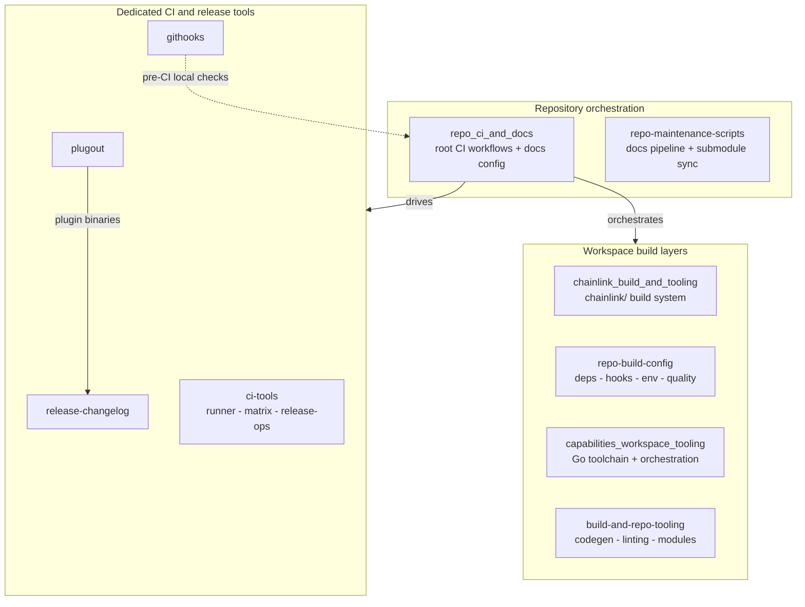

# Build, CI & Release Infrastructure

## Purpose

The `Build,_CI___Release_Infrastructure` module groups everything required to build, validate, and release the Chainlink platform. It contains no runtime node logic; instead, it provides the CI workflows, per-workspace build systems, developer-environment configuration, and dedicated release tooling that the rest of the monorepo depends on. Its responsibilities cover:

- **Repository-level CI & docs** — the pipeline definitions and documentation infrastructure at the repo root.
- **Per-workspace build tooling** — build systems, dependency management, code generation, linting, and versioning for the `chainlink/`, `capabilities/`, and `chainlink-common/` workspaces.
- **Dedicated CI & release tools** — purpose-built utilities for running CI jobs, computing test matrices, executing release operations, generating changelogs, packaging plugin binaries, and enforcing local git-hook checks.
- **Repo maintenance** — scripts for the docs pipeline and submodule synchronization.

Artifacts produced through this module (node binaries, capability plugins, SDKs, deployment tooling) are consumed by every other module in the repository.

## Architecture

The module is organized in three layers: **repository orchestration** (root CI + maintenance scripts), **workspace build layers** (one per Go workspace), and **dedicated tools** (standalone binaries under `chainlink/tools/` and `scripts/`).

The end-to-end build and release lifecycle flows from a developer commit through local hooks, CI execution, workspace builds, quality gates, and finally release packaging and changelog generation:

```mermaid
flowchart LR
    DEV(["Developer commit / PR"]) --> HOOKS["githooks<br/>local pre-commit checks"]
    HOOKS --> CICD["repo_ci_and_docs<br/>CI pipelines"]
    CICD --> RUN["ci-tools runner<br/>+ matrix"]
    RUN --> BUILD["Workspace builds<br/>chainlink / capabilities / chainlink-common"]
    BUILD --> QUAL["Quality gates<br/>linting + versioning"]
    QUAL --> REL["ci-tools release-ops"]
    REL --> PKG["plugout<br/>plugin packaging"]
    PKG --> LOG["release-changelog<br/>notes + dependency snapshot"]
    LOG --> PUB(["Published release"])
```

## Core components

| Component | Path | Scope |
|---|---|---|
| [repo_ci_and_docs](<Build,_CI___Release_Infrastructure/repo_ci_and_docs.md>) | `.` | Repository-root CI workflow definitions and documentation infrastructure. |
| [chainlink_build_and_tooling](<Build,_CI___Release_Infrastructure/chainlink_build_and_tooling.md>) | `chainlink` | Build system and developer tooling at the root of the primary `chainlink/` node workspace. |
| [capabilities_workspace_tooling](<Build,_CI___Release_Infrastructure/capabilities_workspace_tooling.md>) | `capabilities` | Go toolchain configuration, monorepo orchestration, and maintenance scripts for the `capabilities/` workspace. |
| [repo-build-config](<Build,_CI___Release_Infrastructure/repo-build-config.md>) | `chainlink` | Build configuration for `chainlink/`: Go dependencies, git hooks, developer environment, quality and versioning. |
| [build-and-repo-tooling](<Build,_CI___Release_Infrastructure/build-and-repo-tooling.md>) | `chainlink-common` | Code generation, linting/quality enforcement, and Go module management for the `chainlink-common/` shared-libraries workspace. |
| [ci-tools](<Build,_CI___Release_Infrastructure/ci-tools.md>) | `chainlink/tools/ci` | Custom CI tool suite: shell CLI, test-matrix computation, release operations, job runner, and tooling discovery. |
| [githooks](<Build,_CI___Release_Infrastructure/githooks.md>) | `chainlink/tools/githooks` | Shared git hooks that run contributor-side checks before changes reach CI. |
| [plugout](<Build,_CI___Release_Infrastructure/plugout.md>) | `chainlink/tools/plugout` | Plugin packaging/extraction tooling used in the build and release pipeline. |
| [release-changelog](<Build,_CI___Release_Infrastructure/release-changelog.md>) | `chainlink/tools/release/release-changelog` | Changelog generation and release reporting: product-specific outputs (CCIP, engine core), commit changelog aggregation, dependency snapshots, git integration, and delivery. |
| [repo-maintenance-scripts](<Build,_CI___Release_Infrastructure/repo-maintenance-scripts.md>) | `scripts` | Repository-level maintenance scripts: documentation pipeline and submodule synchronization. |

## How it fits together

The workspace build layers (chainlink, capabilities, chainlink-common) each own their own build, dependency, code-generation, and quality tooling, so product teams can iterate independently. The repository orchestration layer ties these workspaces together: root CI invokes the dedicated tools (`ci-tools` for execution and release operations, `plugout` for plugin packaging, `release-changelog` for release notes), while `githooks` and `repo-maintenance-scripts` keep local developer workflow and repo hygiene aligned with what CI enforces. Together they form the single entry point through which all code in the monorepo is built, tested, versioned, and shipped.