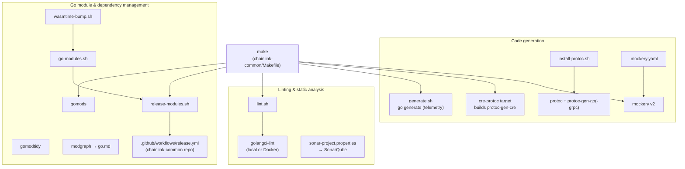
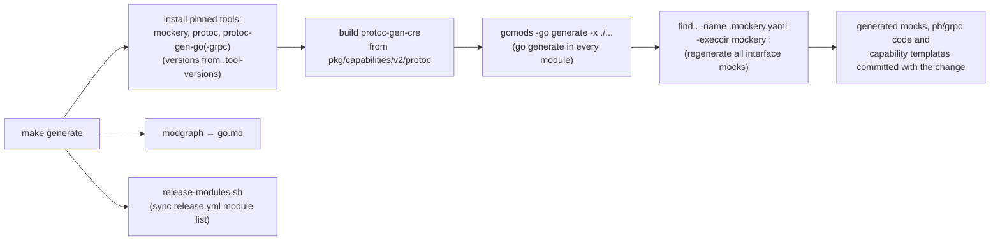
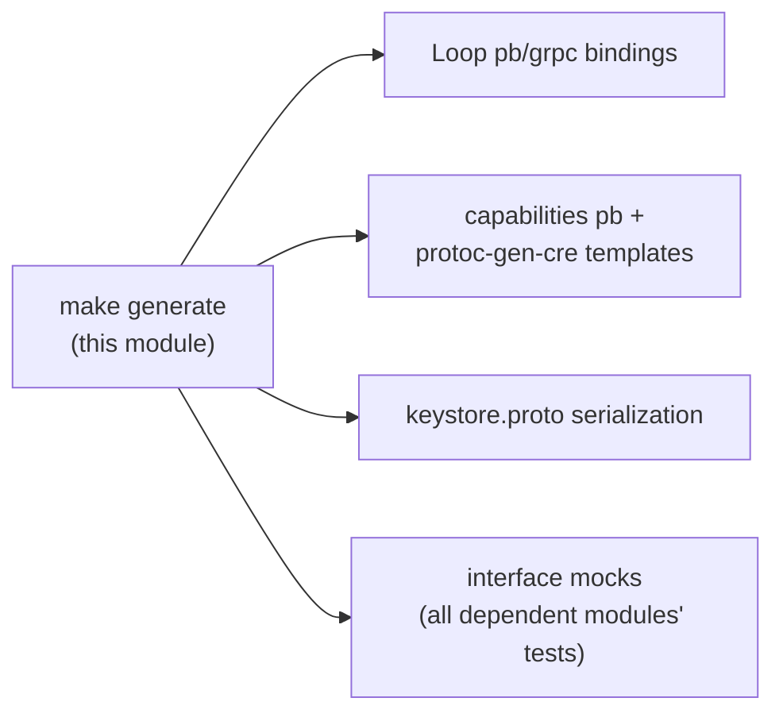

# Build & Repo Tooling (`chainlink-common`)

> **Page:** `Build,_CI___Release_Infrastructure/build-and-repo-tooling.md` · **Repository area:** `chainlink-common/`

## 1. Purpose

This module documents the **build and repository tooling of the `chainlink-common` Go library** — the shared foundation package that provides domain types, the keystore runtime, the Loop plugin framework, capability primitives and observability libraries to the rest of the Chainlink platform (see [Shared Foundation Libraries & Domain Types](<../Shared_Foundation_Libraries___Domain_Types.md>)).

Because `chainlink-common` is consumed by nearly every other module in this wiki — the node core, the CRE engine, CCIP, the deployment suites — its build tooling has to guarantee three things:

1. **Deterministic code generation.** Protobuf/gRPC stubs, CRE capability templates and interface mocks must be regenerated identically on every developer machine and CI run. All generator versions are pinned in `chainlink-common/.tool-versions` (golang `1.27.1`, protoc `29.3`, protoc-gen-go-grpc `1.5.1`, golangci-lint `2.13.2`, mockery `2.53.7`).
2. **Coherent multi-module dependency management.** `chainlink-common` is a *multi-module* Go repository — the root module (`chainlink-common/go.mod`) plus sub-modules (`pkg/chipingress`, `pkg/monitoring`, `pkg/values`, `x/config`, `keystore`, `observability-lib`). They must be discovered, tidied, graphed and released together.
3. **Uniform quality gates.** One canonical, version-pinned golangci-lint configuration (fetched from the org-wide `smartcontractkit/.github` repository) and one SonarQube analysis profile.

The tooling is deliberately **plain `make` + shell scripts** — no bespoke build framework — so every step can be run locally exactly the way CI runs it.

## 2. Where this module fits

This page is one leaf of the [Build, CI & Release Infrastructure](<../Build,_CI___Release_Infrastructure.md>) module group. Sibling pages cover the rest of the infrastructure:

| Sibling page | Scope | Relationship to this module |
|---|---|---|
| [repo_ci_and_docs](<repo_ci_and_docs.md>) | Root `README.md` and the `.github/workflows/weekly-docs.yml` CI job | Same CI platform; this module's tooling produces the code that workflow documents |
| [chainlink_build_and_tooling](<chainlink_build_and_tooling.md>) | The `chainlink` node's `GNUmakefile`, lint/mocking/typos configs | The *consumer* side: the node repo embeds `chainlink-common` and relies on the generated code produced here |
| [capabilities_workspace_tooling](<capabilities_workspace_tooling.md>) | `capabilities/` monorepo Makefile, nx.json, pnpm workspace | Mirrors the same patterns (protoc install, mockery, gomodtidy, changesets) for the capabilities workspace |
| [repo-build-config](<repo-build-config.md>) | `chainlink/go.mod`, lefthook git hooks, nix dev environment, Sonar properties | Complementary per-repo configuration; `sonar-project.properties` here is the `chainlink-common` counterpart |
| [ci-tools](<ci-tools.md>), [githooks](<githooks.md>), [plugout](<plugout.md>), [release-changelog](<release-changelog.md>), [repo-maintenance-scripts](<repo-maintenance-scripts.md>) | Dedicated Go/CLI tools for CI matrices, git hooks, plugin extraction, release changelogs and repo upkeep | `release-changelog` consumes a `pluginsFile` similar to what `release-modules.sh` keeps in sync for `chainlink-common` |

## 3. Component inventory

| File | Kind | Responsibility |
|---|---|---|
| `chainlink-common/Makefile` | Makefile | Single developer/CI entrypoint orchestrating generation, linting and module tasks |
| `chainlink-common/.mockery.yaml` | Config | Declarative mockery configuration: which interfaces get mocks and where they are written |
| `chainlink-common/go.mod` | Manifest | Root module `github.com/smartcontractkit/chainlink-common` (Go `1.27.1`); dependency manifest incl. `hashicorp/go-plugin`, gRPC, OpenTelemetry, `wasmtime-go`; `retract` directives for the accidentally published `v1.3.0`/`v1.3.1` |
| `chainlink-common/script/generate.sh` | Script | Thin wrapper running `go generate -v ./core/services/telemetry/generated/generate.go` (telemetry codegen entrypoint) |
| `chainlink-common/script/go-modules.sh` | Script | Enumerates every Go module in the repository (skipping `examples/` directories) and resolves a directory's owning module |
| `chainlink-common/script/install-protoc.sh` | Script | Installs the pinned `protoc` release into `~/.local` (Linux x86_64 or macOS universal binary) |
| `chainlink-common/script/lint.sh` | Script | Runs golangci-lint locally or in Docker, using the org-wide remote config; saves timestamped reports |
| `chainlink-common/script/release-modules.sh` | Script | Rewrites the module dropdown in the repository's `.github/workflows/release.yml` between generated markers |
| `chainlink-common/script/wasmtime-bump.sh` | Script | Bumps `bytecodealliance/wasmtime-go` to the latest release, rewriting import-path major versions if needed |
| `chainlink-common/sonar-project.properties` | Config | SonarQube project profile for `smartcontractkit_chainlink-common` (exclusions for mocks/generated/testdata) |

## 4. Architecture overview

The Makefile is the orchestrator; each shell script encapsulates one concern and is also runnable standalone. Declarative configs (`.mockery.yaml`, `go.mod`, `.tool-versions`, `sonar-project.properties`) feed the external tools the scripts invoke.

### 4.1 Code generation

The `make generate` target is the umbrella for **all** generated code in `chainlink-common`. It first installs the pinned tooling (mockery, protoc, protoc-gen-go/protoc-gen-go-grpc), builds the custom `protoc-gen-cre` plugin, regenerates the module graph and syncs the release workflow — then runs `go generate` in every module and executes mockery once per `.mockery.yaml` file:

A deliberate operational warning is baked into the Makefile: `make generate` executes the **mockery binary found on `PATH`**, so a locally installed (or outdated) mockery will break regeneration — the Makefile comment instructs developers to uninstall or update it and use the pinned `make mockery` install.

Details: [Code Generation Toolchain](build-and-repo-tooling/build-and-repo-tooling_code-generation.md)

### 4.2 Go module & dependency management

`chainlink-common` is multi-module. `script/go-modules.sh` is the single source of truth for *what a module is*: it lists every `go.mod` under git tracking, treats directories under `examples/` as part of their nearest non-example parent module (they model a downstream consumer with local `replace` directives), and exposes `examples MODULE` / `parent DIR` lookup modes. Everything else builds on it:

- `make gomodtidy` / `make gomods` — install and run `jmank88/gomods` (`gomods tidy`) across all modules.
- `make modgraph` — installs `jmank88/modgraph` and writes the module dependency graph to `go.md`.
- `make release-modules` (`script/release-modules.sh`) — rewrites the module dropdown in `.github/workflows/release.yml` between `# BEGIN/END generated by script/release-modules.sh` markers. The comment explains the design: *"A dropdown's options can't be computed when the workflow runs, so they are generated here and CI fails when they fall behind."*
- `script/wasmtime-bump.sh` — standalone helper that resolves the latest `bytecodealliance/wasmtime-go` tag, and if the **major** version changed, rewrites the import path (`gofmt -w -r '"…/wasmtime-go/vOLD" -> "…/wasmtime-go/vNEW"'`), `go get`s the new version and stages the changes. This keeps the WASM host module runtime (used by the [Workflow & Capability Runtime (CRE Engine)](<../Workflow___Capability_Runtime_(CRE_Engine).md>)) current.
- `chainlink-common/go.mod` additionally **retracts** `v1.3.0` (accidentally published) via `v1.3.1`, protecting all downstream consumers from resolving the bad release.

Details: [Module & Dependency Management](build-and-repo-tooling/build-and-repo-tooling_module-management.md)

### 4.3 Linting & static analysis

`make lint` / `make lint-workspace` both delegate to `script/lint.sh`, which:

1. Resolves the golangci-lint version from the `GOLANGCI_LINT_VERSION` env var or `chainlink-common/.tool-versions` (`2.13.2`).
2. Uses a developer-provided config if `GOLANGCI_LINT_CONFIG` is set; otherwise downloads the **org-wide default config** from `smartcontractkit/.github` (action tag `ci-lint-go/v4`, overridable via `CI_LINT_GO_VERSION`) into the gitignored `./golangci-lint/` directory.
3. Runs the **local** binary only when its version matches exactly; otherwise falls back to the Docker image `golangci/golangci-lint:v<version>` with the working directory mounted at `/app`.
4. Saves a timestamped report under `./golangci-lint/<date>.txt`.

`make lint-workspace` lints everything; `make lint` adds `--new-from-rev=origin/main` so CI and pre-push checks only flag *changed* code. SonarQube analysis is configured separately via `chainlink-common/sonar-project.properties` (project key `smartcontractkit_chainlink-common`, with exclusions for mocks, generated code, testdata, fixtures and protobuf artifacts, and a duplication exclusion for `observability-lib`).

Details: [Linting & Quality Gates](build-and-repo-tooling/build-and-repo-tooling_linting-quality.md)

## 5. Sub-module documentation

The module is split into three sub-modules. Each page documents the core components, their responsibilities and their internal flows in depth:

| Sub-module | Scope | Page |
|---|---|---|
| **Code Generation Toolchain** | protoc + `protoc-gen-cre`, mockery mock generation (`.mockery.yaml`), telemetry `go generate`, pinned tool installation | [build-and-repo-tooling_code-generation](build-and-repo-tooling/build-and-repo-tooling_code-generation.md) |
| **Module & Dependency Management** | multi-module discovery (`go-modules.sh`), tidy/graph, release-workflow sync, `wasmtime-go` bumps, root `go.mod` | [build-and-repo-tooling_module-management](build-and-repo-tooling/build-and-repo-tooling_module-management.md) |
| **Linting & Quality Gates** | golangci-lint runner (`lint.sh`) with org remote config, SonarQube profile | [build-and-repo-tooling_linting-quality](build-and-repo-tooling/build-and-repo-tooling_linting-quality.md) |

## 6. How this tooling feeds the rest of the system

The artifacts generated by this module are consumed across the wiki — the documentation below links rather than duplicates:

| Generated artifact | Producer here | Consumed by |
|---|---|---|
| Loop gRPC bindings (`chainlink-common/pkg/loop/internal/pb/*_grpc.pb.go`) and query primitives | `protoc` via `make generate` | [Plugin Process Framework (Loop)](<../Plugin_Process_Framework_(Loop).md>) |
| `protoc-gen-cre` templates (`chainlink-common/pkg/capabilities/v2/protoc/pkg/template_generator.go`) | `make cre-protoc` | [Workflow & Capability Runtime (CRE Engine) — capabilities](<../Workflow___Capability_Runtime_(CRE_Engine)/capabilities.md>) |
| Keystore serialization (`chainlink-common/keystore/serialization/keystore.proto`) | `protoc` | [Node Platform Services — keystore](<../Node_Platform_Services/keystore.md>) |
| Interface mocks (`Relayer`, `ContractReader`, `GatewayConnector`, `Module`, `JWTGenerator`, …) | `mockery` + `.mockery.yaml` | Test suites of every dependent module, e.g. [types-core](<../Shared_Foundation_Libraries___Domain_Types/types-core.md>) |
| Module graph `go.md`, release workflow module list | `make modgraph`, `make release-modules` | Release CI in the `chainlink-common` repository |

## 7. Quick reference — make targets & scripts

| Command | Effect |
|---|---|
| `make generate` | Full regeneration pipeline: tool install → `protoc-gen-cre` build → `go generate` everywhere → mockery per `.mockery.yaml` |
| `make cre-protoc` | Build the custom `protoc-gen-cre` plugin from `pkg/capabilities/v2/protoc` |
| `make install-protoc` | Install pinned `protoc` (`~/.local`) plus `protoc-gen-go` (module-graph version) and `protoc-gen-go-grpc` (`.tool-versions`) |
| `make mockery` | Install `mockery v2` at the pinned version (`2.53.7`) |
| `make rm-mocked` | Delete every file starting with `// Code generated by mockery` |
| `make gomodtidy` / `make gomods` | Run `gomods tidy` across all modules / install the gomods tool |
| `make modgraph` | Generate the module dependency graph `go.md` |
| `make release-modules` | Sync the module list in `.github/workflows/release.yml` |
| `make lint` / `make lint-workspace` | golangci-lint with org config; diff-only (`--new-from-rev=origin/main`) vs. full workspace |
| `make docs` | Serve package documentation locally via `go doc -http` |
| `make dependabot` | Deprecated — prints a pointer to the CI workflow |
| `script/wasmtime-bump.sh` | Bump `wasmtime-go` to the latest release tag (rewrites import majors when needed) |
| `script/go-modules.sh [examples M \| parent D]` | Enumerate modules / list a module's examples / resolve a directory's parent module |
