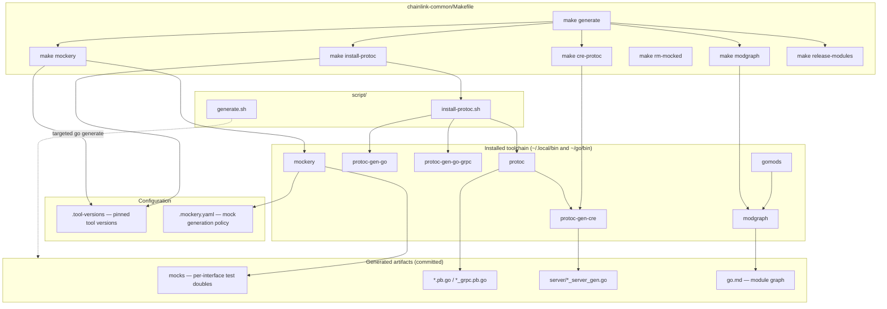
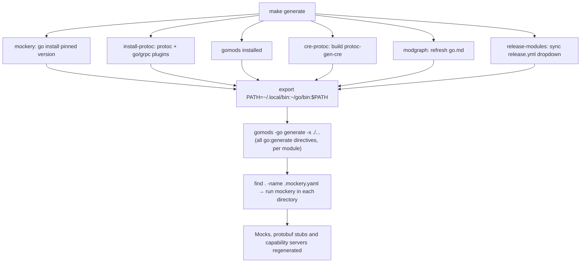
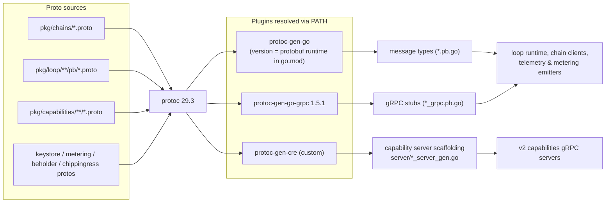

# Code Generation (chainlink-common)

> Part of [build-and-repo-tooling](../build-and-repo-tooling.md) under [Build, CI & Release Infrastructure](../../Build,_CI___Release_Infrastructure.md).

## 1. Overview

This module documents the **code-generation toolchain of the `chainlink-common` repository**. It is responsible for regenerating every artifact in `chainlink-common` that is derived from source-of-truth inputs rather than written by hand:

- **Test doubles (mocks)** generated by [mockery](https://github.com/vektra/mockery) from Go interfaces, configured in `chainlink-common/.mockery.yaml`.
- **Protobuf message types and gRPC client/server stubs** generated by `protoc` + `protoc-gen-go` + `protoc-gen-go-grpc` from the many `.proto` schemas in the repository (keystore serialization, loop gRPC bindings, chain services, capabilities, metering, beholder, etc.).
- **Capability gRPC server scaffolding** generated by the repository's *custom* protoc plugin **`protoc-gen-cre`** (built by the `cre-protoc` target from `chainlink-common/pkg/capabilities/v2/protoc`).
- **Module graph documentation** (`go.md`) generated by `modgraph`.

The single entry point is `make generate` in `chainlink-common/Makefile`, which installs the pinned toolchain, builds the custom plugin, runs all `go:generate` directives across every Go module, and re-runs mockery everywhere a `.mockery.yaml` exists.

## 2. Scope and responsibilities

| In scope | Out of scope (documented elsewhere) |
| --- | --- |
| `chainlink-common/Makefile` code-gen targets: `generate`, `install-protoc`, `mockery`, `rm-mocked`, `cre-protoc` | Linting targets (`lint`, `lint-workspace`) → [linting & quality](build-and-repo-tooling_linting-quality.md) |
| `chainlink-common/.mockery.yaml` (mock generation policy) | Module hygiene targets (`gomods`, `gomodtidy`, `modgraph`, `release-modules`, `dependabot`) and `chainlink-common/go.mod` → [module management](build-and-repo-tooling_module-management.md) |
| `chainlink-common/script/install-protoc.sh` (protoc installer) | CI workflows and repo docs automation → [repo CI & docs](../repo_ci_and_docs.md) |
| `chainlink-common/script/generate.sh` (targeted `go generate` wrapper) | The generated `.pb.go` artifacts themselves → [chain gRPC protos](../../Shared_Foundation_Libraries___Domain_Types/chain-grpc-protos.md), [loop gRPC bindings](../../Plugin_Process_Framework_\(Loop\)/loop-grpc-bindings.md) |
| The custom `protoc-gen-cre` plugin (`pkg/capabilities/v2/protoc`) | The parallel toolchain copies in other workspaces: [`capabilities/`](../capabilities_workspace_tooling.md), [`chainlink/`](../chainlink_build_and_tooling.md) |

## 3. Architecture

The Makefile is the orchestrator; all tool versions are pinned in `chainlink-common/.tool-versions` (golang 1.27.1, protoc 29.3, protoc-gen-go-grpc 1.5.1, golangci-lint 2.13.2, mockery 2.53.7). Generated code is committed to the repository, so regeneration must be deterministic and version-pinned.



### Component summary

| Component | File | Role |
| --- | --- | --- |
| `generate` target | `chainlink-common/Makefile` | Orchestrates the full regeneration pipeline |
| `install-protoc` target | `chainlink-common/Makefile` | Installs `protoc`, `protoc-gen-go`, `protoc-gen-go-grpc` |
| `mockery` / `rm-mocked` targets | `chainlink-common/Makefile` | Installs mockery / deletes all mockery-generated mocks |
| `cre-protoc` target | `chainlink-common/Makefile` | Builds the custom `protoc-gen-cre` plugin |
| Mock policy | `chainlink-common/.mockery.yaml` | Declares which interfaces get mocks and their output layout |
| Protoc installer | `chainlink-common/script/install-protoc.sh` | Idempotent, platform-aware protoc download |
| Targeted generator | `chainlink-common/script/generate.sh` | Runs a specific telemetry `go:generate` directive (legacy, see §8) |
| Custom plugin | `chainlink-common/pkg/capabilities/v2/protoc/` | `protoc-gen-cre` — capability server code generation |

## 4. Toolchain versioning

Versions are sourced from `chainlink-common/.tool-versions` at run time, not hard-coded:

| Tool | Pinned version | How the Makefile resolves it |
| --- | --- | --- |
| `protoc` | 29.3 | `grep '^protoc ' .tool-versions` → passed to `script/install-protoc.sh` |
| `protoc-gen-go-grpc` | 1.5.1 | `grep '^protoc-gen-go-grpc ' .tool-versions` |
| `protoc-gen-go` | *follows the runtime* | Installed at the exact version of `google.golang.org/protobuf` in `go.mod` (`go list -m -json google.golang.org/protobuf \| jq -r .Version`) — this guarantees generated marshalling code never drifts from the protobuf runtime the library depends on |
| `mockery` | 2.53.7 | `grep '^mockery ' .tool-versions` |
| `golangci-lint` | 2.13.2 | Same file; used by the [linting & quality](build-and-repo-tooling_linting-quality.md) module |

Installing tools under `~/go/bin` and protoc under `~/.local/bin` keeps the host environment untouched, which is why `make generate` re-exports `PATH="$(HOME)/.local/bin:$(HOME)/go/bin:$(PATH)"` before invoking the generators.

## 5. Makefile targets

### 5.1 `make generate` — the orchestrator

`make generate` chains the installation targets and then performs the actual generation:

1. **Install mockery** (`make mockery`) at the `.tool-versions` version.
2. **Install protoc + plugins** (`make install-protoc`).
3. **Install `gomods`** (a multi-module runner for Go commands).
4. **Build `protoc-gen-cre`** (`make cre-protoc`).
5. **Install `modgraph` and refresh `go.md`** (`make modgraph`).
6. **Sync the release workflow's module dropdown** (`make release-modules`; details in [module management](build-and-repo-tooling_module-management.md)).
7. **Export the generator `PATH`**, then run `gomods -go generate -x ./...` — this executes every `go:generate` directive in every Go module of the repository (including protobuf/gRPC regeneration driven by `protoc` and `protoc-gen-cre`).
8. **Run mockery for every `.mockery.yaml`**: `find . -type f -name .mockery.yaml -execdir mockery \;`.

The Makefile carries an operational warning on step 8: if it fails, a stale, locally-installed mockery is usually the cause — uninstall or update it so the pinned version is used.



### 5.2 `make install-protoc`

Runs `script/install-protoc.sh <version>` (version from `.tool-versions`) and installs the two Go protoc plugins:

- `protoc-gen-go` — deliberately installed at the **same version as the `google.golang.org/protobuf` module** declared in `chainlink-common/go.mod` (resolved via `go list -m -json … | jq`), preventing generated/runtime version skew.
- `protoc-gen-go-grpc` — pinned via `.tool-versions`.

The installer script (`chainlink-common/script/install-protoc.sh`) is **idempotent and platform-aware**:

- Requires an explicit `VERSION` argument (exits 1 without one).
- Short-circuits if the existing `protoc` already reports the requested version (`command -v protoc` + `protoc --version | grep`).
- Supports **Linux (x86_64 only)** and **macOS (universal binary)**; anything else exits with "unsupported os".
- Downloads the official `protocolbuffers/protobuf` release zip into a temp dir, unzips into `~/.local`, and reminds the user to add `~/.local/bin` to `PATH`.

> This is a hardened variant of the same script used by the capabilities workspace (`capabilities/script/install-protoc.sh` — see [capabilities workspace tooling](../capabilities_workspace_tooling.md)); the chainlink-common copy adds `set -eu`, a `command -v` guard for missing protoc, and `curl -fLO` (fail on HTTP errors).

### 5.3 `make mockery` and `make rm-mocked`

- `make mockery` — `go install github.com/vektra/mockery/v2@v$(grep '^mockery ' .tool-versions)`.
- `make rm-mocked` — **nuclear reset** for mocks: deletes every file whose first line is `// Code generated by mockery`:

  ```makefile
  grep -rl "^// Code generated by mockery" | grep .go$ | xargs -r rm
  ```

  This is useful when changing `.mockery.yaml` (renamed packages, moved directories, changed mock names) so that stale mocks from the old configuration cannot survive. Re-running `make generate` (or just the mockery step) recreates them.

### 5.4 `make cre-protoc` — build the custom plugin

```makefile
cre-protoc:
	cd pkg/capabilities/v2/protoc && go build -o protoc-gen-cre .
```

This compiles the repository's bespoke protoc plugin (see §7.2). Because `protoc` discovers plugins by binary-name convention (`protoc-gen-cre` ↔ `--cre_out`), the freshly built binary is picked up automatically once `~/.local/bin`/`~/go/bin` is on `PATH` during step 7 of `make generate`.

## 6. Mock generation policy (`.mockery.yaml`)

`chainlink-common/.mockery.yaml` drives every `mockery` invocation. Global defaults:

```yaml
dir: "{{ .InterfaceDir }}/mocks"      # mocks live next to the interface, in a mocks/ package
mockname: "{{ .InterfaceName }}"
outpkg: mocks
filename: "{{ .InterfaceName | snakecase }}.go"
fail-on-missing: true                 # a listed interface that no longer exists fails the run
```

`fail-on-missing: true` turns interface deletions/renames into hard generation errors instead of silently stale mocks.

Per-package overrides:

| Package | Interfaces | Overrides |
| --- | --- | --- |
| `pkg/loop/internal/types` | `Relayer` | output dir `../../mocks` |
| `pkg/types/ccip` | `OffRampReader` | filename `offramp_reader_mock.go` |
| `pkg/types` | `ContractReader`, `EVMService`, `TONService`, `SolanaService`, `AptosService`, `StellarService` | defaults |
| `pkg/types/core` | `CapabilitiesRegistry`, `Relayer`, `GatewayConnector`, `MultiGatewayConnector`, `GatewayConnectorHandler`, `RelayerSet` | defaults |
| `pkg/beholder/internal` | `OTLPExporter` | defaults |
| `pkg/workflows/host` | `Module`, `ExecutionHelper`, `ExecutionHelperWithRawSecrets` | the two ExecutionHelpers use mockname `Mock<InterfaceName>` |
| `pkg/custmsg` | `MessageEmitter` | **inpackage** test mock: `mock_{{ .InterfaceName \| snakecase }}_test.go`, mockname `mock<InterfaceName>` |
| `pkg/nodeauth/jwt` | `JWTGenerator`, `JWTAuthenticator`, `NodeAuthProvider` | defaults |
| `pkg/settings` | `Getter` | dir `<pkg>/limits`, outpkg `limits`, test-file naming |

These mocks back the test suites of the modules that consume the interfaces — notably the [loop plugin runtime](../../Plugin_Process_Framework_\(Loop\)/loop-plugin-core.md) (`Relayer`), the [core plugin-service contracts](../../Shared_Foundation_Libraries___Domain_Types/types-core/types-core_plugin-services.md) (`pkg/types/core`), chain services ([types-chains](../../Shared_Foundation_Libraries___Domain_Types/types-chains.md)), [beholder telemetry](../../Telemetry___Observability_Platform/beholder-telemetry.md), and the [workflows host](../../Workflow___Capability_Runtime_\(CRE_Engine\)/workflows/workflows_engine.md). When you change one of those interfaces, run `make generate` (or `mockery` alone) and commit the refreshed mocks.

## 7. Protobuf, gRPC and capability-server generation

### 7.1 Pipeline

All `.proto` schemas in `chainlink-common` — loop gRPC bindings, chain services (EVM/Solana/Aptos/Stellar/TON), capabilities, keystore serialization, metering, beholder, chip-ingress — are compiled with the pinned toolchain:



The proto source files themselves and the resulting generated bindings are documented in [chain-grpc-protos](../../Shared_Foundation_Libraries___Domain_Types/chain-grpc-protos.md) and [loop-grpc-bindings](../../Plugin_Process_Framework_\(Loop\)/loop-grpc-bindings.md); the protobuf-driven capability definitions are covered in [capabilities_pb](../../Workflow___Capability_Runtime_\(CRE_Engine\)/capabilities/capabilities_pb.md). This page only owns *how they are regenerated*.

### 7.2 The `protoc-gen-cre` plugin (`pkg/capabilities/v2/protoc`)

A [protogen](https://pkg.go.dev/google.golang.org/protobuf/compiler/protogen)-based plugin that scaffolds **gRPC server implementations for v2 capabilities**, on top of the standard `protoc-gen-go-grpc` output:

- `main.go` parses protoc plugin parameters via `protogen.Options{ParamFunc}`:
  - `server_language` — defaults to `go`; `ServerLanguage.Validate()` currently accepts only `go` (`pkg/generate_server.go`), but the enum exists to grow per-language templates.
  - Environment flag `CL_PROTOC_WITH_MONITORING=true` opts the generated server into monitoring instrumentation (wired through `serverArgs.WithMonitoring`).
- For every file protoc marks `Generate`, `pkg.GenerateServer` is invoked. Files with no services are skipped.
- Code emission is template-driven: the `TemplateGenerator` struct (`pkg/template_generator.go`) carries the template, a `FileNameTemplate` (`server/{{.}}_server_gen.go`), label-conversion helpers (`PbLabelToGoLabels`, `StringLblValue`) and an import-path/package map; the embedded Go template `pkg/templates/server.go.tmpl` is rendered per service to produce `server/<service>_server_gen.go` with a `// Code generated … DO NOT EDIT` provenance.

The generated servers are the host-side counterparts of the capability gRPC contracts used by the [v2 capability runtime](../../Workflow___Capability_Runtime_\(CRE_Engine\)/capabilities/capabilities_registry.md) and the [capabilities v2 tooling](../../Workflow___Capability_Runtime_\(CRE_Engine\)/capabilities/capabilities_v2_tooling.md).

## 8. Legacy telemetry generator script

`chainlink-common/script/generate.sh` wraps one specific `go:generate` directive:

```bash
cd "$(dirname "$0")"/..
go generate -v ./core/services/telemetry/generated/generate.go
```

Note that the referenced path (`core/services/telemetry/generated/generate.go`) **does not exist in the current `chainlink-common` layout** (the repository has no top-level `core/` directory), nor does a matching `generated/` package exist under `chainlink/core/services/telemetry/`. Treat this script as legacy tooling inherited from the main node repository's layout; verify the path before relying on it, and prefer `make generate` for repository-wide regeneration.

## 9. Multi-module execution via gomods

`chainlink-common` is a multi-module repository (`go.mod` plus nested modules such as `keystore`, `observability-lib`, `x/config`, `pkg/values`, `pkg/chipingress`, `pkg/monitoring`). `make generate` therefore does not run `go generate ./...` directly; it runs **`gomods -go generate -x ./...`**, which iterates the module list (the same discovery logic `script/go-modules.sh` implements, including folding `examples/` modules into their parent). See [module management](build-and-repo-tooling_module-management.md) for the module inventory and hygiene targets that share these binaries.

## 10. Relationship to other workspaces

The same generation pattern is duplicated (with small drift) across the monorepo:

- `capabilities/Makefile` (see [capabilities workspace tooling](../capabilities_workspace_tooling.md)) — its own `protoc`, `mockery` and `generate` targets; its `install-protoc.sh` is a close copy of the one documented here, and its `generate` uses `gomods -w go generate -x ./...`.
- `chainlink/GNUmakefile` (see [chainlink build & tooling](../chainlink_build_and_tooling.md)) — exposes `generate`, `install-loopinstall`, plugin install targets and Docker builds for the node binary, consuming several of the `chainlink-common` generated artifacts (loop gRPC bindings, capability protos) via module dependencies.
- The `cre-sdk-typescript` generated capability clients ([generated capabilities](../../Developer_Toolchain_\(CLI,_SDKs___API_Clients\)/cre-sdk-generated-capabilities.md)) are generated from the same capability proto family by their own tooling; `protoc-gen-cre`'s `ServerLanguage` abstraction is the seam where additional target languages (e.g. TypeScript) could be added.

## 11. Maintenance notes and gotchas

1. **PATH matters.** Generators are installed under `~/.local/bin` (protoc) and `~/go/bin` (Go plugins); `make generate` re-exports `PATH` internally, but running `protoc`/`mockery` manually requires it too.
2. **Local tool shadowing.** A previously installed, different-version `mockery` breaks `make generate`'s mockery step — the Makefile comment calls this out explicitly. Prefer the pinned `make mockery` install.
3. **Deleting an interface?** Remove/adjust its entry in `.mockery.yaml` first; `fail-on-missing: true` otherwise fails generation. Use `make rm-mocked` before renaming/moving mock output locations.
4. **protoc installer is selective.** Only Linux x86_64 and macOS universal binaries are supported; ARM Linux users must install protoc 29.3 manually.
5. **protoc-gen-go tracks the runtime.** Never pin `protoc-gen-go` to a global version; the Makefile deliberately ties it to `google.golang.org/protobuf` in `go.mod`.
6. **`go.md` is a generated doc.** `make modgraph` (part of `make generate`) rewrites `chainlink-common/go.md`; commit it alongside dependency changes.
7. **Generated code is committed.** All outputs (mocks, `*_grpc.pb.go`, `*_server_gen.go`) live in git; PRs that touch interfaces or protos must include regenerated files, and [linting & quality](build-and-repo-tooling_linting-quality.md) gates the results.

## Related documentation

- Parent: [build-and-repo-tooling](../build-and-repo-tooling.md)
- Siblings: [linting & quality](build-and-repo-tooling_linting-quality.md) · [module management](build-and-repo-tooling_module-management.md)
- Consumers of generated code: [loop gRPC bindings](../../Plugin_Process_Framework_\(Loop\)/loop-grpc-bindings.md) · [chain gRPC protos](../../Shared_Foundation_Libraries___Domain_Types/chain-grpc-protos.md) · [capabilities protobuf contracts](../../Workflow___Capability_Runtime_\(CRE_Engine\)/capabilities/capabilities_pb.md)
- Parallel toolchains: [capabilities workspace tooling](../capabilities_workspace_tooling.md) · [chainlink build & tooling](../chainlink_build_and_tooling.md)
