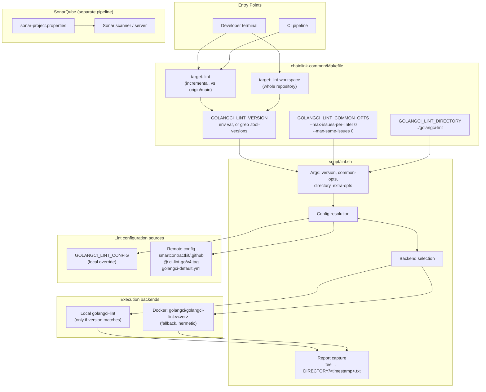
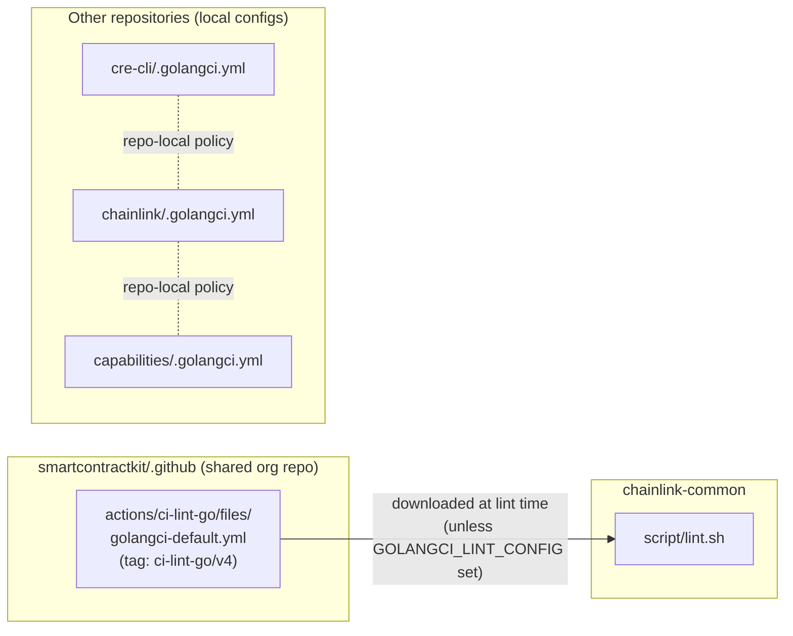
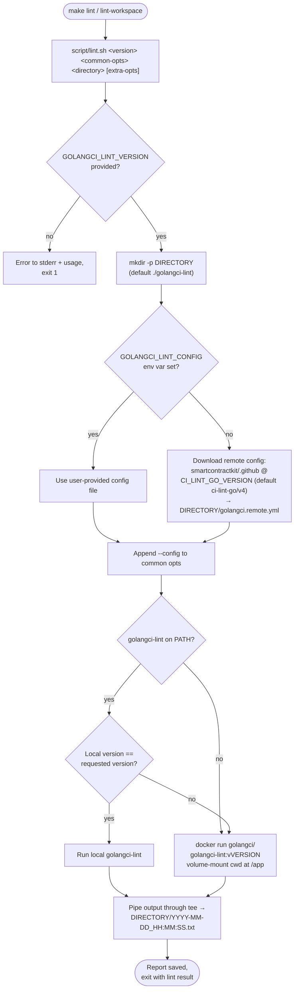
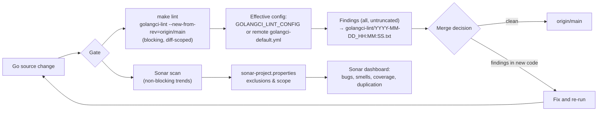

# Linting & Quality — `chainlink-common`

> **Module path:** `Build,_CI___Release_Infrastructure/build-and-repo-tooling/build-and-repo-tooling_linting-quality`
> **Part of:** [Build & Repo Tooling](../build-and-repo-tooling.md) · [Build, CI & Release Infrastructure](../../Build,_CI___Release_Infrastructure.md)

## 1. Introduction

The **Linting & Quality** module implements the standardized code-quality gate for the `chainlink-common` repository. It answers a simple operational question with a deterministic answer: *what constitutes "clean" Go code in this repo, and how is that check executed identically on every developer machine and CI runner?*

It consists of three cooperating pieces:

| Component | File | Role |
|---|---|---|
| Lint runner | `chainlink-common/script/lint.sh` | Portable executor that runs `golangci-lint` locally or in Docker, resolves the lint configuration, and captures timestamped reports |
| Make entry points | `chainlink-common/Makefile` (`lint`, `lint-workspace`) | Developer/CI-facing targets that pin the tool version, inject shared options, and select execution mode |
| Static analysis config | `chainlink-common/sonar-project.properties` | SonarQube project definition: scope, exclusions, coverage and duplication rules for deep (non-gate) analysis |

The module's key design decision is **hermeticity without duplication**: rather than committing a large `.golangci.yml` per repository, `lint.sh` downloads the *organization-wide* golangci-lint configuration from the shared `smartcontractkit/.github` repository, pinned to a release tag. This keeps lint policy consistent across the whole SmartContractKit organization while still allowing per-repo overrides via an environment variable.

For the sibling concerns of this module — generating mocks/protobuf code and managing Go module dependencies — see [Code Generation](build-and-repo-tooling_code-generation.md) and [Module Management](build-and-repo-tooling_module-management.md).

---

## 2. Architecture

### 2.1 Component relationships



### 2.2 How this module fits into the build infrastructure

The module is one of three quality/tooling pillars of the [build-and-repo-tooling](../build-and-repo-tooling.md) parent, alongside:

- [Code Generation](build-and-repo-tooling_code-generation.md) — produces generated artifacts (`mock_*.go`, `*.pb.go`, `*_generated.go`) which the lint and Sonar configurations deliberately **exclude** so generated code never pollutes quality signals.
- [Module Management](build-and-repo-tooling_module-management.md) — owns `go.mod` hygiene and `.tool-versions`, from which this module reads the pinned `golangci-lint` version.

Across the wider monorepo, every major repository follows the same *shape* of quality setup but with different levels of centralization:

| Repository | golangci-lint config | Version pinning | Sonar config |
|---|---|---|---|
| `chainlink-common` (this module) | **Remote**, downloaded by `lint.sh` from `smartcontractkit/.github` | `.tool-versions` via Makefile (`chainlink-common/Makefile`) | `chainlink-common/sonar-project.properties` |
| `chainlink` | Repo-local `chainlink/.golangci.yml` (v2 config format, ~50 linters incl. `depguard`, `gomodguard_v2`, `gosec`, `revive`) | Pinned in `chainlink/GNUmakefile` (`GOLANGCI_LINT_VERSION = "v2.14.0"`) | `chainlink/sonar-project.properties` |
| `capabilities` | Repo-local `capabilities/.golangci.yml` | `capabilities/Makefile` | `capabilities/sonar-project.properties` |
| `cre-cli` | Repo-local `cre-cli/.golangci.yml` | `cre-cli/Makefile` / `.goreleaser.yml` (see [cre-cli build & release](../../../Developer_Toolchain_(CLI,_SDKs___API_Clients)/cre-cli-build-and-release.md)) | — |



---

## 3. Lint Execution Flow

`script/lint.sh` implements a defensive, hermetic execution strategy: it never fails because a developer has the "wrong" golangci-lint installed, and it never silently uses a stale lint policy.



Key behaviors, traced to the source in `chainlink-common/script/lint.sh`:

1. **Fail fast on missing version** (`chainlink-common/script/lint.sh:12-16`) — the script exits with code `1` and prints usage if the first argument is absent. Version pinning is mandatory, not optional, because a lint run without a known linter version is not reproducible.
2. **Two-tier configuration** (`chainlink-common/script/lint.sh:24-37`):
   - `GOLANGCI_LINT_CONFIG` (env) → a developer/CI-provided config file, used verbatim. This is the escape hatch for repo-local policies (like `chainlink/.golangci.yml` in sibling repos).
   - Otherwise → the remote default config is fetched with `curl -sfL` from `https://raw.githubusercontent.com/smartcontractkit/.github/refs/tags/<tag>/actions/ci-lint-go/files/golangci-default.yml`, where the tag defaults to `ci-lint-go/v4` and can be overridden by `CI_LINT_GO_VERSION`. A source comment instructs maintainers to keep this tag in sync with the action reference in `/.github/workflows/golangci_lint.yml` — the same policy file is used by CI and by this script.
3. **Version-matched local execution, Docker fallback** (`chainlink-common/script/lint.sh:41-57`) — if a local `golangci-lint` binary reports exactly the requested version, it runs natively (fast path). Any mismatch or absence falls back to `docker run --rm -v $(pwd):/app -w /app golangci/golangci-lint:v<version>`, which guarantees byte-identical linter behavior regardless of host tooling.
4. **Timestamped report capture** (`chainlink-common/script/lint.sh:9, 45, 52, 57`) — all lint output (local or Docker) is piped through `tee` into `<directory>/<YYYY-MM-DD_HH:MM:SS>.txt`, preserving raw results for CI artifact upload or post-mortems. Note the directory is the *aggregate* lint workspace (`./golangci-lint` by default), reused across runs; each run appends a new timestamped file.

### 3.1 `lint` vs `lint-workspace`

The two Makefile targets differ only in the extra options forwarded to golangci-lint (`chainlink-common/Makefile`, `lint-workspace`/`lint` targets):

| Target | Extra opts | Semantics |
|---|---|---|
| `lint-workspace` | *(none)* | Lint the **entire** module. Use for baseline checks and after large refactors. |
| `lint` | `--new-from-rev=origin/main` | Lint **only code changed relative to `origin/main`**. This is the PR/CI gate: pre-existing debt does not block merges, but all new code must be clean. |

Both targets share:

- `--max-issues-per-linter 0 --max-same-issues 0` (`GOLANGCI_LINT_COMMON_OPTS`) — disables golangci-lint's default issue truncation so **every** finding is reported, never sampled.
- Version resolution: `GOLANGCI_LINT_VERSION` env var if exported; otherwise extracted from `.tool-versions` via `grep '^golangci-lint ' .tool-versions | awk '{print $2}'`. This is the same `.tool-versions` file consumed by the toolchain setup in [Module Management](build-and-repo-tooling_module-management.md), so the linter version is pinned in exactly one place per developer environment.

**Typical invocation:**

```bash
# Full workspace lint (uses version from .tool-versions)
make lint-workspace

# Incremental lint against origin/main (PR-style)
make lint

# Pin a specific linter version and a local config
GOLANGCI_LINT_VERSION=v2.1.0 GOLANGCI_LINT_CONFIG=/path/to/.golangci.yml make lint-workspace
```

---

## 4. SonarQube Static Analysis

The second quality axis is deep static analysis via SonarQube, configured by `chainlink-common/sonar-project.properties`. Sonar complements golangci-lint: where the lint gate is fast, diff-scoped and blocking, Sonar provides repo-wide trends for bugs, code smells, coverage and copy-paste duplication.

### 4.1 Configuration summary

| Property | Value | Purpose |
|---|---|---|
| `sonar.projectKey` | `smartcontractkit_chainlink-common` | Unique project identity on the Sonar server |
| `sonar.sources` / `sonar.tests` | `.` | Scan the whole repo; tests detected via `sonar.test.inclusions=**/*_test.go` |
| `sonar.sourceEncoding` | `UTF-8` | Deterministic parsing |

### 4.2 Exclusion strategy

The most important part of the file is the exclusion matrix, which keeps quality metrics focused on hand-written production code:

- **Full analysis exclusions** (`sonar.exclusions`): `**/mocks/**/*` (mockery output — see [Code Generation](build-and-repo-tooling_code-generation.md)), `**/testdata/**/*`, `**/script/**/*` (the shell scripts of this very module), `**/generated/**/*`, `**/fixtures/**/*`, `**/docs/**/*`, `**/tools/**/*`, protobuf artifacts (`**/*.pb.go`), and generated Go (`**/generated_*`, `**/*_generated.go`, `**/mock_*.go`). This mirrors the exclusion patterns used in `chainlink/sonar-project.properties` and `capabilities/sonar-project.properties`, keeping metric semantics comparable across repositories.
- **Coverage exclusions** (`sonar.coverage.exclusions`): test files (`**/*_test.go`), test helpers, examples and fuzz harnesses — coverage numbers are computed over them but they are not *required* to be covered.
- **Duplication (CPD) exclusions** (`sonar.cpd.exclusions`): `**/observability-lib/**/*` is exempted from copy-paste detection, isolating that independently-versioned Go module (own `go.mod`, see [Module Management](build-and-repo-tooling_module-management.md)) from the main duplication metrics.

This mirrors the pattern in the `chainlink` repo, whose Sonar config additionally excludes contract artifacts, typechain output and migration files (`chainlink/sonar-project.properties`), confirming the exclusion taxonomy is a deliberate cross-repo convention rather than per-repo ad-hoc tuning.

---

## 5. Data Flow: From Source Change to Quality Signal



---

## 6. Interaction With Other Modules

| Interaction | Module | Nature |
|---|---|---|
| Consumes `.tool-versions` (golangci-lint, mockery versions) | [Module Management](build-and-repo-tooling_module-management.md) | This module's Make targets read the version pin that Module Management maintains |
| Excludes generated code from analysis | [Code Generation](build-and-repo-tooling_code-generation.md) | `mock_*.go`, `*.pb.go`, `*_generated.go` artifacts from mockery/protoc are excluded in both `sonar-project.properties` and typical golangci configs |
| Shares the org-wide lint policy | `smartcontractkit/.github` → `/.github/workflows/golangci_lint.yml` (see [Repo CI & Docs](../repo_ci_and_docs.md)) | `lint.sh` downloads the same `golangci-default.yml` that the shared CI lint action uses; the tag must be kept in sync |
| Comparable quality setup in sibling repos | [chainlink Build & Tooling](../chainlink_build_and_tooling.md), [Capabilities Workspace Tooling](../capabilities_workspace_tooling.md) | `chainlink/GNUmakefile` pins `GOLANGCI_LINT_VERSION` and ships a local `.golangci.yml`; `capabilities/` follows the same pattern — alternative to this module's remote-config approach |
| Same pattern reused in developer tooling | [cre-cli Build & Release](../../../Developer_Toolchain_(CLI,_SDKs___API_Clients)/cre-cli-build-and-release.md) | `cre-cli` ships its own `.golangci.yml` and quality gates for a CLI distributed via goreleaser |
| Parent overview & other tooling | [build-and-repo-tooling](../build-and-repo-tooling.md), [Build, CI & Release Infrastructure](../../Build,_CI___Release_Infrastructure.md) | Positioning within the overall infrastructure; CI helper tools live in [ci-tools](../ci-tools.md), git hooks in [githooks](../githooks.md) |

---

## 7. Operational Reference

### 7.1 Environment variables

| Variable | Set by | Effect |
|---|---|---|
| `GOLANGCI_LINT_VERSION` | Makefile (from `.tool-versions`) or caller | Linter version to enforce; required first argument to `lint.sh`; drives the Docker image tag and the local-version match check |
| `GOLANGCI_LINT_CONFIG` | Caller (developer/CI) | Path to a local golangci config; when set, the remote config download is skipped entirely |
| `CI_LINT_GO_VERSION` | CI environment | Overrides the org-repo tag used for the remote config URL (default `ci-lint-go/v4`) |

### 7.2 On-disk artifacts

| Path | Produced by | Contents |
|---|---|---|
| `./golangci-lint/` | `make lint` / `lint-workspace` (via `mkdir -p`) | Aggregate lint workspace; intended to be gitignored |
| `./golangci-lint/<YYYY-MM-DD_HH:MM:SS>.txt` | each `lint.sh` run | Raw lint output for the run (local or Docker) |
| `./golangci-lint/golangci.remote.yml` | `lint.sh` config download | The fetched org-wide golangci config, cached per run directory |

### 7.3 Maintenance notes

- **Changing lint policy for this repo:** either set `GOLANGCI_LINT_CONFIG` in CI, or change the org-wide `golangci-default.yml` in `smartcontractkit/.github` (affects every repo that uses the remote-config mode of `lint.sh`). The in-file comment at `chainlink-common/script/lint.sh:29` requires keeping the `CI_LINT_GO_VERSION` default in sync with the action tag in `/.github/workflows/golangci_lint.yml`.
- **Upgrading the linter:** bump `golangci-lint` in `.tool-versions`; the Makefile and Docker fallback pick it up automatically. Do not rely on a locally installed binary — a version mismatch silently switches execution to Docker by design.
- **Local config path handling:** the remote config is stored inside the lint output directory, keeping the repo working tree clean (the directory is a gitignored scratch space).
