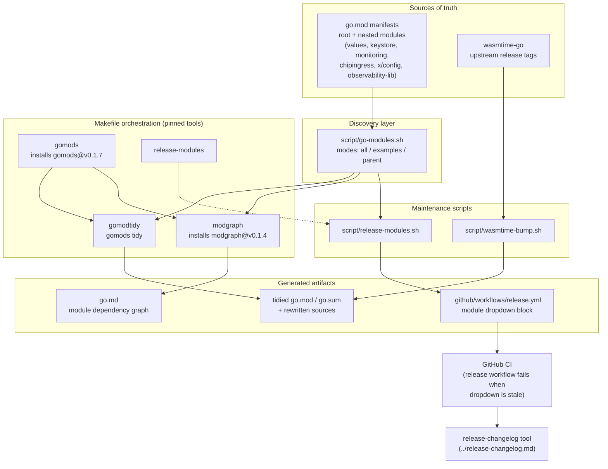
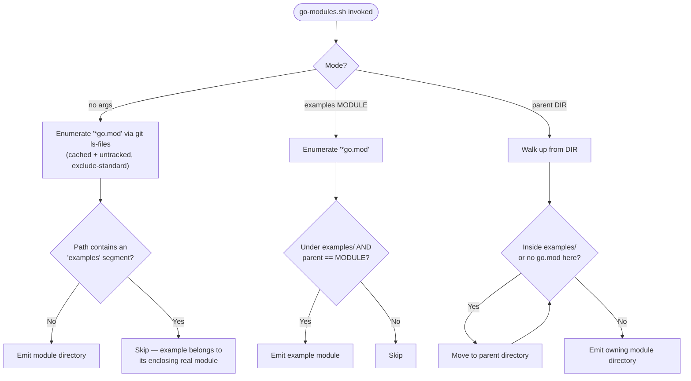
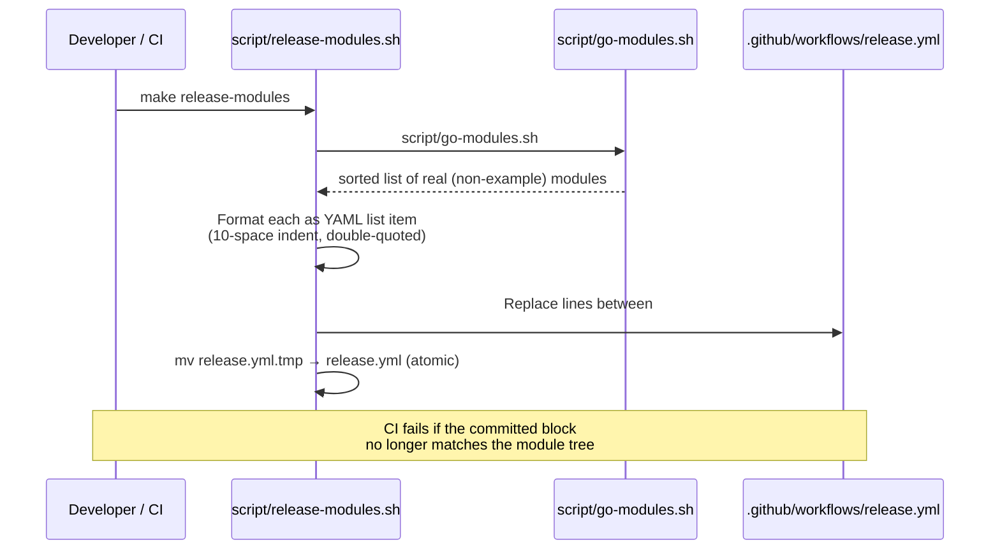
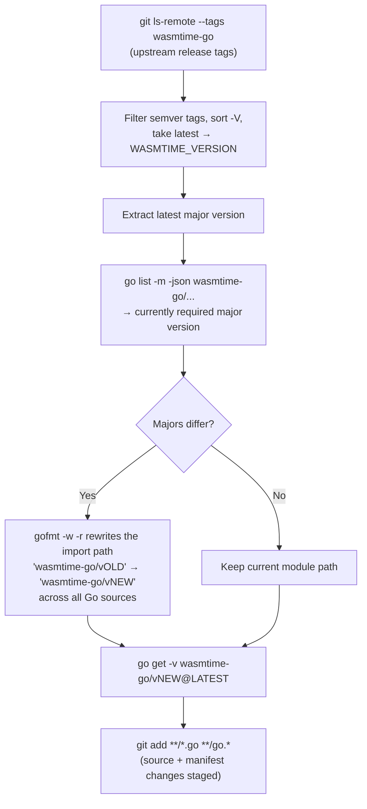
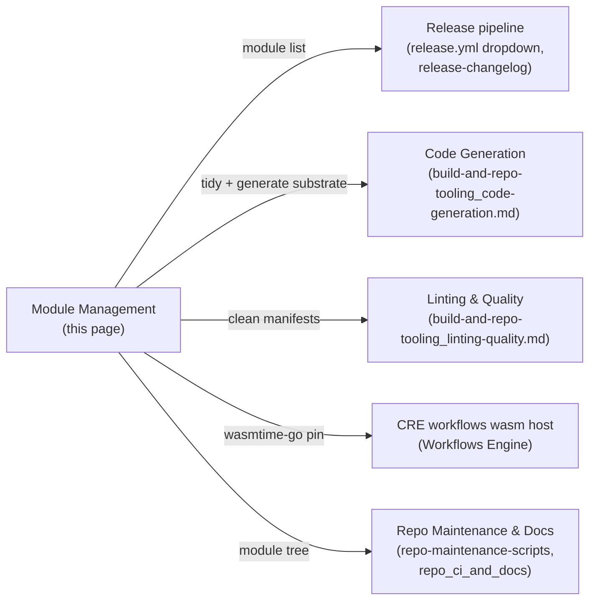

# Build & Repo Tooling — Module Management (`chainlink-common`)

This module governs **Go multi-module management** for the [`chainlink-common`](../../Shared_Foundation_Libraries___Domain_Types.md) repository. It answers four operational questions:

1. **Which Go modules exist** in the repository, and how do "example" modules relate to their real parents? (`script/go-modules.sh`)
2. **How are dependency manifests kept tidy** and how is the module dependency graph documented? (Make targets `gomods`, `gomodtidy`, `modgraph`)
3. **How does the release pipeline learn the module list?** (`script/release-modules.sh` regenerating `.github/workflows/release.yml`)
4. **How are hard-to-bump native dependencies upgraded?** (`script/wasmtime-bump.sh` for the WASM runtime)

For the surrounding toolchain (code generation, linting) see the parent page [build-and-repo-tooling](../build-and-repo-tooling.md) and its siblings [code-generation](build-and-repo-tooling_code-generation.md) and [linting-quality](build-and-repo-tooling_linting-quality.md). The equivalent dependency setup for the main `chainlink` node repo is covered in [repo-build-config_go-dependencies](../repo-build-config/repo-build-config_go-dependencies.md).

---

## Component Inventory

| Component | Path | Responsibility |
|---|---|---|
| `go.mod` | `chainlink-common/go.mod` | Root module manifest: module path, Go version, direct/indirect dependencies, `retract` directives |
| `go-modules.sh` | `chainlink-common/script/go-modules.sh` | Discovers every Go module in the repository; special-cases `examples/` modules; resolves the owning module for any directory |
| `release-modules.sh` | `chainlink-common/script/release-modules.sh` | Rewrites the module dropdown block in `.github/workflows/release.yml` from the discovered module list |
| `wasmtime-bump.sh` | `chainlink-common/script/wasmtime-bump.sh` | Upgrades the `bytecodealliance/wasmtime-go` dependency, including major-version import-path rewrites |
| Makefile targets | `chainlink-common/Makefile` | `gomods`, `gomodtidy`, `modgraph`, `release-modules`, `dependabot` — pinned tool installation and orchestration |

## Architecture



The Makefile acts as the single entry point: it pins tool versions (`gomods@v0.1.7`, `modgraph@v0.1.4` — other tools such as `protoc`, `mockery`, and `golangci-lint` are pinned via `.tool-versions`), installs them, and delegates module discovery to `go-modules.sh` so every downstream artifact (tidied manifests, `go.md`, the release dropdown) is derived from the same source of truth.

---

## 1. Module Discovery — `script/go-modules.sh`

The repository is a **multi-module Go tree**: the root module (`github.com/smartcontractkit/chainlink-common`) plus nested leaf modules such as `pkg/values`, `keystore`, `pkg/monitoring`, `pkg/chipingress`, `x/config`, and `observability-lib`. The script is the canonical enumerator of these modules.

### Discovery algorithm

- `all()` runs `git ls-files --cached --others --exclude-standard '*go.mod'` — it sees **tracked and untracked (but not git-ignored)** manifests, deduplicates by directory, and sorts. New modules are picked up the moment their `go.mod` file is added, even before commit.
- The repo root is located via `git rev-parse --show-toplevel`, so the script works from any subdirectory.
- Paths that match `(^|/)examples(/|$)` are treated as **example modules**: *"a module under a directory named `examples` is an example of its nearest enclosing module that is not one. It models a downstream consumer, local replace directives and all, so it is built, tidied and generated as part of that module rather than checked on its own."*

### Modes

| Invocation | Behavior |
|---|---|
| `script/go-modules.sh` | Prints every module directory that is **not** an example |
| `script/go-modules.sh examples MODULE` | Prints the example modules whose owning module is `MODULE` |
| `script/go-modules.sh parent DIR` | Walks up from `DIR` (while inside an `examples/` path **or** no `go.mod` is present) and prints the owning module directory |



The `parent` mode is what makes the examples convention safe: an example with its own `go.mod` and `replace` directives simulates a downstream consumer, but tooling always attributes it to the nearest real module.

## 2. Dependency Hygiene — `gomods`, `gomodtidy`, `modgraph`

Three Makefile targets keep the manifests consistent and documented:

| Target | Tool (pinned) | Effect |
|---|---|---|
| `gomods` | `github.com/jmank88/gomods@v0.1.7` | Installs the multi-module helper binary into `GOBIN` |
| `gomodtidy` | gomods | Runs `gomods tidy` across the module tree |
| `modgraph` | gomods + `github.com/jmank88/modgraph@v0.1.4` | Runs `./modgraph > go.md`, emitting a human-readable **module dependency graph** at the repo root |

`gomods` is module-aware: it applies operations to every module discovered in the tree (including examples, which are tidied/generated as part of their parent rather than checked independently). The `generate` target (documented in [code-generation](build-and-repo-tooling_code-generation.md)) depends on this infrastructure: `gomods -go generate -x ./...` runs `go generate` across all modules, after which `release-modules` and `modgraph` are refreshed in the same pass.

## 3. Release Workflow Synchronization — `script/release-modules.sh`

The release workflow (`.github/workflows/release.yml`) exposes a `workflow_dispatch` dropdown of releasable modules. Because *a dropdown's options cannot be computed while the workflow runs*, the list is **generated ahead of time** and committed:

> "Rewrites the module choices in release.yml to every module go-modules.sh lists. … generated here and CI fails when they fall behind."



Mechanics worth noting:

- The script pipes the module list into `awk` **via the process environment** (`OPTIONS=$(...) awk '...' "$file"`), and the awk program reads it back with `ENVIRON["OPTIONS"]` — no temp files for the option payload.
- The generated block is delimited by the marker comments `# BEGIN generated by script/release-modules.sh` and `# END generated by script/release-modules.sh`; only content between the markers is replaced, so hand-authored workflow logic is preserved.
- The rewrite is performed via `release.yml.tmp` + `mv`, i.e. an atomic in-place replacement.
- **Drift detection is implicit**: if a developer adds or removes a module without re-running `make release-modules` (it is also a dependency of `make generate`), CI fails on the stale dropdown. This converts module-list drift into a build failure rather than a release-time surprise.

The resulting dropdown drives which module each release job packages; downstream, the [release-changelog](../release-changelog.md) tool (`chainlink/tools/release/release-changelog`) consumes module/plugin identifiers (see its `pluginsFile` type: `plugins: [{moduleURI, gitRef}]`) to assemble product changelogs.

## 4. WASM Runtime Upgrades — `script/wasmtime-bump.sh`

The `bytecodealliance/wasmtime-go` dependency (currently **v47** in `chainlink-common/go.mod`) backs the WASM workflow host — see the CRE engine documentation, [workflows_engine](../../Workflow___Capability_Runtime_(CRE_Engine)/workflows/workflows_engine.md). Because wasmtime-go publishes **new major module paths** (e.g. `/v47` → `/v48`), bumping it is not a plain `go get`. The script handles the full upgrade:



Step-by-step:

1. **Latest version discovery** — remote tags are listed with `git ls-remote`, tag names extracted, non-semver tags filtered out (`^v?[0-9]+\.[0-9]+\.[0-9]+$`), and the highest chosen with `sort -V | tail -n 1`.
2. **Major-version comparison** — the currently required major is read with `go list -m -json github.com/bytecodealliance/wasmtime-go/...` and compared against the latest major.
3. **Import-path migration (major bumps only)** — a `gofmt -w -r` rewrite rule replaces the versioned import path string across the source tree, updating every consumer of the runtime.
4. **Dependency update** — `go get -v .../v$MAJOR@$VERSION` upgrades the manifest; `git add **/*.go **/go.*` stages both source rewrites and `go.mod`/`go.sum` changes so the bump lands as one reviewable change.

## 5. Root Module Manifest — `chainlink-common/go.mod`

The root manifest defines `module github.com/smartcontractkit/chainlink-common` on **Go 1.27.1** and is the primary dependency surface for the shared foundation libraries documented in [Shared Foundation Libraries & Domain Types](../../Shared_Foundation_Libraries___Domain_Types.md). Its direct requirements fall into these groups:

| Group | Representative dependencies |
|---|---|
| WASM runtime | `bytecodealliance/wasmtime-go/v47` — the execution substrate for WASM workflows (see [wasmtime-bump.sh](#4-wasm-runtime-upgrades--scriptwasmtime-bumpsh)) |
| Observability | OpenTelemetry suite (`otel`, `otel/sdk`, `otel/log`, `otel/metric`, `otel/trace`, OTLP gRPC/HTTP exporters, stdout exporters), `prometheus/client_golang`, `otelsql`, Grafana `pyroscope-go` + `otel-profiling-go` |
| RPC & plugin transport | `google.golang.org/grpc`, `protobuf`, `genproto/googleapis/rpc`, `hashicorp/go-plugin` + `go-hclog` (the Loop plugin host), `smartcontractkit/grpc-proxy`, gRPC Prometheus middleware |
| Persistence | `jmoiron/sqlx`, `jackc/pgx/v5`, `lib/pq`, `marcboeker/go-duckdb` |
| First-party SmartContractKit | `libocr`, `chain-selectors`, `freeport`, `chainlink-protos/*` (billing, cre, linking-service, metering, node-platform, storage-service, workflows), `chainlink-common/pkg/chipingress` |
| Serialization & config | `fxamacker/cbor/v2`, `pelletier/go-toml` (v1 + v2), `go-playground/validator`, `santhosh-tekuri/jsonschema`, `invopop/jsonschema`, `go-viper/mapstructure`, `Masterminds/semver` |
| Chain integrations | `stellar/go-stellar-sdk`, `mr-tron/base58` |
| Developer experience | `zap`, `testify`, `go-cmp`, `golang-jwt/v5`, `uuid`, `clockwork`, `jpillora/backoff`, `shopspring/decimal`, `gonum` |

**Version governance is visible in the manifest** via `retract` directives:

```text
retract v1.3.0 // accidentally published
retract v1.3.1 // exists only to retract v1.3.0
```

This is the canonical pattern in this repo for unpublishing a bad tag: a follow-up version is published solely to carry the retraction. Consumers using module-aware tooling will resolve away from the retracted versions automatically.

## 6. Make Target Reference

| Target | Depends on | Description |
|---|---|---|
| `gomods` | — | Install `gomods@v0.1.7` (module-tree helper used by tidy/generate/graph) |
| `gomodtidy` | `gomods` | `gomods tidy` — normalize `go.mod`/`go.sum` across all modules |
| `modgraph` | `gomods` | Install `modgraph@v0.1.4` and emit the module dependency graph to `go.md` |
| `release-modules` | — | Run `script/release-modules.sh` — sync `release.yml`'s module choices with the repository's modules |
| `dependabot` | — | **Deprecated** — prints `Deprecated: manually trigger the CI workflow instead` |
| `generate` *(related, see [code-generation](build-and-repo-tooling_code-generation.md))* | `mockery`, `install-protoc`, `gomods`, `cre-protoc`, `modgraph`, `release-modules` | Runs `gomods -go generate -x ./...` plus mockery over every `.mockery.yaml`; also refreshes the release dropdown and module graph |

The `dependabot` deprecation means automated dependency bumps are triggered from CI workflows instead of the Makefile; manual manifest edits still flow through `gomodtidy` and the `wasmtime-bump.sh` procedure for the WASM runtime.

---

## How This Module Fits Into the System



- **Release pipeline** — the generated dropdown in `.github/workflows/release.yml` is the only place the release system learns the set of releasable modules; the [release-changelog](../release-changelog.md) tool then maps `moduleURI`/`gitRef` entries into product changelogs.
- **Code generation** — `make generate` is module-aware through `gomods` and keeps `release-modules` and `modgraph` outputs fresh in the same pass (see [code-generation](build-and-repo-tooling_code-generation.md)).
- **Linting & quality** — linting operates over the same repository (Docker-based `golangci-lint` via `script/lint.sh`, SonarQube via `sonar-project.properties`); see [linting-quality](build-and-repo-tooling_linting-quality.md).
- **Parallel setups** — the main `chainlink` node repository maintains its own dependency surface and hooks (lefthook, Nix dev shell); compare [repo-build-config_go-dependencies](../repo-build-config/repo-build-config_go-dependencies.md) and the parent [Build, CI & Release Infrastructure](../../Build,_CI___Release_Infrastructure.md) index. Cross-repository hygiene (submodule freshness, public-repo checks) lives in [repo-maintenance-scripts](../repo-maintenance-scripts.md), and the scheduled doc-generation CI that runs those checks is documented in [repo_ci_and_docs](../repo_ci_and_docs.md).

## Operational Notes

- **Adding a new Go module**: create its `go.mod`, then run `make gomodtidy && make release-modules` (or simply `make generate`) so the module graph (`go.md`) and the release dropdown pick it up. If it should *not* be independently releasable, place it under an `examples/` directory — it will then be built, tidied, and generated as part of its parent and excluded from the release dropdown.
- **Routine dependency bumps**: use `make gomodtidy`; the pinned `gomods` tool guarantees consistent treatment across all nested modules.
- **Wasmtime bumps**: always use `script/wasmtime-bump.sh` rather than a manual `go get` — a new upstream major version requires the gofmt-driven import-path migration, which the script automates and stages for commit.
- **Stale release dropdown**: if CI fails because the generated block is behind, run `make release-modules` and commit the diff.
- **Unpublishing a released version**: follow the established `retract` pattern in `go.mod` (a new patch-only version whose sole purpose is carrying the retraction directive).
