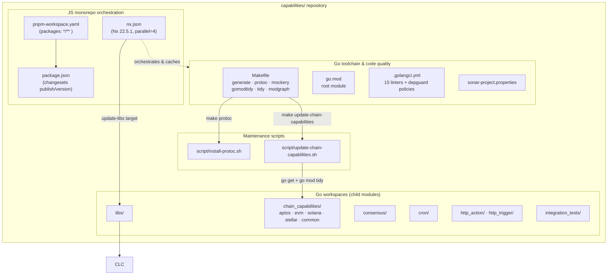
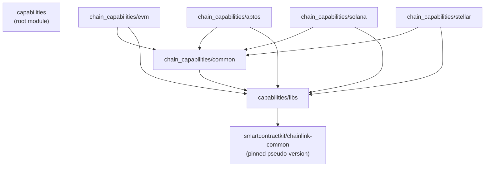

# Capabilities Workspace Tooling

## Overview

The **capabilities_workspace_tooling** module covers the build, dependency-management, code-quality, and release tooling at the root of the [`capabilities/`](https://github.com/smartcontractkit/capabilities) repository (`github.com/smartcontractkit/capabilities`). This repository is the home of the Chainlink Runtime Environment (CRE) **capability implementations** — the standard capabilities (cron, HTTP action/trigger, consensus) and the per-chain capabilities (Aptos, EVM, Solana, Stellar) that are executed as plugin processes by the node, plus the shared `libs/` Go module they all depend on.

The files documented here do **not** implement product functionality themselves. Instead they define *how the capabilities workspace is built, linted, generated, versioned, and kept consistent*:

| Artifact | Role |
| --- | --- |
| `capabilities/go.mod` | Root Go module definition for the workspace |
| `capabilities/Makefile` | Make targets that drive Go code generation, proto compilation, mock generation, module tidying and dependency updates |
| `capabilities/.golangci.yml` | `golangci-lint` v2 configuration — enforced lint rules and dependency policies (depguard) |
| `capabilities/sonar-project.properties` | SonarQube static-analysis project configuration (exclusions, coverage scope, duplication scope) |
| `capabilities/nx.json` | Nx monorepo task-runner configuration (caching, parallelism, `update-libs` target) |
| `capabilities/package.json` | Node package manifest wiring **Changesets** for versioning/publishing |
| `capabilities/pnpm-workspace.yaml` | pnpm workspace definition covering all nested packages |
| `capabilities/script/install-protoc.sh` | Idempotent installer for the `protoc` compiler |
| `capabilities/script/update-chain-capabilities.sh` | Bulk dependency updater across the per-chain capability Go modules |

### Why this tooling exists: a polyglot, multi-module capability repo

The `capabilities/` repository deliberately mixes two ecosystems, and the tooling in this module is what keeps them coherent:

- **Go**: one root module plus ten child Go modules (`libs`, `chain_capabilities/{aptos,common,evm,solana,stellar}`, `consensus`, `cron`, `http_action`, `http_trigger`, `integration_tests`), each with its own `go.mod`/`go.sum`. The root `Makefile`'s `gomods`/`gomodtidy`/`tidy` targets (driven by `github.com/jmank88/gomods`) run `go mod tidy` across **all** modules in one command.
- **JavaScript/TypeScript (dev tooling only)**: Nx (`nx.json`, per-project `project.json` files) orchestrates and caches `build`/`lint`/`generate`/`test`/`tidy` targets, while pnpm (`pnpm-workspace.yaml`) and Changesets (`package.json`) manage the tooling packages and their versioning.

## Architecture: how the tooling fits together

### 1. Go workspace management

The root `capabilities/go.mod` declares module `github.com/smartcontractkit/capabilities` (Go 1.27.1) with a minimal direct-dependency set (`stretchr/testify`, `google.golang.org/protobuf`); the real code lives in the child modules. Each chain capability module pins the shared code by pseudo-version, e.g. `chain_capabilities/evm/go.mod` requires both `capabilities/libs` and `capabilities/chain_capabilities/common`, and everything converges on a pinned `github.com/smartcontractkit/chainlink-common` pseudo-version:

Two pieces of tooling exist precisely to keep this graph up to date:

- **`make gomodtidy` / `make tidy`** (`capabilities/Makefile`) — run `gomods tidy` across every module and stage all `go.*` files into git.
- **`make update-chain-capabilities MODULE=<module> REF=<ref>`** — executes `capabilities/script/update-chain-capabilities.sh`, which loops over `aptos`, `evm`, `solana`, and `stellar` and runs `go get <module>@<ref>` + `go mod tidy` in each, so a bump of `chainlink-common` or `capabilities/libs` lands uniformly in all four chain families.

Nx complements this with a cached, parallel `update-libs` target (`capabilities/nx.json`) that pins `capabilities/libs` at an argument-supplied version and then chains into `nx run tidy`.

### 2. Code generation

Generated code is a first-class part of this repo (protobuf monitoring/report schemas per chain, mocks). `make generate` composes the whole toolchain: it installs `protoc 29.3` via `capabilities/script/install-protoc.sh` and `protoc-gen-go v1.36.10`, installs `mockery v2.53.7` (matching the `capabilities/.mockery.yaml`-style mock generation used across the workspace), and then runs `gomods -w go generate -x ./...` with `~/.local/bin` prepended to `PATH` so `go:generate` directives pick up the pinned compiler. The protobuf sources feeding this pipeline are documented per capability in [Workflow & Capability Runtime (CRE Engine) → chain capability pages](../Workflow___Capability_Runtime_(CRE_Engine).md) (e.g. `capabilities/chain_capabilities/evm/monitoring/*.proto`).

### 3. Code quality gates

Two complementary quality layers are configured:

1. **`golangci-lint` v2** (`capabilities/.golangci.yml`) — 15 enabled linters (`revive`, `errorlint`, `exhaustive`, `gosec`, `loggercheck`, `containedctx`, `noctx`, `sqlclosecheck`, …) plus a **depguard policy that encodes the repo's "chain-agnostic" architecture rule**: `github.com/ethereum/go-ethereum` is denied everywhere *except* `**/chain_capabilities/evm/**`, where it is explicitly allow-listed. The `goimports` formatter uses `github.com/smartcontractkit/capabilities` as the local import prefix.
2. **SonarQube** (`capabilities/sonar-project.properties`) — project key `smartcontractkit_capabilities`, with extensive exclusions for generated code (`*.pb.go`, `*_gen.go`, mocks, fixtures) and test/tooling paths, and duplication exclusions for the intentionally-similar `workflows/**/main.go` entrypoints. A tracked TODO (`CRE-542`) notes that coverage under `**/evm/` still needs to be enabled.

Nx caches both gates: its `lint` target declares `.golangci.yml` as a named input and `sonar-project.properties` is part of the `sharedGlobals` named input, so cache hashes correctly invalidate when either file changes.

### 4. Versioning & release

`capabilities/package.json` (private, `@chainlink/capabilities`) exposes the two CI entry points `ci:changeset:version` and `ci:changeset:publish`, backed by `@changesets/cli` and `@changesets/changelog-github`. The pnpm workspace pattern `*/**` picks up every nested package. This mirrors the changeset-based release flow used by the sibling `chainlink/` repository — see [repo-build-config](repo-build-config.md) — and complements the Go-side module-release machinery documented in [build-and-repo-tooling](build-and-repo-tooling.md) (`chainlink-common/script/release-modules.sh`).

## Sub-module documentation

The tooling is grouped into three sub-modules:

- **[Go Toolchain & Code Quality](capabilities_workspace_tooling/capabilities_workspace_tooling_go_toolchain.md)** — the root `go.mod`, every `Makefile` target (`generate`, `protoc`, `mockery`, `gomods`, `gomodtidy`, `tidy`, `modgraph`, `update-chain-capabilities`, `help`), the `golangci-lint` v2 configuration with its chain-agnostic depguard policies, and the SonarQube project setup.
- **[Monorepo Orchestration (Nx, pnpm, Changesets)](capabilities_workspace_tooling/capabilities_workspace_tooling_monorepo_orchestration.md)** — `nx.json` task caching/parallelism and the `update-libs` target, the pnpm workspace definition, and the Changesets-based version/publish CI entry points in `package.json`.
- **[Maintenance Scripts](capabilities_workspace_tooling/capabilities_workspace_tooling_maintenance_scripts.md)** — `script/install-protoc.sh` (idempotent cross-platform protoc installer) and `script/update-chain-capabilities.sh` (bulk dependency bumps across the Aptos/EVM/Solana/Stellar chain capability modules).

## Relationship to the rest of the system

This module is one slice of the overall build/CI infrastructure. The [parent module](../Build,_CI___Release_Infrastructure.md) documents the other slices; to avoid duplication:

| Concern | Documented in |
| --- | --- |
| Root-repo `Makefile`, Docker images, docs targets (`chainlink/GNUmakefile`) | [chainlink_build_and_tooling](chainlink_build_and_tooling.md) |
| `chainlink/` repo build config: golangci, lefthook, Nix, SonarQube | [repo-build-config](repo-build-config.md) |
| `chainlink-common/` build & lint scripts, module release automation | [build-and-repo-tooling](build-and-repo-tooling.md) |
| CI matrix tool (`chainlink/tools/ci`) | [ci-tools](ci-tools.md) |
| Git hooks tooling | [githooks](githooks.md) |
| Weekly docs refresh workflow & README | [repo_ci_and_docs](repo_ci_and_docs.md) |
| Repo maintenance scripts (`scripts/*.sh`) | [repo-maintenance-scripts](repo-maintenance-scripts.md) |

The *products* built and linted by this tooling are documented elsewhere:

- The capability implementations themselves (consensus, cron, HTTP, and the Aptos/EVM/Solana/Stellar chain capabilities) live under [Workflow & Capability Runtime (CRE Engine)](../Workflow___Capability_Runtime_(CRE_Engine).md) — notably [capabilities](../Workflow___Capability_Runtime_(CRE_Engine)/capabilities.md), [capabilities_shared_libs](../Workflow___Capability_Runtime_(CRE_Engine)/capabilities_shared_libs.md) and the per-chain pages such as [chain_capability_evm](../Workflow___Capability_Runtime_(CRE_Engine)/chain_capability_evm.md).
- `capabilities/integration_tests/` — a separate Go module managed by the same tooling — is covered by [capabilities_integration_tests](../Dev,_Test___Simulation_Environments/capabilities_integration_tests.md) in the Dev/Test/Simulation Environments module.
- The `depguard` import rules reference `github.com/smartcontractkit/chainlink-common` logger/`SugaredLogger` printf signatures; that shared logger library is documented in [logger](../Shared_Foundation_Libraries___Domain_Types/logger.md).
