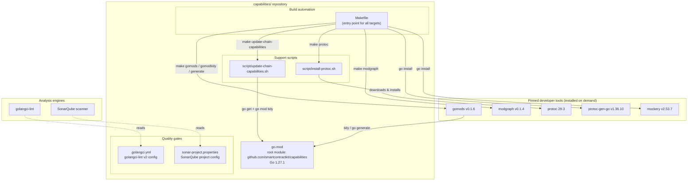
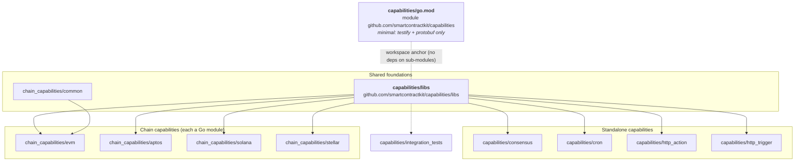
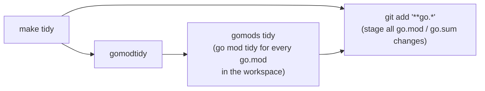
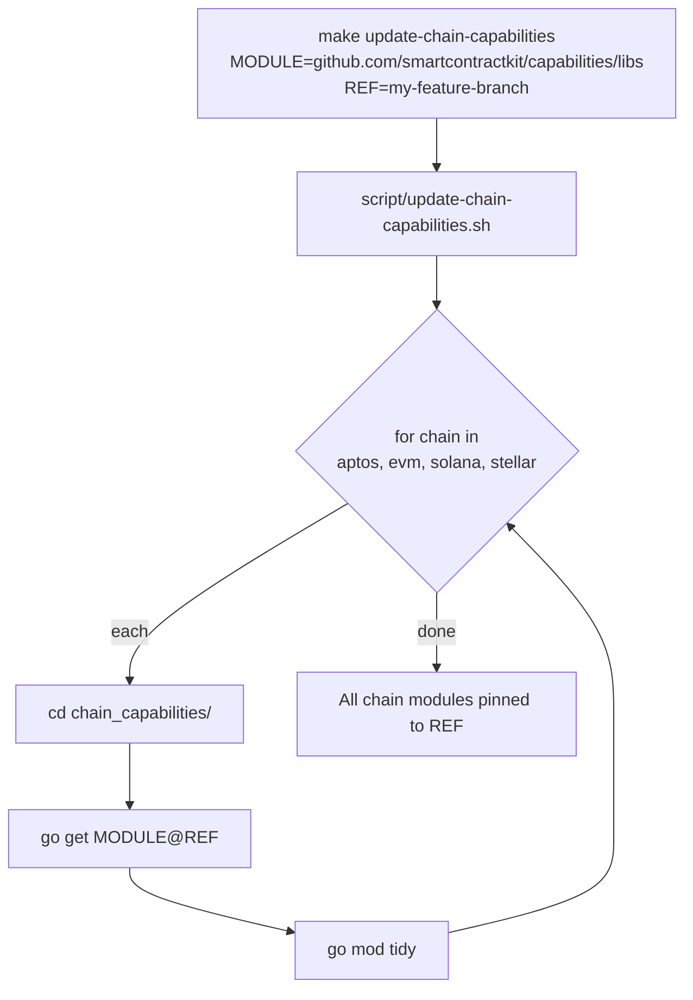
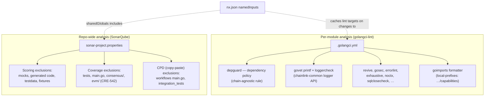
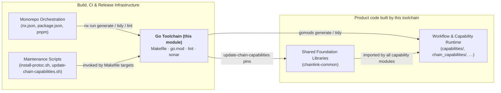

# Capabilities Workspace Tooling — Go Toolchain

> **Parent module:** [Capabilities Workspace Tooling](../capabilities_workspace_tooling.md) — part of [Build, CI & Release Infrastructure](../../Build,_CI___Release_Infrastructure.md)

## 1. Introduction

The `capabilities_workspace_tooling_go_toolchain` module defines the **Go build, dependency-management, code-generation and static-analysis toolchain** for the `capabilities/` repository — the home of Chainlink's Chain Reliability Engine (CRE) capabilities (chain capabilities for EVM/Aptos/Solana/Stellar, consensus, cron, HTTP trigger/action, and shared libs).

Because `capabilities/` is a **multi-module Go workspace** (a root module plus ~11 sub-modules, each with its own `go.mod`), the module provides bespoke tooling that no single `go mod` invocation can cover: the [`gomods`](https://github.com/jmank88/gomods) utility orchestrates `go mod tidy` and `go generate` **across all modules**, while pinned versions of `protoc`, `protoc-gen-go` and `mockery` guarantee reproducible code generation. Repository-wide quality policy is enforced through a `golangci-lint` v2 configuration (notably a **"chain-agnostic repo" dependency policy**) and a SonarQube project configuration.

### Module at a glance

| Aspect | Detail |
|---|---|
| Repository | `github.com/smartcontractkit/capabilities` |
| Go version | **1.27.1** (declared in every `go.mod`) |
| Workspace shape | 1 root module + 11 sub-modules (no `go.work`; orchestrated via `gomods`) |
| Core files | `capabilities/go.mod`, `capabilities/Makefile`, `capabilities/.golangci.yml`, `capabilities/sonar-project.properties` |
| Support scripts | `script/install-protoc.sh`, `script/update-chain-capabilities.sh` (documented in [Maintenance Scripts](capabilities_workspace_tooling_maintenance_scripts.md)) |
| Pinned tools | `gomods` v0.1.6, `modgraph` v0.1.4, `protoc` 29.3, `protoc-gen-go` v1.36.10, `mockery` v2.53.7 |
| Quality gates | golangci-lint v2 (per-module), SonarQube (repo-wide) |

---

## 2. Architecture

The module consists of four cooperating artifacts: a module manifest, a build entry point, and two quality-gate configurations. The Makefile is the single entry point that installs and drives all external tooling.



**Key relationships:**

- **`go.mod`** declares the root module. It is intentionally minimal — its only direct dependencies are `stretchr/testify` and `google.golang.org/protobuf` — because almost all functional code lives in the sub-modules (see §3).
- **`Makefile`** is the orchestration hub: every target either installs a pinned tool, delegates to a support script, or invokes `gomods` to fan operations out across all `go.mod` files.
- **`.golangci.yml`** encodes the linter *policy*, including the repo's defining rule: the repository is chain-agnostic, so `go-ethereum` imports are only permitted under `chain_capabilities/evm/` (see §6).
- **`sonar-project.properties`** configures repo-wide static analysis in SonarQube, excluding generated/mock/test scaffolding from scoring (see §7).

---

## 3. Multi-Module Workspace Layout

The repository deliberately avoids a single Go module. Each deployable capability and shared library is its own module with independent dependency resolution. The root `capabilities/go.mod` anchors the repository (required for `go test ./...` style commands at the root and for tooling that walks the tree), while sub-modules pin their own dependencies.



Observed dependency facts (from the sub-module manifests):

- `capabilities/libs` is the internal foundation: every other in-repo module depends on it via a Go **pseudo-version** (e.g. `github.com/smartcontractkit/capabilities/libs v0.0.0-20261001142216-…`), which is why `make tidy` and `make update-chain-capabilities` exist — pseudo-version bumps must be applied consistently across modules.
- `chain_capabilities/evm` additionally depends on `chain_capabilities/common` and on external SmartContract Kit libraries (`chainlink-common`, `chainlink-evm`, `chainlink-protos/cre/go`, `libocr`).
- All sub-modules agree on `go 1.27.1`; the protobuf **runtime** library sits at v1.36.11–v1.36.12, while the **generator** plugin is pinned separately at v1.36.10 (see §4.3).

Module descriptions and the capabilities they implement are covered by the product documentation in [Workflow & Capability Runtime (CRE Engine)](../../Workflow___Capability_Runtime_(CRE_Engine)/capabilities.md) and its chain-specific pages such as [Chain Capability EVM](../../Workflow___Capability_Runtime_(CRE_Engine)/chain_capability_evm.md).

---

## 4. Build Automation (`capabilities/Makefile`)

The Makefile exposes nine self-documenting targets (`help` greps the `##` annotations). It is the canonical way to install tooling, tidy modules, regenerate code, and propagate internal dependency bumps.

### 4.1 Target reference

| Target | Purpose | Mechanism |
|---|---|---|
| `help` | Print all targets with descriptions | `grep` over `##` comments in `MAKEFILE_LIST` |
| `gomods` | Install the multi-module utility | `go install github.com/jmank88/gomods@v0.1.6` |
| `gomodtidy` | Run `go mod tidy` in **all** modules | Delegates to `gomods tidy` (dependency: `gomods`) |
| `tidy` | Tidy all modules **and stage results** | `gomodtidy` + `git add '**go.*'` |
| `modgraph` | Emit a module dependency graph to `go.md` | Installs `gomods` + `jmank88/modgraph@v0.1.4`, runs `./modgraph > go.md` |
| `protoc` | Install `protoc` 29.3 and `protoc-gen-go` v1.36.10 | `./script/install-protoc.sh 29.3` + `go install …/protoc-gen-go@v$(PROTOC_GEN_GO_VERSION)` |
| `mockery` | Install the mock generator | `go install github.com/vektra/mockery/v2@v2.53.7` |
| `generate` | Execute **all** `go:generate` directives across all modules | `gomods -w go generate -x ./…` with `~/.local/bin` prepended to `PATH` |
| `update-chain-capabilities` | Update one shared module across all chain capabilities | `./script/update-chain-capabilities.sh "$(MODULE)" "$(REF)"` |

### 4.2 Code-generation pipeline (`make generate`)

This is the most important compound target. It guarantees that `go:generate` invocations (protobuf compilation, mockery mocks, etc.) run with the exact pinned toolchain, regardless of what a developer has on their system.

```mermaid
sequenceDiagram
    autonumber
    participant Dev as Developer / CI
    participant Make as make generate
    participant Script as script/install-protoc.sh
    participant Tool as go install
    participant Gen as gomods -w go generate -x ./…

    Dev->>Make: make generate
    Make->>Script: install-protoc.sh 29.3
    Note over Script: Idempotent: exits early if<br/>protoc --version already matches 29.3.<br/>Downloads GitHub release artifact for<br/>linux/x86_64 or macOS universal binary,<br/>unzips into ~/.local
    Make->>Tool: go install protoc-gen-go@v1.36.10
    Make->>Tool: go install mockery/v2@v2.53.7
    Make->>Tool: go install gomods@v0.1.6
    Make->>Gen: export PATH="$HOME/.local/bin:$PATH"; gomods -w go generate -x ./…
    Note over Gen: gomods walks every go.mod in the tree and<br/>runs go generate per module (-x echoes commands)
    Gen-->>Dev: Regenerated *.pb.go / *_grpc.pb.go and mockery mocks
```

Notes:

- The `PATH` export is essential: `install-protoc.sh` installs the `protoc` binary into `~/.local/bin`, and `gomods` must find that version — not a stale system one — when it spawns `go generate` per module (the Makefile comment states this explicitly).
- `generate` declares `protoc`, `mockery` and `gomods` as prerequisites, so a single `make generate` bootstraps a fresh machine end-to-end.
- `install-protoc.sh` supports Linux x86_64 and macOS (universal binary) only; other platforms fail fast with a clear error. The script lives in the [Maintenance Scripts](capabilities_workspace_tooling_maintenance_scripts.md) module.

### 4.3 Dependency maintenance flows

**`make tidy`** keeps the multi-module dependency graph consistent and stages the results so module bumps never land accidentally:



**`make update-chain-capabilities MODULE=<path> REF=<ref>`** propagates a version bump of a shared module (e.g. `capabilities/libs` after a feature branch merge, or `chainlink-common`) into all four chain-capability modules:



This complements the Nx-level `update-libs` target defined in `capabilities/nx.json` (which runs `go get …/libs@<version>` followed by `nx run tidy`) — the Nx orchestration side is documented in [Monorepo Orchestration](capabilities_workspace_tooling_monorepo_orchestration.md).

**`make modgraph`** regenerates `go.md`, a rendered snapshot of inter-module dependencies, useful for reviewing the graph shown in §3.

### 4.4 Toolchain version matrix

All versions are pinned in the Makefile (tools) and `go.mod` files (language & runtime), making builds reproducible across developers and CI.

| Component | Version | Pinned in |
|---|---|---|
| Go toolchain | `1.27.1` | every `go.mod` (`go 1.27.1`) |
| gomods (multi-module driver) | `v0.1.6` | `Makefile` |
| modgraph (dependency graph) | `v0.1.4` | `Makefile` |
| protoc compiler | `29.3` | `Makefile` → `install-protoc.sh` |
| protoc-gen-go plugin | `v1.36.10` | `Makefile` (`PROTOC_GEN_GO_VERSION`) |
| protobuf runtime | `v1.36.11` (root) / `v1.36.12` (sub-modules) | `go.mod` |
| mockery (mock generator) | `v2.53.7` | `Makefile` (`MOCKERY_VERSION`) |
| testify (test framework) | `v1.11.1` (root) / `v1.12.1` (sub-modules) | `go.mod` |

> **Note:** the generator plugin (v1.36.10) is pinned independently of the runtime library (v1.36.11+). When bumping the protobuf runtime, regenerate with `make generate` so wire formats stay consistent across all modules.

---

## 5. Quality Gates Overview

Static analysis runs at two complementary levels:



---

## 6. Static Analysis Policy (`capabilities/.golangci.yml`)

The configuration uses the **golangci-lint v2** format and defines both linting and formatting for all Go modules in the repository.

### 6.1 Enabled linters

| Linter | Role |
|---|---|
| `containedctx` | No `context.Context` stored in structs |
| `copyloopvar` | Flags redundant loop-variable copies (Go ≥1.22 semantics) |
| `depguard` | **Dependency allow/deny policy** (see §6.2) |
| `errorlint` | Correct error comparison/wrapping (`errorf` mode disabled) |
| `exhaustive` | `switch` over enums must be exhaustive (`default-signifies-exhaustive: true`) |
| `gomodguard_v2` | Guards `go.mod` (local replace directives disallowed) |
| `gosec` | Security scanning (`G101` hardcoded-credentials and `G104` unhandled-errors excluded) |
| `loggercheck` | Validates key/value pairs in structured logging calls (see §6.3) |
| `misspell` | Spelling |
| `noctx` | HTTP requests must carry context |
| `revive` | ~40 style/correctness rules (confidence 0.8), incl. `error-strings`, `context-as-argument`, `atomic`, `early-return`, `modifies-parameter` |
| `rowserrcheck`, `sqlclosecheck` | Database correctness (rows/`sql.Rows` handling) |
| `unconvert`, `whitespace` | Idiomatic cleanup |

### 6.2 The chain-agnostic dependency policy (`depguard`)

The defining policy of the repository. Two file-scoped rule sets implement it:

| Scope | Files | Effect |
|---|---|---|
| `evm` | `**/chain_capabilities/evm/**` | `github.com/ethereum/go-ethereum/` is **allowed** |
| `main` | everything **except** `chain_capabilities/evm/**` | `github.com/ethereum/go-ethereum` is **denied** — *"This is a chain-agnostic repo"* |

Both scopes deny, with prescribed replacements:

| Denied package | Required replacement |
|---|---|
| `cosmossdk.io/errors` | standard library (`errors.Join`) |
| `github.com/go-gorm/gorm` | `github.com/jmoiron/sqlx` |
| `github.com/gofrs/uuid`, `github.com/satori/go.uuid` | `github.com/google/uuid` |
| `github.com/pkg/errors`, `go.uber.org/multierr` | standard library (`errors.Join`) |
| `github.com/test-go/testify/{assert,mock,require}` | `github.com/stretchr/testify/*` |
| `gopkg.in/guregu/null.v1/.v2/.v3` | `gopkg.in/guregu/null.v4` |

This means shared modules (`libs`, `consensus`, `cron`, `http_*`, `chain_capabilities/{aptos,solana,stellar,common}`) cannot accidentally import EVM-specific code — only the [EVM chain capability](../../Workflow___Capability_Runtime_(CRE_Engine)/chain_capability_evm.md) may. `integration_tests` are exempted from `depguard` entirely via the exclusions block (test harnesses legitimately need chain clients).

### 6.3 Logger integration

Both `govet` (printf-style format checking) and `loggercheck` (key-value pair checking) are configured for the SmartContract Kit logger types from [Shared Foundation Libraries — logger](../../Shared_Foundation_Libraries___Domain_Types/logger.md):

- `govet` printf funcs: `logger.Logger.{Debugf,Infof,Warnf,Errorf,Panicf,Fatalf}` and `logger.SugaredLogger.{AssumptionViolationf,Tracef,Criticalf}`.
- `loggercheck` rules: the `…w` variants (`Debugw`…`Fatalw`) plus `SugaredLogger.AssumptionViolationw`, `Tracew`, `Criticalw`, `With`.

This ensures format strings and structured key/value pairs passed to the common logger are validated exactly like `fmt.Printf`/`log` calls.

### 6.4 Formatting & exclusions

- Formatter: **`goimports`** with `local-prefixes: github.com/smartcontractkit/capabilities` — import grouping keeps internal imports in their own block.
- Exclusion presets: `comments`, `common-false-positives`, `legacy`, `std-error-handling`; generated code is excluded in "lax" mode.
- Test-specific relief: `gosec G404` (insecure randomness) is allowed in `*_test.go` paths.
- Path filters: `third_party$`, `builtin$`, `examples$` are always excluded.

---

## 7. SonarQube Configuration (`capabilities/sonar-project.properties`)

The properties file configures repo-wide analysis under project key `smartcontractkit_capabilities` (`sonar.sources=.`).

| Setting | Purpose |
|---|---|
| `sonar.exclusions` | Removes non-product code from **scoring**: `**/mocks/**`, `**/mock_*.go`, `**/testdata/**`, `**/script/**`, `**/generated/**`, `**/gen.go`, `**/*_gen.go`, `**/*_generated.go`, `**/fixtures/**`, `**/docs/**`, `**/tools/**`, `**/testutils/**`, `**/*.pb.go`, protobuf/solidity artifacts (`*.sol`, `*.abi`, `*.bin`), report XML/TXT |
| `sonar.coverage.exclusions` | Removes code from **coverage metrics**: tests, fuzz, `integration_tests/**`, `**/main.go` (per-binary entrypoints), `consensus/**`, and EVM protobuf helpers/actions. Carries an explicit follow-up ticket: `FIX: CRE-542 (cover code under **/evm/)` |
| `sonar.cpd.exclusions` | Skips copy-paste detection for `**/workflows/**/main.go` (deliberately similar per-example binaries) and `integration_tests/**` |
| `sonar.tests` / `sonar.test.inclusions` | Test discovery rooted at the repo with `**/*_test.go` inclusion |

The Sonar configuration is referenced by the Nx build graph: `nx.json` lists `sonar-project.properties` in the `sharedGlobals` named input, so Nx invalidates affected `build`/`generate`/`test`/`tidy` targets when analysis configuration changes (see [Monorepo Orchestration](capabilities_workspace_tooling_monorepo_orchestration.md)).

---

## 8. Position in the Overall System

The Go toolchain module is the build backbone for everything under `capabilities/`:



- **Upstream:** [Build, CI & Release Infrastructure](../../Build,_CI___Release_Infrastructure.md) groups this module with the analogous toolchains for other repos — the `chainlink` [repo build config](../repo-build-config.md) and the `chainlink-common` [build & repo tooling](../build-and-repo-tooling.md) follow the same Makefile + golangci + Sonar pattern with their own pins (e.g. `chainlink-common`'s `cre-protoc`, `release-modules` targets).
- **Downstream:** every capability binary in [Workflow & Capability Runtime (CRE Engine)](../../Workflow___Capability_Runtime_(CRE_Engine)/capabilities.md) is generated, tidied and linted through this module. Proto schemas compiled here (monitoring protos per chain, `value_consensus_types.proto`, `ocr.proto`, `execution_context.proto`) belong to the [Capabilities Shared Libs](../../Workflow___Capability_Runtime_(CRE_Engine)/capabilities_shared_libs.md) and per-chain monitoring pages.
- **Runtime dependency contract:** the lint policy's allow-list (`chainlink-common/pkg/logger`, `stretchr/testify`, `google/uuid`) mirrors the foundation libraries documented in [Shared Foundation Libraries & Domain Types](../../Shared_Foundation_Libraries___Domain_Types/types-core.md).

---

## 9. Operational Notes & Gotchas

1. **Always use `make generate`, never raw `go generate`.** Raw invocations may pick up an un-pinned system `protoc` and produce wire-incompatible `.pb.go` files. The Makefile's `PATH` prepend (`~/.local/bin`) is what routes `gomods`-spawned `go generate` to the pinned compiler.
2. **`make tidy` stages changes automatically** (`git add '**go.*'`). If you tidy as part of an unrelated commit, unstage the module files first.
3. **Platform support for `install-protoc.sh`** is Linux x86_64 and macOS only; the script fails fast otherwise. It is idempotent — it exits successfully if `protoc --version` already reports the requested version.
4. **EVM imports are lint-blocked outside `chain_capabilities/evm/`.** If `golangci-lint` rejects a `go-ethereum` import in shared code, the fix is to move the EVM-specific logic into the EVM chain capability (or use a chain-agnostic abstraction from `capabilities/libs`), not to weaken `depguard`.
5. **Sub-module version skew:** internal dependencies between capability modules are pseudo-versions. After merging changes to `capabilities/libs`, run `make update-chain-capabilities MODULE=github.com/smartcontractkit/capabilities/libs REF=<ref>` (Makefile) or the Nx `update-libs` target, then `make tidy` — don't hand-edit go.sum files.
6. **Known coverage gap:** EVM capability code is excluded from Sonar coverage metrics pending ticket CRE-542 (noted in `sonar-project.properties`).

---

## 10. Related Documentation

| Topic | Page |
|---|---|
| Parent module (workspace overview) | [Capabilities Workspace Tooling](../capabilities_workspace_tooling.md) |
| Nx / pnpm / changesets orchestration | [Monorepo Orchestration](capabilities_workspace_tooling_monorepo_orchestration.md) |
| `install-protoc.sh`, `update-chain-capabilities.sh` internals | [Maintenance Scripts](capabilities_workspace_tooling_maintenance_scripts.md) |
| Sibling toolchains (`chainlink`, `chainlink-common`) | [Repo Build Config](../repo-build-config.md) · [Build & Repo Tooling](../build-and-repo-tooling.md) |
| Built product: capabilities & chain capabilities | [Workflow & Capability Runtime (CRE Engine)](../../Workflow___Capability_Runtime_(CRE_Engine)/capabilities.md) |
| Shared libraries consumed by lint policy | [Shared Foundation Libraries & Domain Types](../../Shared_Foundation_Libraries___Domain_Types/types-core.md) |
