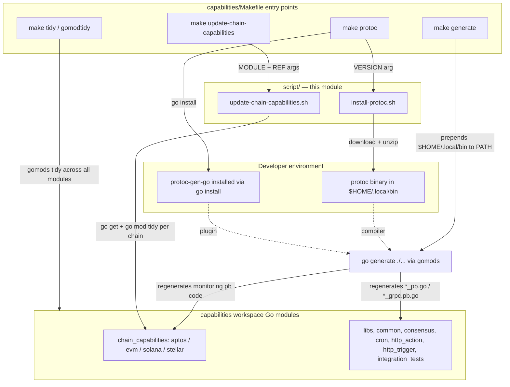
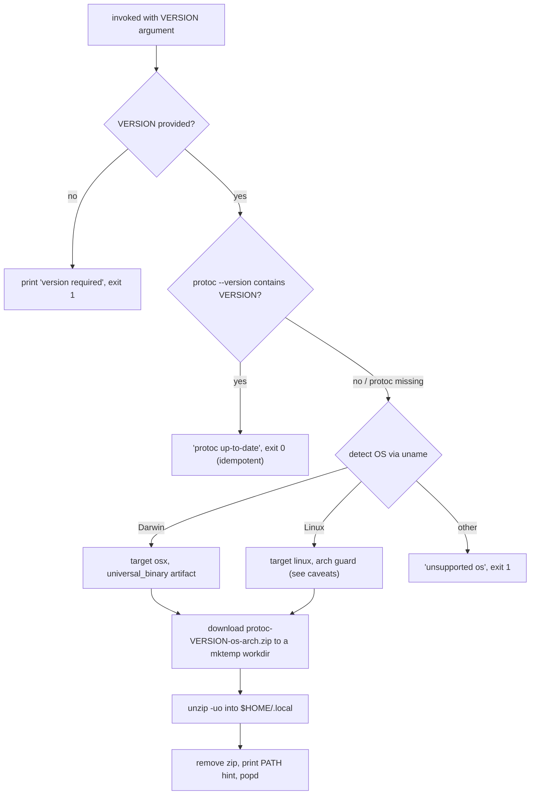
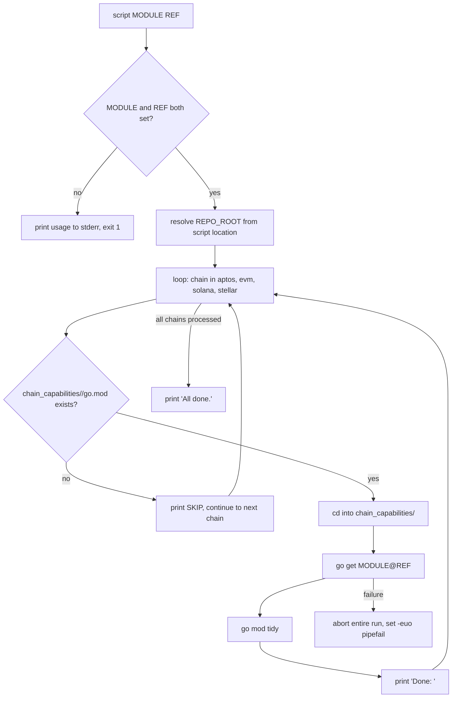

# Capabilities Workspace Tooling — Maintenance Scripts

## Overview

The `capabilities_workspace_tooling_maintenance_scripts` module contains the two shell scripts that live in the `capabilities/` workspace root under `capabilities/script/`:

| Script | Purpose | Invoked by |
|---|---|---|
| `capabilities/script/install-protoc.sh` | Installs a pinned version of the `protoc` compiler (Protocol Buffers + gRPC code generator) into the developer's home directory | `make protoc` in `capabilities/Makefile` |
| `capabilities/script/update-chain-capabilities.sh` | Updates one Go module dependency across **all four per-chain capability modules** (`aptos`, `evm`, `solana`, `stellar`) in a single operation | `make update-chain-capabilities` in `capabilities/Makefile` |

These scripts are thin, version-agnostic automation wrappers: neither hard-codes a version. All version pinning (protoc `29.3`, `protoc-gen-go` v1.36.10, mockery v2.53.7) is owned by the `capabilities/Makefile` entry points documented in the sibling [Go toolchain page](capabilities_workspace_tooling_go_toolchain.md) and passed to the scripts as arguments.

> **Disambiguation:** this page covers the *capabilities workspace* scripts only. The repository-root maintenance scripts (`scripts/check-repos.sh`, `scripts/run-codewiki.sh`, `scripts/update-submodules.sh`) are documented separately in [repo-maintenance-scripts](../repo-maintenance-scripts.md), and the `chainlink-common/` workspace scripts (including its own copy of `install-protoc.sh`) in [build-and-repo-tooling](../build-and-repo-tooling.md).

---

## Architecture and Position in the Toolchain

The scripts bridge the Make-based toolchain (documented in [capabilities_workspace_tooling_go_toolchain](capabilities_workspace_tooling_go_toolchain.md)) and the Nx/pnpm orchestration layer (documented in [capabilities_workspace_tooling_monorepo_orchestration](capabilities_workspace_tooling_monorepo_orchestration.md)) with the underlying Go modules that make up the [capabilities workspace](../../Workflow___Capability_Runtime_(CRE_Engine)/capabilities.md).



Key relationships:

- **`install-protoc.sh` is a prerequisite for code generation.** The `make generate` target re-exports `PATH="$(HOME)/.local/bin:$(PATH)"` before running `go generate`, ensuring the protoc binary placed by this script is the one `go:generate` directives use (see `capabilities/Makefile`, `generate` target).
- **`update-chain-capabilities.sh` is the cross-module dependency bumper.** The capabilities repo is a Go multi-module workspace (`capabilities/go.mod` is a small root module; each chain capability has its own `go.mod`), so a single shared dependency bump must be replayed in several modules — this script automates that.
- **The scripts do not commit anything.** Resulting `go.mod`/`go.sum` changes are left for review; the Makefile `tidy` target (`git add '**go.*'`) is the counterpart that stages tidy results.

---

## `install-protoc.sh`

**File:** `capabilities/script/install-protoc.sh` (component: `install-protoc.sh`)

### Purpose

Downloads and installs the official `protoc` release binary from the [protocolbuffers/protobuf GitHub releases](https://github.com/protocolbuffers/protobuf/releases) into `~/.local`, so that proto compilation for the capabilities workspace (monitoring protos, gRPC capability bindings, etc.) is reproducible across machines without requiring a system package manager.

### Usage

```bash
./script/install-protoc.sh <version>     # direct
make protoc                              # preferred: pins 29.3 + installs protoc-gen-go
```

The Makefile invocation is:

```make
protoc:
        ./script/install-protoc.sh 29.3
        go install google.golang.org/protobuf/cmd/protoc-gen-go@v$(PROTOC_GEN_GO_VERSION)
```

### Behavior



Step details:

1. **Version check / idempotency** — runs `protoc --version | grep $VERSION`. If the currently installed protoc already reports the requested version, the script exits 0 without downloading ("protoc up-to-date"). Re-running the same `make protoc` is therefore a no-op.
2. **Platform detection** — `uname` maps `Linux → linux` and `Darwin → osx`. On macOS the *universal binary* artifact is used, so Apple Silicon (arm64) works without extra logic.
3. **Download & install** — fetches `protoc-$VERSION-$os-$arch.zip`, then `unzip -uo` into `$HOME/.local` (placing the binary in `$HOME/.local/bin` and the Well-Known Types descriptors in `$HOME/.local/include`). `-u` makes reinstalls/upgrades in-place safe.
4. **PATH** — the script exports `$HOME/.local/bin` onto PATH *inside its own process only*; callers must add it themselves (the Makefile `generate` target does this explicitly).

### Caveats and known divergences

When maintaining this script, be aware of behaviors that differ from the hardened copy at `chainlink-common/script/install-protoc.sh` (see [build-and-repo-tooling](../build-and-repo-tooling.md)):

| Aspect | `capabilities/script/install-protoc.sh` | `chainlink-common/script/install-protoc.sh` |
|---|---|---|
| Shell safety | `set -x` only — a failed download does **not** abort the script | `set -eu` — aborts on first failure |
| protoc detection | runs `protoc --version` unconditionally (noisy error if protoc absent, but proceeds correctly) | guards with `command -v protoc` first |
| Download | `curl -LO` — an HTTP error (e.g., wrong version) saves the error page as the "zip", producing a confusing unzip failure | `curl -fLO` — fails loudly on HTTP errors |
| Linux arch guard | `if [$arch != "x86_64"]` is missing spaces, so the guard never triggers; non-x86_64 Linux hosts download the x86_64 artifact anyway | same defect present |

Other operational notes:

- Version `29.3` is pinned in the Makefile (`protoc` target), while `PROTOC_GEN_GO_VERSION := 1.36.10` pins the Go plugin; the protobuf *runtime* dependency in `capabilities/go.mod` is `google.golang.org/protobuf v1.36.11`. Keep the plugin and runtime versions aligned when bumping.
- The temp directory created by `mktemp -d` is not cleaned up (harmless leftovers under `$TMPDIR`).
- Bumping the protoc version requires updating the argument in `capabilities/Makefile`, then re-running `make protoc && make generate`.

---

## `update-chain-capabilities.sh`

**File:** `capabilities/script/update-chain-capabilities.sh` (component: `update-chain-capabilities.sh`)

### Purpose

The chain capabilities ([Aptos](../../Workflow___Capability_Runtime_(CRE_Engine)/chain_capability_aptos.md), [EVM](../../Workflow___Capability_Runtime_(CRE_Engine)/chain_capability_evm.md), [Solana](../../Workflow___Capability_Runtime_(CRE_Engine)/chain_capability_solana.md), [Stellar](../../Workflow___Capability_Runtime_(CRE_Engine)/chain_capability_stellar.md)) are separate Go modules that must consume shared code (e.g., `github.com/smartcontractkit/chainlink-common`, `github.com/smartcontractkit/capabilities/libs`) at a consistent ref. This script performs the same `go get` + `go mod tidy` in all four module directories in one step, guaranteeing they stay in lockstep.

### Usage

```bash
# via Make (preferred; documentation via `make help`)
make update-chain-capabilities MODULE=github.com/smartcontractkit/chainlink-common REF=main
make update-chain-capabilities MODULE=github.com/smartcontractkit/capabilities/libs REF=my-feature-branch
make update-chain-capabilities MODULE=github.com/smartcontractkit/chainlink-common REF=1d3a14a9b049

# direct invocation
./script/update-chain-capabilities.sh <module> <branch-or-commit>
```

Parameters:

| Argument | Required | Meaning |
|---|---|---|
| `MODULE` | yes | Go module path to update in each chain capability |
| `REF` | yes | Branch name, tag, or commit SHA to pin the module to (SHA recommended for reproducibility) |

### Behavior



Implementation notes:

- **Strict mode** — `set -euo pipefail`; unset variables and the first failing module abort the whole run. A partial update is possible (earlier chains already updated), so a failed run should be followed by a status check (`git diff '**/go.mod'`) before retrying.
- **Path resolution** — `REPO_ROOT` is derived from the script's own location (`dirname $0/..`), so the script works from any working directory.
- **Missing modules are skipped, not fatal** — if a chain directory has no `go.mod` (e.g., a chain module is scaffolded later), the script prints `SKIP:` and continues.
- **No git operations** — updated `go.mod`/`go.sum` files are left uncommitted for human review. If you want them staged automatically, the Makefile `tidy` target (`git add '**go.*'`) is the existing convention.

### Scope: what is and is not updated

The script hard-codes the loop `for chain in aptos evm solana stellar` and only touches `capabilities/chain_capabilities/<chain>/go.mod`. It deliberately does **not** touch:

- `capabilities/chain_capabilities/common` — the shared chain-capability base module ([chain_capabilities_common](../../Workflow___Capability_Runtime_(CRE_Engine)/chain_capabilities_common.md))
- `capabilities/libs`, `consensus`, `cron`, `http_action`, `http_trigger`, `integration_tests`
- the root `capabilities/go.mod`

If you bump a module that other workspace modules also depend on, run this script for the chain modules and update the remaining modules individually (or via the workspace-wide `make gomodtidy` / `go get` flow).

### Relationship to the Nx orchestration layer

The [monorepo orchestration config](capabilities_workspace_tooling_monorepo_orchestration.md) contains a related, finer-grained mechanism: the `update-libs` target default in `capabilities/nx.json` bumps `github.com/smartcontractkit/capabilities/libs` for a *single Nx project* and then triggers `nx run tidy`. Use:

- **`nx update-libs`** — versioned `capabilities/libs` bump for one project (Nx-cached, parallel-safe).
- **`make update-chain-capabilities`** — atomic, cross-chain bump of *any* module at *any* ref across all four chain capabilities (no Nx involvement).

---

## How the Module Fits Into the Overall System

- **Code-generation pipeline:** `make protoc` (this module's `install-protoc.sh`) is the first step of `make generate`, which regenerates the protobuf/gRPC artifacts consumed across the workspace — e.g., the capability proto definitions backing [capabilities_pb](../../Workflow___Capability_Runtime_(CRE_Engine)/capabilities/capabilities_pb.md) and the chain-capability monitoring schemas wired into the observability platform (see [monitoring wire schemas](../../Telemetry___Observability_Platform/monitoring/monitoring_wire_schemas.md)).
- **Dependency hygiene:** `update-chain-capabilities.sh` keeps the four chain capability plugin modules consistent with shared platform code, which in turn keeps the [CRE workflow runtime](../../Workflow___Capability_Runtime_(CRE_Engine)/workflows.md) and node integration tests building against a single shared ref.
- **Larger maintenance-script family:** this module is one of three script collections under the Build/CI documentation tree — the others are the `chainlink-common` workspace scripts ([build-and-repo-tooling](../build-and-repo-tooling.md)) and the repository-root scripts ([repo-maintenance-scripts](../repo-maintenance-scripts.md)). All are entry-point-agnostic shell automation invoked from their respective Makefiles/CI.

## Related Documentation

- [Capabilities workspace tooling (parent)](../capabilities_workspace_tooling.md)
- [Go toolchain & code generation](capabilities_workspace_tooling_go_toolchain.md) — pinned versions of protoc/protoc-gen-go/mockery and the `generate` pipeline
- [Monorepo orchestration (Nx/pnpm/changesets)](capabilities_workspace_tooling_monorepo_orchestration.md) — `nx.json` `update-libs` alternative
- [Build & repo tooling for chainlink-common](../build-and-repo-tooling.md) — hardened sibling of `install-protoc.sh`
- [Repository maintenance scripts](../repo-maintenance-scripts.md) — root-level `scripts/` (different module, same pattern)
- [Capabilities module](../../Workflow___Capability_Runtime_(CRE_Engine)/capabilities.md) — the workspace these scripts maintain
