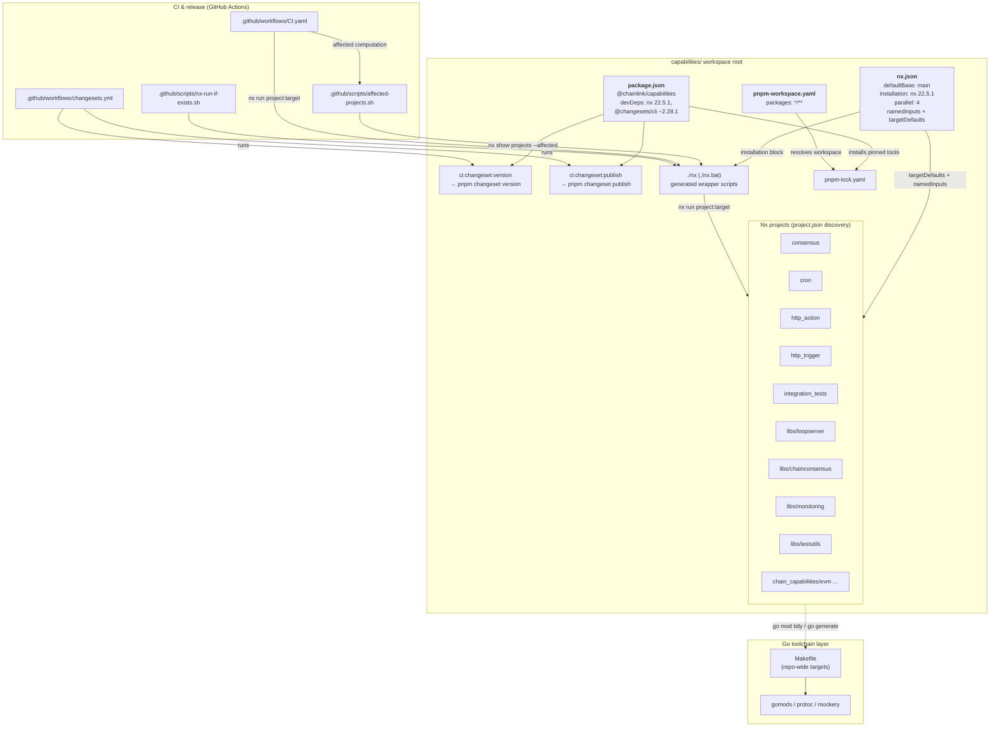
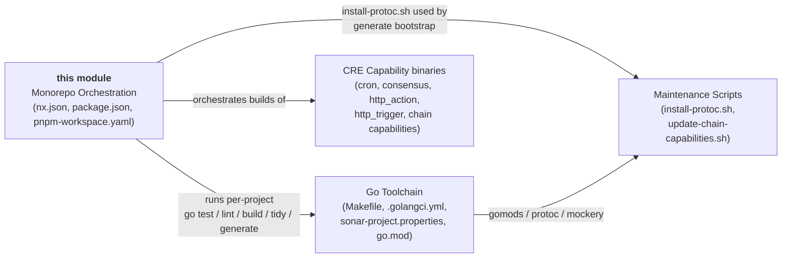
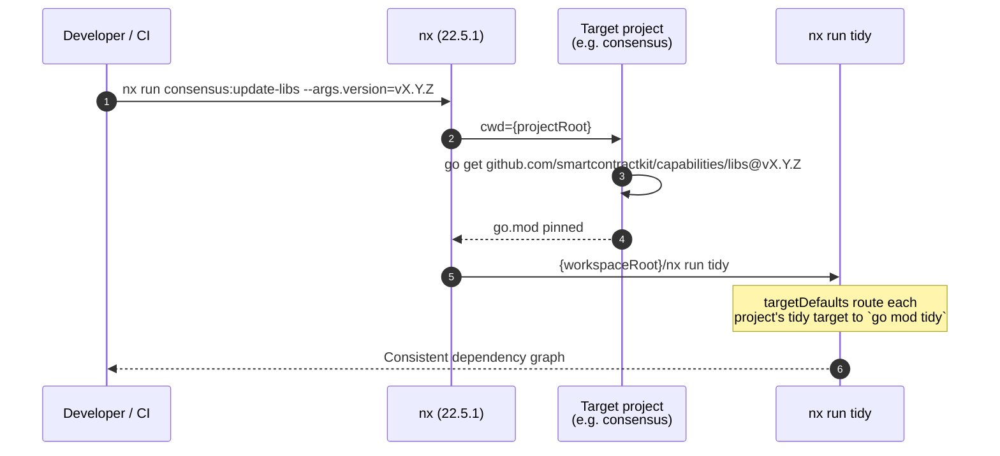
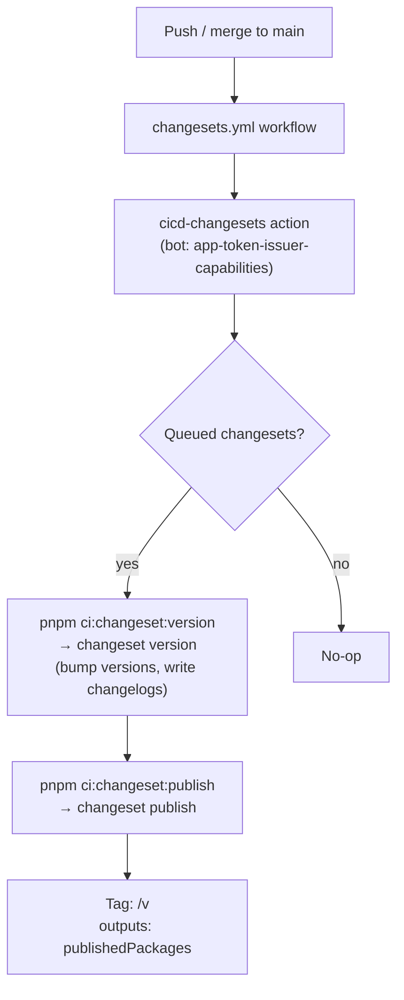
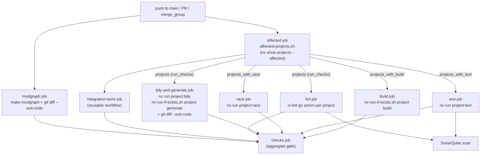

# Capabilities Workspace Tooling — Monorepo Orchestration

> **Parent module:** [Capabilities Workspace Tooling](../capabilities_workspace_tooling.md) — part of [Build, CI & Release Infrastructure](../../Build,_CI___Release_Infrastructure.md)

## 1. Introduction

The `capabilities_workspace_tooling_monorepo_orchestration` module defines the **task-orchestration, dependency-graph and release-automation layer** of the `capabilities/` repository — the home of Chainlink's Chain Reliability Engine (CRE) capabilities (cron, consensus, HTTP trigger/action, chain capabilities for EVM/Aptos/Solana/Stellar, and shared libs). While the [Go Toolchain](capabilities_workspace_tooling_go_toolchain.md) module defines *how a single Go operation is performed* (tidy, generate, lint), this module defines **what to run, where, when, and in what order** — across roughly a dozen independently versioned Go modules and their CI pipelines.

It is built from three declarative artifacts:

| Artifact | Role |
|---|---|
| `capabilities/nx.json` | **Nx workspace configuration** — task graph, caching inputs, parallelism, pinned Nx runtime |
| `capabilities/package.json` | **Workspace root manifest** — pinned dev tooling (Nx, Changesets) and the CI-facing changeset entry-point scripts |
| `capabilities/pnpm-workspace.yaml` | **pnpm workspace definition** — declares every subdirectory as a candidate JS package so pnpm manages the root toolchain |

Together these give the repository:

1. **Per-project task execution** — each module declares a standard target contract (`build`, `test`, `race`, `lint`, `tidy`, `generate`, `update-libs`) in a `project.json` file; Nx fans commands out with bounded parallelism.
2. **Content-addressed caching** — targets only re-run when their declared inputs (Go files, `go.sum`, lint config, Sonar config, CI definition) change.
3. **Affected-based CI** — CI computes the set of projects affected by a diff against `main` (the `defaultBase`) and runs a build/test/race/lint matrix only for those projects.
4. **Changesets release automation** — version bumps and publishing are driven by the `ci:changeset:version` / `ci:changeset:publish` scripts, executed by a dedicated GitHub workflow on pushes to `main`.

### Module at a glance

| Aspect | Detail |
|---|---|
| Repository | `github.com/smartcontractkit/capabilities` |
| Orchestrator | **Nx 22.5.1** — pinned twice: `installation.version` in `nx.json` *and* the `nx` devDependency in `package.json` |
| JS package manager | **pnpm** (`pnpm-workspace.yaml`, `pnpm-lock.yaml`) |
| Release automation | **Changesets** `@changesets/cli ~2.28.1` + `@changesets/changelog-github ^0.5.1` |
| Parallelism cap | `parallel: 4` concurrent tasks |
| Affected base branch | `defaultBase: "main"` |
| Core files | `capabilities/nx.json`, `capabilities/package.json`, `capabilities/pnpm-workspace.yaml` |
| Consumed by | `.github/workflows/CI.yaml`, `.github/workflows/changesets.yml`, helper scripts under `.github/scripts/` |

---

## 2. Architecture

### 2.1 Component inventory

The module's three core files coordinate a larger cast of build artifacts:

| Component | File | Responsibility |
|---|---|---|
| `nx.json` | `capabilities/nx.json` | Workspace-wide Nx settings: base branch, pinned runtime, parallelism, cache inputs, target defaults |
| `package.json` | `capabilities/package.json` | Root npm package `@chainlink/capabilities`; pins `nx` 22.5.1, `@changesets/cli` ~2.28.1; exposes `ci:changeset:*` scripts |
| `ci:changeset:version` | `capabilities/package.json` | Script → `pnpm changeset version` — applies queued version bumps |
| `ci:changeset:publish` | `capabilities/package.json` | Script → `pnpm changeset publish` — publishes changed packages and tags |
| `pnpm-workspace.yaml` | `capabilities/pnpm-workspace.yaml` | Declares `*/**` as workspace package globs |

Their cooperation with the surrounding infrastructure:



**Key relationships:**

- `nx.json`'s **`installation` block** is why the repo root contains generated `nx` / `nx.bat` wrapper scripts — every developer and CI job invokes `./nx …` without a global install, and the wrapper pins the exact version (22.5.1, mirrored by the `nx` devDependency for editor tooling).
- `pnpm-workspace.yaml`'s `*/**` glob makes **every directory in the tree a candidate workspace package**; today only the root carries a `package.json`, and the root-level `pnpm-lock.yaml` locks the (tiny) JS dependency set. The glob future-proofs the layout for nested JS packages without further config.
- The Nx **project graph** is discovered from `project.json` files anywhere in the tree; each project declares targets that shell out to `golangci-lint`, `go test`, `go build`, `go mod tidy` and `go generate` in its own directory (see §4).
- The **Makefile** (Go Toolchain module) remains the canonical entry point for *repo-wide* Go operations, while Nx owns *per-project* orchestration; the two interlock at the `tidy`/`generate` targets (see §7).

### 2.2 Relationship to sibling modules



- **Go Toolchain** ([capabilities_workspace_tooling_go_toolchain.md](capabilities_workspace_tooling_go_toolchain.md)) — supplies the pinned tools (`gomods`, `protoc`, `mockery`) and lint policy that Nx targets invoke per project.
- **Maintenance Scripts** ([capabilities_workspace_tooling_maintenance_scripts.md](capabilities_workspace_tooling_maintenance_scripts.md)) — the `install-protoc.sh` bootstrapped by `make generate` (and transitively by `nx generate` runs) and `update-chain-capabilities.sh`, the Make-level counterpart of the Nx `update-libs` target.

---

## 3. Nx Workspace Configuration (`capabilities/nx.json`)

`nx.json` is the control plane of the workspace. Every setting in it is consumed either by developers running `./nx` locally or by `CI.yaml`'s affected computation.

### 3.1 Global settings

| Key | Value | Effect |
|---|---|---|
| `defaultBase` | `"main"` | Baseline used by `nx affected` when no `--base` is given; CI passes explicit `--base origin/main` but this remains the local-development default. |
| `installation.version` | `"22.5.1"` | Generates the repo-root `nx` / `nx.bat` wrapper scripts that download and run exactly Nx 22.5.1 — enabling version-pinned orchestration without a global install. Matches the `nx` devDependency in `package.json`. |
| `parallel` | `4` | At most 4 tasks run concurrently. Go compilation and tests are memory-hungry; the cap keeps local and CI machines stable. |
| `$schema` | `./node_modules/nx/schemas/nx-schema.json` | IDE schema validation. |

### 3.2 Cache inputs (`namedInputs`)

Nx's computation cache keys each target on the file sets declared in `namedInputs`. Two inputs are defined:

| Named input | Files | Rationale |
|---|---|---|
| `sharedGlobals` | `{workspaceRoot}/.github/**`, `{workspaceRoot}/.nx/**`, `{workspaceRoot}/sonar-project.properties` | Workflow definitions, Nx state and Sonar configuration affect *every* target's outcome, so they are part of the hash of all cached targets. |
| `lint` | `{workspaceRoot}/.golangci.yml` | Isolated so that lint results are invalidated only when the golangci-lint policy changes (the config itself is documented in the [Go Toolchain](capabilities_workspace_tooling_go_toolchain.md) module). |

### 3.3 Target defaults (`targetDefaults`)

Five conventional targets declare their cache inputs; the sixth is a reusable executor definition:

| Target | Inputs | Meaning |
|---|---|---|
| `build` | `sharedGlobals` | Cached on CI definition / Nx state / Sonar config + project sources |
| `lint` | `sharedGlobals`, `lint` | Additionally invalidated by `.golangci.yml` changes |
| `generate` | `sharedGlobals` | Code generation cache |
| `test` | `sharedGlobals` | Unit-test cache |
| `tidy` | `sharedGlobals` | `go mod tidy` cache |
| `update-libs` | *(executor definition — see below)* | Not cached; a mutation target |

Because `targetDefaults` are inherited, each `project.json` may declare targets as tersely as `"update-libs": {}` and still receive the executor defined once here (observable in `capabilities/consensus/project.json`).

### 3.4 The `update-libs` target default

This is the most consequential piece of orchestration logic in `nx.json`:

```json
"update-libs": {
  "executor": "nx:run-commands",
  "options": {
    "cwd": "{projectRoot}",
    "commands": [
      "go get github.com/smartcontractkit/capabilities/libs@{args.version}",
      "{workspaceRoot}/nx run tidy"
    ],
    "parallel": false
  }
}
```

It bump-pins the internal foundation module `github.com/smartcontractkit/capabilities/libs` (declared in each project's `go.mod`, e.g. via a pseudo-version in `capabilities/libs/go.mod`) to a requested `{args.version}`, then re-tidies. The two commands run **sequentially** (`parallel: false`) because the tidy must observe the new pin.



> **Relationship to the Make-level flow:** the [Maintenance Scripts](capabilities_workspace_tooling_maintenance_scripts.md) module documents `make update-chain-capabilities`, which propagates bumps of *any* module into the four `chain_capabilities/*` modules. The Nx `update-libs` target is its per-project, libs-focused complement: Nx updates one project against `capabilities/libs`; the script updates the chain modules against an arbitrary module ref.

---

## 4. Nx Project Model

Nx discovers projects from `project.json` files located anywhere beneath the workspace root (no plugin-based inference is configured). The projects span both levels of the Go module tree:

| Nx project | Location | Notes |
|---|---|---|
| `consensus` | `capabilities/consensus/project.json` | Declares `implicitDependencies: ["loopserver"]` — an explicit graph edge between modules |
| `cron` | `capabilities/cron/project.json` | |
| `http_action` | `capabilities/http_action/project.json` | |
| `http_trigger` | `capabilities/http_trigger/project.json` | |
| `integration_tests` | `capabilities/integration_tests/project.json` | Excluded from the CI `test` matrix (has a dedicated workflow) |
| `loopserver` | `capabilities/libs/loopserver/project.json` | |
| `chainconsensus` | `capabilities/libs/chainconsensus/project.json` | |
| `monitoring` | `capabilities/libs/monitoring/project.json` | |
| `testutils` | `capabilities/libs/testutils/project.json` | |
| `evm` (and chain siblings) | `capabilities/chain_capabilities/evm/project.json` … | One project per chain capability |

Every project adheres to a **standard target contract** (illustrated from `consensus/project.json`; the other projects follow the same pattern):

| Target | Command (executed with `cwd: {projectRoot}`) |
|---|---|
| `lint` | `golangci-lint run ./...` |
| `test` | `go test ./... -coverpkg=./... -coverprofile=coverage.txt` |
| `race` | `go test -race ./...` |
| `tidy` | `go mod tidy` |
| `build` | Cross-compile: `CGO_ENABLED='0' GOOS='linux' GOARCH='amd64|arm64' go build -o ./../bin/<arch>/{projectName} .` |
| `generate` | Remove `// Code generated by` files, then `go generate -x ./...` (non-parallel) |
| `update-libs` | *(inherited from `nx.json` targetDefault)* |

This contract is what makes CI generic: one set of jobs runs `nx run <project>:<target>` for any project, and a helper script tolerates projects that omit optional targets.

---

## 5. pnpm Workspace (`capabilities/pnpm-workspace.yaml`)

```yaml
packages:
  - "*/**"
```

- The `*/**` glob nominates **every subdirectory, at any depth**, as a candidate pnpm workspace package. Directories without a `package.json` are simply ignored, so the Go-only module tree coexists harmlessly with the JS toolchain.
- In practice the workspace resolves the root package `@chainlink/capabilities`, and pnpm generates the root `pnpm-lock.yaml` that locks the orchestrator's own devDependencies (`nx` 22.5.1, `@changesets/cli` ~2.28.1, `@changesets/changelog-github` ^0.5.1).
- CI leverages this: `CI.yaml` caches `~/.npm` alongside the `.nx` directory so the pnpm/Nx toolchain installs are reused across jobs, and the `setup-nodejs` composite action provisions Node for the pre-installed runner.
- Because the root package is `"private": true`, pnpm can manage tooling without ever publishing the workspace root itself; publishing is handled per-package through Changesets (§6).

---

## 6. Versioning & Release Automation (`capabilities/package.json`)

The root manifest (`@chainlink/capabilities`, version `0.1.0`, private) carries the two CI-facing changeset scripts:

| Script | Expansion | Purpose |
|---|---|---|
| `ci:changeset:version` | `pnpm changeset version` | Consumes queued changesets and rewrites package versions / changelogs |
| `ci:changeset:publish` | `pnpm changeset publish` | Publishes changed packages and creates release tags |

These are consumed by `capabilities/.github/workflows/changesets.yml`:

- **Trigger:** push to `main` only; minimal permissions (`id-token: write`, `contents: read`).
- **Executor:** the shared `smartcontractkit/.github/actions/cicd-changesets@cicd-changesets/1.1.2` action, authenticated as `app-token-issuer-capabilities[bot]` via an AWS-GATI-issued token (`aws-role-arn: AWS_ROLE_ARN_GATI_CHANGESETS`, `aws-lambda-url: AWS_LAMBDA_URL_GATI`).
- **Tag scheme:** `changesets-tag-separator: "/v"` produces tags of the form `<pkg>/v<version>` — the slash form distinguishes package tags from commit tags.
- **Outputs:** the job exports `changesets_published` and `changesets_publishedPackages`, allowing downstream workflows to react to releases.



The same changesets convention is used by sibling repositories' roots (`chainlink/package.json`, `cre-cli/package.json` both expose `ci:changeset:version`/`publish`), keeping release mechanics uniform across the [Build, CI & Release Infrastructure](../../Build,_CI___Release_Infrastructure.md) landscape.

---

## 7. CI Integration

`capabilities/.github/workflows/CI.yaml` is the largest consumer of this module's configuration. Its design leans entirely on Nx primitives:

### 7.1 Affected computation

The first job (`affected`) runs `.github/scripts/affected-projects.sh` with base `origin/main` (or `origin/main~1` for pushes to `main`) and emits a compact JSON payload used to fan out matrices. The script builds on `nx.json`'s graph:

1. `./nx show projects --affected --json --base=$BASE --head=HEAD` — the *affected set*, computed against `defaultBase: main` (explicitly overridden via `--base`).
2. For each of `test`, `race`, `build`: `./nx show projects --affected -t <target>` — the subset of affected projects that actually define that target (the standard target contract from §4). `integration_tests` is filtered out of the test list (it runs via its own `integration-tests.yml` reusable workflow).
3. Per-project details: `./nx show project <name> --json` yields each project's `root` and locates its `go.sum` (looking one level deeper when nested, e.g. for projects rooted at `libs/*`).
4. A final `run_checks` flag short-circuits lint/tidy/generate jobs when nothing is affected.

### 7.2 Job fan-out



Notable mechanics that trace back to `nx.json`:

- **Caching:** the workflow caches `.nx` (Nx daemon state & cache) and `~/.npm` (pnpm/Nx toolchain) keyed on the runner OS — direct beneficiaries of the `namedInputs`-driven cache (§3.2).
- **Target tolerance:** `.github/scripts/nx-run-if-exists.sh` inspects `./nx show project <name> --json` and runs `./nx run <project>:<target>` only when the target exists — the reason optional targets (e.g. `generate`) can be omitted from some `project.json` files without breaking CI.
- **No-diff gates:** `tidy-and-generate` and `modgraph` fail if `go mod tidy` / `go generate` (via the [Go Toolchain](capabilities_workspace_tooling_go_toolchain.md) Makefile) produce uncommitted changes, keeping generated artifacts and module pins honest.

### 7.3 Division of labor: Nx vs Make

| Concern | Owner | Entry point |
|---|---|---|
| Per-project build/test/race/lint with caching | Nx | `nx run <project>:<target>` |
| Repo-wide multi-module tidy & generate | Make + gomods | `make tidy`, `make generate` |
| Dependency-bump propagation (chain modules) | Maintenance script | `make update-chain-capabilities` |
| Dependency-bump of `capabilities/libs` per project | Nx | `nx run <project>:update-libs --args.version=…` |
| Release versioning/publishing | Changesets | `pnpm ci:changeset:*` via `changesets.yml` |
| Dependency-graph documentation | Make + modgraph | `make modgraph` (regenerates `go.md`) |

---

## 8. Operational Reference

Common commands for day-to-day work in the `capabilities/` workspace:

| Command | Effect |
|---|---|
| `./nx show projects` | List all projects discovered from `project.json` files |
| `./nx affected --base=main` | Run default pipeline only for projects affected vs `main` (`defaultBase` from `nx.json`) |
| `./nx run consensus:build` | Cross-compile the consensus capability for linux amd64/arm64 |
| `./nx run-many -t test -p cron http_trigger` | Run tests for selected projects (≤4 concurrent per `parallel`) |
| `./nx run <project>:tidy` | `go mod tidy` scoped to one module, cached on `sharedGlobals` |
| `./nx run <project>:update-libs --args.version=<ref>` | Pin `capabilities/libs` at `<ref>` in that project and re-tidy |
| `pnpm ci:changeset:version` / `pnpm ci:changeset:publish` | Local equivalents of the release workflow's steps |
| `make tidy` / `make generate` | Repo-wide counterparts (see [Go Toolchain](capabilities_workspace_tooling_go_toolchain.md)) |

---

## 9. Related Documentation

- **Parent:** [Capabilities Workspace Tooling](../capabilities_workspace_tooling.md) — overview of the `capabilities/` toolchain split (Go toolchain, orchestration, maintenance scripts).
- **Sibling — [Go Toolchain](capabilities_workspace_tooling_go_toolchain.md):** Makefile targets, `.golangci.yml` policy (including the chain-agnostic dependency rule), `sonar-project.properties`, and the pinned `gomods`/`protoc`/`mockery` versions that Nx targets invoke.
- **Sibling — [Maintenance Scripts](capabilities_workspace_tooling_maintenance_scripts.md):** `install-protoc.sh` (used by `make generate`, which backs the Nx `generate` target) and `update-chain-capabilities.sh` (script-level counterpart of the Nx `update-libs` target).
- **Grandparent:** [Build, CI & Release Infrastructure](../../Build,_CI___Release_Infrastructure.md) — repository-wide CI, hooks, and the changesets convention shared with `chainlink/` and `cre-cli/`.
- **Orchestrated products:** the capability binaries and libraries documented in [Workflow & Capability Runtime (CRE Engine)](../../Workflow___Capability_Runtime_(CRE_Engine)/capabilities.md), e.g. the [Cron](../../Workflow___Capability_Runtime_(CRE_Engine)/cron_capability.md), [HTTP Action](../../Workflow___Capability_Runtime_(CRE_Engine)/http_action_capability.md) and [Chain Capability EVM](../../Workflow___Capability_Runtime_(CRE_Engine)/chain_capability_evm.md) modules, each built and tested by the Nx projects listed in §4.
