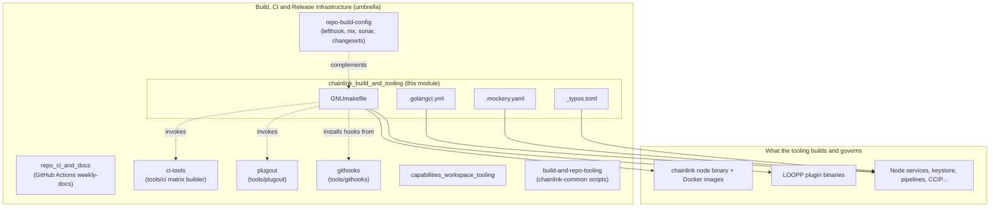
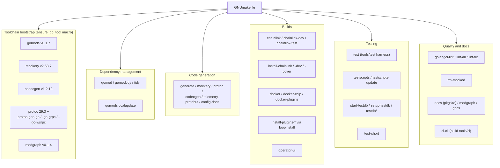
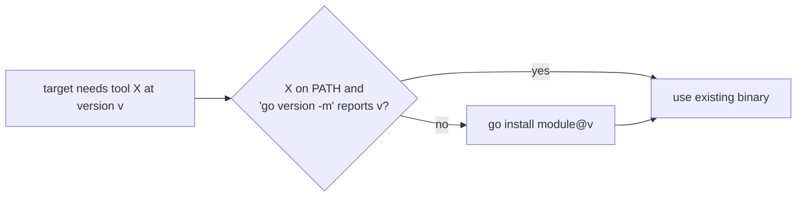
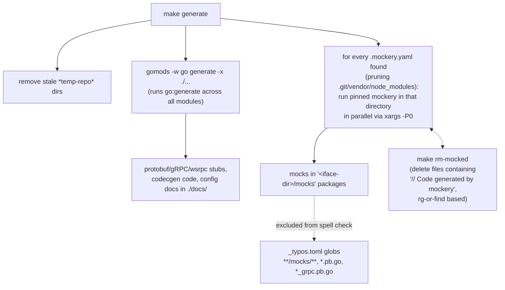
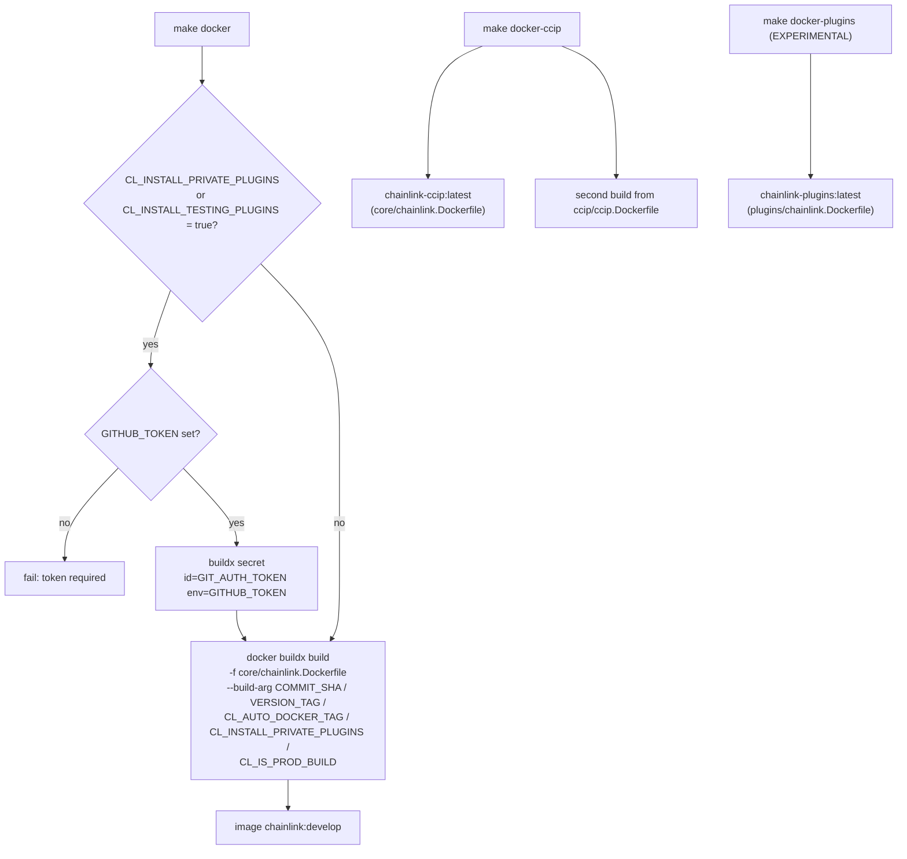
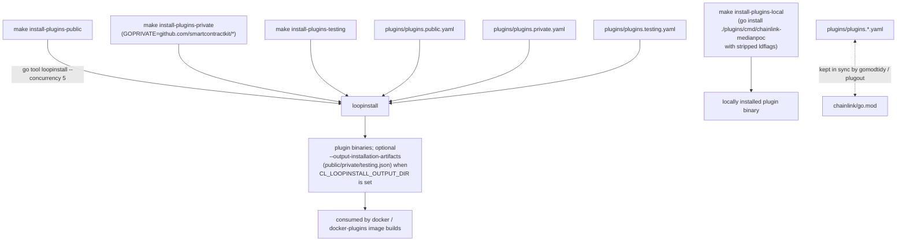
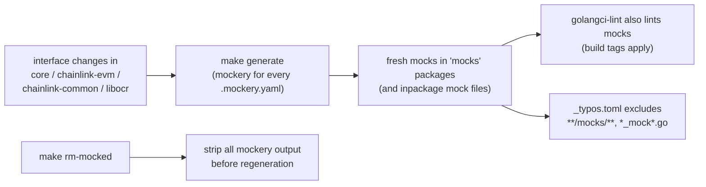
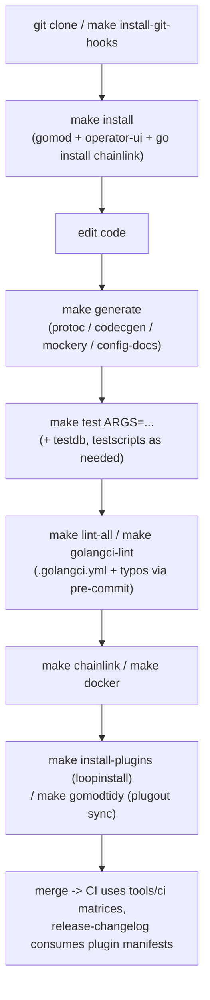

# Build & Tooling for the `chainlink` Core Repository (`chainlink_build_and_tooling`)

> Parent module: [Build, CI & Release Infrastructure](../Build,_CI___Release_Infrastructure.md)

## 1. Purpose and Scope

This module documents the **build orchestration and developer-tooling configuration for the `chainlink` core repository** (`chainlink/go.mod` → module `github.com/smartcontractkit/chainlink/v2`, Go 1.27). It is the tooling layer that turns the source tree into:

- the `chainlink` node binary (production, `dev`-tagged, and coverage builds),
- the production Docker images (`chainlink`, `chainlink-ccip`, `chainlink-plugins`),
- the remote **LOOPP** plugin binaries installed via `loopinstall` (see [Plugin Process Framework (Loop)](<../Plugin_Process_Framework_(Loop).md>)),
- generated artifacts (mocks, protobuf/gRPC/wsrpc code, codecgen code, configuration docs), and
- the quality gates that every change must pass (static analysis, mock freshness, spell checking).

It is intentionally *configuration-only*: there is no runtime Go code here. The module answers three questions for maintainers:

1. **How is everything built?** — `chainlink/GNUmakefile`
2. **What must the code satisfy before it is merged?** — `chainlink/.golangci.yml`, `chainlink/_typos.toml`
3. **How are test doubles kept consistent with interfaces?** — `chainlink/.mockery.yaml`

### Files in this module

| File | Size | Role |
|---|---|---|
| `chainlink/GNUmakefile` | 14.6 KB | Master build orchestration: toolchain bootstrap, dependency management, code generation, binary/Docker/plugin builds, test harnesses, lint drivers |
| `chainlink/.golangci.yml` | 10.0 KB | golangci-lint **v2** configuration: ~40 enabled linters, dependency governance (`gomodguard_v2`, `depguard`), logger-aware format checking, import ordering |
| `chainlink/.mockery.yaml` | 7.7 KB | mockery **v2** manifest declaring which interfaces across the node, `chainlink-evm`, `chainlink-common`, `chainlink-protos` and `libocr` get generated mocks |
| `chainlink/_typos.toml` | 4.1 KB | [crate-ci/typos](https://github.com/crate-ci/typos) configuration: exclusion globs for generated/vendor/binary content and a Chainlink domain dictionary |

---

## 2. Position in the System

The `chainlink` repository is one of several Go modules in the monorepo family, each with its own build entry point. This module is the tooling for the **core node** repository; the sibling pages of [Build, CI & Release Infrastructure](../Build,_CI___Release_Infrastructure.md) cover the rest:



**Relationships to sibling modules:**

| Sibling page | Relationship to this module |
|---|---|
| [repo_ci_and_docs](repo_ci_and_docs.md) | CI workflows (e.g. `.github/workflows/weekly-docs.yml`) invoke targets of `chainlink/GNUmakefile` |
| [repo-build-config](repo-build-config.md) | Owns the *other* chainlink-repo configs this Makefile does not drive: `lefthook.yml` (git hooks triggered via `install-git-hooks`), `nix.conf` + `nix-darwin-shell-hook.sh` (dev shells), `sonar-project.properties`, `package.json` (the source of the build `VERSION`, see §3.1) |
| [ci-tools](ci-tools.md) | `make ci-cli` compiles `tools/ci` — the CLI whose matrix builder (e.g. `RawInMemoryEntry` from `.github/in-memory-tests.json`) expands GitHub Actions test matrices |
| [plugout](plugout.md) | `make gomodtidy` runs `go run ./tools/plugout --update`, keeping the LOOPP plugin manifests in sync with `go.mod` |
| [githooks](githooks.md) | `make install-git-hooks` sets `git config core.hooksPath .githooks`, activating the Go-based hook tooling |
| [capabilities_workspace_tooling](capabilities_workspace_tooling.md) | The equivalent build/lint/mock/typos tooling for the `capabilities` workspace (own Makefile, `.golangci.yml`, nx/pnpm config) |
| [build-and-repo-tooling](build-and-repo-tooling.md) | The equivalent for `chainlink-common` (own Makefile + `script/*.sh` helpers) |
| [release-changelog](release-changelog.md) | Consumes the `plugins/plugins.*.yaml` manifests that this module's plugin targets install and `tidy` commits |

Downstream, the artifacts governed here are consumed by many product modules — e.g. mocks are generated for interfaces documented in [Node Platform Services](../Node_Platform_Services.md) (keystore, jobs, gateway, pipelines), [Workflow & Capability Runtime (CRE Engine)](<../Workflow___Capability_Runtime_(CRE_Engine).md>) and the [Relayer](../Shared_Foundation_Libraries___Domain_Types/types-core.md) types — while the `docker-compose` files for local development are documented in [Dev, Test & Simulation Environments](../Dev,_Test___Simulation_Environments.md).

---

## 3. Build Orchestration — `chainlink/GNUmakefile`

The GNUmakefile is the single entry point for every build, test and generation task in the core repo. The default goal is `chainlink` (build the binary). Targets fall into the following functional groups:



### 3.1 Build metadata and versioning

All versioning is derived at make-time — nothing is hard-coded:

| Variable | Source | Purpose |
|---|---|---|
| `VERSION` | `jq -r '.version' chainlink/package.json` (currently `2.68.0`) | Node version embedded into builds |
| `COMMIT_SHA` | `git rev-parse HEAD` | Passed as a Docker build-arg and to `testscripts` |
| `VERSION_TAG` | `git describe --always` | Docker build-arg |
| `GO_LDFLAGS` | output of `tools/bin/ldflags` | Injected into every `go build`/`go install` via `GOFLAGS` |
| `GCFLAGS` | caller-supplied `GO_GCFLAGS` | Optional compiler debugging flags |
| `PROTOBUF_VERSION`, `WSRPC_VERSION` | parsed out of `chainlink/go.mod` with `awk` | Pin `protoc-gen-go` / `protoc-gen-go-wsrpc` to the exact versions the code was built against |
| `GOLANGCI_LINT_VERSION` | `v2.14.0` (literal) | Pinned lint runner |
| `MOCKERY_VERSION` | `2.53.7` (literal) | Pinned mock generator; `MOCKERY_BIN` is resolved from `GOBIN`/`GOPATH` so `make generate` never picks up a different (e.g. v3) mockery from `PATH` |

Docker builds forward this metadata as build-args (`COMMIT_SHA`, `VERSION_TAG`, `CL_AUTO_DOCKER_TAG`, `CL_IS_PROD_BUILD`, `CL_INSTALL_PRIVATE_PLUGINS`).

### 3.2 Toolchain bootstrap — the `ensure_go_tool` macro

A reusable macro guarantees that every pinned CLI tool is installed at the *exact* required version before use:



This is used for `gomods`, `mockery`, `codecgen`, `protoc-gen-go`, `protoc-gen-go-grpc`, `protoc-gen-go-wsrpc` and `modgraph`, making `make` targets self-provisioning and reproducible on developer machines and CI runners alike.

### 3.3 Dependency and module management

- **`gomod`** — installs `gencodec` if missing, then `go mod download`.
- **`gomodtidy`** — runs `gomods tidy` across **all** Go modules (the repo is a multi-module tree: `chainlink`, `chainlink-common`, `capabilities/*`, `tools/*`, ...) and then `go run ./tools/plugout --update` to re-sync LOOPP plugin manifests (`plugins/plugins.*.yaml`) with the versions resolved by `go.mod` (see [plugout](plugout.md)). `tidy` additionally `git add`s the touched `go.*` files and `plugins/plugins.public.yaml`.
- **`gomodslocalupdate`** — installs and runs the in-repo `tools/gomod-local-update` helper via `gomods`, then tidies.

### 3.4 Code generation pipeline

`make generate` is the umbrella target (`codecgen mockery protoc gomods config-docs`) and performs, in order:



Individual targets can also be run alone:

- **`protoc`** — installs protoc `29.3` via `core/scripts/install-protoc.sh`, then the three pinned Go plugins. **`telemetry-protobuf`** regenerates the wsrpc bindings under `core/services/synchronization/telem/*.proto`.
- **`config-docs`** — runs `core/config/docs/cmd/generate` to emit node configuration documentation into `./docs/`.
- **`mockery`** — installs/verifies the pinned mockery binary only.

### 3.5 Binary builds

| Target | Effect |
|---|---|
| `chainlink` (default goal) | `go build` with injected ldflags |
| `chainlink-dev` | same, with `-tags dev` (matches the `dev` build-tag in `.golangci.yml` linting) |
| `chainlink-test` | test-variant build used by `testscripts` |
| `install-chainlink` / `-dev` / `-cover` | `go install` variants; all depend on the **`operator-ui`** target, which runs `go run operator_ui/install.go .` to fetch/build the frontend assets |
| `install` | meta-target: `install-chainlink-autoinstall` = `gomod` + `install-chainlink` |
| `install-git-hooks` | `git config core.hooksPath .githooks` — wires up the hooks from [githooks](githooks.md) and `chainlink/lefthook.yml` (see [repo-build-config](repo-build-config.md)) |

### 3.6 Docker image builds



The `GIT_AUTH_TOKEN` buildkit secret is what allows the image build to `go get` **private** LOOPP plugin modules during `CL_INSTALL_PRIVATE_PLUGINS=true` builds (the install step inside the image uses the `install-plugins-*` machinery described next).

### 3.7 LOOPP plugin installation

The Makefile drives `loopinstall` — the plugin installer from `chainlink-common/pkg/loop` (documented in [Plugin Process Framework (Loop)](<../Plugin_Process_Framework_(Loop).md>)):



`make install-plugins` = `install-plugins-local` + `install-plugins-public`. The three manifest flavours (public / private / testing) are gated by `CL_INSTALL_PRIVATE_PLUGINS` / `CL_INSTALL_TESTING_PLUGINS` and GitHub authentication, matching the Docker gating above.

### 3.8 Testing targets

- **`test`** — builds the `tools/test` harness (`tools/test/.bin/test`) and runs it with `ARGS` (e.g. `make test ARGS="./core/..."`).
- **`test-short`** — plain `go test -short ./...` with uninteresting output filtered.
- **`testscripts` / `testscripts-update`** — behavioural tests in [txtar](https://pkg.go.dev/github.com/rogpeppe/go-internal/testscript) format: `tools/txtar/cmd/lstxtardirs` enumerates `testdata/scripts/*`, and `testscript` executes each `.txtar` with `COMMIT_SHA`, `VERSION`, `VERSION_TAG` and a temp `HOME` exported; `-u` updates golden files.
- **`start-testdb` / `setup-testdb` / `testdb` / `testdb-force` / `testdb-user-only`** — provision the PostgreSQL test database (Docker container, `core/scripts/setup_testdb.sh`, or the `core/store/cmd/preparetest` migrator with `--force` / `--user-only` variants) used by the persistence layers documented in [Node Platform Services → database persistence](../Node_Platform_Services/database_persistence.md).

### 3.9 Linting and quality drivers

- **`golangci-lint`** — runs the pinned `golangci/golangci-lint:v2.14.0` **Docker image** against the repo with zero issue caps, teeing a timestamped report. Config: [`chainlink/.golangci.yml`](#4-static-analysis--chainlinkgolangciyml).
- **`lint-all`** — via `gomods -u -go run`, runs golangci-lint across **every** Go module at once, emitting text to stdout and a checkstyle XML report.
- **`lint-fix`** — same multi-module sweep with `--fix`.
- **`rm-mocked`** — deletes all files containing the `// Code generated by mockery` marker (uses `rg` when available, falling back to NUL-delimited `find`/`grep`), complementing regeneration.
- **`gocs`** — generates changeset markdown files via `smartcontractkit/gocs`.
- **`dependabot`** — deprecated stub (CI workflow triggered manually instead).

### 3.10 Documentation and auxiliary targets

- **`docs`** — installs and serves `pkgsite` (`http://localhost:8080/pkg/github.com/smartcontractkit/chainlink/v2/`).
- **`modgraph`** — renders the module dependency graph into `go.md`.
- **`ci-cli`** — builds `tools/ci/.bin/ci` from `tools/ci` sources with a proper dependency rule on `tools/ci/go.mod`/`go.sum`; this binary provides GitHub-Actions matrix expansion (see [ci-tools](ci-tools.md)).
- **`help`** — prints the ASCII Chainlink logo and a self-documenting target listing extracted from `##` comments.

---

## 4. Static Analysis — `chainlink/.golangci.yml`

This is the **golangci-lint v2** configuration enforced by the `golangci-lint`/`lint-all`/`lint-fix` targets. Key characteristics:

### 4.1 Run configuration

```yaml
run:
  timeout: 5m
  allow-parallel-runners: true
  modules-download-mode: readonly
  build-tags: [integration, dev, trace]
```

Linting runs with the same build tags used by real builds — notably `dev` (the tag used by `make chainlink-dev`), `integration` and `trace` — so code behind those tags is analyzed, not skipped.

### 4.2 Linter portfolio

The `standard` default set is extended with ~35 additional linters, which group as:

| Group | Linters | What they catch |
|---|---|---|
| Correctness & resources | `bodyclose`, `rowserrcheck`, `sqlclosecheck`, `errorlint`, `nilerr`, `noctx`, `reassign`, `copyloopvar`, `exptostd` | Unclosed HTTP bodies / DB rows / SQL statements, wrapped-error misuse, swallowed errors, missing contexts, loop-variable capture |
| Exhaustiveness & performance | `exhaustive`, `perfsprint`, `prealloc`, `intrange` | Missing switch cases on enums, slow `fmt` in hot paths, pre-allocatable slices, modern range syntax |
| Context, tracing & concurrency | `containedctx`, `fatcontext`, `spancheck` | Context stored in structs, contexts created in loops, unclosed OpenTelemetry spans |
| Security | `gosec` (with `G101`, `G104` excluded) | Security issues, except hardcoded-credential noise and unhandled-error noise |
| Style & hygiene | `revive` (curated ~40-rule set, confidence 0.8), `gocritic`, `asciicheck`, `errname`, `misspell`, `nakedret`, `unconvert`, `usestdlibvars`, `whitespace`, `modernize` (embedlit disabled) | Naming, exported-symbol docs, redundant conversions, modern Go idiom |
| Test quality | `ginkgolinter`, `testifylint`, `paralleltest`, `usetesting`, `gocheckcompilerdirectives` | Ginkgo/testify misuse, non-parallel tests, misuse of `testing` helpers |
| Meta | `nolintlint` (`require-explanation`, `require-specific`) | Every `//nolint` must name the linter and justify itself |
| Dependency governance | `depguard`, `gomodguard_v2` | See §4.3 |

`issues` sets `max-same-issues: 0` and `max-issues-per-linter: 0` — every finding is reported, nothing suppressed by quota.

### 4.3 Dependency governance

This is the module's most strategically interesting configuration — it enforces the LOOPP architecture at lint time.

**`gomodguard_v2` — blocked modules** (imports fail the build with a recommendation):

| Blocked module | Reason / recommendation |
|---|---|
| `chainlink-aptos`, `chainlink-cosmos`, `chainlink-solana`, `chainlink-stellar`, `chainlink-ton` | *"only runs as a LOOPP"* — chain integrations must run as out-of-process plugins, not be linked into the node |
| `chainlink-starknet/relayer`, `chainlink-sui/relayer`, `chainlink-tron/relayer` | same LOOPP-only rule |
| `chainlink-integrations/evm` | use `chainlink-evm` instead |

**`depguard` — deny lists** (two rule scopes):

- `main` (all files): forbids superseded libraries — e.g. `cosmossdk.io/errors` (use stdlib), `go.uber.org/multierr` (use `errors.Join`), `gofrs/uuid` / `satori/go.uuid` (use `google/uuid`), `pgx3`/`pgx5` (use `pgx4`), `test-go/testify/*` (use `stretchr/testify`), `go-gorm/gorm` (use `sqlx`), `consul/sdk/freeport` (use `smartcontractkit/freeport`), and old `guregu/null` major versions.
- `keystore` (scoped to `core/services/keystore/**`): denies both the core and common logger packages, keeping the security-critical keystore free of logging dependencies.

### 4.4 Logger-aware checking

The node's structured loggers are taught to the linters, so format-string and key/value mistakes are compile-time-grade errors:

- **`govet` `printf`** registers `Tracef`…`Fatalf` plus `AssumptionViolationf` on both `chainlink/v2/core/logger.Logger`/`SugaredLogger` and the shared `chainlink-common/pkg/logger` types (see [logger](../Shared_Foundation_Libraries___Domain_Types/logger.md)).
- **`loggercheck`** does the same for the structured `*w` methods (`Debugw`, `Infow`, `Errorw`, …, `With`), validating key-value pair counts.

### 4.5 Exclusions and formatters

- Exclusions are `warn-unused: true` (stale exclusions are flagged), `generated: lax`, plus four presets (`comments`, `common-false-positives`, `legacy`, `std-error-handling`).
- Two narrowly-scoped custom exclusion rules carry explanatory comments: `bodyclose` is suppressed only in specific test files whose response bodies are closed by helper closures (`cltest` cleaners, `postSkip`, `sendRequest`), and `gosec` `G404` is allowed under `test` paths.
- **Formatters**: `gofmt` (with `simplify`) and `gci` with a custom import order — `standard` → `default` → `prefix(github.com/smartcontractkit/)` → `prefix(github.com/smartcontractkit/chainlink)` — keeping first-party imports visually grouped last.

---

## 5. Mock Generation — `chainlink/.mockery.yaml`

This is the mockery **v2** manifest consumed by the `generate` and `mockery` make targets. It defines repository-wide conventions plus a per-package scope.

### 5.1 Conventions

| Setting | Value | Meaning |
|---|---|---|
| `dir` | `{{ .InterfaceDir }}/mocks` (overridable per package) | Mocks live next to the interface, in a `mocks` package |
| `mockname` | `{{ .InterfaceName }}` | Mock is named after the interface |
| `outpkg` / `filename` | `mocks` / `<snakecase interface>.go` | One file per interface |
| `fail-on-missing` | `true` | Generation fails if a declared interface vanishes — the manifest cannot silently rot |

### 5.2 Scope

The manifest covers interfaces across four source modules:

- **`chainlink/v2/core/...`** — the bulk: `bridges`, `capabilities` (incl. vault `SecretsService`, CCIP `CCIPOracle`/`OracleCreator`, remote `Dispatcher`/`Receiver`), `cmd` (`Prompter`), `config` (`TelemetryIngress*`), `feeds`, `gateway` (connector, handlers, network servers/clients), `job`, `keystore` (all per-chain keyrings: `Eth`, `OCR`, `OCR2`, `P2P`, `Aptos`, `Solana`, `StarkNet`, `Tron`, `TON`, `Sui`, `Stellar`, `VRF`, `Workflow`, `CSA`), `ocr`, `p2p/types`, `pipeline`, `headreporter`, `services` (`Checker`, `Application`, `GeneralConfig`), `registrysyncer` (v1+v2), `workflows/syncer/v2` and `workflows/metering`, plus `sessions`/`ldapauth`.
- **`chainlink-evm`** — `log` (`Broadcaster`), `logpoller`, `txmgr` (with explicit `ConfirmerI → Confirmer`-style renames), `chains/legacyevm`, `config` (`LogPollerWrapper`); outputs are redirected into shared `common/...` mock directories.
- **`chainlink-common`** — `pkg/capabilities` capability interfaces (`BaseCapability`, `TriggerCapability`, `ExecutableCapability`, …) into `core/capabilities/mocks`, and `pkg/types.Relayer` into `core/web/mocks`.
- **`chainlink-protos` / `libocr`** — `orchestrator/feedsmanager.FeedsManagerClient` and `libocr/commontypes.MonitoringEndpoint`.

Special in-package mocks (`inpackage: true`) are generated for `core/logger`, `headreporter` and `core/services/telemetry`, where the mocks must live beside the code under test.

### 5.3 Lifecycle and interaction with other tooling



Because `fail-on-missing` is set and CI runs the linters, an interface deleted without updating this manifest fails the build rather than producing a stale mock. Generated mocks back the unit tests of the services documented in [Node Platform Services](../Node_Platform_Services.md) and [Workflow & Capability Runtime (CRE Engine)](<../Workflow___Capability_Runtime_(CRE_Engine).md>).

---

## 6. Spell Checking — `chainlink/_typos.toml`

The `typos` configuration keeps the large monorepo free of misspellings without drowning in false positives.

### 6.1 What is excluded (`[files] extend-exclude`)

Deliberate exclusions target content where "misspellings" are actually data:

- **Generated code**: `*.pb.go`, `*_grpc.pb.go`, `*_generated.go`, `*.gen.go`, `gen/`, `bindings/`, `gethwrappers/`
- **Mocks**: `**/mocks/**`, `*_mock*.go` (the output of §5)
- **Database migrations** (checksummed/historical), **vendor & node_modules**
- **Web/UI build outputs**: `operator_ui/dist|build`, `*.min.js`, sourcemaps
- **Fixtures, logs and dumps**: `testdata/`, `*.log`, `*.csv`, coverage files
- **Binaries and archives**: images, wasm, `.so`/`.a`, all compression formats
- **Lock files and secrets material**: `go.sum`, `package-lock.json`, `*.keystore`, `*.p12`, PEM bundles (also handled by regex below)

### 6.2 Regex-based ignores (`[default] extend-ignore-re`)

- PEM certificate/private-key blocks,
- hex literals (`0x…`, ≥8-char hashes, function selectors) and any ≥20-char base64-ish token (addresses, keys, signatures),
- inline `typos:ignore` directives (`//`, `#`, `--`, `<!--`) and block `typos:disable/enable` spans.

### 6.3 Domain dictionary (`[default.extend-words]`)

The Chainlink vocabulary that a generic English spell-checker would flag as wrong is pinned explicitly: **LOOPP, CCIP, OCR/OCR2/OCR3, DON/DONs, VRF, CRE, BHS, CSA, MCMS, LLO, TXMGR, CLL, EVM, WSRPC, NOOP(s)** — plus accepted variants (`brin`/`BRIN` PostgreSQL index type, `writeable`, `transferrable`, `supercedes`) and a few internal short names (`ned`, `strat`, `eis`, `ot`, `ba`).

---

## 7. End-to-End Developer Workflow

The following diagram shows how a typical change flows through this module's tooling:



The same targets are what CI executes, which is why every target is pinned (tool versions, lint version, protoc version) and self-provisioning via `ensure_go_tool`.

---

## 8. Related Documentation

- [Build, CI & Release Infrastructure](../Build,_CI___Release_Infrastructure.md) — umbrella page and sibling tooling modules
- [repo_ci_and_docs](repo_ci_and_docs.md) · [repo-build-config](repo-build-config.md) · [ci-tools](ci-tools.md) · [plugout](plugout.md) · [githooks](githooks.md) · [capabilities_workspace_tooling](capabilities_workspace_tooling.md) · [build-and-repo-tooling](build-and-repo-tooling.md) · [release-changelog](release-changelog.md) · [repo-maintenance-scripts](repo-maintenance-scripts.md)
- [Plugin Process Framework (Loop)](<../Plugin_Process_Framework_(Loop).md>) — the `loop` package that provides `loopinstall` and the LOOPP plugin model that `.golangci.yml` dependency rules enforce
- [Node Platform Services](../Node_Platform_Services.md) — node services whose interfaces are mocked by `.mockery.yaml` and whose persistence is provisioned by the `testdb` targets
- [Dev, Test & Simulation Environments](../Dev,_Test___Simulation_Environments.md) — the docker-compose-based environments that consume the images built here
- [Shared Foundation Libraries & Domain Types](../Shared_Foundation_Libraries___Domain_Types.md) — logger and config libraries referenced by the lint configuration
