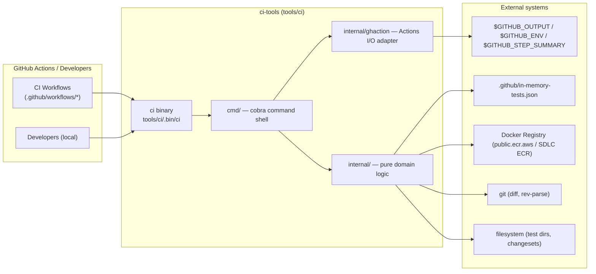
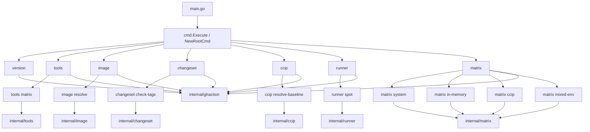
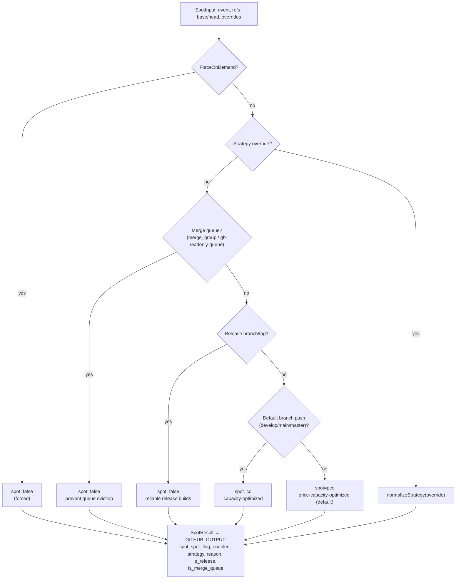
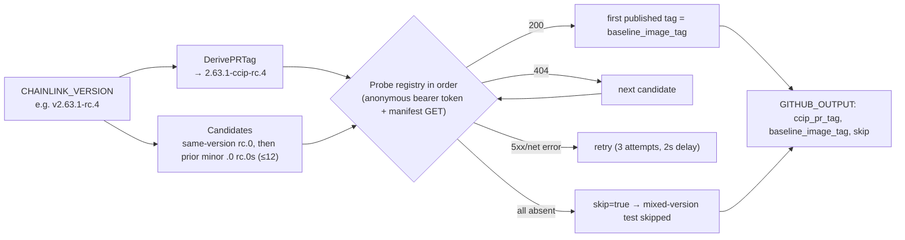

# ci-tools — Unified CI CLI Tool (`chainlink/tools/ci`)

## Overview

`ci-tools` is a standalone Go module (`github.com/smartcontractkit/chainlink/v2/tools/ci`, declared in [`chainlink/tools/ci/go.mod`](https://github.com/smartcontractkit/chainlink) — see the module manifest in the repository) that builds the **`ci`** command-line tool. Per its [`README.md`](../repo) (see `chainlink/tools/ci/README.md` in the repo), the tool exists to **replace brittle inline bash scripts and complex `jq`/`sed`/`awk` pipelines across GitHub Actions CI workflows with typed, tested, and locally reproducible Go subcommands**.

Every command follows the same contract:

- **Flag → input → env fallback chain** — each option can be supplied as a CLI flag, a GitHub Actions workflow input, or an environment variable, so the same command works locally and in CI.
- **Dual output** — results are written to `$GITHUB_OUTPUT` when running inside Actions (consumed by later workflow steps), and as human-readable text or pretty `--json` on stdout otherwise.
- **Pure domain logic** — all decisions are computed in `internal/` packages that take explicit structs and return `(T, error)`, keeping the `cmd/` layer a thin shell (see `chainlink/tools/ci/AGENTS.md`).

### Module identity

| Aspect | Value |
|---|---|
| Go module | `github.com/smartcontractkit/chainlink/v2/tools/ci` |
| Go version | 1.26.6 |
| Key dependencies | `sethvargo/go-githubactions` (Actions I/O), `spf13/cobra` (CLI), `stretchr/testify` (tests), `gopkg.in/yaml.v3` (changeset frontmatter) |
| Build target | `make ci-cli` → `tools/ci/.bin/ci` (see `CI_CLI_BIN` in `chainlink/GNUmakefile`) |
| Tests | `go -C tools/ci test ./...` |

Because `tools/ci` is its own Go module, it also participates in the repository's *submodule discovery* domain: the `ci tools matrix` command scans `tools/` for nested `go.mod` files to decide which tool modules (e.g. [githooks](githooks.md), [plugout](plugout.md)) need tests for a given change set.

## Position in the system

`ci-tools` sits at the heart of the *Build, CI & Release Infrastructure* module. It is built by the [chainlink build and tooling](chainlink_build_and_tooling.md) Makefile (`ci-cli` target in `chainlink/GNUmakefile`), invoked by GitHub Actions workflows (the workflow layer itself is described in [repo CI and docs](repo_ci_and_docs.md)), and coexists with sibling tool modules [githooks](githooks.md), [plugout](plugout.md), [release-changelog](release-changelog.md), and the repo-level [maintenance scripts](repo-maintenance-scripts.md).



## Architecture

The codebase follows a strict three-layer architecture (enforced by the rules in `chainlink/tools/ci/AGENTS.md`):

1. **Entry point** — `main.go` wires a context into `cmd.Execute`.
2. **Command shell (`cmd/`)** — one file per cobra command group (`root.go`, `version.go`, `matrix.go`, `runner.go`, `image.go`, `changeset.go`, `ccip.go`, `tools.go`). It parses flags, resolves flag→input→env fallbacks, calls `internal/`, and renders dual output.
3. **Domain logic (`internal/`)** — `ghaction`, `matrix`, `runner`, `image`, `changeset`, `ccip`, `tools`. These packages never read env vars or write to streams (except `ghaction`), which keeps every decision unit-testable.



### Command summary

| Command | Purpose | Replaced script |
|---|---|---|
| `ci version` | Print CLI version (text or `--json`) | custom version checks |
| `ci runner spot` | Decide RunsOn spot strategy from event, refs, merge queue | custom runner-label logic |
| `ci image resolve` | Resolve Chainlink Docker image URI (public ECR or SDLC ECR) | `.github/scripts/resolve-chainlink-image.sh` |
| `ci ccip resolve-baseline` | Resolve CCIP release baseline image tag for mixed-version/rollout tests | `.github/scripts/resolve-ccip-release-baseline.sh` |
| `ci changeset check-tags` | Validate changeset frontmatter semver + detect release tags | `.github/scripts/check-changeset-tags.sh` |
| `ci tools matrix` | Matrix of test targets for the `tools/` directory | inline matrix scripts |
| `ci matrix system` | Discover Go tests, build CRE smoke / regression matrix | inline `grep`+`jq` scripts |
| `ci matrix in-memory` | Parse in-memory test config into a job matrix | inline `jq` scripts |
| `ci matrix ccip` | CCIP system test matrix (with mixed-version filtering) | inline `jq` scripts |
| `ci matrix mixed-env` | CRE mixed-environment test matrix | inline `jq` scripts |

## Sub-modules

Detailed documentation for each functional area is split into dedicated pages:

### [CLI Shell & GitHub Actions Integration](ci-tools/ci-tools_cli-shell.md)

The program entry point (`main.go`), the cobra root command wiring (`cmd/root.go`, `cmd/version.go`), and the `internal/ghaction` adapter — the single sanctioned gateway to GitHub Actions inputs, `$GITHUB_OUTPUT`/`$GITHUB_ENV`/`$GITHUB_STEP_SUMMARY` writes, context parsing, and log groups that every other sub-module depends on.

### [Test Matrix Generation](ci-tools/ci-tools_matrix.md)

The `ci matrix system|in-memory|ccip|mixed-env` commands and the `internal/matrix` package. Covers config-driven in-memory matrices built from `.github/in-memory-tests.json` (`RawInMemoryEntry` → `InMemoryEntry`), AST-based Go test discovery, per-test CRE smoke/regression topology overrides, CCIP mixed-version filtering, and the shared `runs-on` label scheme.

### [Runner Spot Strategy & Image Resolution](ci-tools/ci-tools_runner.md)

The `ci runner spot` command (`internal/runner`) that decides on-demand vs. spot allocation for RunsOn runners based on event type, release branches/tags, and merge-queue status — plus the `ci image resolve` command (`internal/image`) that builds public-ECR or SDLC-ECR Docker image URIs.

### [Release Operations](ci-tools/ci-tools_release-ops.md)

Release-gating logic: `ci changeset check-tags` (frontmatter semver validation and release-tag detection from the embedded `tags.txt` allow-list) and `ci ccip resolve-baseline` (derivation of the CCIP PR image tag and ordered registry probing for the published rc.0 baseline used by mixed-version/rollout tests). Also the `format_changelog` bash companion script.

### [Tools Discovery](ci-tools/ci-tools_tools-discovery.md)

The `ci tools matrix` command and `internal/tools` package: walking the `tools/` directory to enumerate standalone Go submodules and root-module test targets, diffing changed files against them, and emitting the filtered job matrix for the tools CI workflow.

## Key data flows

### 1. Matrix generation (`ci matrix ...` → GitHub Actions job matrix)

The flagship feature of the module, and home of the core `RawInMemoryEntry` component. Workflow steps call e.g. `ci matrix in-memory --file .github/in-memory-tests.json`; the tool resolves runner-label parameters, expands raw config into fully-qualified job entries, and emits the matrix as the `matrix` action output for `jobs.<id>.strategy.matrix` to consume.

```mermaid
sequenceDiagram
    participant WF as Workflow step
    participant CI as ci matrix in-memory
    participant GH as ghaction adapter
    participant FS as .github/in-memory-tests.json

    WF->>CI: flags / action inputs / env
    CI->>GH: resolve run_id, run_attempt, spot_flag (flag → input → GITHUB_RUN_ID → context)
    CI->>FS: read raw entries [RawInMemoryEntry]
    FS-->>CI: name, test, timeout, parallel, runs_on, plugins…
    CI->>CI: resolveRunsOnParams (defaults: attempt=1, spot=co)
    CI->>CI: job_timeout = timeout + 5m; build runs-on label (runs-on=…/family=m7i+m8i/…/extras=s3-cache+tmpfs)
    CI->>CI: SanitizeTestID(name) → legal artifact name
    CI->>GH: SetOutput("matrix", JSON) [or pretty JSON to stdout]
    GH-->>WF: matrix JSON for strategy.matrix
```

Other matrix builders follow the same skeleton but source their tests differently:

- `matrix system` — **discovers** Go tests via AST parsing (`DiscoverGoTestNames` in `internal/matrix/discover.go`) rather than reading a config file, then applies per-test topology/config override maps.
- `matrix ccip` — uses a hard-coded definitions table with per-test timeouts, networks, RMN proxy versions and a `MixedVersion` flag used to filter the matrix for release-rollout runs.
- `matrix mixed-env` — uses a hard-coded test list with default/config-specific TOML topology files.

### 2. Runner spot decision (`ci runner spot`)



The output `spot_flag` (e.g. `spot=pco`) is exactly the token embedded into the `runs-on` labels produced by the matrix builders, coupling the two features.

### 3. CCIP baseline resolution (`ci ccip resolve-baseline`)



### 4. Changeset validation (`ci changeset check-tags`)

Parses YAML frontmatter (`---` delimiters) of a changeset markdown file, requires a `chainlink:` semver key (`major`/`minor`/`patch`), and scans the body for release tags loaded from the embedded `internal/changeset/tags.txt` allow-list (guarded by a golden test so the tag set can only change intentionally). Results (`has_tags`, `found_tags`) are emitted as action outputs.

## Design principles

Codified in `chainlink/tools/ci/AGENTS.md` and visible throughout the code:

1. **Logic in `internal/`** — pure functions over explicit structs; no `os.Getenv`, flag parsing, or stream writes outside `internal/ghaction`.
2. **`cmd/` is a thin shell** — flags, fallback resolution, delegation, rendering.
3. **Dual output** — every data command supports `--json` and writes `k=v` outputs via `internal/ghaction` when `$GITHUB_OUTPUT` is set.
4. **No `${{ }}` interpolation** — workflows pass values via `env:`/flags, never interpolated into `run:` scripts.
5. **Strict TDD** — golden-file tests for matrices, `httptest` fakes for registry interactions (e.g. the `Prober` interface in `internal/ccip`).

## Repository artifacts & operational footprint

| Artifact | Role |
|---|---|
| `chainlink/tools/ci/go.mod` | Standalone module manifest (Go 1.26.6, cobra/go-githubactions/testify/yaml) |
| `chainlink/GNUmakefile` (`ci-cli` target, `CI_CLI_BIN=tools/ci/.bin/ci`) | Builds the binary from `tools/ci/**/*.go` |
| `chainlink/tools/ci/README.md` | User-facing command reference (source of the command table above) |
| `chainlink/tools/ci/AGENTS.md` | Mandatory development rules for the module |
| `chainlink/tools/ci/format_changelog` | Bash companion script (used by the changesets preview workflow) that rewrites `CHANGELOG.md`, grouping changesets under their `#tag` headers and emitting the preview PR body to `$GITHUB_OUTPUT` |
| `chainlink/tools/ci/install_solana`, `install_stellar` | Pinned, checksum-verified toolchain installers for CI runners |

Note: this repository snapshot contains only the [weekly-docs workflow](repo_ci_and_docs.md); the `ci` binary is consumed by the CI workflows of the parent chainlink repository, which is why all outputs are designed around the `$GITHUB_OUTPUT` contract.

## Related modules

- [chainlink_build_and_tooling](chainlink_build_and_tooling.md) — the `chainlink/GNUmakefile` that builds this CLI (`ci-cli`) and orchestrates the rest of the toolchain.
- [githooks](githooks.md), [plugout](plugout.md), [release-changelog](release-changelog.md) — sibling standalone tool modules under `chainlink/tools/`; `ci tools matrix` discovers and schedules tests for these modules.
- [repo-maintenance-scripts](repo-maintenance-scripts.md) — repo-level shell scripts with a complementary role to this Go CLI.
- [repo_ci_and_docs](repo_ci_and_docs.md) — GitHub Actions workflow definitions and docs automation.
