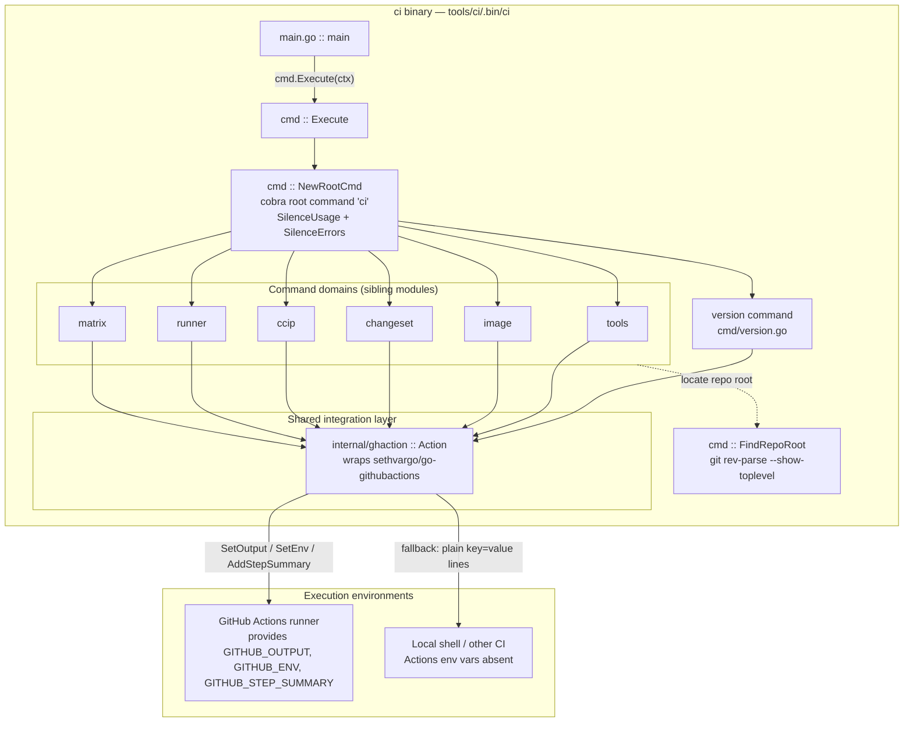
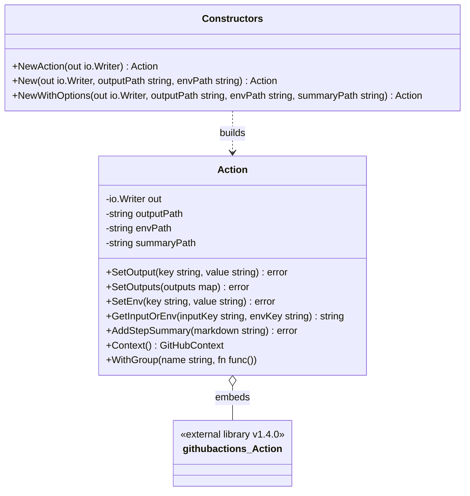
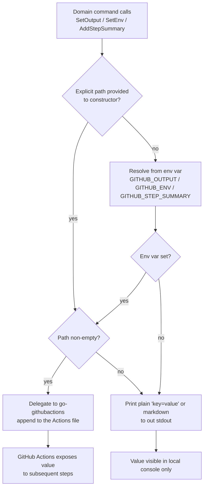

# CI Tools CLI — Executable Shell & Shared GitHub Actions Layer

> **Module:** `ci-tools_cli-shell` (component of [ci-tools](../ci-tools.md), part of [Build, CI & Release Infrastructure](../../Build,_CI___Release_Infrastructure.md))

## 1. Introduction

`ci-tools_cli-shell` is the executable shell of the `tools/ci` Go CLI. It contains everything needed to turn the `ci` binary into a runnable, CI-ready program:

- the **`main` entry point** (`chainlink/tools/ci/main.go`),
- the **cobra root command** (`ci`) that wires every subcommand domain together (`chainlink/tools/ci/cmd/root.go`),
- the **`version` command** (`chainlink/tools/ci/cmd/version.go`), and
- the **`ghaction` package** (`chainlink/tools/ci/internal/ghaction/ghaction.go`) — the shared adapter through which *all* command domains talk to the GitHub Actions runtime (outputs, environment files, step summaries, inputs).

The tool exists to replace brittle inline bash and `jq`/`sed`/`awk` pipelines in GitHub Actions workflows with typed, unit-tested, locally reproducible Go subcommands (see `chainlink/tools/ci/README.md`). This page documents the shell and integration layer; the functional domains (matrix generation, image/runner resolution, changeset/CCIP operations, tools discovery) are documented in their sibling pages and are linked throughout.

## 2. Scope & Position in the System

The `tools/ci` module is a standalone Go module (`github.com/smartcontractkit/chainlink/v2/tools/ci` per `chainlink/tools/ci/go.mod`) inside the `chainlink` submodule. Within the [ci-tools](../ci-tools.md) module tree, this page owns the *shell* and *shared plumbing*, while sibling pages own the *domains*:

| Root subcommand | Domain owner (documentation) |
|---|---|
| `ci version` | **this page** |
| `ci tools` | [ci-tools_tools-discovery](ci-tools_tools-discovery.md) |
| `ci image` | [ci-tools_runner](ci-tools_runner.md) |
| `ci runner` | [ci-tools_runner](ci-tools_runner.md) |
| `ci changeset` | [ci-tools_release-ops](ci-tools_release-ops.md) |
| `ci ccip` | [ci-tools_release-ops](ci-tools_release-ops.md) |
| `ci matrix` | [ci-tools_matrix](ci-tools_matrix.md) |

## 3. Architecture



**Design highlights**

1. **Thin `main`, fat wiring.** `main` only calls `cmd.Execute(context.Background())`; on error it prints `Error: %v` to stderr and exits with status `1`. Because the root command sets `SilenceUsage: true` and `SilenceErrors: true`, cobra does not double-print errors — the process-level handler in `main` is the single source of exit-code semantics, which is what CI steps rely on.
2. **Centralized Actions adaptation.** Every domain command constructs a `ghaction.Action` rather than touching the GitHub Actions runtime directly, so output/env conventions are enforced in exactly one place.
3. **Local reproducibility.** When Actions-specific environment variables are missing (e.g., a developer running `ci image resolve` locally), the `ghaction` layer degrades gracefully to writing plain `key=value` lines to stdout (see [§5](#5-runtime-behavior-outputs-env-and-graceful-degradation)).

## 4. Core Components

### 4.1 Binary entry point — `chainlink/tools/ci/main.go::main`

```go
func main() {
    if err := cmd.Execute(context.Background()); err != nil {
        fmt.Fprintf(os.Stderr, "Error: %v\n", err)
        os.Exit(1)
    }
}
```

- Delegates immediately to the cobra layer; keeps `main` free of logic so the binary is trivially testable.
- Guarantees non-zero exit on any command error — the contract every workflow step depends on.

### 4.2 Root command & execution — `chainlink/tools/ci/cmd/root.go`

- **`NewRootCmd`** builds the `ci` root command (`Short: "ci manages CI workflow operations"`) and registers all seven subcommand trees: `version`, `tools`, `image`, `changeset`, `ccip`, `runner`, `matrix`. Adding a new domain is a one-line `AddCommand` here; the domain's cobra tree lives in its own file (see sibling pages).
- **`Execute`** runs `NewRootCmd().ExecuteContext(ctx)`, propagating the caller's context (used for cancellation/timeout plumbing by domain commands).
- **`FindRepoRoot`** shells out to `git rev-parse --show-toplevel`, trims the result, and wraps failures with context (`failed to find repo root via git`). Domain commands use it to anchor path-relative behavior (e.g., tools discovery and changeset operations) to the repository checkout regardless of the working directory of the CI step.

### 4.3 Version command — `chainlink/tools/ci/cmd/version.go`

- `Version` is a package-level `var` (`"0.1.0"`), intentionally a variable so it can be stamped at build time.
- `newVersionCmd` supports:
  - default text output: `ci version 0.1.0`
  - `--json` flag: indented JSON (`{"version": "..."}`) written to stdout via `json.NewEncoder(cmd.OutOrStdout())` — convenient for `jq`-free consumption in workflows.
- Output goes through cobra's `OutOrStdout()`, keeping the command itself testable (its behavior is covered by `cmd/version_test.go`).

### 4.4 GitHub Actions integration layer — `chainlink/tools/ci/internal/ghaction/ghaction.go`

`ghaction.Action` wraps `*githubactions.Action` from `github.com/sethvargo/go-githubactions` (pinned at v1.4.0 in `chainlink/tools/ci/go.mod`) and extends it with explicit path management and stdout fallbacks.



**Constructor cascade.** `NewWithOptions` is the fully-parameterized constructor; `New` and `NewAction` are convenience wrappers. Any unset path falls back to the corresponding environment variable (`GITHUB_OUTPUT`, `GITHUB_ENV`, `GITHUB_STEP_SUMMARY`), and a `nil` writer falls back to `os.Stdout`. Crucially, the constructor injects a custom `WithGetenv` resolver into the underlying library so that the wrapper's explicit path map always wins over the process environment — this is what enables hermetic testing of Actions behavior without real CI env vars.

**API semantics:**

| Method | Behavior with Actions path set | Behavior without (local run) |
|---|---|---|
| `SetOutput(k, v)` | Appends `k=v` to `$GITHUB_OUTPUT` | Prints `k=v` to `out` |
| `SetOutputs(map)` | Same as `SetOutput`, **keys sorted** for deterministic ordering | Same fallback |
| `SetEnv(k, v)` | Appends `k=v` to `$GITHUB_ENV` | Prints `k=v` to `out` |
| `AddStepSummary(md)` | Appends markdown to `$GITHUB_STEP_SUMMARY` | Prints markdown to `out` |
| `GetInputOrEnv(inputKey, envKey)` | Action input `inputKey` if non-empty, else env `envKey` | — |
| `Context()` | Typed `GitHubContext` from event payload | — |
| `WithGroup(name, fn)` | Wraps `fn` in a collapsible log group (`Group`/`EndGroup`) | — |

## 5. Runtime behavior: outputs, env, and graceful degradation

The following decision flow applies to every output-producing call (`SetOutput`, `SetEnv`, `AddStepSummary`) and is the reason the same command binary works identically in a workflow step and on a developer laptop:



Example (from the [runner domain](ci-tools_runner.md)): `ci image resolve` builds an `Action` via `ghaction.NewAction(cmd.OutOrStdout())`, resolves each parameter with `GetInputOrEnv` (workflow `with:` input first, plain env var second), computes the result, and emits `resolved_image=<uri>` through `SetOutput` only when `GITHUB_OUTPUT` is present — otherwise it prints the URI plainly or as `--json`.

## 6. Typical invocation (data flow)

```mermaid
sequenceDiagram
    autonumber
    participant S as CI workflow step
    participant M as ci main
    participant C as cobra subcommand
    participant G as ghaction.Action
    participant D as Domain logic
    participant O as GITHUB_OUTPUT file

    S->>M: tools/ci/.bin/ci &lt;command&gt;
    M->>C: cmd.Execute(ctx) via NewRootCmd
    C->>G: ghaction.NewAction(stdout)
    C->>G: GetInputOrEnv input and env keys
    G-->>C: resolved inputs
    C->>D: domain operation e.g. Resolve / BuildMatrix
    D-->>C: result
    C->>G: SetOutput(s) / AddStepSummary
    G->>O: append key=value lines
    C-->>M: nil error
    M-->>S: exit 0
```

On any returned error, `main` prints `Error: …` to stderr and exits `1`, failing the step.

## 7. Build, Dependencies & Testing

**Module manifest** — `chainlink/tools/ci/go.mod`:

- Module path: `github.com/smartcontractkit/chainlink/v2/tools/ci`, Go `1.26.6`.
- Direct dependencies: `github.com/spf13/cobra v1.10.2` (CLI), `github.com/sethvargo/go-githubactions v1.4.0` (Actions toolkit), `github.com/stretchr/testify v1.12.1` (tests), `gopkg.in/yaml.v3 v3.0.1` (consumed by domain commands, e.g. changeset parsing in [ci-tools_release-ops](ci-tools_release-ops.md)).

**Build** — `chainlink/GNUmakefile` (lines 295–303) defines the `ci-cli` target:

```make
CI_CLI_BIN = tools/ci/.bin/ci
CI_CLI_SRCS = $(shell find tools/ci -name "*.go" -not -path "*/.bin/*")
$(CI_CLI_BIN): $(CI_CLI_SRCS) tools/ci/go.mod tools/ci/go.sum
	go -C tools/ci build -o .bin/ci .
.PHONY: ci-cli
ci-cli: $(CI_CLI_BIN)
```

The output binary is rebuilt whenever *any* Go source under `tools/ci` or the module manifests change. Usage examples live in `chainlink/tools/ci/README.md`:

```sh
make ci-cli
tools/ci/.bin/ci --help
tools/ci/.bin/ci version [--json]
```

**Testing** — every layer is unit-testable without GitHub infrastructure: the version command tests encoder output, and the `ghaction` path-injection design lets tests point `outputPath`/`envPath`/`summaryPath` at temp files. Run with:

```sh
go -C tools/ci test ./...
```

Domain-level test coverage is described on the sibling pages ([matrix](ci-tools_matrix.md), [runner](ci-tools_runner.md), [release-ops](ci-tools_release-ops.md), [tools-discovery](ci-tools_tools-discovery.md)).

## 8. Related Documentation

- Parent module overview: [ci-tools](../ci-tools.md)
- Sibling domains: [ci-tools_matrix](ci-tools_matrix.md) · [ci-tools_runner](ci-tools_runner.md) · [ci-tools_release-ops](ci-tools_release-ops.md) · [ci-tools_tools-discovery](ci-tools_tools-discovery.md)
- Build tooling context: [chainlink_build_and_tooling](../chainlink_build_and_tooling.md)
- Repository CI & docs automation: [repo_ci_and_docs](../repo_ci_and_docs.md)
