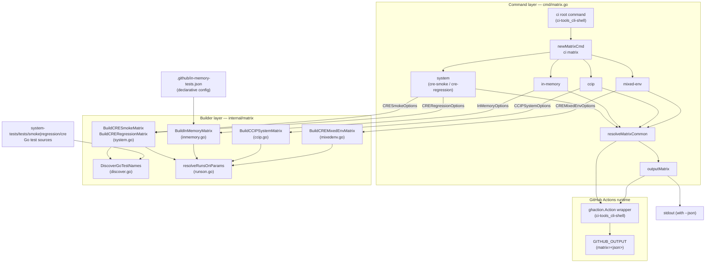
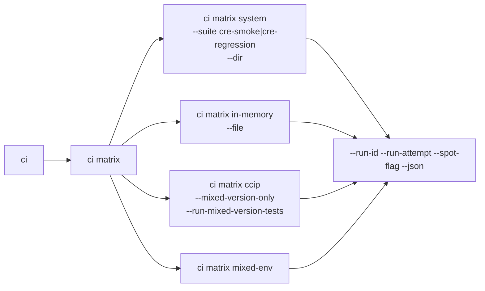
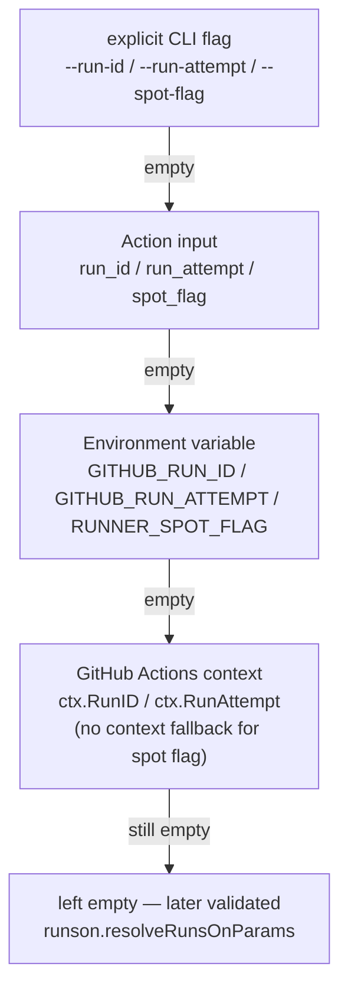
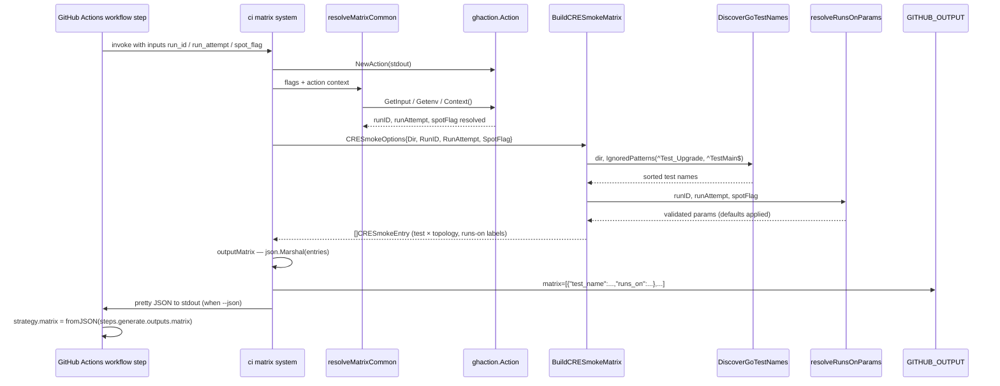

# CI Tools — Test Matrix Generation (`ci matrix`)

## Introduction

The `ci-tools_matrix` module is the test-matrix engine of the [ci-tools](../ci-tools.md) CLI (`chainlink/tools/ci`). It generates **dynamic GitHub Actions test matrices** so that workflows no longer need to hand-maintain static matrix definitions in YAML. Given a run identifier and a test-suite family, it produces a JSON array of job entries — test names, topologies/configs, timeouts, and fully-qualified `runs-on` runner labels — and emits it as a GitHub Actions output that a workflow step consumes via `strategy.matrix: ${{ fromJSON(...) }}`.

The module covers four test-suite families:

| Subcommand | Suite family | Matrix source |
|---|---|---|
| `matrix system` | CRE smoke & regression system tests | **Discovered** from Go test files via AST parsing, with per-test topology/config overrides |
| `matrix in-memory` | In-memory integration tests | **Declarative** — a JSON config file (default `.github/in-memory-tests.json`) |
| `matrix ccip` | CCIP system tests | **Hardcoded** test definitions with mixed-version filtering |
| `matrix mixed-env` | CRE mixed-environment system tests | **Hardcoded** test list with config overrides |

### Source layout

| File | Responsibility |
|---|---|
| `chainlink/tools/ci/cmd/matrix.go` | Cobra commands, input resolution, GitHub Actions output plumbing |
| `chainlink/tools/ci/internal/matrix/system.go` | CRE smoke and regression matrix builders + topology overrides |
| `chainlink/tools/ci/internal/matrix/inmemory.go` | In-memory matrix builder, config schema, test-ID sanitization |
| `chainlink/tools/ci/internal/matrix/ccip.go` | CCIP system-test matrix builder with mixed-version gating |
| `chainlink/tools/ci/internal/matrix/mixedenv.go` | CRE mixed-environment matrix builder |
| `chainlink/tools/ci/internal/matrix/discover.go` | AST-based Go test-function discovery |
| `chainlink/tools/ci/internal/matrix/runson.go` | Validation/defaults for `runs-on` label parameters |

The module lives in its own Go module, `github.com/smartcontractkit/chainlink/v2/tools/ci` (`chainlink/tools/ci/go.mod`), depending only on `spf13/cobra`, `sethvargo/go-githubactions`, `stretchr/testify`, and `yaml.v3`.

## Architecture

The module is a two-layer pipeline. The **command layer** (`cmd/matrix.go`) owns CLI interaction and is the only layer aware of the GitHub Actions runtime; the **builder layer** (`internal/matrix`) is pure matrix construction that returns typed entry structs which are serialized at the boundary. Command wiring is registered in [ci-tools CLI & shell](ci-tools_cli-shell.md): `main.go` → `cmd.Execute` → `NewRootCmd` → `newMatrixCmd()`.



Key architectural properties:

- **Separation of concerns.** Builders in `internal/matrix` never touch the GitHub Actions environment; they receive all runtime parameters (`RunID`, `RunAttempt`, `SpotFlag`) as plain option structs and return entry structs with JSON tags. This keeps matrix logic unit-testable without a GitHub runtime.
- **Single serialization point.** `outputMatrix` is the only place entries become JSON, guaranteeing that every subcommand emits an identically-shaped `matrix` output.
- **Shared input semantics.** All four subcommands funnel through `resolveMatrixCommon`, so run identity (`run_id`/`run_attempt`) and spot-capacity policy (`spot_flag`) behave identically across suites.

## Command layer (`cmd/matrix.go`)

### Command tree



### Common input resolution (`resolveMatrixCommon`)

`resolveMatrixCommon` fills `runID`, `runAttempt`, and `spotFlag` using a four-stage precedence chain. The first non-empty value wins:



| Parameter | CLI flag | Action input | Env var | GitHub context | Downstream default |
|---|---|---|---|---|---|
| `runID` | `--run-id` | `run_id` | `GITHUB_RUN_ID` | `ctx.RunID` | **none — hard error** if unresolved |
| `runAttempt` | `--run-attempt` | `run_attempt` | `GITHUB_RUN_ATTEMPT` | `ctx.RunAttempt` | `"1"` |
| `spotFlag` | `--spot-flag` | `spot_flag` | `RUNNER_SPOT_FLAG` | — | `"spot=co"` |

The resolved values feed every `runs-on` label, so a missing run ID would produce ambiguous runner labels; `resolveRunsOnParams` (see below) fails fast instead. The CCIP subcommand additionally resolves the booleans `mixed_version_only` and `run_mixed_version_tests` from the same flag → input → env chain (`MIXED_VERSION_ONLY`, `RUN_MIXED_VERSION_TESTS`), and `matrix system` resolves `suite` (default `cre-smoke`) and `dir` from flags and action inputs.

### Matrix output (`outputMatrix`)

`outputMatrix` marshals the builder result to JSON once, then delivers it according to the runtime context:

| Condition | Delivery |
|---|---|
| `GITHUB_OUTPUT` env set | Writes `matrix=<json>` via `ghaction.Action.SetOutput` — consumable by subsequent workflow steps |
| `--json` flag passed | Pretty-printed (2-space indent) JSON to stdout |
| Neither (local run) | Compact JSON to stdout — useful for local debugging |

When both `GITHUB_OUTPUT` is set and `--json` is passed, the output is written to both destinations, which simplifies debugging of workflow runs. The `ghaction.Action` wrapper (documented in [ci-tools CLI & shell](ci-tools_cli-shell.md)) falls back to echoing `key=value` lines when `GITHUB_OUTPUT` is unset, so behavior is sane outside Actions.

## Builder layer (`internal/matrix`)

### Runner labels (`runson.go`)

Every builder computes a `runs-on` label per matrix entry. `resolveRunsOnParams` is the single validation/defaulting point:

- **Run ID is mandatory** — returns an error listing the three ways to supply it (`--run-id`, action input `run_id`, `GITHUB_RUN_ID`).
- Run attempt defaults to `"1"`, spot flag defaults to `"spot=co"` (cost-optimized spot capacity).

The resulting label template (exact values vary by suite):

```
runs-on=<run-id>-<test-id>-<run-attempt>/cpu=16/ram=64/family=m7i+m8i/<spot-flag>/image=ubuntu24-full-x64/extras=s3-cache+tmpfs
```

These labels target the `runs-on` self-hosted runner fleet. Each segment has a purpose:

| Segment | Meaning |
|---|---|
| `runs-on=<run-id>-<index>-<run-attempt>` | **Unique per matrix job.** The run-ID/attempt pair scopes labels to a single workflow run, and the entry index guarantees no two jobs in the matrix share a runner — each test gets a dedicated, freshly-provisioned host. |
| `cpu=N/ram=M` | Resource sizing (16 CPU/64 GB for CRE tests; 8 CPU/64 GB for CCIP). |
| `family=...` | EC2 instance family set (`m7i+m8i` general compute, `r6i+r7i+r8i` memory-optimized for CCIP). |
| `<spot-flag>` | Spot vs on-demand capacity policy, threaded from `resolveMatrixCommon`. |
| `image=ubuntu24-full-x64` | Runner image with pre-installed toolchain. |
| `extras=s3-cache+tmpfs` | Optimizations: S3 build caching and tmpfs mounts. |

### CRE smoke and regression matrices (`system.go`)

Both builders are **discovery-driven**: they scan a directory of Go system tests and build one matrix entry per test (smoke: per *test × topology* pair).

`BuildCRESmokeMatrix` (suite `cre-smoke`, default dir `system-tests/tests/smoke/cre`):

1. Discovers test names with `DiscoverGoTestNames`, ignoring `^Test_Upgrade` and `^TestMain$`.
2. Looks up per-test topology overrides in `defaultCRESmokePerTestTopologies` (a `map[string][]TopologyConfig`). Tests with an override produce one entry *per topology*; e.g. `Test_CRE_V2_Suite_Bucket_B` runs against both `workflow-gateway-capabilities` and `workflow-gateway-capabilities-vault-stall-purge`. Overrides exist for sharding, Solana/Aptos/Stellar chains, failover, shared-vault, multi-gateway, confidential-workflow, and cache-test scenarios.
3. Tests without an override use the default topology `workflow-gateway-capabilities` with `configs/workflow-gateway-capabilities-don.toml`.
4. `TestID` is a global counter across all `(test, topology)` pairs, keeping runner labels unique even for multi-topology tests.

`BuildCRERegressionMatrix` (suite `cre-regression`, default dir `system-tests/tests/regression/cre`):

1. Discovers tests ignoring only `^TestMain$`.
2. Applies per-test config overrides from `defaultCRERegressionPerTestConfigs` (currently Stellar and Solana regression suites); everything else falls back to `configs/workflow-gateway-capabilities-don.toml`.
3. One entry per test; `TestID` is the discovery order index.

Both use the `cpu=16/ram=64/family=m7i+m8i` runner template. `TopologyConfig` pairs a named topology (`topology`) with its config file (`configs`) — the workflows consumed by these matrices are documented in [System Tests](../../Dev,_Test___Simulation_Environments/system-tests.md).

### CCIP system matrix (`ccip.go`)

`BuildCCIPSystemMatrix` uses a hardcoded, ordered table of five test definitions — CCIP system tests are a fixed operational set rather than something to auto-discover:

| Test | Timeout | Purpose markers |
|---|---|---|
| `Test_CCIPGasPriceUpdatesWriteFrequency` | 15m | Gas price write cadence |
| `TestRMN_GlobalCurseTwoMessagesOnTwoLanes` | 15m | Pins `RMNRageProxyVersion` / `RMNAFN2ProxyVersion` build identifiers |
| `TestDeleteCCIPJobs-TestRevokeJobs` | 15m (+20m job timeout) | Job lifecycle |
| `Test_CCIPMixedVersionDON` | 20m | Mixed-version DON (`mixed_version: true`) |
| `Test_CCIPRollingUpgrade` | 30m | Rolling upgrade (`mixed_version: true`) |

All target networks `SIMULATED_1,SIMULATED_2` and run on `cpu=8/ram=64/family=r6i+r7i+r8i` memory-optimized runners. The result is then **filtered** by release-rollout controls:

- `mixed_version_only` → emit *only* the mixed-version tests (narrow matrix for rollout verification).
- `run_mixed_version_tests` → emit everything.
- Neither → emit everything *except* the mixed-version tests (default for ordinary PRs).

This makes the same workflow serve daily CI and controlled mixed-version rollouts without YAML duplication.

### In-memory matrix (`inmemory.go`)

`BuildInMemoryMatrix` is the only **config-file-driven** builder. It reads a declarative JSON file (default `.github/in-memory-tests.json`, overridable via `--file` or the `file` action input) whose raw entries match `RawInMemoryEntry`:

```json
[
  {
    "name": "string — display name, also basis for test_id",
    "test": "string — go test selector",
    "timeout": "string — e.g. \"15m\"; parsed as minutes, default 15",
    "parallel": "int — test parallelism",
    "plugins": "bool — enable plugin build",
    "runs_on": "string — extra runner label segment; empty = shared ubuntu-latest",
    "free_disk": "bool — request extra disk",
    "aptos": "string — Aptos version/config selector",
    "sui": "string — Sui version/config selector"
  }
]
```

Each raw entry is transformed into a resolved `InMemoryEntry`:

- **`job_timeout`** = parsed timeout + 5 minutes of job overhead (default timeout 15m → job timeout 20m), giving the harness headroom over the test's own timeout.
- **`test_id`** = `SanitizeTestID(name)`, which replaces every character outside `[A-Za-z0-9._-]` with `_` so the name is legal as a GitHub Actions **artifact name** regardless of what the config contains.
- **`runs_on`** = literal `ubuntu-latest` when the raw entry omits it (cheap shared runners for light tests); otherwise a full fleet label of the form `runs-on=<run-id>-<index>-<run-attempt>/<entry runs_on>/family=m7i+m8i/<spot-flag>/image=ubuntu24-full-x64/extras=s3-cache+tmpfs` — the config's `runs_on` value is spliced in as the label segment, letting the JSON file select per-test hardware.

This design keeps routine test additions (the common case) to a one-line JSON edit with no Go code involved.

### CRE mixed-environment matrix (`mixedenv.go`)

`BuildCREMixedEnvMatrix` is a small hardcoded list of five tests (`Test_CRE_V2_Suite_Bucket_A`, `Test_CRE_V2_Suite_Bucket_B`, and three EVM read-surface tests). Every entry defaults to `configs/mixed-env-don.toml`, with a single per-test override in `defaultCREMixedEnvConfigs` (`Test_CRE_V2_ConfidentialWorkflows_Relay` → `configs/mixed-env-confidential-workflows.toml`). It uses the same `cpu=16/ram=64/family=m7i+m8i` runner template as CRE smoke tests. Unlike `matrix system`, this builder does **not** discover tests — the mixed-env suite is intentionally pinned so its composition is reviewable in code.

### Test discovery (`discover.go`)

`DiscoverGoTestNames(dir, DiscoverOptions)` is the non-`go test` equivalent of test enumeration, used so matrix generation needs no compiled test binary:

1. Iterates `*_test.go` files in the given directory (non-recursive).
2. Parses each file with `go/parser` + `go/ast` (comments enabled).
3. Collects **top-level** function declarations (no receiver) whose names start with `Test` or `Example`, deduplicated across files.
4. Filters out names matching any `IgnoredPatterns` regex (e.g. `^Test_Upgrade`, `^TestMain$`).
5. Returns names sorted alphabetically — this makes matrix ordering deterministic across machines and CI reruns.

Invalid ignore patterns and unreadable/unparseable files produce wrapped errors rather than silently truncating the matrix.

## Data flow

The end-to-end flow for a typical workflow step (`ci matrix system --suite cre-smoke`):



Every matrix job then carries its unique `runs-on` label; the `runs-on` fleet matches it and provisions a dedicated runner with the requested CPU/RAM, instance family, image, and spot policy.

## CI integration

The generated output is consumed by GitHub Actions workflows as follows:

```yaml
jobs:
  generate:
    runs-on: ubuntu-latest
    outputs:
      matrix: ${{ steps.gen.outputs.matrix }}
    steps:
      - uses: actions/checkout@v4
      - uses: ./.github/actions/ci-tools        # builds/runs the tools/ci binary
        with:
          command: matrix
          args: system --suite cre-smoke
  test:
    needs: generate
    strategy:
      matrix: ${{ fromJSON(needs.generate.outputs.matrix) }}
      fail-fast: false
    runs-on: ${{ matrix.runs_on }}              # unique label → dedicated runner
    steps:
      - run: go test -run '^${{ matrix.test_name }}$' ./...
```

The two-layer design keeps workflows declarative: the only thing a workflow change requires is a new `--suite` argument, while test/topology/runner policy lives in this module. For the broader repository CI picture — including the docs-refresh workflow (`​.github/workflows/weekly-docs.yml`) — see [Repo CI & Docs](../repo_ci_and_docs.md).

## Practical usage

```bash
# CRE smoke matrix, fully explicit (works outside GitHub Actions)
ci matrix system --suite cre-smoke --run-id 123456 --run-attempt 1 --json

# CRE regression matrix with spot disabled
ci matrix system --suite cre-regression --run-id 123456 --spot-flag spot=false

# In-memory tests from a custom config
ci matrix in-memory --file .github/in-memory-tests.json --run-id 123456

# CCIP: release-rollout mode (mixed-version tests only)
ci matrix ccip --run-id 123456 --mixed-version-only

# CRE mixed-environment suite
ci matrix mixed-env --run-id 123456
```

Inside Actions, the same flags can be omitted in favor of action inputs or environment variables (see the precedence table above); passing `--json` locally prints the exact JSON that would be written to `GITHUB_OUTPUT`.

## Design notes and extension points

- **Adding a test to CRE smoke/regression or mixed-env:** just add the `Test_*` function to the test directory — discovery picks it up on the next run. Add an entry to `defaultCRESmokePerTestTopologies` / `defaultCRERegressionPerTestConfigs` / `defaultCREMixedEnvConfigs` only when the test needs a non-default topology or config.
- **Adding a test to CCIP:** extend the definitions table in `ccip.go` — the suite is deliberately code-defined to keep rollout-critical tests under review.
- **Adding a test to in-memory:** append an object to the config JSON; no code change is required.
- **Runner sizing:** change the label template in the relevant builder; `resolveRunsOnParams` is the shared place to change spot defaults or make additional parameters mandatory.
- **Consistency invariants to preserve:** every `runs-on` label must embed `run-id` + entry index + `run-attempt` (runner exclusivity), and every builder must route through `resolveRunsOnParams` (fail-fast on missing run identity).

## Related documentation

- [ci-tools](../ci-tools.md) — the overall `tools/ci` CLI module.
- [ci-tools CLI & shell](ci-tools_cli-shell.md) — root command, entry point, and the `ghaction` package used for all GitHub Actions I/O.
- [ci-tools runner](ci-tools_runner.md) — spot-capacity strategy (`ResolveSpot`) and runner-image resolution; complements the `spot_flag` / runner-label logic here.
- [ci-tools tools-discovery](ci-tools_tools-discovery.md) — the analogous matrix builder for `tools` targets.
- [ci-tools release-ops](ci-tools_release-ops.md) — changeset tag checking and CCIP baseline resolution.
- [System Tests](../../Dev,_Test___Simulation_Environments/system-tests.md) — the CRE test suites and topologies this module schedules.
- [Integration Tests](../../Dev,_Test___Simulation_Environments/integration-tests.md) — the in-memory test harness family.
