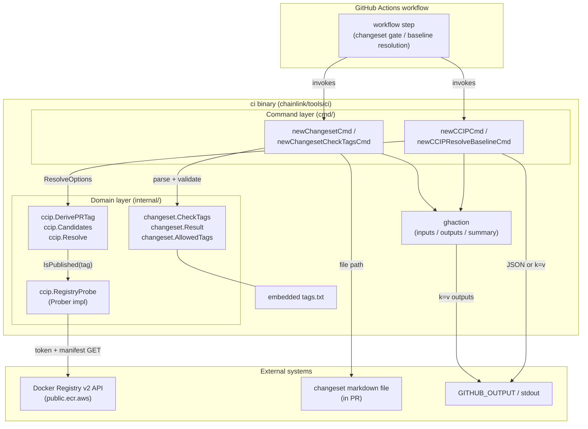
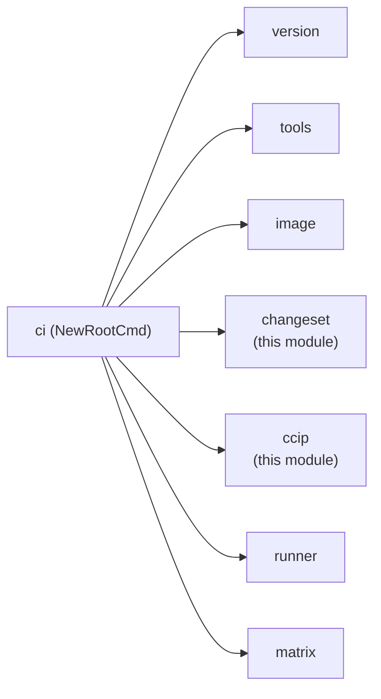
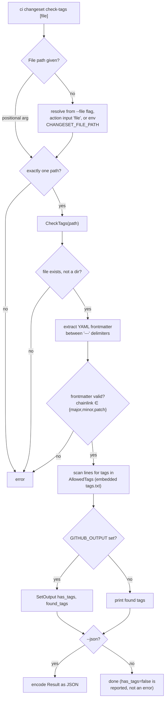
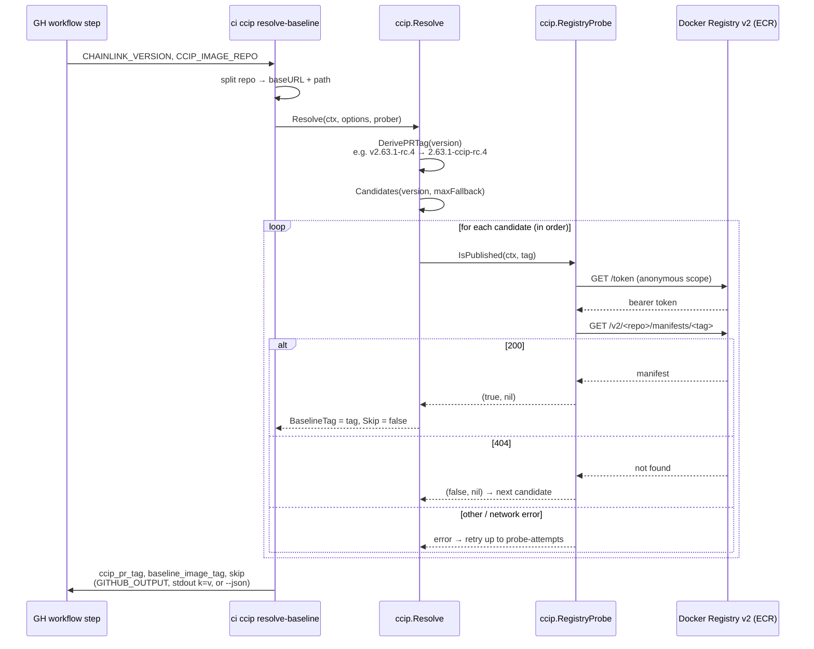
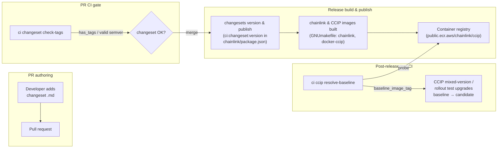

# CI Tools — Release Operations (`ci-tools_release-ops`)

> **Module location:** `chainlink/tools/ci/cmd/changeset.go`, `chainlink/tools/ci/cmd/ccip.go`, `chainlink/tools/ci/internal/changeset/changeset.go`, `chainlink/tools/ci/internal/ccip/baseline.go`
> **Go module:** `github.com/smartcontractkit/chainlink/v2/tools/ci` (see `chainlink/tools/ci/go.mod`)

## Introduction

`ci-tools_release-ops` provides the **release-operations commands** of the `ci` CLI tool: a small Go binary that replaces fragile inline bash snippets in GitHub Actions workflows with testable, typed commands.

This module implements two independent, self-contained release subsystems:

| Subsystem | Command | Purpose |
|---|---|---|
| **Changeset validation** | `ci changeset check-tags` | Gates pull requests on changeset quality: verifies the changeset frontmatter declares a valid `chainlink` semver bump and contains at least one recognized release tag. |
| **CCIP baseline resolution** | `ci ccip resolve-baseline` | Resolves the **baseline image tag** used by CCIP mixed-version / rollout tests: derives the CCIP image tag under test from a Chainlink release version and probes the container registry for the first published prior `rc.0` image. |

Both commands are GitHub Actions–aware: they read configuration from workflow inputs or environment variables and emit machine-readable outputs (via `$GITHUB_OUTPUT` or JSON) that downstream workflow steps consume. Notably, `ci ccip resolve-baseline` replaces the former shell script `.github/scripts/resolve-ccip-release-baseline.sh`.

For the overall `ci` CLI (root command, version command, and the `ghaction` helper used by this module), see [ci-tools](../ci-tools.md) and [ci-tools_cli-shell](ci-tools_cli-shell.md).

---

## Architecture

The module follows a strict two-layer split:

1. **Command layer** (`cmd/`) — Cobra command definitions, flag parsing, environment/input resolution, and output formatting (human-readable, `k=v` GitHub Actions outputs, or JSON).
2. **Domain layer** (`internal/`) — pure, testable release logic with no dependency on the CLI framework:
   - `internal/changeset` — changeset file parsing and tag validation.
   - `internal/ccip` — version derivation, baseline candidate generation, and registry probing.

The command layer depends on the shared `ghaction` package (from [ci-tools_cli-shell](ci-tools_cli-shell.md)) which wraps `sethvargo/go-githubactions` to interface with GitHub Actions inputs and outputs.



### Relationship to sibling `ci` commands

`newChangesetCmd` and `newCCIPCmd` are registered on the root command in `chainlink/tools/ci/cmd/root.go`, alongside the sibling command groups documented in [ci-tools_matrix](ci-tools_matrix.md), [ci-tools_runner](ci-tools_runner.md), and [ci-tools_tools-discovery](ci-tools_tools-discovery.md):



---

## Subsystem 1: Changeset Validation

### Purpose

This repository uses [Changesets](https://github.com/changesets/changesets) for versioning and changelog generation — the release automation consumes `*.md` changeset files during `pnpm changeset version` (wired as `ci:changeset:version` in `chainlink/package.json`, and mirrored by the changeset scripts in `capabilities/package.json` and `cre-cli/package.json`). A changeset is only useful to the release process if it:

1. declares a **valid semver bump for the `chainlink` package** in its YAML frontmatter (`major`, `minor`, or `patch`), and
2. mentions **at least one recognized release tag** so the generated changelog can categorize the entry.

`ci changeset check-tags` enforces both rules in PR CI, failing (or flagging via `has_tags=false`) when a changeset is malformed or uncategorized.

### Command surface

```
ci changeset check-tags [file] [--file <path>] [--json]
```

| Aspect | Behavior |
|---|---|
| Positional arg | Optional path to a single changeset file (exactly one path; multiple paths are rejected). |
| `--file` flag / `CHANGESET_FILE_PATH` env / action input `file` | Path resolution order: positional arg → flag → action input/env (`CHANGESET_FILE_PATH`) via `ghaction.GetInputOrEnv`. |
| `--json` | Emit the `Result` struct as indented JSON instead of human-readable lines. |
| Exit behavior | Returns an error for missing path, unreadable file, directory path, invalid frontmatter, or invalid semver value. A changeset *without tags* is **not** an error — it sets `has_tags=false` so the workflow can decide policy. |

### Validation logic (`changeset.CheckTags`)

`CheckTags(filePath)` in `chainlink/tools/ci/internal/changeset/changeset.go` performs:

1. **File checks** — the path must exist and be a regular file.
2. **Frontmatter extraction** — locates the first two `---` delimiter lines and extracts the YAML block between them (via `extractFrontmatter`).
3. **Frontmatter validation** — unmarshals the YAML into a string map and requires the `chainlink` key to be exactly one of `major`, `minor`, or `patch`.
4. **Tag scan** — scans every line of the file and collects any occurrence of the tags in `AllowedTags`.

The result is:

```go
type Result struct {
    HasTags   bool     `json:"has_tags"`
    FoundTags []string `json:"found_tags"`
}
```

### Allowed tags

`AllowedTags` is loaded **once at startup** from the embedded file `chainlink/tools/ci/internal/changeset/tags.txt` (via `go:embed`). The current canonical set:

| Tag | Meaning |
|---|---|
| `#nops` | No operational impact |
| `#added` | New feature |
| `#changed` | Behavior change |
| `#removed` | Removed feature |
| `#updated` | Dependency/update |
| `#deprecation_notice` | Deprecation |
| `#breaking_change` | Breaking change |
| `#db_update` | Database schema/data change |
| `#wip` | Work in progress |
| `#bugfix` | Bug fix |
| `#internal` | Internal change |

> **Golden test guard:** a test (`TestAllowedTags`) pins the exact set of tags. Any addition, removal, or typo in `tags.txt` fails CI until the change is intentional — preventing release-process drift.

### GitHub Actions integration

When running inside a workflow (`GITHUB_OUTPUT` is set), the command publishes outputs via `ghaction`:

| Output | Value |
|---|---|
| `has_tags` | `"true"` / `"false"` |
| `found_tags` | Comma-joined list of found tags (e.g. `#added,#changed`) |

### Process flow



---

## Subsystem 2: CCIP Baseline Resolution

### Purpose

CCIP mixed-version / rollout tests upgrade Chainlink nodes **from a known-good baseline image to the image under test**. Determining that baseline requires:

1. deriving the **CCIP image tag under test** from the Chainlink release version (build/publish uses a modified tag format for CCIP images), and
2. finding the most recent **published baseline `rc.0` image** in the container registry to upgrade from.

`ci ccip resolve-baseline` replicates the semantics of the former `.github/scripts/resolve-ccip-release-baseline.sh` in typed, testable Go code. It performs HTTP probes directly against a Docker Registry v2 API (e.g. AWS Public ECR), so **no local docker daemon is required**.

### Command surface

```
ci ccip resolve-baseline [--chainlink-version v2.63.1-rc.4] [--repo <image-ref>] \
    [--registry-url <base-url>] [--max-fallback N] [--probe-attempts N] \
    [--probe-retry-delay dur] [--json]
```

| Input | Flag | Env / default |
|---|---|---|
| Chainlink release version | `--chainlink-version` | env `CHAINLINK_VERSION` (e.g. `v2.63.1-rc.4`); **required** |
| CCIP image ref (no scheme) | `--repo` | env `CCIP_IMAGE_REPO`, default `public.ecr.aws/chainlink/ccip` |
| Registry API base URL override | `--registry-url` | derived from `--repo` host by default (useful for mirrors and httptest fakes) |
| Fallback depth | `--max-fallback` | `12` prior minor `rc.0` candidates |
| Probe retries per candidate | `--probe-attempts` | `3` |
| Delay between probe retries | `--probe-retry-delay` | `2s` |
| JSON output | `--json` | off |

The full image ref (`"<host>/<path>"`, e.g. `public.ecr.aws/chainlink/ccip`) is split into a registry **base URL** (`https://public.ecr.aws`) and a **repository path** (`chainlink/ccip`). `--registry-url` overrides the derived base URL.

### Tag derivation (`DerivePRTag`)

Replicates the "Compute CCIP image tag" step of the build/publish pipeline: strip the leading `v`, then insert `-ccip-` before the pre-release identifier. Stable versions are returned unchanged:

| Chainlink version | CCIP PR tag |
|---|---|
| `v2.63.1-rc.4` | `2.63.1-ccip-rc.4` |
| `v2.63.0` | `2.63.0` |
| `v2.63.0-beta.0` | `2.63.0-ccip-beta.0` |

The input must be a non-empty, `v`-prefixed version.

### Candidate selection (`Candidates`)

The baseline is always an **`rc.0`** tag, chosen product-agnostically. With `M = maxFallback`:

- **`rc.N` with N > 0** → first try `rc.0` of the *exact same version* (e.g. `2.63.1-ccip-rc.0`), then the base minor `.0` `rc.0`s.
- **`rc.0` / stable / beta** → only the base minor `.0` `rc.0`s.

The *base minor* is this minor's `.0` when `patch > 0`, otherwise the **previous** minor's `.0` (when `patch == 0`). The walk continues through prior minor `.0` `rc.0`s — e.g. `2.63.0-ccip-rc.0` → `2.62.0-ccip-rc.0` → … — until `M` fallbacks are tried or the minor drops below 0.

Example, `v2.63.1-rc.4` with `--max-fallback 2`:

```
2.63.1-ccip-rc.0   (same-version rc.0)
2.63.0-ccip-rc.0   (base minor, patch > 0)
2.62.0-ccip-rc.0   (one fallback)
```

### Resolution (`Resolve`)

`Resolve(ctx, ResolveOptions, prober)` orchestrates the algorithm:

1. Derive the PR tag (`DerivePRTag`).
2. Build the ordered candidate list (`Candidates`).
3. Probe each candidate **in order** via the `Prober` interface. A transient error is retried up to `ProbeAttempts` times with `ProbeRetryDelay` between attempts; a *definitively absent* tag (registry 404) moves on immediately. Context cancellation aborts early.
4. The **first published candidate wins**. If none is published, `Skip` is `true` and `BaselineTag` is empty (the workflow then skips the mixed-version test).

```go
type ResolveResult struct {
    PRTag       string   // derived CCIP image tag under test
    BaselineTag string   // resolved baseline tag (empty if Skip)
    Skip        bool     // true if no published baseline was found
    Candidates  []string // ordered candidate tags that were probed
}
```

### Registry probing (`RegistryProbe`)

`RegistryProbe` is the production `Prober` implementation, speaking the **Docker Registry v2 API**:

1. Fetch an anonymous bearer token from `{baseURL}/token?service=public.ecr.aws&scope=repository:<repo>:pull`.
2. `GET {baseURL}/v2/<repo>/manifests/<tag>` with the bearer token and Docker/OCI manifest `Accept` headers.
3. Interpret the status: `200` → published; `404` → definitively absent; anything else → transient error (eligible for retry).

The `Prober` interface contract makes the whole resolution algorithm unit-testable:

```go
type Prober interface {
    IsPublished(ctx context.Context, tag string) (bool, error)
}
// (true, nil)  = published
// (false, nil) = definitively absent (404)
// (_, err)     = transient failure (network, 5xx, auth) — caller may retry
```

### Resolution sequence



### Outputs

When `GITHUB_OUTPUT` is set, outputs are published via `ghaction` (mirroring the replaced bash script); otherwise `k=v` lines go to stdout. With `--json`, a single JSON object is emitted:

| Output | JSON key | Meaning |
|---|---|---|
| `ccip_pr_tag` | `ccip_pr_tag` | Derived CCIP image tag under test |
| `baseline_image_tag` | `baseline_image_tag` | Resolved baseline tag (empty if skipping) |
| `skip` | `skip` | `"true"` when no published baseline was found |
| — | `candidates` | Ordered candidate list (JSON mode only) |

When skipping, a warning is emitted: no published baseline `rc.0` was found for the given version among the probed candidates, so the mixed-version test will be skipped.

---

## How This Module Fits Into the Release Pipeline



1. **Changeset gate.** Every PR that touches the node must ship a well-formed changeset; `check-tags` is the CI-side enforcement point for the format that the [Changesets](https://github.com/changesets/changesets) automation (`@changesets/cli`, wired via `ci:changeset:version` in `chainlink/package.json` and equivalents in `capabilities/package.json` / `cre-cli/package.json`) later consumes to produce the changelog and version bump.
2. **Image publication.** The release pipeline builds and publishes Chainlink and CCIP images (see the `chainlink` / `docker` / `docker-ccip` targets in `chainlink/GNUmakefile`, documented in [chainlink_build_and_tooling](../chainlink_build_and_tooling.md)). CCIP images use the `-ccip-`-prefixed tag scheme derived by `DerivePRTag`.
3. **Baseline resolution for rollout tests.** After a release, CI runs CCIP mixed-version tests against the new image. `resolve-baseline` computes the candidate's tag and locates the newest published prior-minor `rc.0` baseline so the test can exercise an upgrade path. Results feed the smoke/system-test suites described in [Dev, Test & Simulation Environments → integration-tests](../../Dev,_Test___Simulation_Environments/integration-tests.md).
4. **Fallback safety.** When no baseline exists (e.g. a brand-new minor line), the command outputs `skip=true` with a warning rather than failing the workflow — allowing the rest of the release validation to proceed.

## Design Notes

- **Bash → Go migration.** Both subsystems replace inline workflow bash (`resolve-ccip-release-baseline.sh`, changeset checks) with typed code that can be unit-tested, linted, and versioned like the rest of the codebase.
- **Pure domain logic.** All file parsing (`CheckTags`), version math (`DerivePRTag`, `Candidates`), and orchestration (`Resolve`) live in `internal/` packages, free of CLI and GitHub Actions dependencies; only the `cmd/` layer performs I/O and formatting.
- **Defensive parameter clamping.** `Resolve` clamps `ProbeAttempts` to ≥ 1 and `MaxFallback` to ≥ 0, so misconfigured workflows degrade gracefully instead of erroring.
- **Embedded configuration.** The allowed-tags list is embedded via `go:embed` (`tags.txt`) and pinned by a golden test, making the tag vocabulary an explicit, reviewed artifact rather than a regex buried in a workflow file.
- **Zero docker dependency.** The registry prober speaks plain HTTP against the Registry v2 API, removing the local-docker requirement of the original shell-based approach and enabling fast, parallel CI probes.

## Related Documentation

- [ci-tools](../ci-tools.md) — the `ci` CLI tool overview and command registration.
- [ci-tools_cli-shell](ci-tools_cli-shell.md) — root command, `version`, and the `ghaction` GitHub Actions helper used by both commands in this module.
- [ci-tools_matrix](ci-tools_matrix.md), [ci-tools_runner](ci-tools_runner.md), [ci-tools_tools-discovery](ci-tools_tools-discovery.md) — sibling `ci` command groups (test matrices, runner/image resolution, tool discovery).
- [chainlink_build_and_tooling](../chainlink_build_and_tooling.md) — the `GNUmakefile` targets (`chainlink`, `docker`, `docker-ccip`) that produce the images referenced by baseline resolution.
- [Dev, Test & Simulation Environments → integration-tests](../../Dev,_Test___Simulation_Environments/integration-tests.md) — consumers of the resolved baseline for CCIP smoke and mixed-version testing.
