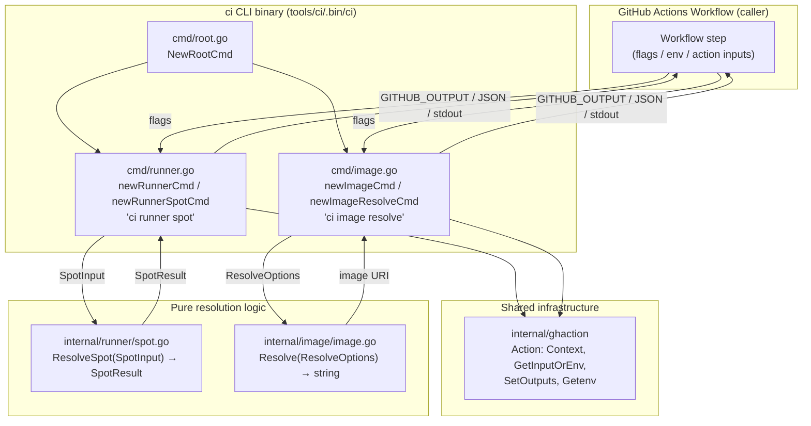
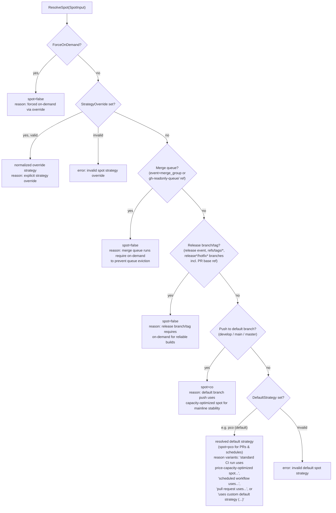
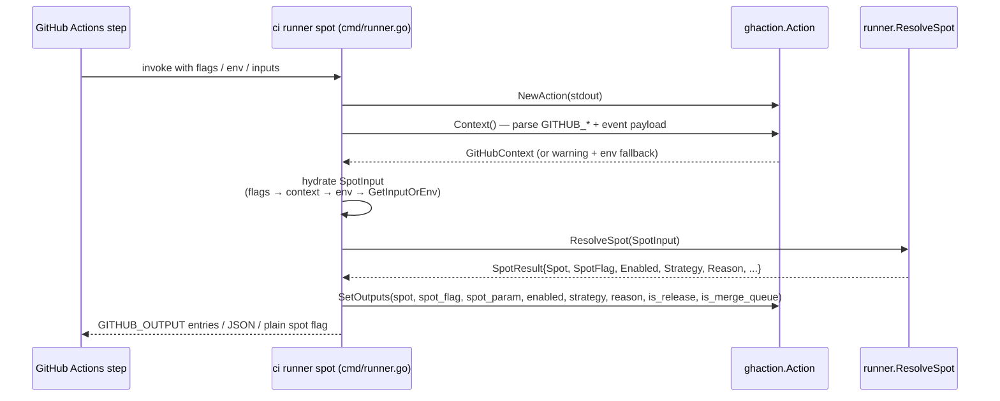
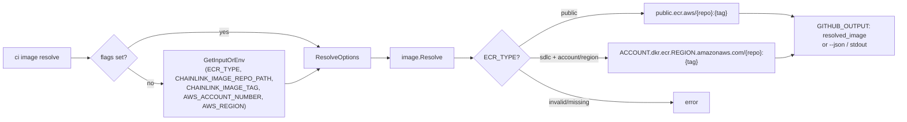

# CI Tools Runner — Spot Strategy & Image Resolution

## Introduction

The `ci-tools_runner` module is a functional sub-module of the [`ci` CLI](../ci-tools.md) (source: `chainlink/tools/ci/`). It encapsulates two CI *orchestration* concerns that were previously implemented as brittle inline Bash scripts in GitHub Actions workflows:

1. **Runner spot strategy resolution** — `ci runner spot` decides whether a CI job should run on **spot** (preemptible, cheap) or **on-demand** (stable) RunsOn runner instances, based on the GitHub event context (event type, branch/tag refs, merge queue state).
2. **Container image resolution** — `ci image resolve` composes the fully-qualified Docker image URI for Chainlink images, for either the public ECR registry or the SDLC (private) ECR registry.

Both commands follow the same architectural pattern: a thin **cobra CLI layer** that hydrates inputs from flags, the GitHub Actions context, and environment variables, delegating all decision-making to a **pure, deterministic resolution function** in an `internal` package. This separation makes the business logic fully unit-testable and locally reproducible without a GitHub Actions runtime.

For the other `ci` command families, see [ci-tools CLI shell](ci-tools_cli-shell.md), [ci-tools matrix](ci-tools_matrix.md), [ci-tools release ops](ci-tools_release-ops.md), and [ci-tools tools discovery](ci-tools_tools-discovery.md).

---

## Architecture

The module consists of four source files — two command files in `cmd/` and two pure-logic packages in `internal/`:

| File | Components | Role |
|---|---|---|
| `chainlink/tools/ci/cmd/runner.go` | `newRunnerCmd`, `newRunnerSpotCmd` | `ci runner spot` cobra command; input hydration & output emission |
| `chainlink/tools/ci/internal/runner/spot.go` | `SpotStrategy`, `SpotInput`, `SpotResult`, `ResolveSpot` | Pure spot-strategy decision engine |
| `chainlink/tools/ci/cmd/image.go` | `newImageCmd`, `newImageResolveCmd` | `ci image resolve` cobra command; input hydration & output emission |
| `chainlink/tools/ci/internal/image/image.go` | `Resolve`, `ResolveOptions` | Pure image URI composition & validation |

Both command packages depend on the shared GitHub Actions helper `internal/ghaction` (see [ci-tools CLI shell](ci-tools_cli-shell.md)), which wraps `github.com/sethvargo/go-githubactions`.

**Command wiring.** Both commands are registered in the CLI root via `NewRootCmd()` (`chainlink/tools/ci/cmd/root.go`), which adds `newRunnerCmd()` and `newImageCmd()` alongside the `version`, `tools`, `changeset`, `ccip`, and `matrix` commands. The `runner` and `image` commands each expose a single subcommand today (`spot` and `resolve` respectively), leaving room for additional runner/image management subcommands.

---

## Runner Spot Resolution (`ci runner spot`)

### Input resolution order

`newRunnerSpotCmd` hydrates a `runner.SpotInput` from three possible sources, in strict precedence order:

1. **CLI flags** (`--event`, `--ref`, `--ref-type`, `--ref-name`, `--base-ref`, `--head-ref`, `--force-on-demand`, `--strategy`, `--default-strategy`) — always win when set.
2. **GitHub Actions context** — if a flag is empty, the command parses the typed GitHub context via `ghaction.Action.Context()` (which reads `GITHUB_*` environment variables and the event payload). If context parsing fails, a warning is printed to stderr and the command falls back to environment variables.
3. **Environment variables** — final fallback (`GITHUB_EVENT_NAME`, `GITHUB_REF`, `GITHUB_REF_TYPE`, `GITHUB_REF_NAME`, `GITHUB_BASE_REF`, `GITHUB_HEAD_REF`).
4. **Action inputs / dedicated env vars** — for policy controls only: `force-on-demand` (`RUNNER_FORCE_ON_DEMAND`), `strategy` (`RUNNER_SPOT_STRATEGY`), `default-strategy` (`RUNNER_DEFAULT_SPOT_STRATEGY`) are read via `GetInputOrEnv` (action input first, then env var).

> Note: the GitHub context is consulted *before* plain environment variables, so the typed event payload (e.g. `merge_group`) takes precedence over the raw env fallback whenever both are available.

### Spot strategies

`SpotStrategy` models the RunsOn spot allocation modes (`chainlink/tools/ci/internal/runner/spot.go`):

| Strategy | Constant | `spot=` value | Meaning |
|---|---|---|---|
| Disabled (on-demand) | `SpotDisabled` | `false` | On-demand EC2 instances — maximum stability |
| Capacity optimized | `SpotCapacityOptimized` | `co` | Prioritizes pools with the most available capacity |
| Price-capacity optimized | `SpotPriceCapacityOptimized` | `pco` | Balances price and capacity (the default when spot is enabled) |
| Lowest price | `SpotLowestPrice` | `lowest-price` | Selects the cheapest available pool |

Free-form strategy strings (from overrides or `RUNNER_*` env vars) are normalized by `normalizeStrategy`, which accepts many aliases:

| Accepted inputs | Normalized strategy |
|---|---|
| `false`, `off`, `0`, `no`, `on-demand`, `ondemand`, `none` | `SpotDisabled` |
| `co`, `capacity-optimized`, `capacity_optimized` | `SpotCapacityOptimized` |
| `pco`, `price-capacity-optimized`, `price_capacity_optimized`, `true`, `on`, `1`, `yes` | `SpotPriceCapacityOptimized` |
| `lp`, `lowest-price`, `lowest_price` | `SpotLowestPrice` |

Any unrecognized value produces an error (`invalid spot strategy %q ...`), which fails the workflow step — invalid configuration is never silently ignored.

### Decision ladder

`ResolveSpot` evaluates the context against an ordered set of safety/cost rules. The first matching rule wins:

| # | Rule | Result | Rationale |
|---|---|---|---|
| 1 | `ForceOnDemand` is set | on-demand | Explicit kill-switch (`spot=false`) |
| 2 | `StrategyOverride` set | as specified | Explicit per-invocation control |
| 3 | Merge queue context (`merge_group` event, or ref/ref-name prefixed `gh-readonly-queue/`) | on-demand | Spot eviction would fail merge-queue checks and block the queue |
| 4 | Release context (`release` event, tag refs, or `release*`/`hotfix*` branch names — including a PR's **base** ref) | on-demand | Release builds must be reliable and reproducible |
| 5 | `push` event to a default branch (`develop`, `main`, `master`) | capacity-optimized spot | Cost savings on mainline, but biased toward pools with free capacity |
| 6 | Everything else (pull requests, `schedule`, etc.) | default strategy (default: price-capacity-optimized spot) | Maximizes cost efficiency for interruptible workloads |

The release detection (`isReleaseOrTag`) is deliberately conservative: it also inspects `BaseRef`, so a PR **targeting** a release branch runs on-demand even though the head branch is not a release branch.

### Result & output contract

`ResolveSpot` returns a `SpotResult` with both machine fields (`Spot`, `Enabled`, `Strategy`) and an audit trail (`Reason`, `IsRelease`, `IsMergeQueue`). The command emits the result through up to three channels:

| Channel | Condition | Content |
|---|---|---|
| `GITHUB_OUTPUT` file | `GITHUB_OUTPUT` set (workflow context) | Keys: `spot`, `spot_flag`, `spot_param`, `enabled`, `strategy`, `reason`, `is_release`, `is_merge_queue` (sorted alphabetically by `SetOutputs`) |
| JSON | `--json` flag | Full `SpotResult` document, 2-space indented |
| stdout | Only when `GITHUB_OUTPUT` is **not** set (local runs) | Plain `SpotFlag` string, e.g. `spot=pco` |

The `spot` / `spot_flag` / `spot_param` trio lets downstream workflow steps paste the value directly into a `runs-on: ${{ ... }}` expression, while `spot_flag` is the literal flag form (`spot=co`).

### End-to-end execution flow

---

## Image Resolution (`ci image resolve`)

### Purpose

The command composes the fully-qualified Docker image URI for Chainlink images. Per the [ci-tools README](../../../README.md) mapping, it replaces the retired inline script `.github/scripts/resolve-chainlink-image.sh`.

### URI formats

`image.Resolve` (`chainlink/tools/ci/internal/image/image.go`) supports two registry modes, selected by `ECRType` (case-insensitive, trimmed):

| `ECR_TYPE` | Required inputs | Resulting URI |
|---|---|---|
| `public` | `repo_path`, `tag` | `public.ecr.aws/{repo_path}:{tag}` |
| `sdlc` | `repo_path`, `tag`, **`aws_account`**, **`aws_region`** | `{aws_account}.dkr.ecr.{aws_region}.amazonaws.com/{repo_path}:{tag}` |

### Validation rules

`Resolve` is strict — missing or malformed configuration is an error rather than a best-effort guess:

- `ECR_TYPE` must be non-empty and exactly `sdlc` or `public` (after lowercasing/trimming).
- `CHAINLINK_IMAGE_REPO_PATH` must be non-empty.
- `CHAINLINK_IMAGE_TAG` must be non-empty.
- For `sdlc`, both `AWS_ACCOUNT_NUMBER` and `AWS_REGION` must be non-empty.

### Input hydration

Identical pattern to the runner command: flags (`--ecr-type`, `--repo-path`, `--tag`, `--aws-account`, `--aws-region`) win over action inputs / env vars (`ECR_TYPE`, `CHAINLINK_IMAGE_REPO_PATH`, `CHAINLINK_IMAGE_TAG`, `AWS_ACCOUNT_NUMBER`, `AWS_REGION`) via `GetInputOrEnv`.

### Output channels

| Channel | Condition | Content |
|---|---|---|
| `GITHUB_OUTPUT` file | `GITHUB_OUTPUT` set | Single key `resolved_image` |
| JSON | `--json` flag | `{"resolved_image": "..."}` |
| stdout | Always (if no earlier channel returned) | The resolved URI string |

### Flow

---

## Build, Packaging & Testing

- **Module**: `github.com/smartcontractkit/chainlink/v2/tools/ci` (Go 1.26.6), declared in `chainlink/tools/ci/go.mod`. Direct dependencies: `github.com/spf13/cobra v1.10.2` (CLI), `github.com/sethvargo/go-githubactions v1.4.0` (Actions integration), `github.com/stretchr/testify` and `gopkg.in/yaml.v3` (testing).
- **Build**: the `ci-cli` target in `chainlink/GNUmakefile` (lines 295–303) compiles all `tools/ci` Go sources into `tools/ci/.bin/ci` (`go -C tools/ci build -o .bin/ci .`); see [chainlink build and tooling](../chainlink_build_and_tooling.md).
- **Tests**: unit tests cover both command and logic layers (`cmd/runner_test.go`, `cmd/image_test.go`); run with `go -C tools/ci test ./...` as documented in `chainlink/tools/ci/README.md`.
- **Local usage**: the graceful fallbacks (no `GITHUB_OUTPUT` → plain stdout, context-parse failure → env vars) mean both commands run identically on a developer workstation and inside a workflow step.

---

## Related Documentation

- [ci-tools](../ci-tools.md) — parent module: the unified `ci` CLI and its command families.
- [ci-tools CLI shell](ci-tools_cli-shell.md) — `ci` binary entry point and the shared `ghaction` helper used by this module.
- [ci-tools matrix](ci-tools_matrix.md) — test-matrix generation; its `runs-on` parameter resolution consumes the same GitHub context conventions and complementary runner sizing decisions.
- [ci-tools release ops](ci-tools_release-ops.md) — changeset tag checks and CCIP baseline resolution.
- [ci-tools tools discovery](ci-tools_tools-discovery.md) — tools-directory test target discovery.
- [Build, CI & Release Infrastructure](../../Build,_CI___Release_Infrastructure.md) — top-level overview of build, CI and release tooling.
