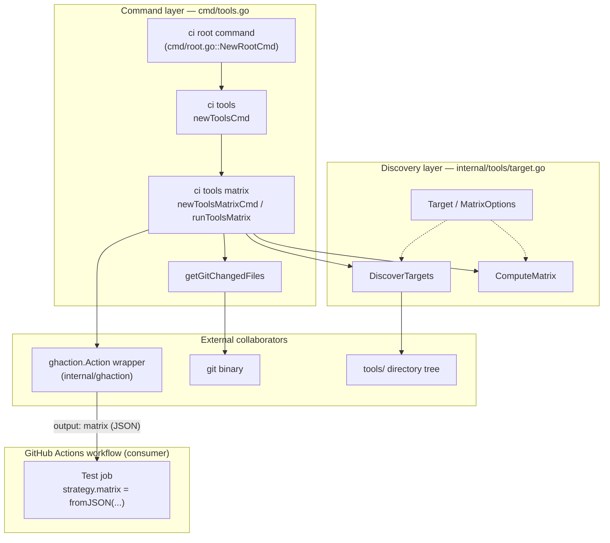
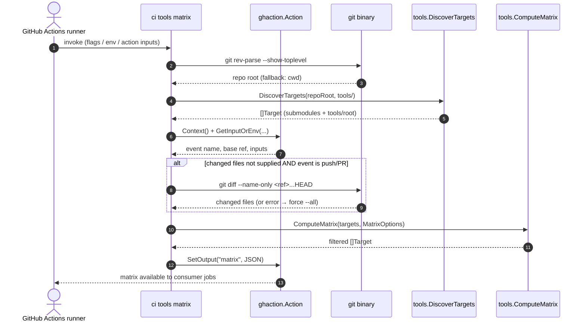
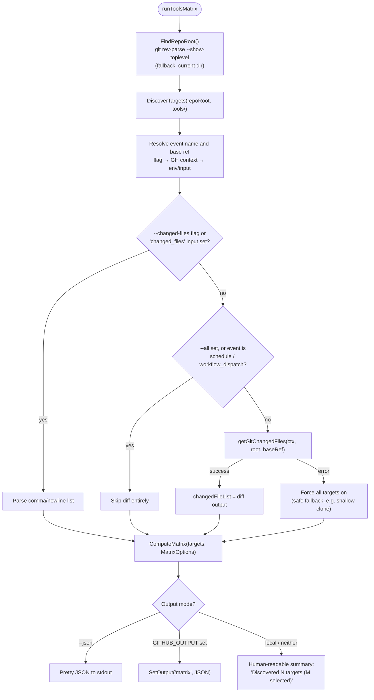
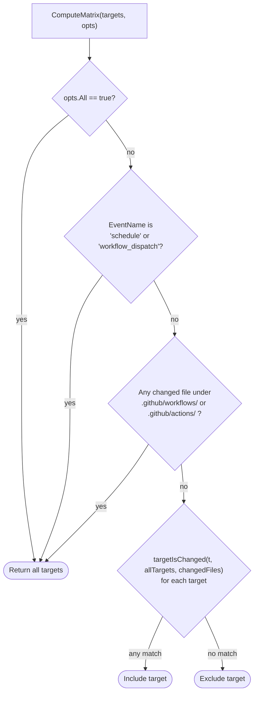
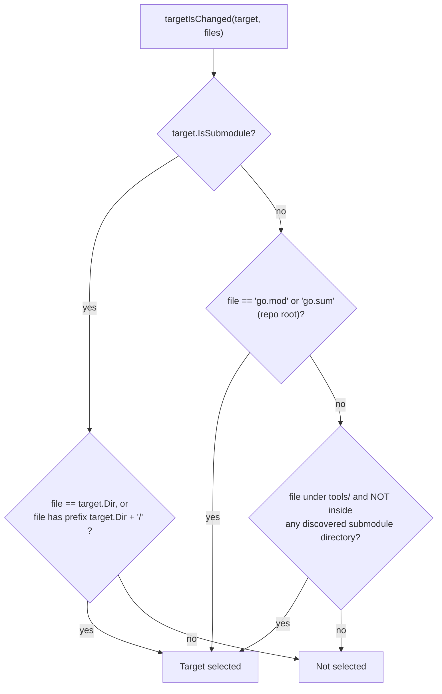

# CI Tools — Tool Test Discovery & Matrix Generation

> **Module page:** `Build,_CI___Release_Infrastructure/ci-tools/ci-tools_tools-discovery.md`
> **Parent module:** [ci-tools](../ci-tools.md) · **Domain:** [Build, CI & Release Infrastructure](../../Build,_CI___Release_Infrastructure.md)

## 1. Introduction

The **tools-discovery** module is the part of the `ci` CLI that answers a single question for CI: *"which Go test targets under the `tools/` directory need to run for this change?"* It implements the `ci tools matrix` command, which:

1. **Discovers** every runnable Go test target under `tools/` — both standalone Go submodules (directories containing their own `go.mod`) and root-module packages containing tests.
2. **Filters** those targets against the files changed in a branch (via `git diff`) and the triggering GitHub event, so CI runs only what is affected.
3. **Emits** the result as a JSON job matrix, either to stdout (`--json`) or as a GitHub Actions output (`matrix`) that downstream jobs consume via `strategy.matrix`.

This replaces ad-hoc inline `bash` logic in workflows with a testable, versioned Go binary — the stated goal of the parent [ci-tools](../ci-tools.md) module (`chainlink/tools/ci/cmd/root.go`: *"ci provides tooling for CI workflows to replace inline bash and provide testable operations"*).

The module lives in two source files:

| File | Responsibility |
|---|---|
| `chainlink/tools/ci/cmd/tools.go` | Command wiring, option resolution, git integration, output emission |
| `chainlink/tools/ci/internal/tools/target.go` | Filesystem discovery of targets and matrix filtering logic |

## 2. Architecture

The module follows the ci-tool's two-layer convention: a thin **command layer** in `cmd/` that handles CLI/GitHub-Actions plumbing, and a pure, unit-testable **discovery layer** in `internal/tools/` that contains no I/O beyond filesystem reads.



### 2.1 Discovery layer (`internal/tools/target.go`)

- **`Target`** — the serializable matrix entry, with JSON tags consumed directly by `strategy.matrix`:

  | Field | Type | Meaning |
  |---|---|---|
  | `name` | `string` | Human/CI identifier (e.g. `tools/ci`, `tools/root`) |
  | `dir` | `string` | Working directory for the job (repo-relative) |
  | `packages` | `string` | Go package pattern (e.g. `./...`, `./tools/...`) |
  | `is_submodule` | `bool` | `true` if the target is a standalone Go module |

- **`DiscoverTargets(repoRoot, toolsDir)`** — single `filepath.WalkDir` over the tool tree that classifies every Go file it encounters:
  - A **`go.mod` file** marks a standalone submodule → one `Target{Dir: relDir, Packages: "./...", IsSubmodule: true}`.
  - A **`*_test.go` file** is attributed to the nearest enclosing module by walking up parent directories looking for `go.mod`. If none is found before reaching `toolsDir`/repo root, the test belongs to the **root module**.
  - If any root-module tests exist, a single synthetic target is prepended: `Target{Name: "tools/root", Dir: ".", Packages: "./tools/...", IsSubmodule: false}` — i.e. one job runs `go test ./tools/...` from the repo root, covering all non-submodule tool packages.
  - Submodule targets are sorted alphabetically by name; the root target always comes first.

  Within the chainlink repository this currently discovers, among others, the `tools/ci` and `tools/githooks` submodules (each has its own `go.mod`, see `chainlink/tools/ci/go.mod`, `chainlink/tools/githooks/go.mod`), while packages such as `tools/plugout` and `tools/release/...` (no nested `go.mod`) fall under the `tools/root` umbrella target.

- **`MatrixOptions{EventName, ChangedFiles, All}`** and **`ComputeMatrix(targets, opts)`** — pure filtering logic (see [§4](#4-matrix-decision-logic)).

### 2.2 Command layer (`cmd/tools.go`)

- **`newToolsCmd`** — registers the `tools` command group under the root `ci` command and attaches the `matrix` subcommand.
- **`newToolsMatrixCmd`** — defines the `ci tools matrix` subcommand and its flags:

  | Flag | Default | Purpose |
  |---|---|---|
  | `--all` | `false` | Include all tool targets regardless of git changes |
  | `--json` | `false` | Print the matrix JSON to stdout |
  | `--event-name` | `GITHUB_EVENT_NAME` | GitHub event name used for trigger-based filtering |
  | `--base-ref` | `GITHUB_BASE_REF` → `develop` | Base ref for `git diff` |
  | `--changed-files` | `changed_files` action input | Explicit changed-file list (comma/newline delimited) |

- **`runToolsMatrix`** — orchestrates the full flow (see [§3](#3-execution-flow)).
- **`getGitChangedFiles`** — computes the changed-file list with resilient ref fallbacks (see [§5](#5-git-diff-resolution)).

### 2.3 GitHub Actions integration (`internal/ghaction`)

`runToolsMatrix` never touches raw GitHub Actions files directly; it goes through the `ghaction.Action` wrapper (itself built on `github.com/sethvargo/go-githubactions`). The wrapper centralises:

- **Input resolution** — `GetInputOrEnv(inputKey, envKey)` (e.g. `event_name` input → `GITHUB_EVENT_NAME` env).
- **Output emission** — `SetOutput` writes to the `GITHUB_OUTPUT` file when running in Actions, or prints `key=value` to stdout otherwise.
- **Context access** — `Context()` returns the parsed `GitHubContext` (`EventName`, `BaseRef`) from the event payload and environment.

This indirection is what keeps the command usable both inside Actions runners and locally in a developer shell.

## 3. Execution Flow

The sequence below shows a typical invocation on a pull-request runner. The `schedule`/`workflow_dispatch` fast-path and the shallow-clone fallback are highlighted in the notes.



The corresponding control flow, including output mode selection:



**Example matrix output** (as produced for this repository's `tools/` tree):

```json
[
  { "name": "tools/root",     "dir": ".",             "packages": "./tools/...", "is_submodule": false },
  { "name": "tools/ci",       "dir": "tools/ci",      "packages": "./...",       "is_submodule": true },
  { "name": "tools/githooks", "dir": "tools/githooks","packages": "./...",       "is_submodule": true }
]
```

## 4. Matrix Decision Logic

`ComputeMatrix` applies a short-circuiting rule chain; the goal is *"run everything when in doubt, run the minimum otherwise"*.



Per-target matching (`targetIsChanged`) is asymmetric between the two target kinds:



Practical consequences of these rules:

| Change in a PR | Effect on the matrix |
|---|---|
| Any file inside `tools/ci/` | Only the `tools/ci` job runs |
| Any test file in a non-submodule tool package | The `tools/root` job runs |
| Repo-root `go.mod` / `go.sum` | `tools/root` runs (dependency changes can affect all root-module tool tests) |
| Any file under `.github/workflows/` or `.github/actions/` | **All** targets run (CI definition changes invalidate the diff assumption) |
| `schedule` / `workflow_dispatch` events, or `--all` | **All** targets run unconditionally |
| `git diff` fails (e.g. shallow clone) | **All** targets run (fail-safe in `runToolsMatrix`) |

## 5. Git Diff Resolution

`getGitChangedFiles` is deliberately defensive because CI runners frequently check out shallow clones where arbitrary refs are unavailable:

1. Build a **candidate ref list**: `baseRef`, `origin/<baseRef>` (if not already prefixed), `origin/develop`, `develop` (defaults to `origin/develop` when `baseRef` is empty).
2. For each candidate, run `git diff --name-only <ref>...HEAD` inside the repo root; stop at the first success.
3. If all candidates fail, fall back to `git diff --name-only HEAD~1` (the last commit only).
4. Parse the output into a trimmed, non-empty file list.

Callers treat any error from this function as "unknown diff" and fall back to selecting all targets — CI errs on the side of running more tests rather than silently skipping them.

## 6. Build & Dependency Context

The module is itself a standalone Go submodule, defined in `chainlink/tools/ci/go.mod`:

- **Module path:** `github.com/smartcontractkit/chainlink/v2/tools/ci` (Go 1.26.6)
- **Runtime dependencies:** `github.com/spf13/cobra` (CLI framework), `github.com/sethvargo/go-githubactions` (Actions protocol, via the internal `ghaction` wrapper)
- **Test dependencies:** `github.com/stretchr/testify`, `gopkg.in/yaml.v3`
- **External tool:** the `git` binary must be on `PATH` (repo-root detection and diffing)

Because it carries its own `go.mod`, the module is *also a target of its own discovery logic*: a change to any file under `tools/ci/` causes the CI matrix to include a `go test ./...` job for this tool. The command is wired into the CLI in `chainlink/tools/ci/cmd/root.go` alongside the sibling commands documented in [ci-tools](../ci-tools.md): [matrix](ci-tools_matrix.md) (system-test matrices), [runner](ci-tools_runner.md) (spot/image resolution), [release-ops](ci-tools_release-ops.md) (changesets/CCIP baselines), and [cli-shell](ci-tools_cli-shell.md) (version/Actions helpers).

## 7. Illustrative CI Usage

The typical consumer pattern in a GitHub Actions workflow (illustrative):

```yaml
jobs:
  discover-tools:
    runs-on: ubuntu-latest
    outputs:
      matrix: ${{ steps.tools.outputs.matrix }}
    steps:
      - uses: actions/checkout@v5
        with: { fetch-depth: 0 }   # full history so the base-ref diff succeeds
      - uses: actions/setup-go@v5
      - id: tools
        run: go run ./tools/ci tools matrix

  test-tools:
    needs: discover-tools
    strategy:
      matrix: ${{ fromJSON(needs.discover-tools.outputs.matrix) }}
    steps:
      - uses: actions/checkout@v5
      - run: go test ${{ matrix.packages }}
        working-directory: ${{ matrix.dir }}
```

Because the JSON is produced by `tools.Target` with stable field names, the matrix maps directly onto job context attributes (`matrix.dir`, `matrix.packages`, …) without any intermediate transformation. For local use, `ci tools matrix` prints a plain summary, and `ci tools matrix --json --all` yields the full matrix deterministically — useful for debugging workflow filtering.

## 8. Failure Modes & Operational Notes

| Scenario | Behaviour |
|---|---|
| `git rev-parse --show-toplevel` fails | `FindRepoRoot` errors; `runToolsMatrix` falls back to the current working directory |
| Shallow clone / missing base ref | `getGitChangedFiles` error → all targets selected (never fewer) |
| Non-push events (`schedule`, `workflow_dispatch`) | Diff is skipped entirely; all targets selected |
| `GITHUB_OUTPUT` unset (local run) | Matrix JSON is not written to an output file; summary/`--json` goes to stdout; `ghaction.SetOutput` degrades to printing `matrix=…` |
| No targets match | Empty JSON array (`[]`) is emitted — consumer jobs simply skip |

## 9. Related Documentation

- [ci-tools](../ci-tools.md) — parent module: `ci` binary, architecture, and command surface.
- [ci-tools matrix](ci-tools_matrix.md) — the sibling system-test matrix generator (CRE smoke/regression, CCIP, mixed-env), which shares the ghaction/matrix output conventions.
- [ci-tools runner](ci-tools_runner.md) — spot runner and image resolution used by the same workflows.
- [ci-tools release-ops](ci-tools_release-ops.md) — changeset tag checks and CCIP baseline resolution.
- [ci-tools cli-shell](ci-tools_cli-shell.md) — root command, version, and the `ghaction` wrapper used here.
- [Build, CI & Release Infrastructure](../../Build,_CI___Release_Infrastructure.md) — top-level overview of build tooling and release infrastructure.
