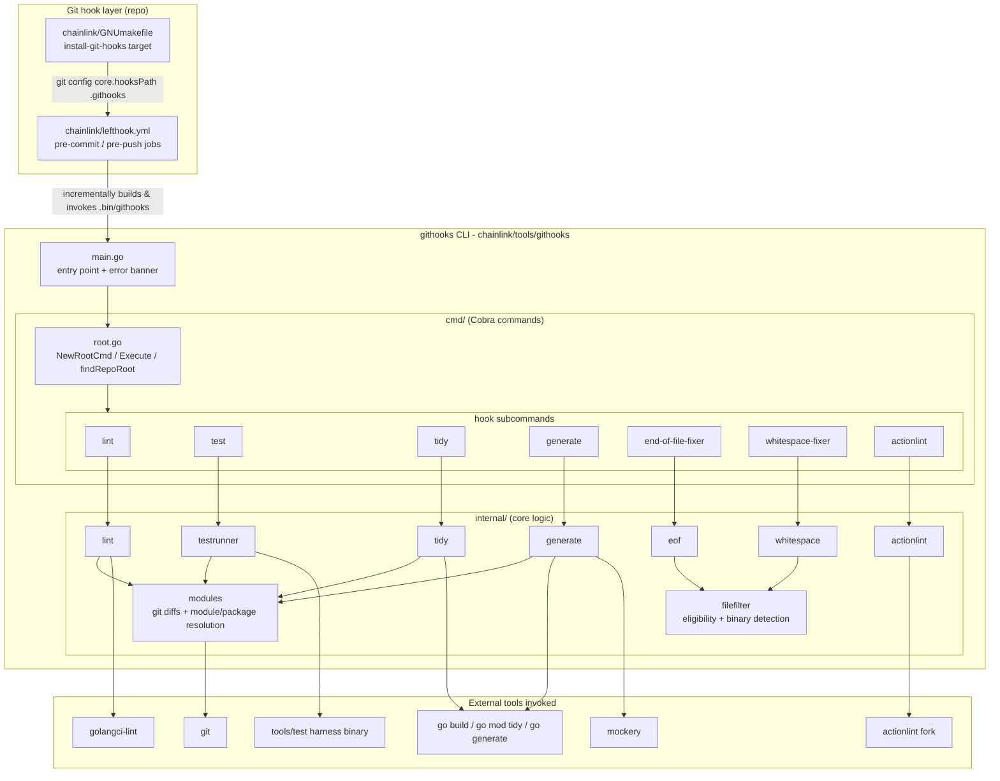
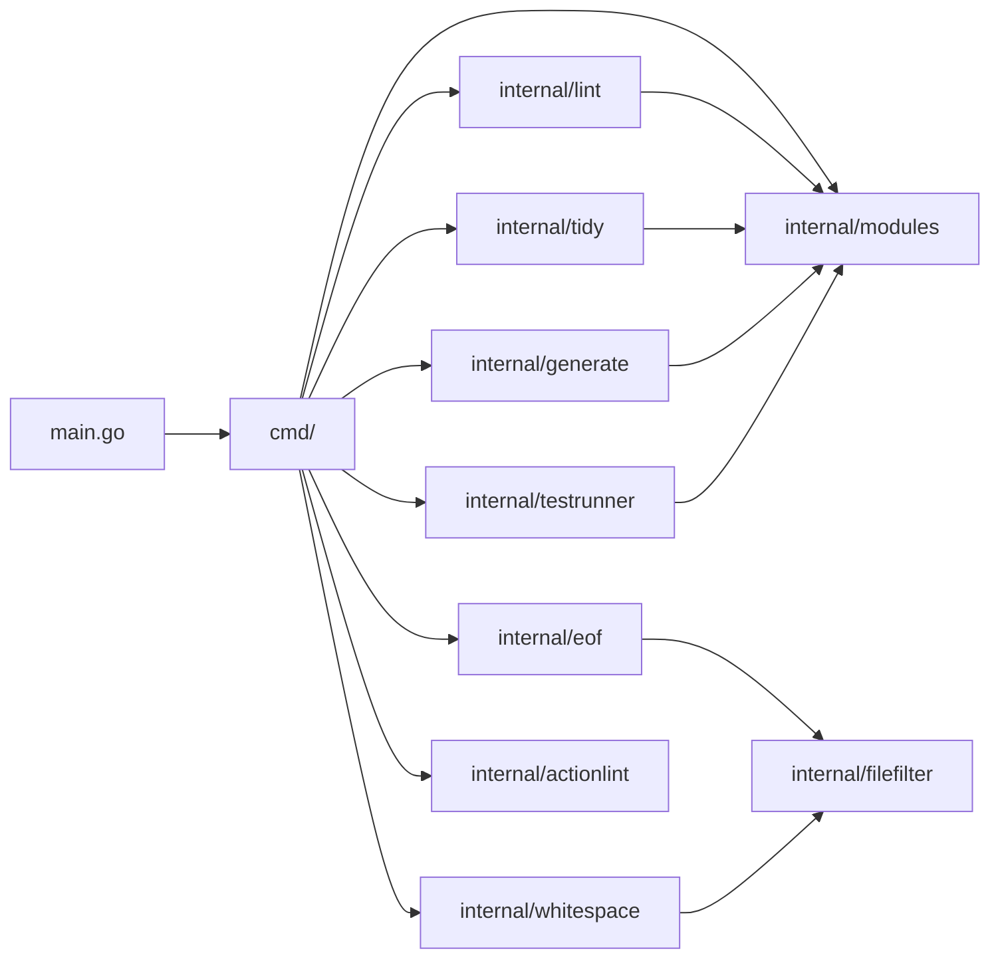
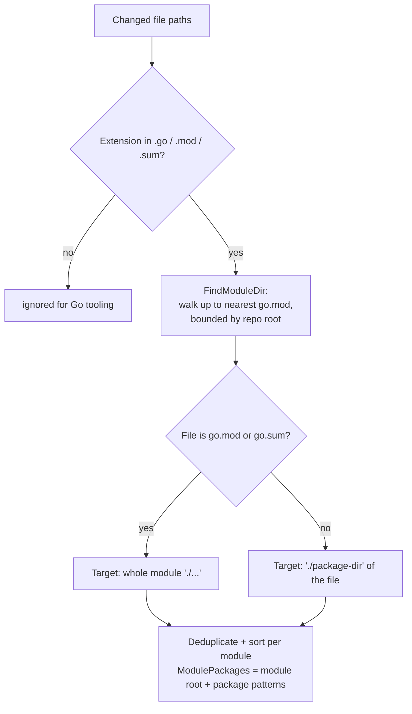
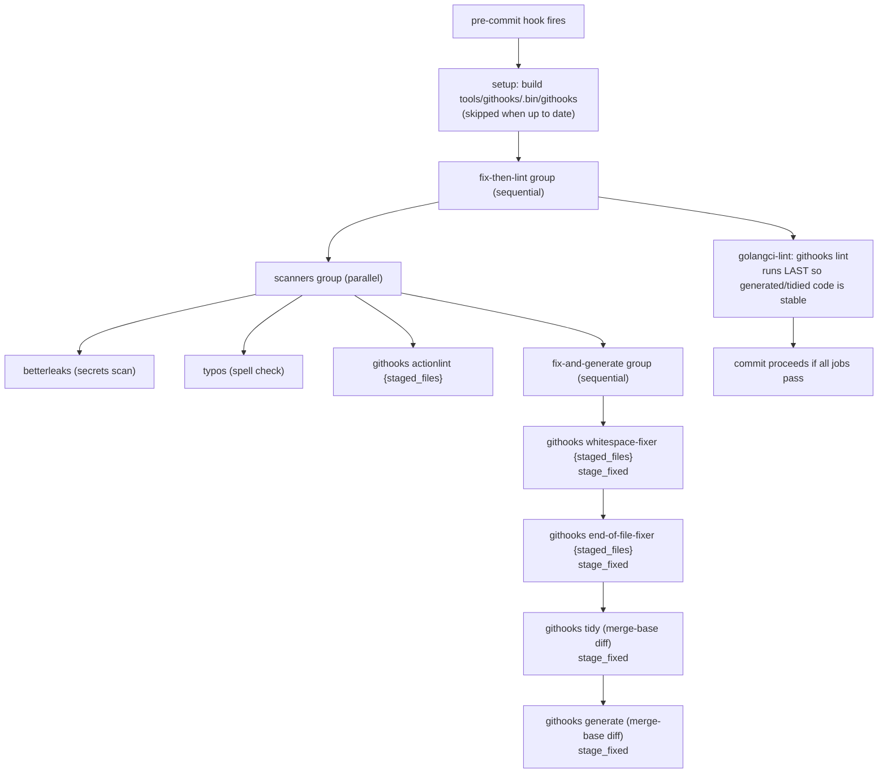
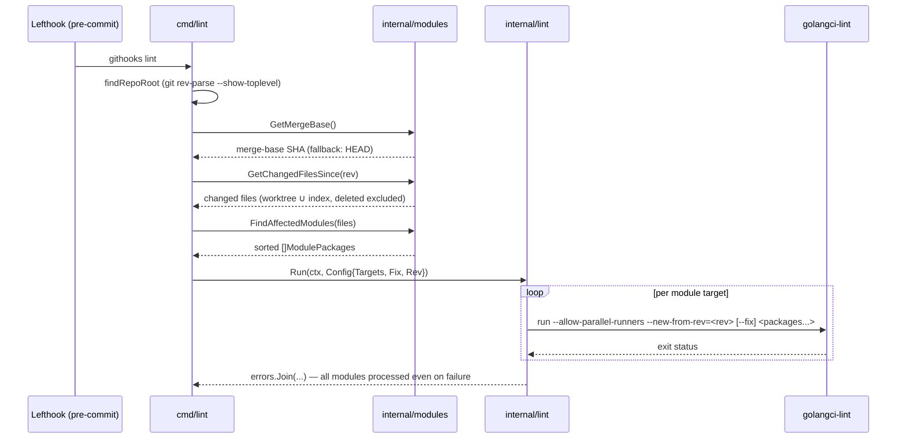

# githooks

`githooks` (`chainlink/tools/githooks/`) is a standalone Go CLI that powers the repository's local Git hook enforcement for the multi-module Go monorepo. It is driven by [Lefthook](https://github.com/evilmartians/lefthook) (configured in `chainlink/lefthook.yml`) and replaces slow, whole-repo hook scripts with targeted, incremental operations: it maps changed files to the Go modules and packages they affect, then runs only the formatting fixes, code generators, tidy passes, linters, and short tests that those changes require.

Its core design goals are:

- **Incrementality** — diff against the merge-base with the origin default branch (the same base CI uses for `only-new-issues`), so issues introduced anywhere on a branch are caught, not just currently staged files.
- **Monorepo awareness** — resolve the nearest enclosing `go.mod` for any changed file and run tools per-module and per-package rather than repo-wide.
- **Safe write ordering** — code generators and `go mod tidy` complete before `golangci-lint --fix` runs, so fixers never race generated code.
- **CI parity** — local hooks mirror the scope of CI checks (unit tests run via the same `tools/test` harness, linting uses the same diff base).

This module is one of several standalone tool CLIs in the repository; see [Build, CI & Release Infrastructure](../Build,_CI___Release_Infrastructure.md) for the overall landscape, [ci-tools](ci-tools.md) (CI matrix/runner CLI), [plugout](plugout.md), and [release-changelog](release-changelog.md).

---

## Module manifest (`go.mod`)

The module is declared in `chainlink/tools/githooks/go.mod`:

- **Module path:** `github.com/smartcontractkit/chainlink/v2/tools/githooks`
- **Go version:** `1.26.5`

Although it lives inside the `chainlink/` directory tree, `tools/githooks` is a **nested Go module**: its own `go.mod` takes precedence over the main `chainlink/go.mod` for anything under this path. This isolates the tool's dependency graph so the hook binary builds quickly at pre-commit time and does not inherit the node binary's heavyweight dependency set.

### Direct dependencies

| Dependency | Version | Role |
|---|---|---|
| `github.com/spf13/cobra` | v1.10.2 | CLI command tree (`cmd/` layer) |
| `golang.org/x/sync` | v0.22.0 | `errgroup`-based concurrency in `internal/generate` and `internal/whitespace` |
| `gopkg.in/yaml.v3` | v3.0.1 | Parses `.mockery.yaml` configs for scoped mock regeneration (`internal/generate`) |
| `github.com/stretchr/testify` | v1.11.1 | Test assertions for the tool's own test suite |

Indirect requirements (`pflag`, `mousetrap` via cobra; `go-spew`, `go-difflib` via testify) are minimal and confined to these four libraries.

---

## Architecture

The tool follows a thin Cobra command layer over focused internal packages. `main.go` is the entry point; each hook concern (lint, tidy, generate, format fixers, actionlint, tests) is a subcommand delegating to one internal package, with `internal/modules` as the shared change-discovery foundation.



### Internal package dependency graph



`internal/modules` is the shared substrate every Go-targeting command depends on; `internal/filefilter` is shared by the two content-mutating fixers.

---

## Component reference

### Entry point — `main.go`

Calls `cmd.Execute(context.Background())`. On error it prints the error plus a pointer to the `#ci-cd` Slack channel and exits non-zero, which fails the Git hook.

### Command layer — `cmd/`

- **`root.go`** — `NewRootCmd` registers all subcommands (`lint`, `test`, `tidy`, `generate`, `end-of-file-fixer`, `whitespace-fixer`, `actionlint`); `findRepoRoot` shells out to `git rev-parse --show-toplevel`.
- **`lint.go`** — resolves the diff base (explicit `--rev`, default merge-base), gathers changed files, maps them to module/package targets, and invokes `internal/lint`. Flags: `--fix` (default `true`), `--rev`.
- **`tidy.go`** — same merge-base discovery, then runs `go mod tidy` in parallel over affected module directories.
- **`test.go`** (aliases `only-changed`, `short-test`) — uses `modules.GetChangedFiles` (staged → `HEAD~1..HEAD` → working tree) rather than the merge base, and additionally filters out long-running E2E suites. Flag: `--short` (default `true`).
- **`eof.go` / `whitespace.go`** — content fixers that default to staged files (falling back to recent changes), with `--check` mode for CI-style verification.
- **`actionlint.go`** (alias `al`) — lints GitHub Actions workflows via the maintained `kjanat/actionlint` fork; explicit file arguments take precedence over `--rev` (the Lefthook hook always passes `{staged_files}`).
- **`generate.go`** — targeted code generation; see [Targeted code generation](#targeted-code-generation-internalgenerate).

### Core packages — `internal/`

| Package | Responsibility |
|---|---|
| `modules` | Git change discovery (`GetMergeBase`, `GetChangedFilesSince`, `GetStagedFiles`, `GetChangedFiles`) and mapping files → `ModulePackages{Module, Packages}` (`FindAffectedModules`, `FindTestModules`, `FindModuleDir`, `ReadModulePath`). |
| `filefilter` | Decides which files the fixers may touch: extension allowlist (`.go`, `.md`, `.yaml`, `.json`, …), exact-name allowlist (`Makefile`, `Dockerfile`, …), binary rejection (NUL byte within the first 8 KB), and path exclusions (`.git/`, `.bin/`, `vendor/`, generated `core/web/assets/`). Marks `.txtar` golden fixtures as content-protected. |
| `lint` | Runs `golangci-lint run --allow-parallel-runners [--new-from-rev=<rev>] [--fix] <packages...>` once per affected module, from the module's directory. Failures are collected and joined (`errors.Join`) so later modules still get their fixes applied. |
| `tidy` | Runs `go mod tidy` concurrently (goroutine per module, `WaitGroup` + mutex-collected errors). |
| `generate` | Targeted `go generate`, `mockery`, config-doc and `go.md` regeneration (details below). |
| `testrunner` | Builds the `tools/test` harness binary incrementally (`needsBuild` compares source mod-times, mirroring the Lefthook setup step) and executes it with `-short` against affected packages — the same scope CI's unit-test job uses. |
| `eof` | Normalizes end-of-file: exactly one trailing newline for eligible files; empty files stay 0 bytes; honors `CheckOnly`. |
| `whitespace` | Trailing-whitespace fixer with extension routing: `.go` files are skipped (gofmt's domain), Markdown uses a dedicated fixer that preserves 2-space hard line breaks, everything else uses the generic fixer; processes files concurrently via `errgroup`. |
| `actionlint` | Detects `.github/**/*.yml|yaml` changes (`IsGithubYAML`); lints only the changed workflow files, or all workflows when non-workflow `.github` YAML (e.g. `actionlint.yml`, composite actions) changes. |

---

## Change discovery & diff-base strategy

The tool's incrementality comes from how it derives the set of files to process. Two strategies coexist:

1. **Merge-base strategy** (`lint`, `tidy`, `generate`, `actionlint` without file args) — `modules.GetMergeBase` resolves `refs/remotes/origin/HEAD` via `git symbolic-ref` and computes `git merge-base HEAD <default-branch>` (falling back to `HEAD` when unavailable). `GetChangedFilesSince` then unions the working-tree diff (`git diff <rev>`) with the index diff (`git diff --cached <rev>`), excluding deleted files, so both committed branch history and staged work are covered. This matches the diff base CI uses for `only-new-issues`, so local lint results align with CI.
2. **Staged-file strategy** (`end-of-file-fixer`, `whitespace-fixer`, `actionlint` when Lefthook passes `{staged_files}`) — pure `git diff --cached --name-only --diff-filter=d`, with fallbacks to `HEAD~1..HEAD` and the working tree.



For unit tests, `FindTestModules` applies the same mapping but skips long-running E2E suites (`deployment`, `system-tests`, `integration-tests`, `tools/secrets`, `tools/docker`, `tools/benchmark`, and CRE workflow examples), because those directories are exercised by dedicated CI jobs rather than pre-push hooks.

---

## Execution pipelines (Lefthook integration)

Hooks are installed via `make install-git-hooks` in `chainlink/GNUmakefile`, which runs `git config core.hooksPath .githooks`. Lefthook (driven by `chainlink/lefthook.yml`) then executes the compiled binary from `tools/githooks/.bin/githooks`. Both `pre-commit` and `pre-push` begin with a **setup** step that rebuilds the binary only when a `.go`/`go.mod`/`go.sum` file under `tools/githooks` is newer than the binary — the same incremental-build trick the testrunner applies.



The ordering is deliberate: the read-only scanners run in parallel while the Go mutators (`tidy`, `generate`) run sequentially — they share the Go toolchain and module files — and `lint --fix` runs strictly after all mutators so it never races mock regeneration or `go mod tidy` rewriting `go.mod`/`go.sum`. Mutator output is re-staged via Lefthook's `stage_fixed: true`.

**pre-push** runs `githooks test {push_files}` in parallel, giving fast, package-scoped `-short` unit tests before pushed commits leave the machine.

### Targeted code generation (`internal/generate`)

The `generate` command scopes expensive generation to what actually changed:

- **`.proto` or other generator-annotated files changed** → `go generate` only for the affected packages.
- **Config docs / `go.md`** → regenerated only when their inputs change; `go.md` is produced by running `tools/bin/modgraph` and writing the output.
- **Mockery scoping** (parsed from `.mockery.yaml` via `yaml.v3`):
  - a changed `.mockery.yaml` triggers a full `mockery` run in that directory (matching `make generate`);
  - a changed `go.mod`/`go.sum` triggers a full run for any enclosing config, so dependency bumps refresh vendored-interface mocks;
  - a changed `.go` file whose package is listed in a config triggers a **scoped run** using a temporary config that preserves global defaults and per-package overrides — avoiding unrelated mockery config drift from blocking unrelated changes.
- The mockery binary is resolved exactly like the `MOCKERY_BIN` variable in `chainlink/GNUmakefile` (`MOCKERY_BIN` env → `PATH` → `GOBIN` → `GOPATH/bin`), guaranteeing hook and `make generate` never use different mockery versions.

### Lint data flow



---

## Command reference

| Command | Aliases | Default input | External tool | Notes |
|---|---|---|---|---|
| `lint [files...]` | — | merge-base diff | `golangci-lint` | `--fix` default on; `--rev` override; per-module invocation |
| `tidy [files...]` | — | merge-base diff | `go mod tidy` | parallel across modules |
| `generate [files...]` | — | merge-base diff | `go generate`, `mockery`, `tools/bin/modgraph` | see scoping rules above |
| `test [files...]` | `only-changed`, `short-test` | staged → `HEAD~1` → working tree | `tools/test` harness | `--short` default on; E2E suites excluded |
| `end-of-file-fixer [files...]` | `eof`, `eof-fixer` | staged → changed | (in-process) | `--check`, `--quiet`, `--verbose` |
| `whitespace-fixer [files...]` | `whitespace`, `ws-fixer`, `trailing-whitespace` | staged files | (in-process) | `--check`; Markdown-aware; skips `.go` |
| `actionlint [files...]` | `al` | merge-base diff (or explicit files) | `kjanat/actionlint` fork | `--rev` ignored when files are passed |

Typical manual usage:

```bash
# Build & run any command
go -C tools/githooks run . lint
go -C tools/githooks run . lint --fix=false --rev=origin/develop core/services/app.go
go -C tools/githooks run . end-of-file-fixer --check README.md
```

---

## Testing

The tool ships its own unit tests, benchmarks, and lint configuration:

```bash
cd tools/githooks
go test -short ./...                    # unit tests
go test -bench=. -benchmem ./...        # benchmarks with allocation metrics
golangci-lint run                       # lint the tool itself
```

Every internal package has corresponding `_test.go` and `_bench_test.go` files, reflecting that hot paths (module resolution, file filtering, fixer I/O) are exercised for performance as well as correctness.

---

## Relationship to other modules

- **Parent:** [Build, CI & Release Infrastructure](../Build,_CI___Release_Infrastructure.md) — the githooks tool is the local, developer-facing half of the enforcement story; CI (workflows in [repo_ci_and_docs](repo_ci_and_docs.md) and the [ci-tools](ci-tools.md) CLI) is the remote half.
- **[repo-build-config git hooks](repo-build-config/repo-build-config_git-hooks.md)** — documents `chainlink/lefthook.yml`, the Lefthook configuration that orchestrates this tool.
- **[chainlink build and tooling](chainlink_build_and_tooling.md)** — documents `chainlink/GNUmakefile`, including `install-git-hooks` and the `MOCKERY_BIN`/`mockery` conventions that `internal/generate` mirrors.
- **[Go dependencies](repo-build-config/repo-build-config_go-dependencies.md)** — the main `chainlink/go.mod`; the githooks tool deliberately keeps its own isolated module graph.
- **[build-and-repo-tooling](build-and-repo-tooling.md)** — mockery/mock-generation conventions (`.mockery.yaml`) that the scoped mock regeneration must stay compatible with.
- **[ci-tools](ci-tools.md)** — sibling tool module (`chainlink/tools/ci`) whose `tools/test`-adjacent CI matrices the `test` command aligns with; the test harness binary it shells out to is built under `chainlink/tools/test`.
- **[plugout](plugout.md)** and **[release-changelog](release-changelog.md)** — sibling standalone tool modules; note that `make tidy`/`gomodtidy` runs `tools/plugout --update`, a workflow separate from the hook-time `go mod tidy`.

## Reference index

| Artifact / source | Path |
|---|---|
| Module manifest | `chainlink/tools/githooks/go.mod` |
| Entry point | `chainlink/tools/githooks/main.go` |
| Command layer | `chainlink/tools/githooks/cmd/{root,lint,test,tidy,generate,eof,whitespace,actionlint}.go` |
| Core packages | `chainlink/tools/githooks/internal/{modules,filefilter,lint,tidy,generate,testrunner,eof,whitespace,actionlint}/` |
| Tool README | `chainlink/tools/githooks/README.md` |
| Lefthook config | `chainlink/lefthook.yml` |
| Hook installation | `chainlink/GNUmakefile` (`install-git-hooks` target) |
