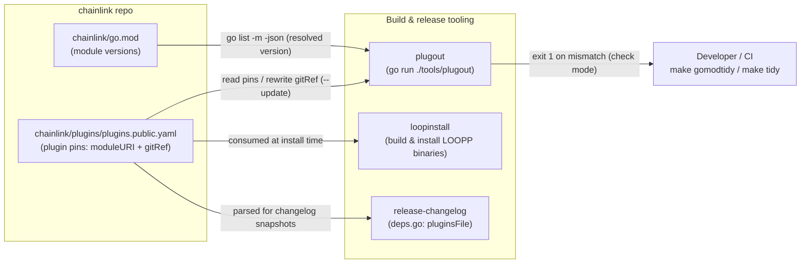
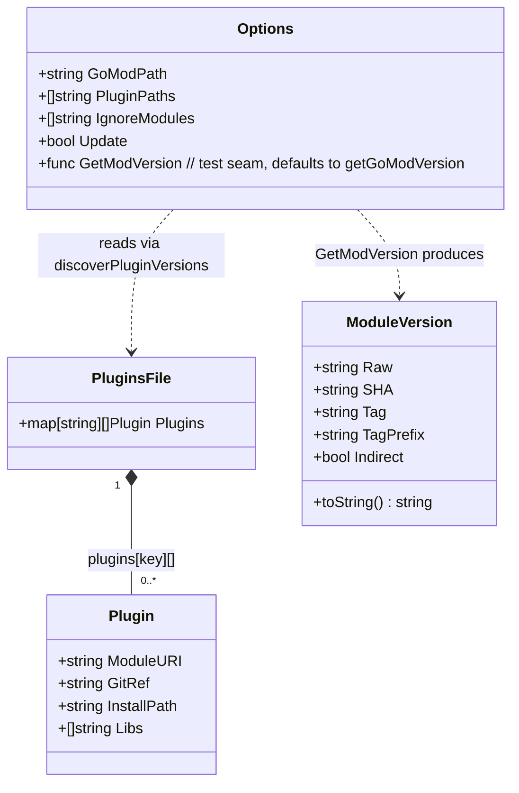
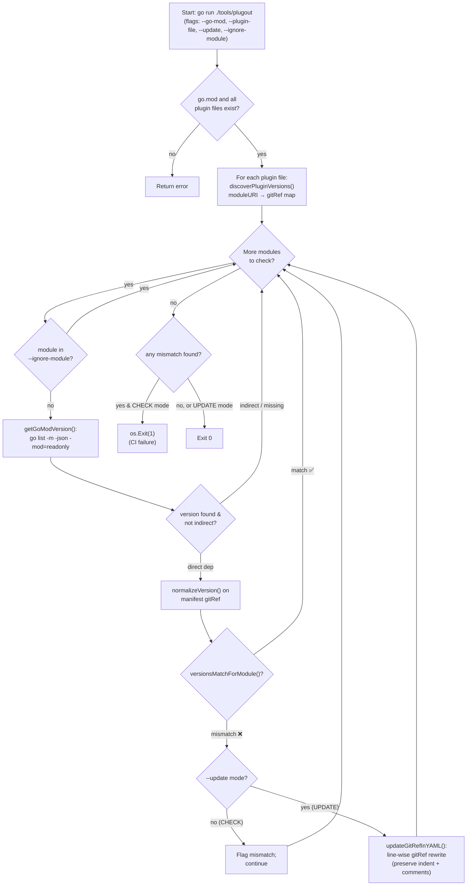
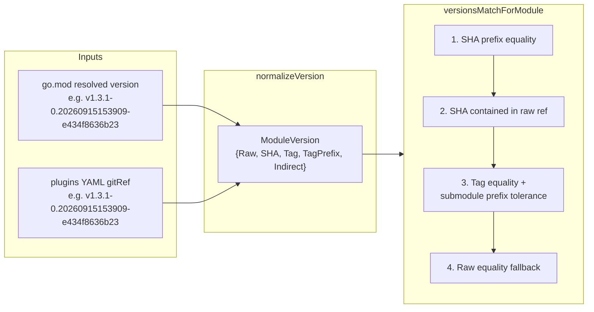

# plugout

> **Module:** `chainlink/tools/plugout` (single-file Go tool: `main.go`)
> **Command:** `go run ./tools/plugout sync` (invoked as part of the chainlink build tooling)

## 1. Introduction

`plugout` is a small, self-contained Go CLI whose single responsibility is to **keep plugin version pins in the plugin manifests in sync with the Go module graph**.

The chainlink node does not compile all chain integrations (Solana, Aptos, Starknet, Stellar, Sui, TON, Tron, data-streams, and the CRE capability binaries, etc.) directly into the main binary. Instead, these components are built as separate **LOOPP plugin binaries**, described in declarative manifest files such as `chainlink/plugins/plugins.public.yaml`. Each manifest entry pins a plugin to a `moduleURI` and a `gitRef`.

Because the main `chainlink/go.mod` also depends on the same modules (for shared types and local development), the pinned `gitRef` in the manifest can silently drift from the version the Go toolchain actually resolves. `plugout` closes this gap:

- **Check mode (default):** compares each manifest `gitRef` against the version resolved by `go.mod` and **exits non-zero on any mismatch** — making it suitable as a CI guard against un-pinned or stale plugin versions.
- **Update mode (`--update`):** rewrites the `gitRef` fields from the resolved `go.mod` versions, **preserving YAML formatting and comments**. This is wired into `make gomodtidy` so dependency bumps automatically propagate to plugin pins.

## 2. Where plugout fits in the build & release infrastructure

`plugout` sits at the intersection of three systems (see [Build, CI & Release Infrastructure](<../Build,_CI___Release_Infrastructure.md>)):

1. **The Go module system** (`chainlink/go.mod`) — the source of truth for dependency versions.
2. **[loopinstall](<../Plugin_Process_Framework_(Loop)/loop-plugin-core/loop-plugin-core_loopinstall.md>)** — the consumer of the manifests. It reads `plugins.public.yaml` / `plugins.private.yaml` / `plugins.testing.yaml` and builds & installs the actual plugin binaries (Make targets `install-plugins-public`, `install-plugins-private`, `install-plugins-testing` in `chainlink/GNUmakefile`).
3. **[release-changelog](release-changelog.md)** — parses the *same* `plugins/plugins.public.yaml` (via a mirrored `pluginsFile` struct in `release-changelog/internal/engine/deps.go`) to build dependency snapshots for changelog generation.



## 3. Core components

All logic lives in `chainlink/tools/plugout/main.go`. The data model is intentionally minimal and mirrors the manifest schema shared with `loopinstall`:

| Component | Kind | Purpose |
|---|---|---|
| `Plugin` | struct | One manifest entry: `moduleURI`, `gitRef`, `installPath`, `libs`. A subset of loopinstall's `PluginDef` (which adds `enabled`, `flags`, `envvars`). |
| `PluginsFile` | struct | Manifest root: `Plugins map[string][]Plugin` keyed by plugin name (e.g. `solana`, `capability-evm`). |
| `ModuleVersion` | struct | Normalized version representation: `Raw`, `SHA`, `Tag`, `TagPrefix` (for submodule tags like `relayer/v1.2.3`), `Indirect`. |
| `Options` | struct | Run configuration: `GoModPath`, `PluginPaths`, `IgnoreModules`, `Update`, plus a `GetModVersion` **test seam** (function injection point for unit testing without shelling out to `go list`). |
| `runSync` | function | Orchestrates the check/update loop across all plugin files; returns whether any mismatch was found. |
| `discoverPluginVersions` | function | Parses a manifest YAML into a `moduleURI → gitRef` map; warns on duplicate `moduleURI`s; ignores entries missing either field. |
| `getGoModVersion` | function | Resolves a module's version by executing `go list -m -json -mod=readonly <module>` in the go.mod's directory; honors `replace` directives; flags indirect dependencies. |
| `normalizeVersion` | function | Classifies a raw version string into SHA / tag / prefixed-tag forms using strict regexes (pseudo-version, plain tag `vX.Y.Z`, submodule-prefixed tag, bare SHA). |
| `versionsMatchForModule` / `tagsMatchWithSubdir` | functions | Equivalence rules that tolerate the submodule tag-prefix conventions. |
| `updateGitRefInYAML` / `desiredYAMLRefForModule` | functions | Line-wise, comment-preserving rewrite of the `gitRef:` field. |



## 4. Execution flow

The tool runs a single `sync` cobra command. The behaviour of check mode vs. update mode differs only at the mismatch decision point:



Key behavioural details:

- **Indirect dependencies are skipped entirely** — neither synced nor flagged. The minimal version selected by the module graph for an indirect dependency has no authoritative relationship to the version a plugin should be built against.
- **Check mode is strict:** `runSync` returns `hasMismatch=true` and `main()` calls `os.Exit(1)`, which fails the build/CI step.
- **Update mode is idempotent and format-preserving:** `updateGitRefInYAML` does a line-wise scan for the `moduleURI:` block, then replaces the following `gitRef:` line while preserving the original indentation and trailing `#` comments (e.g. the "IMP: consult chainlink-sui team" annotations in `chainlink/plugins/plugins.public.yaml`). Files are written with mode `0600`.

## 5. Version normalization and matching semantics

The central subtlety of `plugout` is that **Go module versions and git refs are encoded differently**, especially for repository submodules.

### 5.1 Recognized version forms (`normalizeVersion`)

| Form | Example | Normalized to |
|---|---|---|
| Pseudo-version with SHA | `v1.3.1-0.20260915153909-e434f8636b23` | `SHA = e434f8636b23` |
| Fallback pseudo-version (guarded) | `v0.1.0-20250227111209-g7cd000095135` | `SHA = 7cd000095135` |
| Bare commit SHA | `5d83a289da752e966692a9f390970dbc86c95c7a` | `SHA = 5d83a28…` |
| Submodule-prefixed tag | `relayer/v1.2.3` | `Tag = v1.2.3`, `TagPrefix = relayer` |
| Plain tag | `v1.0.5` | `Tag = v1.0.5` |

### 5.2 Submodule tag prefixes

Go requires tags for submodule modules to be prefixed with the module's path within the repo. For example, module `github.com/smartcontractkit/chainlink-starknet/relayer` is tagged as `relayer/vX.Y.Z` (multi-segment subdirs and `v2+` paths like `v2/sub` are also handled). `moduleSubdir()` extracts the `sub/dir` portion after the `host/org/repo` prefix.

### 5.3 Matching rules (`versionsMatchForModule`)

Two versions are considered equivalent (first match wins):

1. **SHA prefix equality** — a 7–40 hex char SHA in one side matches a longer SHA on the other (`shaEqual` allows prefix comparison, e.g. 12-char pseudo-version SHA vs. 40-char raw ref).
2. **SHA containment** — go.mod's SHA appears anywhere in the YAML's raw gitRef.
3. **Tag equality with subdir tolerance** — `v1.2.3` (go.mod, root form) matches `sub/v1.2.3` (YAML, submodule form) for module `…/repo/sub`, in either direction.
4. **Raw string fallback** — exact string equality.

When *writing* an updated ref (`desiredYAMLRefForModule`), the inverse rule applies: if go.mod resolved a **tag** and the module is a **submodule**, the written ref becomes `subdir/tag`; otherwise the raw version is written verbatim.



## 6. Integration with the build system

`plugout` is invoked from `chainlink/GNUmakefile` (see [chainlink build and tooling](chainlink_build_and_tooling.md)):

| Make target | Role of plugout |
|---|---|
| `gomodtidy` | Runs `gomods tidy` and then `go run ./tools/plugout --update` so that dependency bumps automatically rewrite plugin pins. |
| `tidy` | Runs `gomodtidy` and additionally `git add '**go.*' 'plugins/plugins.public.yaml'` — the manifest is expected to be committed together with go.mod changes. |
| `install-plugins-public` / `-private` / `-testing` | *Consumers* of the manifest (via [loopinstall](<../Plugin_Process_Framework_(Loop)/loop-plugin-core/loop-plugin-core_loopinstall.md>) with `go tool loopinstall … ./plugins/plugins.{public,private,testing}.yaml`). They rely on plugout having kept the pins accurate. |

The manifest itself (`chainlink/plugins/plugins.public.yaml`) pins the relayer plugins (aptos, sui, feeds, solana, starknet, stellar, streams, ton, tron, evm) and the CRE capability binaries (`capability-cron`, `capability-consensus`, `capability-httpaction`, `capability-httptrigger`, `capability-evm`, `capability-solana`, `capability-aptos`, `capability-stellar`, confidential-compute apps), all of which are installed as LOOPP plugin processes at node startup — see [Plugin Process Framework (Loop)](<../Plugin_Process_Framework_(Loop).md>).

## 7. Usage reference

```
go run ./tools/plugout sync [flags]
```

| Flag | Default | Description |
|---|---|---|
| `--go-mod` | `./go.mod` | Path to the go.mod file to resolve versions against. |
| `--plugin-file` | `./plugins/plugins.public.yaml` | Manifest file(s) to check. Repeatable. |
| `--update` | `false` | Rewrite mismatching `gitRef` values from go.mod (otherwise mismatches cause exit code 1). |
| `--ignore-module` | — | `moduleURI` to skip entirely. Repeatable. Useful for plugins intentionally pinned to a different version than the main module's dependency. |

Example — CI check:

```sh
go run ./tools/plugout sync \
  --go-mod ./go.mod \
  --plugin-file ./plugins/plugins.public.yaml
```

Example — update a specific manifest only, ignoring one module:

```sh
go run ./tools/plugout sync --update \
  --plugin-file ./plugins/plugins.private.yaml \
  --ignore-module github.com/smartcontractkit/chainlink-starknet/relayer
```

## 8. Design notes and constraints

- **Deliberately decoupled from loopinstall's schema.** `plugout` parses only the fields it owns (`moduleURI`, `gitRef`, `installPath`, `libs`) via its own `PluginsFile` struct, so additions to loopinstall's `PluginDef` (e.g. `flags`, `envvars`) do not break the tool. `release-changelog` follows the same pattern with its mirrored `pluginsFile` type.
- **Testability.** The `Options.GetModVersion` function field is a seam that allows unit tests to substitute version resolution without invoking the real `go list` binary.
- **No code generation, no vendoring.** The tool uses only the standard library plus `cobra` and `yaml.v3`; it runs via `go run` from the main `chainlink` module and does not need its own `go.mod`.
- **Semantics caveat.** Matching is permissive (SHA prefixes, subdir tag forms) by design — the goal is to detect *meaningful* drift, not formatting differences. When go.mod reports a version for a module, the manifest `gitRef` is expected to identify the same commit or tag.
- **File permissions.** Updated YAML files are written with `0600` (the path is constructed internally during module iteration, not from user-controlled direct input to a write).

## 9. Related documentation

- [Build, CI & Release Infrastructure](<../Build,_CI___Release_Infrastructure.md>) — parent module: repo CI, tooling, and release processes.
- [chainlink build and tooling](chainlink_build_and_tooling.md) — the `chainlink/GNUmakefile` targets that invoke plugout and loopinstall.
- [release-changelog](release-changelog.md) — sibling release tooling that consumes the same `plugins/plugins.public.yaml` pins.
- [Plugin Process Framework (Loop)](<../Plugin_Process_Framework_(Loop).md>) — the plugin runtime that the pinned binaries are built and loaded for; [loopinstall](<../Plugin_Process_Framework_(Loop)/loop-plugin-core/loop-plugin-core_loopinstall.md>) documents the manifest consumer.
