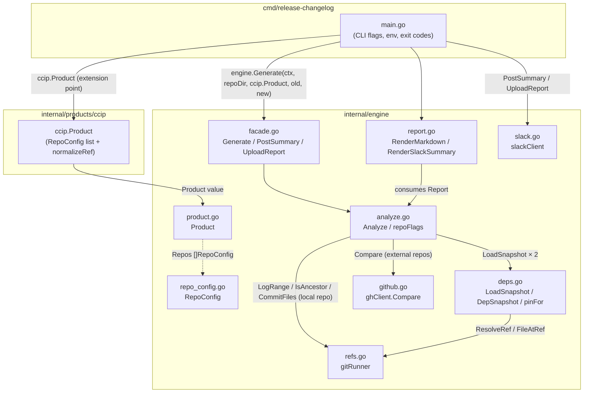
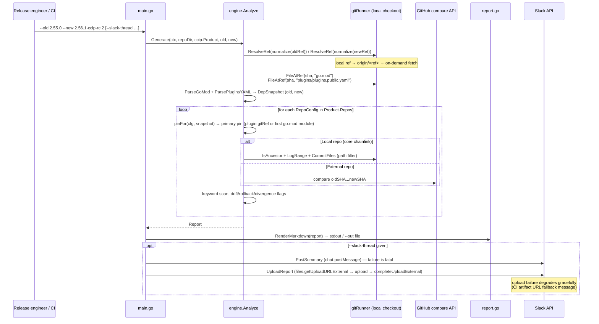
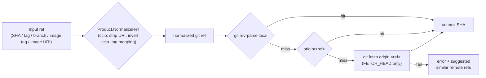

# release-changelog

## Overview

`release-changelog` is a standalone Go CLI (source: `chainlink/tools/release/release-changelog/`) that generates a **CCIP-focused release changelog between two refs of the core `chainlink` repository** — release branches, tags, SHAs, or CCIP release image tags. It is used as a **risk-audit artifact in the release process**.

For a given old/new ref pair the tool produces:

1. **go.mod diff** of CCIP-relevant modules (`chainlink-ccip` and its `chains/*` submodules, `chainlink-evm`, `chainlink-aptos/codec`, `chainlink-sui/codec`, `chainlink-ton`) as pinned in the core repo's root `go.mod` (`chainlink/go.mod`).
2. **Plugin pin diff** of `plugins/plugins.public.yaml` gitRefs (aptos, sui, solana, ton, evm) — the plugin refs are what actually get built into the release image.
3. **Per-repo commit changelogs** between the pinned commits — fetched from the GitHub compare API for external repos (`chainlink-ccip`, `chainlink-evm`, …) or read from the local git checkout for the core repo (restricted to `core/capabilities/ccip/`).
4. **Risk flags**: plugin gitRef add/remove/change, plugin-vs-go.mod dual-source drift, rollbacks/divergence, modules or plugins added/removed, and keyword callouts (`breaking`, `revert`, `hotfix`, `security`, `config`, `fix!`).

The report is rendered as markdown (stdout, `--out` file, and optionally a file upload) and can be posted as a compact summary into a **Slack thread**.

### Key design principle: a product-agnostic engine

The engine (`internal/engine/`) knows nothing about CCIP. Everything product-specific — which repositories to track, which paths to filter, and how to normalize product-specific ref shapes like `2.56.1-ccip-rc.2` image tags into git tags — is supplied by a `Product` value passed in by the caller. The CCIP definition lives in `internal/products/ccip/`, and `cmd/release-changelog/main.go` is the thin wrapper that wires the two together. Adding a new product (e.g. Core releases) means adding `internal/products/<name>/` and a new `main` wiring — no engine changes.

The tool is part of the core `chainlink` Go module (`module github.com/smartcontractkit/chainlink/v2`, see `chainlink/go.mod`) and is run with `go run ./tools/release/release-changelog/cmd/release-changelog` from a full-history checkout of the core repo.

## Architecture

```
cmd/release-changelog/main.go        (CLI: flags, env, Slack wiring)
        │  wires in
        ▼
internal/products/ccip               (Product: repos, path filters, ref normalizer)
        │
        ▼
internal/engine                      (product-agnostic engine)
 ├─ facade.go     Generate / PostSummary / UploadReport   ── public API
 ├─ product.go    Product + NormalizeRef hook             ── extension contract
 ├─ repo_config.go RepoConfig                              ── per-repo tracking spec
 ├─ refs.go       gitRunner: ResolveRef / FileAtRef / LogRange ── local git plumbing
 ├─ deps.go       LoadSnapshot: go.mod + plugins.public.yaml  ── dependency snapshots
 ├─ github.go     ghClient: compare base...head           ── remote commit sourcing
 ├─ analyze.go    Analyze: pins → repo reports → risk flags ── orchestration/audit
 ├─ report.go     RenderMarkdown / RenderSlackSummary     ── rendering
 └─ slack.go      slackClient: PostMessage / UploadFile   ── delivery
```

### Component & dependency graph

Detailed sub-module pages: [Engine core & public API](release-changelog/release-changelog_engine-core.md) · [Git integration](release-changelog/release-changelog_git-integration.md) · [Dependency snapshots](release-changelog/release-changelog_dependency-snapshot.md) · [Commit changelogs & risk analysis](release-changelog/release-changelog_commit-changelogs.md) · [Reporting & Slack delivery](release-changelog/release-changelog_reporting-delivery.md) · [CCIP product definition](release-changelog/release-changelog_ccip-product.md)



### End-to-end data flow



### Ref handling pipeline

The tool accepts whatever a release engineer has at hand, and normalizes it once, at the boundary:



Product-specific shapes (CCIP image tags like `2.56.1-ccip-rc.2`, image URIs, or the hybrid `v2.56.1-ccip-rc.2`) are inverted to git tags **locally** — no image is ever pulled — because `build-publish.yml` derives the image tag from the git tag deterministically. The report header records the mapping for the audit trail (`image tag → git tag`), tracked as `DepSnapshot.ResolvedRef` in `deps.go`.

## Sub-module documentation

The engine splits cleanly by responsibility. Detailed documentation:

| Sub-module | Files | Purpose |
|---|---|---|
| [Engine core & public API](release-changelog/release-changelog_engine-core.md) | `product.go`, `repo_config.go`, `facade.go` | The `Product`/`RepoConfig` extension contract and the exported `Generate`/`PostSummary`/`UploadReport` facade |
| [Git integration](release-changelog/release-changelog_git-integration.md) | `refs.go` | `gitRunner`: ref resolution with fallbacks, file reads at refs, local commit logs, ancestry checks |
| [Dependency snapshots](release-changelog/release-changelog_dependency-snapshot.md) | `deps.go` | Parsing core-repo `go.mod` + `plugins.public.yaml` into `DepSnapshot`; primary-pin selection (`pinFor`) |
| [Commit changelogs & risk analysis](release-changelog/release-changelog_commit-changelogs.md) | `github.go`, `analyze.go` | GitHub compare API client; `Analyze` orchestration, per-repo reports, risk-flag computation |
| [Reporting & Slack delivery](release-changelog/release-changelog_reporting-delivery.md) | `report.go`, `slack.go` | Markdown/Slack-mrkdwn rendering; Slack Web API client (threaded messages, external file upload) |
| [CCIP product definition](release-changelog/release-changelog_ccip-product.md) | `internal/products/ccip/ccip.go` | The tracked repo list for CCIP releases and the image-tag → git-tag normalizer |

## Usage

```bash
# From the core repo root (full git history required)
go run ./tools/release/release-changelog/cmd/release-changelog \
    --old v2.55.0 --new release/2.56.0 \
    [--out report.md] \
    [--slack-thread https://<ws>.slack.com/archives/<channel>/p<ts>]
```

| Input | Meaning |
|---|---|
| `--old` / `--new` (required) | Any git ref, or a CCIP image tag / image URI (see ref pipeline above) |
| `--repo` | Path to the core repo checkout (default `.`); used for ref resolution, file reads, and the local commit log |
| `--out` | Write the full markdown report to a file (default: stdout) |
| `--slack-thread` | Post summary + report file into this Slack thread |

| Environment | Role |
|---|---|
| `GITHUB_TOKEN` / `GH_TOKEN` | GitHub compare API auth (falls back to `gh auth token`; all tracked repos are public — affects rate limits only) |
| `SLACK_BOT_TOKEN` | Required with `--slack-thread`; bot must be a channel member |
| `GITHUB_SERVER_URL` / `GITHUB_REPOSITORY` / `GITHUB_RUN_ID` | Read by `ActionsRunURL()` to build the CI-run artifact link used as the Slack upload fallback |

In CI, the README references the `ccip-release-changelog` `workflow_dispatch` workflow, which takes the same inputs and uses the `SLACK_BOT_TOKEN_RELENG` secret. Delivery semantics in `main.go`: the **summary message is the audit payload** — a failure to post it fails the run — while the **full report file upload degrades gracefully** (fallback message pointing at the CI run artifact).

## Configuration model

There are deliberately **no CLI flags or workflow inputs for tracking behavior**. All tracking is code-config in the `Product` value (see [CCIP product definition](release-changelog/release-changelog_ccip-product.md)):

- `Product.DisplayName` — report/Slack header label.
- `Product.Repos []RepoConfig` — one entry per tracked repo: `Name`/`Owner` (GitHub), `GoModules` (root-go.mod pins, most important first), `PluginKeys` (`plugins.public.yaml` keys, which become the primary pin), `IncludePaths`/`ExcludePaths` (commit path filters), `Local` (read from the local checkout instead of the compare API).
- `Product.NormalizeRef` — maps product-specific ref shapes to git refs before resolution.

The **primary pin** — the single old/new SHA pair that drives each repo's commit changelog — is the plugin `gitRef` when `PluginKeys` is set (that ref is what the release image builds), otherwise the first `GoModules` entry. Repos with both sources (ton, evm) get a **drift flag** if the two pins disagree at the same ref; multi-pin divergence within a ref is reported as informational notes.

## Testing & maintenance

```
go test ./tools/release/release-changelog/...                    # unit + golden tests
UPDATE_GOLDEN=1 go test ./tools/release/release-changelog/...    # regenerate goldens
```

Golden files (`internal/engine/testdata/report.golden.md`, `slack-summary.golden.txt`) render from an inline engine fixture rather than the real product config, so they stay stable across product-config edits. Engine changes to rendering or flag logic require regenerating them.

## Relationship to other modules

- **[plugout](plugout.md)** — the `chainlink/tools/plugout` CLI syncs plugin versions *from* `go.mod` *into* `plugins/plugins.public.yaml` (its `PluginsFile` Go type is the authoritative mirror of that file; `deps.go`'s `pluginsFile` struct is the read-only counterpart used for diffing). The two tools thus form the write and read sides of the plugin-pin workflow.
- **[ci-tools](ci-tools.md)** — `chainlink/tools/ci` covers adjacent release operations (changeset tag checks, CCIP baseline resolution, test matrices); `release-changelog` complements it on the audit/reporting side.
- **[chainlink_build_and_tooling](chainlink_build_and_tooling.md)** — the core repo's `GNUmakefile` and root `go.mod` produce the artifacts whose pins this tool diffs.
- **[CCIP Cross-Chain Protocol](../CCIP_Cross-Chain_Protocol.md)** — the product being audited: the `core/capabilities/ccip/` tree is the path-filtered local changelog source, and the tracked external repos (`chainlink-ccip`, `chainlink-evm`, …) implement the chain codecs/transmitters documented there.
