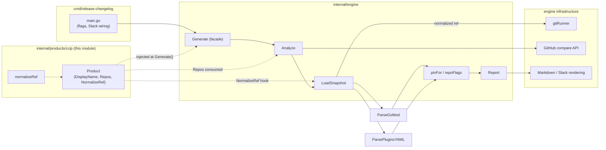
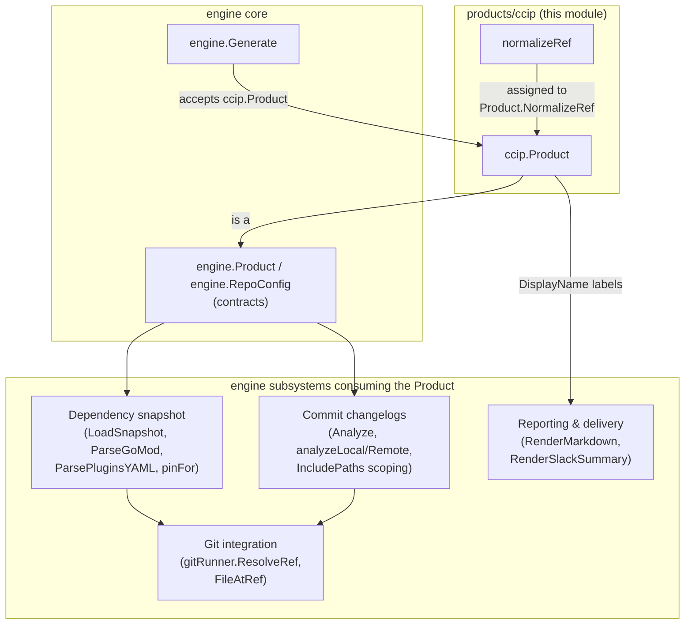
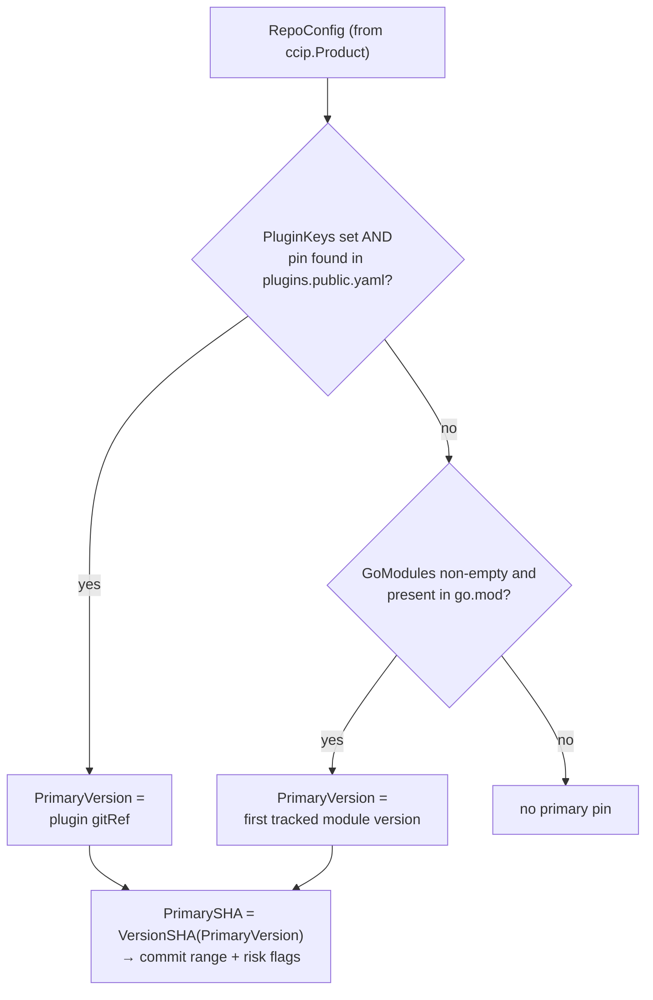
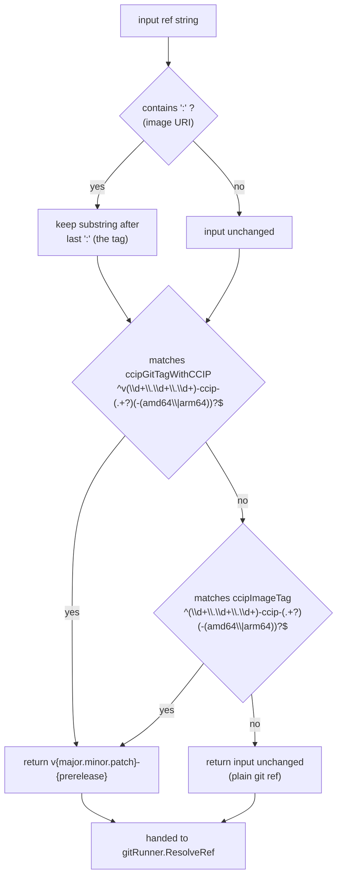
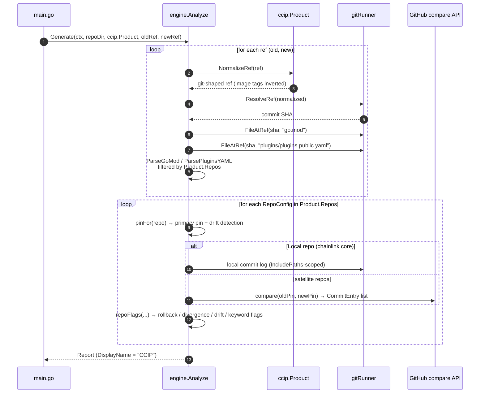

# release-changelog CCIP Product Definition

> **Module path:** `chainlink/tools/release/release-changelog/internal/products/ccip`
> **Part of:** [release-changelog](../release-changelog.md) (Build, CI & Release Infrastructure)
> **Go module:** `github.com/smartcontractkit/chainlink/v2` (main chainlink module, declared in `chainlink/go.mod`)

## Overview

The `ccip` package defines the **CCIP product** for the [release-changelog engine](release-changelog_engine-core.md): it answers two questions that the otherwise product-agnostic engine cannot answer on its own:

1. **What to track** — which repositories, Go modules, and plugin pins constitute a CCIP release audit.
2. **How to interpret input refs** — how to normalize the ref shapes a release engineer actually works with (Docker image tags, full image URIs) into git refs the engine's git machinery can resolve.

The module is pure **configuration and policy**: a single exported `Product` value (`engine.Product`) plus one normalization function (`normalizeRef`). It contains no CLI flags, no Slack inputs, and no I/O. The engine consumes this definition at two hook points:

- `Product.Repos` drives dependency-snapshot parsing, per-repo commit changelogs, and risk flagging.
- `Product.NormalizeRef` is invoked inside [snapshot loading](release-changelog_dependency-snapshot.md) before any git resolution happens, so the git integration layer ([`gitRunner`](release-changelog_git-integration.md)) never sees product-specific ref shapes.

The CLI entry point wires this product into the engine with a single line:

```go
// cmd/release-changelog/main.go
report, err := engine.Generate(ctx, repoDir, ccip.Product, oldRef, newRef)
```

### Position in the release-changelog pipeline



## Architecture & Component Relationships

The engine defines the contract (`engine.Product`, `engine.RepoConfig`); this module provides the CCIP realization of that contract. The relationships are strictly one-directional: **products depend on the engine, never the reverse**.



| Engine hook | Consumed by | What CCIP provides |
|---|---|---|
| `Product.DisplayName` | Report headers, Slack titles, artifact filenames | `"CCIP"` |
| `Product.Repos` | `LoadSnapshot` (filters `go.mod` / `plugins.public.yaml` entries), `Analyze` (drives per-repo changelogs), `pinFor` (primary-pin selection), `repoFlags` (risk flags) | 7 `RepoConfig` entries (see below) |
| `Product.NormalizeRef` | `LoadSnapshot`, before `gitRunner.ResolveRef` | Image tag / image URI → git tag mapping |

## The Product Definition

`ccip.Product` tracks seven repositories under the `smartcontractkit` organization. Each entry is an `engine.RepoConfig` whose fields control how that repo's pin is discovered and how its commit changelog is scoped (full field semantics are documented in the [engine core](release-changelog_engine-core.md)).

| Repository (`Owner: smartcontractkit`) | Tracked Go modules (root `go.mod` of core repo) | Plugin keys (`plugins.plugins.public.yaml`) | Pin sourcing | Notes |
|---|---|---|---|---|
| **chainlink-ccip** | `github.com/smartcontractkit/chainlink-ccip` *(primary)*, `…/chains/evm`, `…/chains/solana`, `…/chains/solana/gobindings` | — | go.mod only | The core CCIP plugin library; first entry is the primary module driving the commit changelog. |
| **chainlink-aptos** | `github.com/smartcontractkit/chainlink-aptos/codec` | `aptos` *(primary)* | plugin gitRef | Plugin pin is what gets built into the release image. |
| **chainlink-sui** | `github.com/smartcontractkit/chainlink-sui/codec` | `sui` *(primary)* | plugin gitRef | Same plugin-driven model. |
| **chainlink-solana** | — (not in root `go.mod`) | `solana` *(primary)* | plugin only | Plugin-only pin; deliberately not a core go.mod dependency. |
| **chainlink-ton** | `github.com/smartcontractkit/chainlink-ton` | `ton` | **dual-source** | Both pins are collected and cross-checked for drift. |
| **chainlink-evm** | `github.com/smartcontractkit/chainlink-evm` *(primary)*, `…/gethwrappers` | `evm` | **dual-source** | `contracts/cre/gobindings` intentionally untracked (CRE-owned). Drift between plugin gitRef and go.mod version is flagged. |
| **chainlink** (core repo) | — | — | local git checkout | `Local: true`; the commit log is read from the local checkout instead of the GitHub compare API. Strictly path-scoped via `IncludePaths: ["core/capabilities/ccip/"]`. |

### Pin sourcing model

The engine's `pinFor` function resolves each repo's **primary pin** (the version whose git history becomes the commit changelog) using the `GoModules` / `PluginKeys` configuration above:



For **dual-source** repos (`chainlink-ton`, `chainlink-evm`) both pin sources are recorded, and `repoFlags` emits a `DRIFT` flag when the plugin `gitRef` and the `go.mod` pseudo-version resolve to different commit SHAs at the same ref — a common and dangerous release inconsistency.

### Why the core repo entry is path-scoped

The `chainlink` entry sets `Local: true` and restricts the changelog to `IncludePaths: ["core/capabilities/ccip/"]`. This is intentional and **guarded by a test**: an unfiltered core-repo changelog would duplicate the repository-level `CHANGELOG` (thousands of commits across every product). The path scope means commits touching other parts of the main module — e.g. the CCIP type definitions under `chainlink-common/pkg/types/ccip…` — are **not** surfaced by this entry, even though they are part of the CCIP stack. This is a deliberate tuning point: the package comment explicitly instructs release engineers to edit the `Product` definition to add paths or repositories.

> The runtime code covered by that path scope is documented in the [CCIP Cross-Chain Protocol](../../CCIP_Cross-Chain_Protocol.md) module; the deployment tooling for the tracked satellite repos lives in the [CCIP Deployment Suite](../../CCIP_Deployment_Suite.md).

## Ref Normalization (`normalizeRef`)

Release engineers rarely think in git refs — they think in the version of the image they run. The CCIP build pipeline (`build-publish.yml`) derives the Docker image tag from the pushed git tag by inserting `-ccip` before the prerelease identifier and dropping the leading `v`:

```
git tag   v2.34.0-rc.1   →   image tag  2.34.0-ccip-rc.1
```

This mapping is **invertible without contacting any registry**, which is what `normalizeRef` exploits. It is applied by `LoadSnapshot` to *both* `--old` and `--new` inputs before git resolution:

### Decision flow



### Rules

1. **Image URI stripping** — git refnames can never contain `:`, so if the input contains a colon, everything after the last `:` is treated as the tag. This turns `public.ecr.aws/chainlink/ccip:2.56.1-ccip-rc.2` into `2.56.1-ccip-rc.2`.
2. **`ccipGitTagWithCCIP`** — matches the common mistake of prefixing an image tag with `v` (or inserting `-ccip-` into a git tag): `v2.56.1-ccip-rc.2` → `v2.56.1-rc.2`. The `v` is kept because real git tags carry it.
3. **`ccipImageTag`** — matches canonical image tags: `2.56.1-ccip-rc.2` → `v2.56.1-rc.2`.
4. **Architecture suffix tolerance** — both patterns strip an optional trailing `-amd64` / `-arm64`, as displayed in the ECR console.
5. **Pass-through** — anything else (plain git tags like `v2.55.0`, branches like `release/2.57.2`, raw SHAs) is returned unchanged, preserving the engine's ability to resolve ordinary refs.

### Covered inputs (from `TestNormalizeRef`)

| Input | Output | Case |
|---|---|---|
| `2.56.1-ccip-rc.2` | `v2.56.1-rc.2` | canonical image tag |
| `2.34.0-ccip-beta.0` | `v2.34.0-beta.0` | beta prerelease |
| `2.56.1-ccip-rc.2-arm64` | `v2.56.1-rc.2` | arch suffix stripped |
| `2.56.1-ccip-rc.0-amd64` | `v2.56.1-rc.0` | arch suffix stripped |
| `v2.56.1-ccip-rc.1` | `v2.56.1-rc.1` | hybrid "v"-prefixed image tag |
| `v2.56.1-ccip-rc.1-arm64` | `v2.56.1-rc.1` | hybrid + arch suffix |
| `public.ecr.aws/chainlink/ccip:2.56.1-ccip-rc.2` | `v2.56.1-rc.2` | full image URI |
| `v2.55.0`, `v2.56.1-rc.2`, `release/2.57.2`, `eee47b86…` | unchanged | plain git refs pass through |

## End-to-End Data Flow

The sequence below shows one full audit run (both refs), highlighting every point where this module's configuration takes effect:



The resulting `Report` is rendered and delivered by the [reporting & delivery subsystem](release-changelog_reporting-delivery.md); the per-repo changelog and flag logic are detailed in [commit changelogs](release-changelog_commit-changelogs.md), and snapshot mechanics in [dependency snapshot](release-changelog_dependency-snapshot.md).

## Testing

Two tests in `ccip_test.go` guard the product definition (`go test ./internal/products/ccip/...` from the tool root):

- **`TestNormalizeRef`** — table-driven coverage of every accepted input shape above (image tags, URIs, hybrid forms, arch suffixes, pass-throughs).
- **`TestProductSanity`** — a configuration regression guard that runs against the *real* `Product` value and asserts that:
  - `DisplayName` is `"CCIP"` and `NormalizeRef` is non-nil;
  - the primary pins of every tracked repo actually resolve from a **realistic** fixture pair (`go.mod` with pseudo-versioned `chainlink-ccip` / `chainlink-ton` requires, and a `plugins.public.yaml` with `aptos` / `evm` gitRef entries) via `engine.ParseGoMod` and `engine.ParsePluginsYAML`;
  - the core-repo (`Local`) entry keeps a non-empty `IncludePaths` — protecting against an accidental unfiltered core changelog.

This makes adding or reconfiguring repos a test-supported edit rather than a hope.

## Extending the Product

Everything in `ccip.go` is configuration; per the package comment, **no CLI or Slack changes are needed to alter tracking behavior**. Common operations:

| Goal | Change |
|---|---|
| Track a new satellite repo | Append an `engine.RepoConfig{Name, Owner, GoModules…}` to `Product.Repos`. If the repo installs as a plugin, set `PluginKeys` (it becomes the primary pin); otherwise list its modules in the core `go.mod`. |
| Narrow/widen core-repo commits | Adjust `IncludePaths` / `ExcludePaths` on the `Local` `chainlink` entry. Keep at least one include path (test-enforced). |
| Add a module of an existing repo | Append to that repo's `GoModules`. The **first** entry is the primary module when no plugin pin exists — order matters. |
| Support a new ref input shape | Extend the regexes / logic in `normalizeRef` and add cases to `TestNormalizeRef`. Only do this for shapes that map *invertibly* to git refs. |
| Opt a repo out of drift detection | Remove its `PluginKeys` (making go.mod the sole source) or its `GoModules` — but beware: this weakens the audit surface. |

Because the module depends only on the [engine core contracts](release-changelog_engine-core.md), a new product for another Chainlink vertical can be created by copying this pattern and registering a different `engine.Product` in `cmd/release-changelog/main.go`.

## Operational Notes

- **Build context:** the tool compiles within the main chainlink Go module (`module github.com/smartcontractkit/chainlink/v2`, `chainlink/go.mod`) — the `internal/` import boundary that lets `products/ccip` reach `internal/engine` is module-scoped, not directory-scoped.
- **Environment:** `GITHUB_TOKEN`/`GH_TOKEN` for the compare API (all tracked repos are public); `SLACK_BOT_TOKEN` when `--slack-thread` is used. See the [parent module page](../release-changelog.md) for invocation details.
- **Related release ops tooling:** tag/changeset validation and CCIP baseline resolution are handled separately by the [ci-tools release-ops commands](../ci-tools.md); this tool consumes resolved refs rather than producing them.
