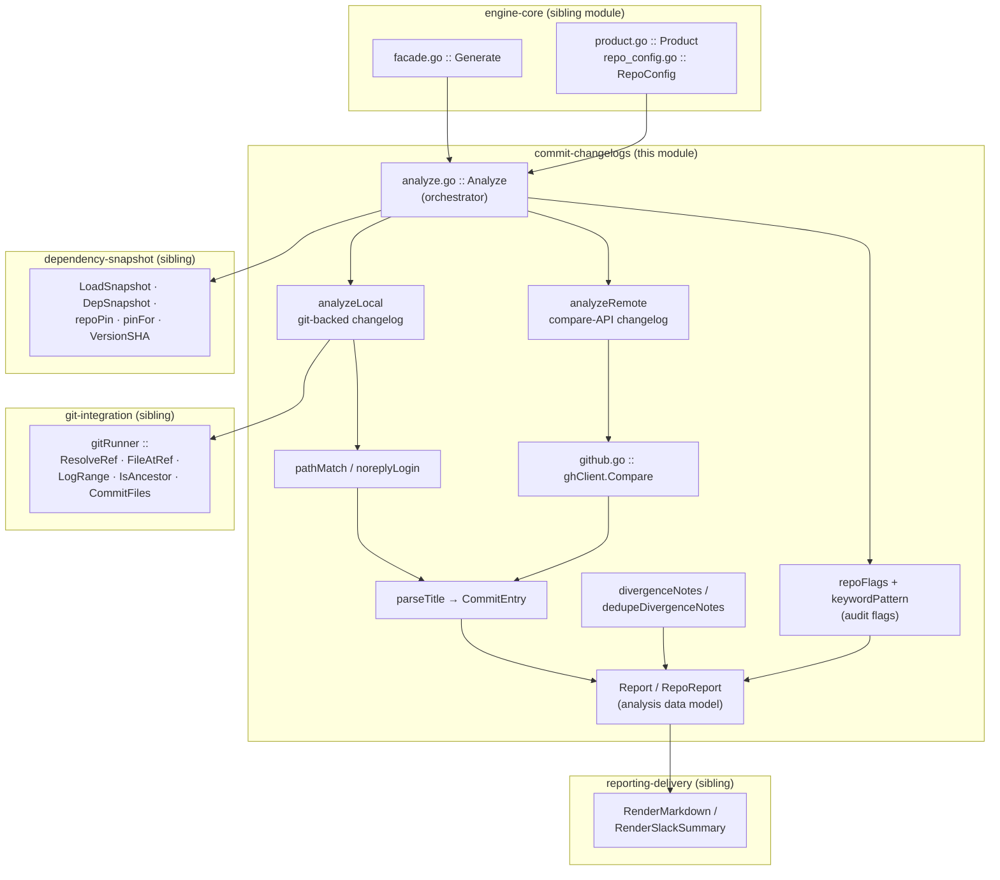
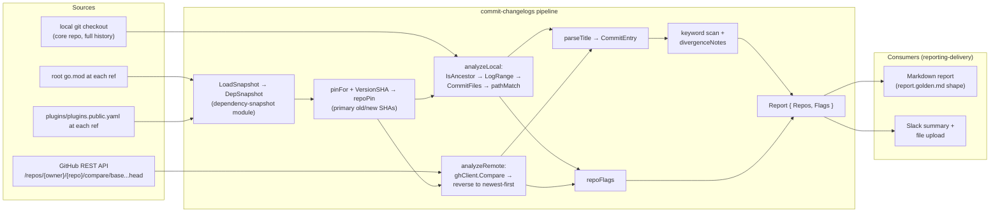
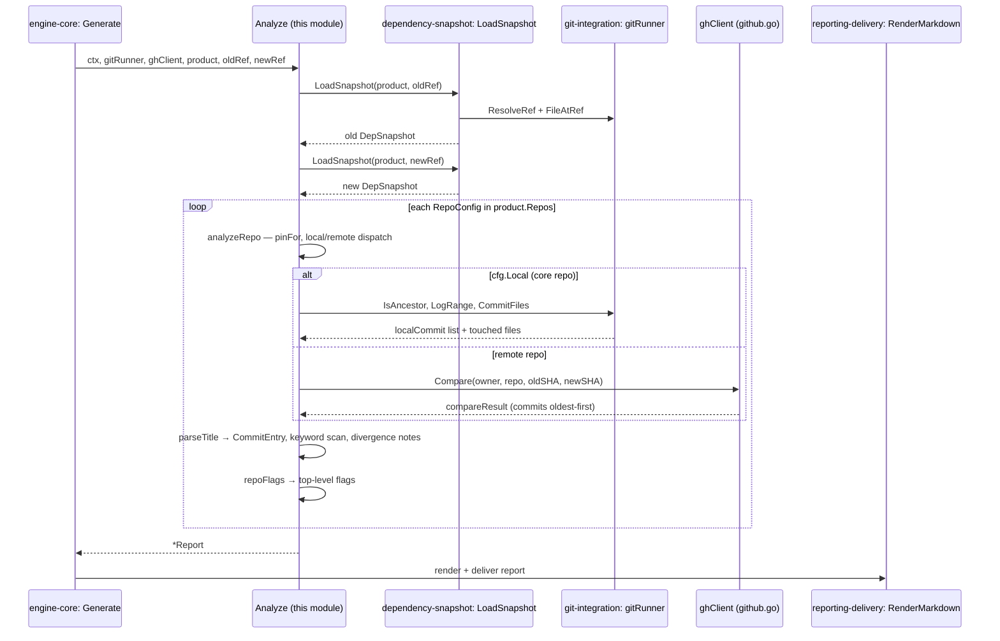
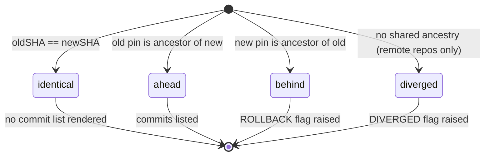

# release-changelog: Commit Changelogs & Analysis

This module is the analytical heart of the [release-changelog](../release-changelog.md) tool: it produces the **per-repository commit changelogs** between two release refs and derives the **risk flags** that make the output useful as a release-audit artifact. It is implemented in two files of the product-agnostic engine package:

| File | Responsibility |
|---|---|
| [`chainlink/tools/release/release-changelog/internal/engine/github.go`](../../../chainlink/tools/release/release-changelog/internal/engine/github.go) | GitHub REST compare-API client and the `CommitEntry` data model (title/PR/author extraction). |
| [`chainlink/tools/release/release-changelog/internal/engine/analyze.go`](../../../chainlink/tools/release/release-changelog/internal/engine/analyze.go) | The `Analyze` orchestrator, local (git-backed) and remote (compare-API) changelog pipelines, divergence notes, and audit-flag computation. |

> **Where this fits:** the tool audits the core `chainlink` repo — restricted to the CCIP capability tree (`core/capabilities/ccip/`) — plus the chain-specific plugin repos (`chainlink-ccip`, `chainlink-aptos`, `chainlink-sui`, `chainlink-solana`, `chainlink-ton`, `chainlink-evm`) between two refs, as part of the broader [Build, CI & Release Infrastructure](../../Build,_CI___Release_Infrastructure.md). The subsystem being audited is documented in [CCIP Cross-Chain Protocol](../../CCIP_Cross-Chain_Protocol.md).

---

## 1. Responsibilities

Given a product definition ([`Product`](release-changelog_engine-core.md)), two core-repo refs, and the dependency snapshots loaded from each ref ([dependency-snapshot](release-changelog_dependency-snapshot.md)), this module:

1. **Computes per-repo pins** — resolves each tracked repo's primary old/new SHAs via `pinFor`/`VersionSHA` (plugin `gitRef` if the repo has plugin entries, else the first tracked `go.mod` module).
2. **Produces a commit changelog per repo**:
   - **Local repos** (the core `chainlink` repo): via `git log` ancestry checks, `LogRange`, and per-commit path filtering against the configured `IncludePaths`/`ExcludePaths`.
   - **Remote repos**: via the GitHub REST compare API (`/repos/{owner}/{repo}/compare/{base}...{head}`).
3. **Normalizes commit entries** — parses squash-merge titles (`"(#1234)"` suffix → PR number) and enriches authors with GitHub logins when available.
4. **Flags release risk** — plugin `gitRef` changes, module add/remove, dual-source drift (plugin pin vs `go.mod` pin), rollbacks, divergence, and keyword callouts (`breaking`, `revert`, `hotfix`, `security`, `config`, `fix!`).
5. **Emits low-severity notes** — e.g. multi-pin divergence within a repo, path-filtering failures, and non-ancestral local refs.

The resulting `Report` is a pure data structure: rendering and delivery are handled by the [reporting-delivery](release-changelog_reporting-delivery.md) module.

---

## 2. Architecture

### Component inventory

**`github.go`** — GitHub REST integration:

| Component | Kind | Description |
|---|---|---|
| `CommitEntry` | struct | One changelog line's worth of commit data: `SHA`, `Title`, `PR` (extracted from a squash-merge `(#1234)` suffix; `0` if none), `Author` (GitHub `@login` when known, else the git author name). |
| `parseTitle` | func | Splits a commit message's first line into a cleaned title and optional PR number using the `prSuffix` / `prNumber` regexes (`\(#[0-9]+\)\s*$`). |
| `ghClient` | struct | REST client (`httpClient` with 30 s timeout, `token`, `baseURL` — overridable for tests). |
| `newGHClient` | func | Token resolution chain: `GITHUB_TOKEN` → `GH_TOKEN` → `gh auth token` → unauthenticated (public repos only, low rate limits). |
| `compareResponse` | struct | Wire type for the compare-API JSON (`status`, `ahead_by`, `behind_by`, `total_commits`, `commits[]`). |
| `compareResult` | struct | Domain result: `Status` (`ahead` / `behind` / `diverged` / `identical`), `AheadBy`, `BehindBy`, `Commits []CommitEntry`, `TotalCommits`. |
| `Compare` | method | `GET {baseURL}/repos/{owner}/{repo}/compare/{base}...{head}` with `Accept: application/vnd.github+json` and `Authorization: Bearer …` when a token is set. Non-200 responses fail with a 200-char-truncated body. Maps each API commit to a `CommitEntry`, preferring `author.login` (`@login`) over the git author name. |

**`analyze.go`** — analysis core:

| Component | Kind | Description |
|---|---|---|
| `Analyze` | func | Top-level entry: loads both `DepSnapshot`s, then runs `analyzeRepo` for every `RepoConfig` in the product, aggregating `RepoReport`s and top-level flags. Accepts `gh == nil` (remote repos then record errors instead of changelogs). |
| `Report` | struct | Full analysis: `ProductName`, `Old`/`New DepSnapshot`, `Repos []RepoReport`, `Flags []string`, `Generated` (UTC timestamp). |
| `RepoReport` | struct | Per-repo result: `Config`, `Old`/`New repoPin`, `Status`, `TotalInRange` (pre-filtering), `Commits`, `KeywordHits`, `Notes`, `Err`, `Truncated`. |
| `analyzeLocal` | func | Git-backed changelog for the core repo (see [§4.1](#41-local-pipeline-analyzelocal)). |
| `analyzeRemote` | func | Compare-API changelog for external repos (see [§4.2](#42-remote-pipeline-analyzeremote)). |
| `pathMatch` | func | Include/exclude prefix filters over a commit's touched files; excludes are applied first; with no includes a commit is kept when any file survives exclusion. |
| `noreplyLogin` | func | Extracts a GitHub login from a noreply email (`12345+octocat@users.noreply.github.com` → `octocat`) for author enrichment in the local pipeline. |
| `dedupeDivergenceNotes` | func | Collapses old/new divergence notes into a single "(both refs)" note when the divergence bodies match. |
| `divergenceNotes` | func | Reports when a repo's various pins (go.mod modules + plugin refs) point at different commits of the same repo at one ref. |
| `repoFlags` | func | Computes top-level audit flags (see [§5](#5-risk-flags-and-keyword-audit)). |
| `keywordPattern` | var | `(?i)\b(breaking|revert|hotfix|security|config)\b|fix!` — titles matching this are surfaced as flags and collected in `KeywordHits`. |

---

## 3. Data flow

The snapshots come from the [dependency-snapshot](release-changelog_dependency-snapshot.md) module, which resolves each ref through the [git-integration](release-changelog_git-integration.md) module and reads two files at the resolved SHA: the core repo's root `go.mod` (`chainlink/go.mod`) and [`chainlink/plugins/plugins.public.yaml`](../../../chainlink/plugins/plugins.public.yaml) — the latter defining each plugin's `moduleURI` and pinned `gitRef` (e.g. the `ton` and `evm` entries that the drift check cross-references against `go.mod` pins).

### Execution sequence

The only production caller is `Generate` in the [engine-core](release-changelog_engine-core.md) facade, which constructs the `gitRunner` (pointed at the core-repo checkout) and the `ghClient`, then invokes `Analyze`.

---

## 4. Changelog pipelines

### 4.1 Local pipeline (`analyzeLocal`)

Used for repos with `Local: true` — in the CCIP product, the core `chainlink` repo itself, whose changelog is restricted to commits touching `core/capabilities/ccip/` (see the product entry in [ccip-product](release-changelog_ccip-product.md)).

1. **Status determination** via `gitRunner.IsAncestor` ([git-integration](release-changelog_git-integration.md)):
   - `oldSHA == newSHA` → `identical` (no changelog rendered).
   - old is ancestor of new → `ahead` (normal release).
   - new is ancestor of old → `behind` — a genuine rollback, flagged at the top level.
   - otherwise → **`ahead` + informational note**. Deliberate design choice: release branches diverge from each other by design, and `LogRange` (old..new) still yields exactly "what's in new that wasn't in old". Unlike external repos, non-ancestry in the core repo is normal and is **not** flagged as `diverged`.
2. **Commit listing**: `gitRunner.LogRange` lists commits reachable from `new` but not `old` (`git log old..new`); `TotalInRange` records the pre-filtering count.
3. **Path filtering**: when `IncludePaths`/`ExcludePaths` are configured, each commit's touched files are resolved with `gitRunner.CommitFiles` (merge commits diffed against their first parent) and passed through `pathMatch`. File-listing failures are downgraded to `Notes` rather than aborting.
4. **Entry normalization**: `parseTitle` extracts title + PR number; `noreplyLogin` upgrades the git author name to a `@login` when the author email is a GitHub noreply address.

### 4.2 Remote pipeline (`analyzeRemote`)

Used for all external repos (pinned via `go.mod` versions or plugin `gitRef`s). Precondition handling:

| Condition | Outcome |
|---|---|
| No pin at either ref | `Err = "no pin found at either ref"` |
| SHA unextractable from version string(s) | `Err` naming the unparseable versions |
| Old and new pins identical | `Status = "identical"` |
| `gh` client is nil | `Err = "no GitHub client configured"` |

Otherwise `ghClient.Compare` runs the compare; the result is post-processed:

- The compare API returns commits **oldest-first**; they are reversed in place so reports render **newest-first**, matching the local pipeline.
- `TotalInRange` = API `total_commits`, falling back to `ahead_by` when zero.
- `Truncated = total_commits > len(commits)` — the API caps its commit list; the renderer emits an explicit truncation warning in this case.
- The API `status` (`ahead` / `behind` / `diverged` / `identical`) is adopted directly; `behind` and `diverged` map to top-level flags (see [§5](#5-risk-flags-and-keyword-audit)).

### Status semantics

For local repos `diverged` is unreachable — non-ancestral refs downgrade to `ahead` with a note (see [§4.1](#41-local-pipeline-analyzelocal)).

---

## 5. Risk flags and keyword audit

`repoFlags` produces the top-level `Report.Flags` list. Flag families, all prefixed with the repo name:

1. **Plugin `gitRef` changes** — a tracked plugin key in `plugins.public.yaml` was `REMOVED`, `ADDED`, or its `gitRef` changed (`old → new`).
2. **go.mod module add/remove** — a tracked module disappeared from or appeared in the root `go.mod`.
3. **Dual-source drift** — when a repo is tracked both as a plugin (`moduleURI` → `gitRef`) and as a `go.mod` module (today: `ton`, `evm`), and the two pins resolve to **different SHAs at the same ref**, a `DRIFT` flag is raised per side (`old` / `new`).
4. **Rollback / divergence** — `Status == "behind"` → `ROLLBACK`; `Status == "diverged"` (remote repos only) → `DIVERGED`, both with the offending SHAs.
5. **Keyword callouts** — every commit title matching `keywordPattern` becomes a flag with a `github.com/{owner}/{repo}/commit/{sha}` link. Matches are also retained per-repo in `RepoReport.KeywordHits`.

Notes vs flags: `Notes` are low-severity observations rendered as blockquotes inside the repo's section (divergent multi-pins, path-filter failures, non-ancestral local refs), while `Flags` are the headline audit signal rendered under the report's **⚠️ Flags** heading by [reporting-delivery](release-changelog_reporting-delivery.md).

Divergence notes are computed per ref and deduplicated by `dedupeDivergenceNotes`: when the divergence at the old and new refs is identical, a single `divergent pins (both refs): …` note is emitted instead of two near-duplicates. This situation is normal for repos that ship mixed pins (e.g. `chainlink-ccip` vs `chainlink-ccip/chains/evm`, or `plugin:sui` vs `chainlink-sui/codec`) and is informational only.

---

## 6. Integration with the rest of release-changelog

| Concern | Module | Interaction with this module |
|---|---|---|
| Product & repo tracking config (`Product`, `RepoConfig`) | [engine-core](release-changelog_engine-core.md) | Supplies the repo list, path filters, and `Local` flag that drive pipeline selection. |
| Ref resolution & git access (`gitRunner`) | [git-integration](release-changelog_git-integration.md) | Provides `ResolveRef`, `FileAtRef`, `LogRange`, `IsAncestor`, `CommitFiles` used by the snapshot loader and `analyzeLocal`. |
| Pin snapshots (`LoadSnapshot`, `DepSnapshot`, `repoPin`, `pinFor`, `VersionSHA`) | [dependency-snapshot](release-changelog_dependency-snapshot.md) | Provides old/new pins; `VersionSHA` extracts commit SHAs from version strings for the remote pipeline. |
| Product definition (CCIP `Repos`, ref normalizer) | [ccip-product](release-changelog_ccip-product.md) | Concrete configuration: external repos plus the `Local` core-repo entry with `IncludePaths: ["core/capabilities/ccip/"]`. |
| Rendering & delivery (`RenderMarkdown`, `RenderSlackSummary`, Slack client) | [reporting-delivery](release-changelog_reporting-delivery.md) | Consumes `Report`/`RepoReport` (`Commits`, `Notes`, `Err`, `Truncated`, `Flags`) — this module has no rendering knowledge. |

---

## 7. Testing and operations

- **Tests** (unit + golden): `go test ./tools/release/release-changelog/...`
- **Golden regeneration** after changing flag logic or rendering: `UPDATE_GOLDEN=1 go test ./tools/release/release-changelog/...`. The goldens (`internal/engine/testdata/report.golden.md`, `internal/engine/testdata/slack-summary.golden.txt`) render from an inline engine fixture, so they stay stable across product-config edits; only engine behavior changes require regeneration.
- **Lint**: `golangci-lint run ./tools/release/release-changelog/...` (configuration: [`chainlink/.golangci.yml`](../../../chainlink/.golangci.yml)).
- **Runtime requirements**: a full git history checkout of the core repo (local pipeline needs ancestry and log data); run from the repo root via `go run ./tools/release/release-changelog/cmd/release-changelog --old <ref> --new <ref>`.
- **Environment**:
  - `GITHUB_TOKEN` / `GH_TOKEN` — compare-API auth (falls back to `gh auth token`; all tracked repos are public, so tokens only affect rate limits).
  - `SLACK_BOT_TOKEN` — required only for delivery (handled downstream in [reporting-delivery](release-changelog_reporting-delivery.md)).
- **CI**: the tool is normally driven by the `ccip-release-changelog` `workflow_dispatch` workflow (using the `SLACK_BOT_TOKEN_RELENG` secret) as documented in the tool's [README](../../../chainlink/tools/release/release-changelog/README.md). Adjacent release-process automation — changeset tag checks and CCIP baseline resolution — lives in the [ci-tools](../ci-tools.md) module.

---

## Related pages

- [release-changelog overview](../release-changelog.md)
- [release-changelog engine core](release-changelog_engine-core.md)
- [release-changelog git integration](release-changelog_git-integration.md)
- [release-changelog dependency snapshot](release-changelog_dependency-snapshot.md)
- [release-changelog CCIP product definition](release-changelog_ccip-product.md)
- [release-changelog reporting & delivery](release-changelog_reporting-delivery.md)
- [Build, CI & Release Infrastructure](../../Build,_CI___Release_Infrastructure.md)
