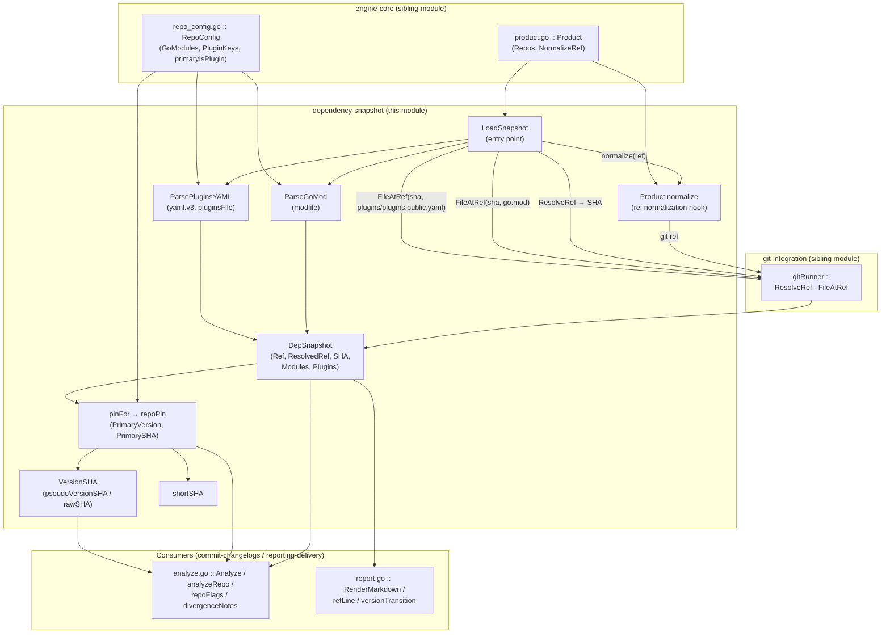
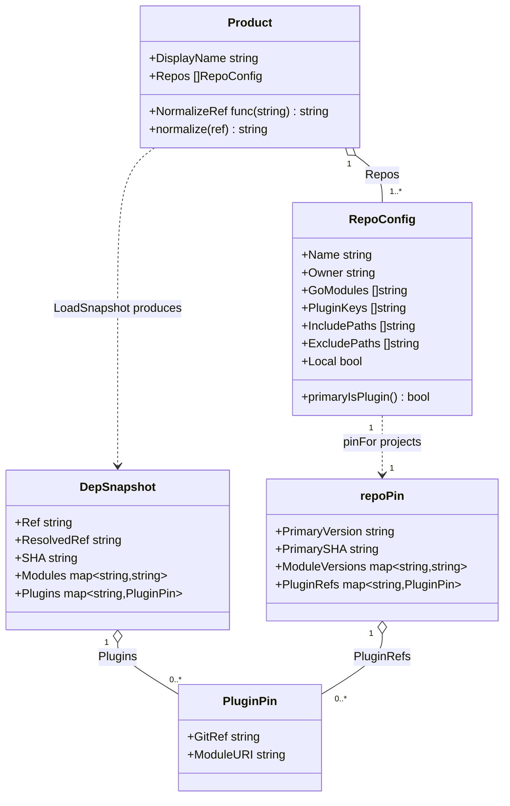
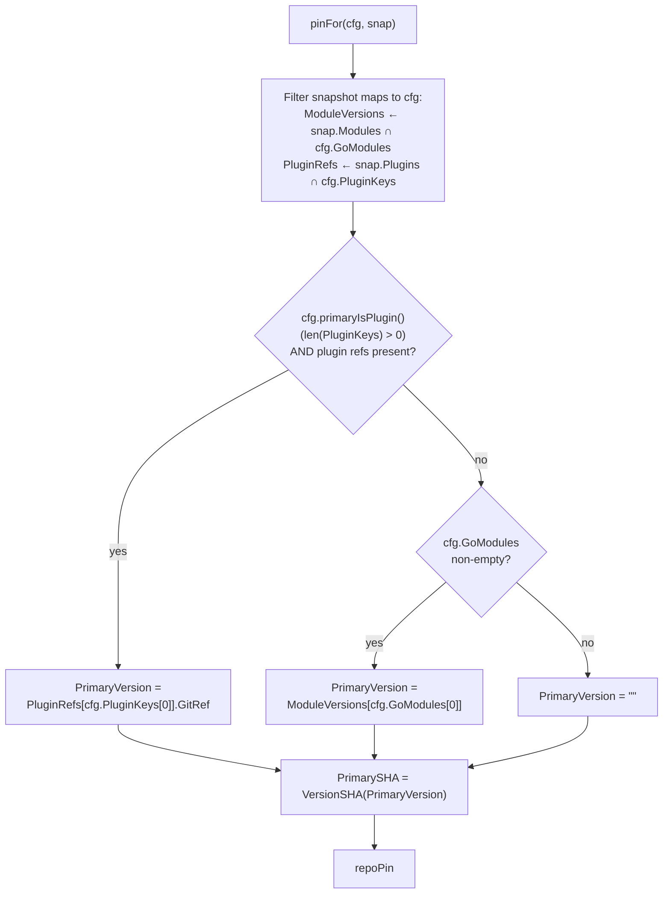
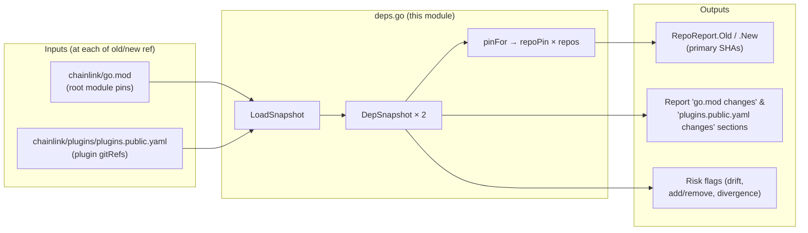

# release-changelog: Dependency Snapshots

This module answers the first question every release audit asks: **"What exactly is pinned where?"** Implemented in a single file, [`chainlink/tools/release/release-changelog/internal/engine/deps.go`](../../../chainlink/tools/release/release-changelog/internal/engine/deps.go), it resolves any input ref of the [release-changelog](../release-changelog.md) tool to a commit SHA, reads the core repo's dependency-manifest files **at that commit**, parses the pins relevant to the configured product, and distills them into per-repo "primary pins" that drive the rest of the analysis.

Concretely, given a ref (tag, branch, SHA, or even a CCIP image tag) it produces a `DepSnapshot` containing:

1. **`go.mod` module pins** — the versions of product-relevant modules (`chainlink-ccip`, `chainlink-evm`, …) as pinned in the core repo's root [`chainlink/go.mod`](../../../chainlink/go.mod).
2. **Plugin pins** — the `gitRef`/`moduleURI` pairs of product-relevant plugin keys from [`chainlink/plugins/plugins.public.yaml`](../../../chainlink/plugins/plugins.public.yaml) — the refs that actually get built into the release image.
3. **A primary pin per tracked repo** — the single old→new SHA pair (via `pinFor` + `VersionSHA`) that the commit-changelog pipelines compare.

> **Where this fits:** this is the data-sourcing layer of the product-agnostic engine. The [engine-core](release-changelog_engine-core.md) module defines *what* to track (`Product`/`RepoConfig`), this module captures *what is pinned at each ref*, and the [commit-changelogs](release-changelog_commit-changelogs.md) module consumes both to produce the audit report. The overall tool is part of [Build, CI & Release Infrastructure](../../Build,_CI___Release_Infrastructure.md).

---

## 1. Responsibilities

1. **Ref normalization & resolution** — maps product-specific ref shapes through `Product.NormalizeRef` (e.g. CCIP image tag `2.56.1-ccip-rc.2` → git tag `v2.56.1-rc.2`, see [ccip-product](release-changelog_ccip-product.md)) and resolves the result to a commit SHA via the [git-integration](release-changelog_git-integration.md) module.
2. **Manifest reading at a commit** — fetches `go.mod` and `plugins/plugins.public.yaml` *from the resolved SHA* rather than the raw ref (see [§4.2](#42-design-decisions)).
3. **Filtered parsing** — extracts only the module versions and plugin keys the product's `RepoConfig`s declare, using `golang.org/x/mod/modfile` and `gopkg.in/yaml.v3`.
4. **Version → SHA extraction** — recovers commit SHAs from Go pseudo-versions and raw-SHA refs (`VersionSHA`), enabling per-repo commit comparisons for external repos.
5. **Primary-pin selection** — for each tracked repo, picks the authoritative pin (plugin `gitRef` first, else first `go.mod` module) and packages it as a `repoPin`.

---

## 2. Architecture



### Component inventory

| Component | Kind | Description |
|---|---|---|
| `DepSnapshot` | struct | The dependency state of the core repo at one ref: `Ref` (as given), `ResolvedRef` (the git ref actually used when normalization changed it — the image-tag → git-tag audit trail), `SHA` (resolved commit), `Modules` (tracked module path → version), `Plugins` (tracked plugin key → `PluginPin`). |
| `PluginPin` | struct | One tracked `plugins.public.yaml` entry: `GitRef` (the pinned ref, i.e. what the release image builds) and `ModuleURI` (the Go module the plugin is built from — used by the dual-source drift check). |
| `pluginsFile` | struct (unexported) | Read-side mirror of `plugins/plugins.public.yaml` (`plugins.<key>[].{moduleURI,gitRef}`). The write-side authority is the [plugout](../plugout.md) tool's `PluginsFile` type — the two tools are the read and write halves of the plugin-pin workflow. |
| `VersionSHA` | func | Extracts a commit SHA from a version string (see [§5](#5-version--sha-extraction-versionsha)); returns `""` when none is extractable. |
| `ParseGoMod` | func | Parses a root `go.mod` via `modfile.Parse` and returns versions **only** for modules listed in any `RepoConfig.GoModules` of the product. |
| `ParsePluginsYAML` | func | Parses `plugins.public.yaml` via `yaml.Unmarshal` into `pluginsFile` and returns `PluginPin`s **only** for keys listed in any `RepoConfig.PluginKeys`; takes the first entry (`entries[0]`) per key. |
| `LoadSnapshot` | func | The module's entry point: normalize → resolve → read files at SHA → parse both manifests → `DepSnapshot` (see [§4](#4-snapshot-loading-pipeline-loadsnapshot)). |
| `repoPin` | struct (unexported) | The resolved pins of **one tracked repo** at one ref: `PrimaryVersion`, `PrimarySHA` (from `VersionSHA`; `""` if unparseable), plus the repo's filtered `ModuleVersions` and `PluginRefs` maps. |
| `pinFor` | func (unexported) | Intersects a `DepSnapshot` with one `RepoConfig` and selects the primary pin (see [§6](#6-per-repo-pin-selection-pinfor--repoin)). |
| `shortSHA` | func (unexported) | Trims a SHA to 12 hex chars for display in notes/flags. |

---

## 3. Data model



Two structural notes for maintainers:

- **Snapshot vs pin.** `DepSnapshot` is repo-wide (all tracked modules/plugins of the whole product at one ref); `repoPin` is the per-repo projection produced by `pinFor`. The `Report` carries both — snapshots for the raw "go.mod changes"/"plugins.public.yaml changes" sections, pins for per-repo commit changelogs.
- **`ResolvedRef` is audit metadata, not input.** It is populated only when `product.normalize(ref) != ref` and is rendered by `refLine` in the report header as `` `2.56.1-ccip-rc.2` (image tag → git tag `v2.56.1-rc.2`) `` so reviewers can verify the mapping.

---

## 4. Snapshot loading pipeline (`LoadSnapshot`)

```mermaid
sequenceDiagram
    participant A as Analyze (commit-changelogs)
    participant L as LoadSnapshot (this module)
    participant P as Product.normalize
    participant G as gitRunner (git-integration)

    A->>L: LoadSnapshot(ctx, g, product, ref)
    L->>P: normalize(ref)
    P-->>L: normalized git ref<br/>(image tag → git tag, or unchanged)
    L->>G: ResolveRef(normalized)
    G-->>L: commit SHA
    Note over G: local ref → origin/&lt;ref&gt; → on-demand fetch
    L->>G: FileAtRef(SHA, "go.mod")
    G-->>L: go.mod bytes
    L->>G: FileAtRef(SHA, "plugins/plugins.public.yaml")
    G-->>L: yaml bytes
    L->>L: ParseGoMod(bytes, product.Repos)
    L->>L: ParsePluginsYAML(bytes, product.Repos)
    L-->>A: DepSnapshot{Ref, SHA, Modules, Plugins[, ResolvedRef]}
```

`LoadSnapshot` is called exactly twice per run — once for `--old`, once for `--new` — by `Analyze`; the two snapshots are then diffed field-by-field downstream.

### 4.1 Error handling

Every step fails loudly: ref resolution errors (including the "did you mean" suggestions from `gitRunner.ResolveRef`), missing files at a SHA, and parse failures all abort snapshot creation with a wrapped error. `Analyze` propagates these as `"loading old snapshot: …"` / `"loading new snapshot: …"` and the run fails. This is deliberate — an audit built on an incompletely loaded snapshot would be silently wrong.

### 4.2 Design decisions

- **Read at the resolved SHA, not the raw ref.** `ResolveRef` may satisfy a ref through the `origin/<ref>` remote-tracking fallback or an on-demand `git fetch origin <ref>` into `FETCH_HEAD` — in both cases the ref *string* may not exist locally. Reading `git show SHA:go.mod` is therefore the only reliable way to fetch file content.
- **Normalize before the git machinery.** `gitRunner.ResolveRef` is intentionally product-agnostic; ref shapes like image URIs (`public.ecr.aws/chainlink/ccip:2.56.1-ccip-rc.2`) are inverted to git tags in `Product.NormalizeRef` (see [ccip-product](release-changelog_ccip-product.md)) before resolution. The original input is preserved in `DepSnapshot.Ref` and the mapping in `ResolvedRef`.
- **Filter at parse time.** `ParseGoMod`/`ParsePluginsYAML` accept the full `[]RepoConfig` list so untracked entries never enter the snapshot. The root `go.mod` has hundreds of requires and `plugins.public.yaml` many keys; only product-relevant pins survive, keeping snapshots, diffs, and flags focused.

---

## 5. Version → SHA extraction (`VersionSHA`)

External repos are compared commit-by-commit, so a version string alone is not enough — a commit SHA is required. `VersionSHA` recognizes the shapes that appear in the wild:

| Input shape | Example | Extraction rule | Result |
|---|---|---|---|
| Raw git SHA used as a plugin `gitRef` | `e5618f5682ee…` (40 hex) | `rawSHA` regex `^[0-9a-f]{40}$` | the SHA itself |
| Go pseudo-version (untagged module pin) | `v0.1.1-solana.0.20260625091148-e5618f5682ee` | `pseudoVersionSHA` regex `-([0-9a-f]{12})$` (trailing 12-hex commit SHA) | `e5618f5682ee` |
| Clean release tag | `v2.10.0` | none matches | `""` |

Returning `""` for clean tags is a feature, not a gap: a tagged go.mod pin carries no commit hash, and the [commit-changelogs](release-changelog_commit-changelogs.md) pipeline records an explicit `"could not extract commit SHA from version(s)"` error for that repo instead of comparing against the wrong commit.

`VersionSHA` is also reused beyond pin selection: the dual-source **drift check** in `repoFlags` extracts SHAs from both a plugin's `GitRef` and the matching `go.mod` module version and flags a `DRIFT` when they disagree at the same ref; `divergenceNotes` uses it to detect multi-pin divergence within one ref.

---

## 6. Per-repo pin selection (`pinFor` / `repoPin`)

`pinFor(cfg RepoConfig, snap DepSnapshot)` projects the snapshot through one repo's tracking lists and then chooses the **primary version** — the single value that drives that repo's commit changelog:



Why the plugin `gitRef` wins when present: it is **what the release image actually builds** (the plugin install manifest), whereas `go.mod` pins are only the compile-time view of the core repo. `RepoConfig.GoModules` is documented as ordered by decreasing importance precisely so `GoModules[0]` is a meaningful fallback primary (e.g. `github.com/smartcontractkit/chainlink-ccip` for the `chainlink-ccip` repo, see [ccip-product](release-changelog_ccip-product.md)).

Repos tracked in both sources (today `ton` and `evm`) keep **both** pins in `repoPin`; the drift check cross-references them rather than discarding one.

---

## 7. Consumers & integration with the rest of release-changelog

| Consumer | Module | What it takes from this module |
|---|---|---|
| `Analyze` / `analyzeRepo` | [commit-changelogs](release-changelog_commit-changelogs.md) | Calls `LoadSnapshot` for old+new refs and `pinFor` per `RepoConfig` to fill `RepoReport.Old`/`.New`; `analyzeLocal`/`analyzeRemote` compare `PrimarySHA`s; snapshots feed `repoFlags` (plugin add/remove/change, module add/remove, dual-source drift) and `divergenceNotes` (via `VersionSHA`). |
| `RenderMarkdown` / `RenderSlackSummary` | [reporting-delivery](release-changelog_reporting-delivery.md) | Renders the **go.mod changes** and **plugins.public.yaml changes** sections directly from `DepSnapshot.Modules`/`.Plugins` with `versionTransition` old→new transitions; `refLine` uses `Ref`, `ResolvedRef`, and `SHA` for the header audit trail. |
| `Generate` facade | [engine-core](release-changelog_engine-core.md) | Supplies the `Product` (and thus the normalization hook and tracked-repo list) and the `gitRunner` bound to the core-repo checkout that `LoadSnapshot` drives. |
| `plugout` tool | [plugout](../plugout.md) | Write-side counterpart: syncs plugin versions *from* `go.mod` *into* `plugins.public.yaml`. This module's `pluginsFile` is the read-only mirror used for diffing. |
| `ccip.Product` | [ccip-product](release-changelog_ccip-product.md) | Reference product definition: `NormalizeRef` (image-tag inversion) and the `RepoConfig` list whose `GoModules`/`PluginKeys` determine what the parsers keep. |



---

## 8. Testing & maintenance

The module is covered by the engine's unit and golden tests (see [Testing & maintenance](../release-changelog.md#testing--maintenance) on the parent page):

```
go test ./tools/release/release-changelog/...                    # unit + golden tests
UPDATE_GOLDEN=1 go test ./tools/release/release-changelog/...    # regenerate goldens
```

Maintenance notes for this file:

- **Regex fragility.** `pseudoVersionSHA` assumes the standard Go pseudo-version layout (trailing `-<12-hex>`); `rawSHA` requires exactly 40 hex chars. New pin shapes (e.g. a 64-char SHA256 ref) need a new pattern in `VersionSHA` *and* a matching update in `divergenceNotes`/drift logic, which reuse it.
- **Parse contracts.** `ParseGoMod` depends on `golang.org/x/mod/modfile` semantics (require blocks, no replacement resolution); `ParsePluginsYAML` assumes the `plugins.<key>` list-of-objects shape with the **first entry** being authoritative. Structural changes to `plugins.public.yaml` should be mirrored in the [plugout](../plugout.md) writer first.
- **Snapshot completeness.** A module/key missing from every `RepoConfig` is invisible by design. New tracked pins are added by editing the product definition (see the EDIT note in [ccip-product](release-changelog_ccip-product.md)), not this file.
