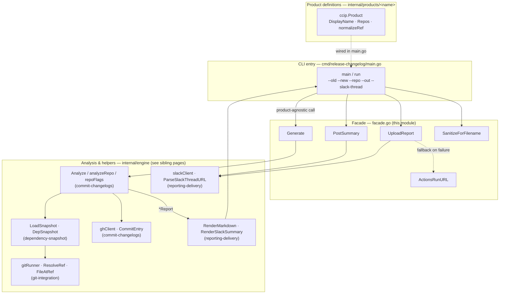
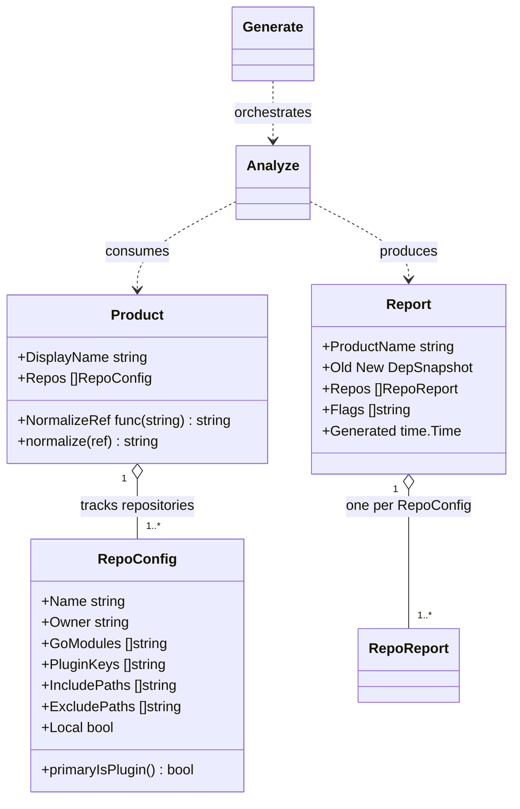
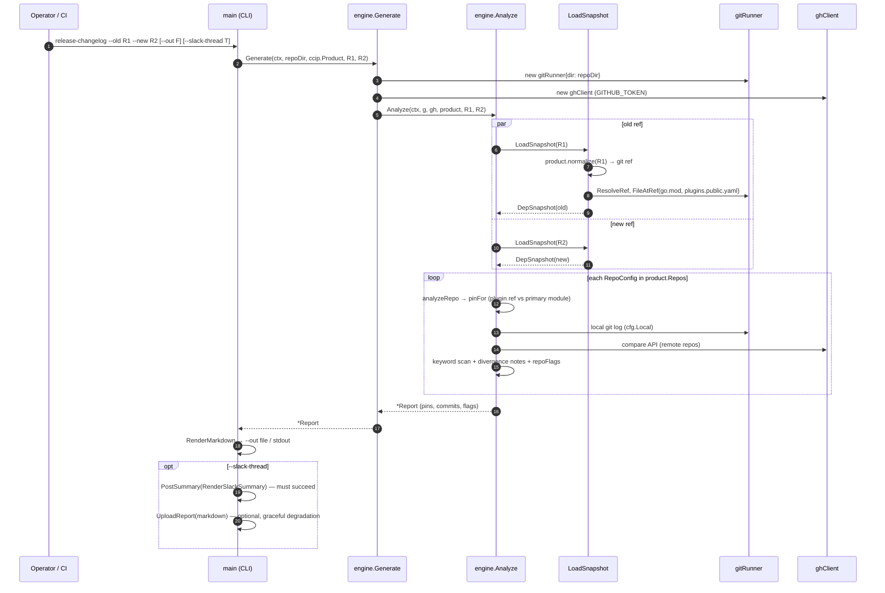

# Release Changelog — Engine Core

> **Module path:** `chainlink/tools/release/release-changelog/internal/engine` (+ `cmd/release-changelog`)
> **Parent:** [release-changelog](../release-changelog.md) · **Area:** [Build, CI & Release Infrastructure](../../Build,_CI___Release_Infrastructure.md)

## Overview

The **engine core** is the product-agnostic heart of the `release-changelog` CLI tool. The tool generates a release changelog for a product (currently CCIP) by diffing the product-relevant dependency pins between two refs of the core `chainlink` repo, producing per-repo commit changelogs, flagging release risks, and optionally posting the result to Slack.

This module owns the four pieces that every product release analysis shares:

1. The **`Product` abstraction** (`internal/engine/product.go`) — the pluggable definition of *what* to track for a product line.
2. The **`RepoConfig` abstraction** (`internal/engine/repo_config.go`) — the per-repository tracking contract consumed by the engine.
3. The **facade API** (`internal/engine/facade.go`) — the narrow surface the CLI (and future callers) use to generate reports and deliver them.
4. The **CLI entry point** (`cmd/release-changelog/main.go`) — flag parsing, wiring of the concrete product (CCIP), output handling, and Slack delivery with graceful degradation.

Everything else the engine needs — dependency snapshotting, git access, GitHub compare integration, risk analysis, and rendering/delivery — lives in dedicated engine sub-packages that are documented by their own module pages (see [Related modules](#related-modules)).

### Design principle: a product-agnostic engine

The engine never hardcodes product knowledge. A `Product` value is passed in by the caller, and concrete product definitions live in `internal/products/<name>/` — `internal/products/ccip` is the reference implementation (documented in [release-changelog CCIP product](release-changelog_ccip-product.md)). The CLI is intentionally a *thin wrapper*: `main.go` wires `ccip.Product` into the engine and nothing more.

---

## Core components

### `Product` — the product abstraction

*Source: `chainlink/tools/release/release-changelog/internal/engine/product.go`*

| Field | Purpose |
|---|---|
| `DisplayName` | Labels report headers and Slack messages (e.g. `"CCIP"`). |
| `Repos []RepoConfig` | The repositories tracked by the product's changelog. |
| `NormalizeRef func(string) string` | Maps product-specific ref shapes (image tags, image URIs) to git refs **before** resolution. `nil` means "treat all inputs as git refs already". |

The single method `normalize(ref)` applies `NormalizeRef` when present and is the identity function otherwise. This lets operators pass Docker image tags (e.g. `ghcr.io/.../ccip:2.20.0-0f1e2d3`) as `--old` / `--new` even though the engine only ever resolves real git refs.

### `RepoConfig` — the per-repository tracking contract

*Source: `chainlink/tools/release/release-changelog/internal/engine/repo_config.go`*

| Field | Purpose |
|---|---|
| `Name`, `Owner` | Repository identity (e.g. `chainlink-ccip` under `smartcontractkit`). |
| `GoModules []string` | Module paths in the **root `go.mod` of the core repo** that come from this repository, in decreasing importance order. The first entry is the *primary module*. |
| `PluginKeys []string` | Keys in `plugins/plugins.public.yaml` installed from this repo. When set, the plugin `gitRef` is what gets built into the release image, making it the **authoritative pin**. |
| `IncludePaths` / `ExcludePaths` | Restrict the commit changelog to (or drop commits that only touch) path prefixes. |
| `Local` | Marks the repository the tool runs inside (the core `chainlink` repo). Its commit log is read from the **local git checkout** instead of the GitHub compare API. |

The helper `primaryIsPlugin()` encodes the **pin precedence rule**: if any `PluginKeys` are configured, the plugin `gitRef` — not a `go.mod` module pin — drives the commit changelog for that repo, because the release image is built from the plugin ref.

### Facade API — `internal/engine/facade.go`

| Function | Role |
|---|---|
| `Generate(ctx, repoDir, product, oldRef, newRef)` | One-call entry point: constructs a `gitRunner` rooted at `repoDir` and a `ghClient`, then delegates to `Analyze`. Returns a `*Report`. |
| `PostSummary(ctx, token, thread, text)` | Posts a text message into a Slack thread (the audit summary). |
| `UploadReport(ctx, token, thread, filename, title, markdown)` | Uploads the full markdown report as a Slack file. Requires the `files:write` scope; the CLI treats failure as **non-fatal** if the summary was already delivered. |
| `ActionsRunURL()` | Returns the URL of the current GitHub Actions run from `GITHUB_SERVER_URL` / `GITHUB_REPOSITORY` / `GITHUB_RUN_ID`, or `""` outside CI. Used for the upload-failure fallback. |
| `SanitizeForFilename(ref)` | Makes a git ref safe for a filename (used for the uploaded report's filename). |

### CLI entry point — `cmd/release-changelog/main.go`

`main` → `runMain()` → `run(ctx, repoDir, oldRef, newRef, outPath, slackThreadURL)`. Responsibilities:

- Parse flags, validate required `--old` / `--new` (exit code `2` on usage errors).
- Install a `signal.NotifyContext` for Ctrl-C cancellation.
- Call `engine.Generate` with the wired-in `ccip.Product`.
- Render via `engine.RenderMarkdown`; write to `--out` (mode `0600`), print to stdout when no output destination is given, or neither when only Slack delivery is requested.
- When `--slack-thread` is set: require `SLACK_BOT_TOKEN`, parse the thread URL (`engine.ParseSlackThreadURL`), post the summary (mandatory), then upload the full report as `<product-slug>-release-changelog-<old>-<new>.md` (optional, with fallback).

---

## Architecture



The **blue-ish boundary is fixed**: the facade, `Product`/`RepoConfig`, and the CLI are the only parts a new product integration touches. Engine internals are shared by all products.

### Component relationship



---

## How a release analysis runs



Key behaviors (implemented in engine helpers, detailed on their pages):

- **Snapshotting** — `LoadSnapshot` normalizes the ref through `Product.normalize`, resolves it to a SHA, and reads the core repo's root [`go.mod`](../repo-build-config/repo-build-config_go-dependencies.md) (`chainlink/go.mod`) and `plugins/plugins.public.yaml` **at that SHA** (the ref may only exist as `origin/<ref>` locally). Only modules/plugins declared by `product.Repos` are kept → a `DepSnapshot`. See [release-changelog dependency snapshot](release-changelog_dependency-snapshot.md).
- **Per-repo analysis** — `analyzeRepo` picks the primary pin per the precedence rule above, then collects commits via the **local git log** (`RepoConfig.Local == true`) or the **GitHub compare API**, applies path filters, scans titles for risk keywords, and appends divergence notes. See [release-changelog commit changelogs](release-changelog_commit-changelogs.md).
- **Risk flags** — `repoFlags` emits: plugin added/removed/gitRef changed; tracked `go.mod` module added/removed; **dual-source DRIFT** (plugin `gitRef` SHA disagrees with the `go.mod` module SHA at the same ref); **ROLLBACK** (new pin behind old pin); **DIVERGED** (no common ancestry); keyword matches.
- **Rendering & delivery** — markdown report (full) and Slack summary (audit payload). See [release-changelog reporting & delivery](release-changelog_reporting-delivery.md).

### Delivery contract (Slack)

The CLI enforces an explicit reliability asymmetry:

| Payload | Failure semantics |
|---|---|
| Summary message (`PostSummary`) | **Fatal** — it is the audit payload; the run exits `1` if it cannot be delivered. |
| Full report file (`UploadReport`) | **Non-fatal** — needs `files:write` which the bot may lack. On failure the CLI posts a fallback warning pointing at the CI run artifact (via `ActionsRunURL`); the report content is already on stdout / in `--out`. |

---

## CLI & environment reference

```
release-changelog --old <ref> --new <ref> [--repo <dir>] [--out <file>] [--slack-thread <url>]
```

| Flag | Meaning | Default |
|---|---|---|
| `--old` | Old git ref (SHA, tag, branch, **or image tag**) that built the current release image | *required* |
| `--new` | New git ref for the new release image | *required* |
| `--repo` | Path to the `chainlink` core repo checkout | `.` |
| `--out` | Write the full markdown report to this file | stdout (when Slack not used) |
| `--slack-thread` | Slack thread URL to post summary + report into | *unset* |

| Environment variable | Purpose |
|---|---|
| `GITHUB_TOKEN` / `GH_TOKEN` | GitHub compare API access (falls back to `gh auth token`; all tracked repos are public). |
| `SLACK_BOT_TOKEN` | Required when `--slack-thread` is given. |
| `GITHUB_SERVER_URL`, `GITHUB_REPOSITORY`, `GITHUB_RUN_ID` | Read by `ActionsRunURL` to build the CI-artifact fallback link. |

Exit codes: `0` success · `1` runtime failure (including failed summary delivery) · `2` usage error.

---

## Extending: adding a new product

The engine is designed so a second product (e.g. *Core* releases) requires **no engine changes**:

1. Create `internal/products/<name>/` with a `Product` value — list the tracked `RepoConfig`s, pick a `DisplayName`, and (optionally) provide a `NormalizeRef` for product-specific ref shapes. Use `internal/products/ccip` as the reference implementation ([CCIP product page](release-changelog_ccip-product.md)).
2. Wire it into `cmd/release-changelog/main.go`. Once a second product actually exists, the intended evolution is a `--product` CLI flag / workflow input that selects among registered products.

Things to keep in mind when authoring `RepoConfig`s:

- Set `Local: true` **only** for the core `chainlink` repo (the checkout the tool runs inside); all other repos go through the GitHub compare API.
- Declare `PluginKeys` when the release image is built from a plugin `gitRef` — this flips pin precedence away from `go.mod`.
- `GoModules` entries must match module paths verbatim as they appear in the root `chainlink/go.mod` (e.g. `github.com/smartcontractkit/chainlink-ccip`).
- Use `IncludePaths`/`ExcludePaths` to keep noisy monorepos' commit changelogs focused on product-relevant code.

---

## Related modules

| Page | Contents |
|---|---|
| [release-changelog (parent)](../release-changelog.md) | Tool overview and release-infrastructure context. |
| [CCIP product definition](release-changelog_ccip-product.md) | The reference `Product` implementation and `normalizeRef` image-tag handling. |
| [Commit changelogs](release-changelog_commit-changelogs.md) | `Analyze`, `Report`/`RepoReport`, risk flags, GitHub compare integration, keyword scanning. |
| [Dependency snapshot](release-changelog_dependency-snapshot.md) | `LoadSnapshot`, `DepSnapshot`, `go.mod` / `plugins.public.yaml` parsing, pin selection. |
| [Git integration](release-changelog_git-integration.md) | `gitRunner`, ref resolution, file-at-ref, local log ranges, ancestry checks. |
| [Reporting & delivery](release-changelog_reporting-delivery.md) | Markdown/Slack rendering, Slack client, thread URL parsing, golden test files. |
| [CI tools](../ci-tools.md) | Sibling release-operations tooling (matrix building, changeset tag checks, CCIP baseline resolution). |
