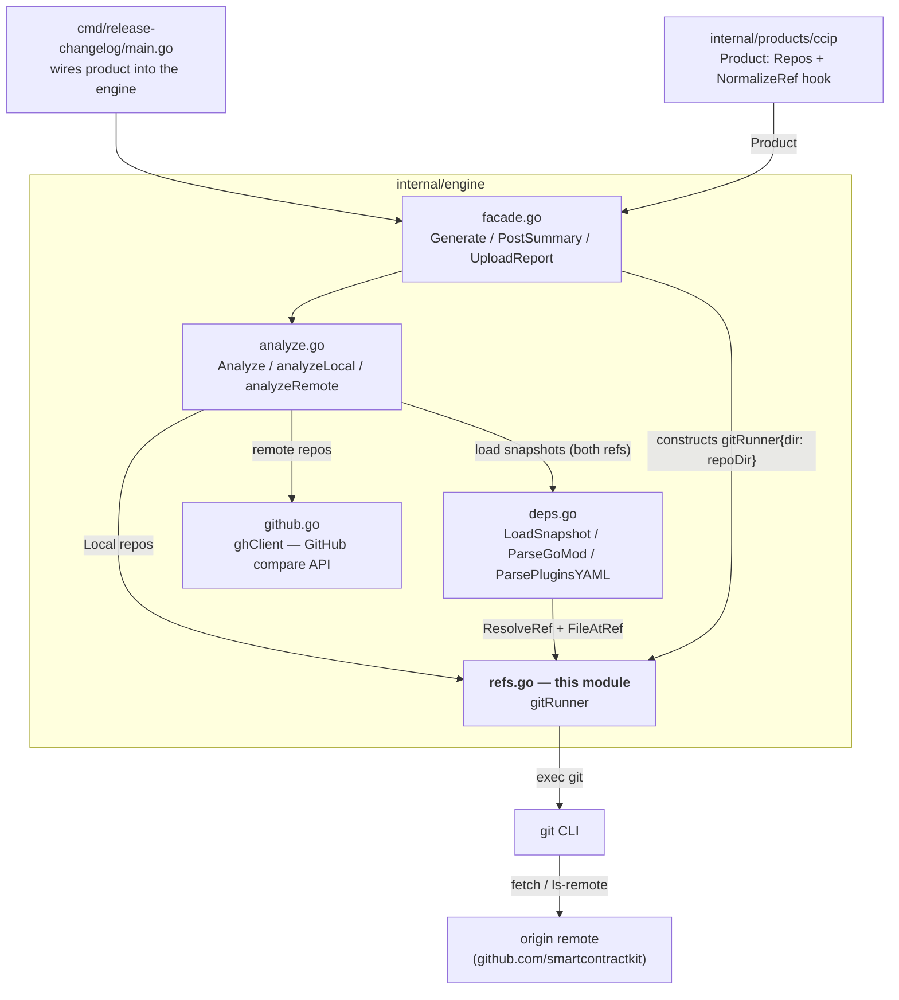
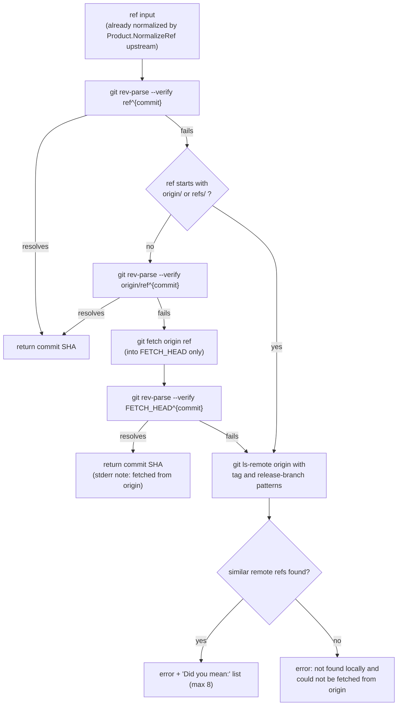
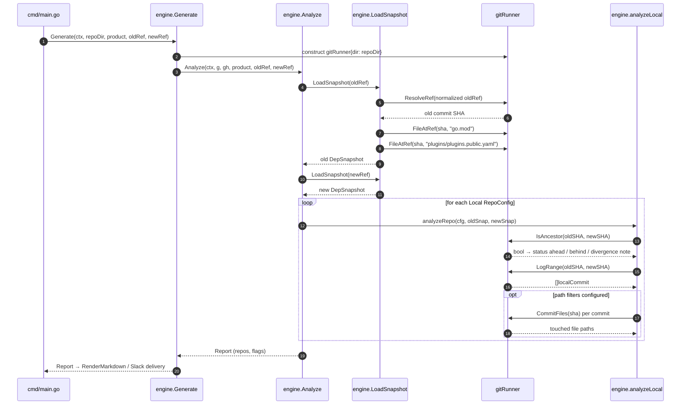

# release-changelog — Git Integration (`refs.go`)

The **git-integration module** is the only part of the [`release-changelog` tool](../release-changelog.md) that talks to git directly. It implements a single value type, **`gitRunner`**, which wraps the `git` CLI for one local repository checkout and exposes the small set of primitives the rest of the engine is built on:

- resolving release inputs (SHAs, tags, branches, or product-specific ref shapes) to commit SHAs,
- reading files at a resolved commit,
- listing commits between two SHAs,
- testing commit ancestry, and
- listing the files touched by a commit.

Everything else the tool does — snapshot diffing, commit changelogs for external repositories, report rendering, and Slack delivery — either consumes these primitives or bypasses them entirely.

- **Source:** `chainlink/tools/release/release-changelog/internal/engine/refs.go`
- **Parent:** [release-changelog](../release-changelog.md)

## At a glance

| Export | Kind | Purpose |
|---|---|---|
| `gitRunner` | struct | Executes git commands in the repository directory held in its single `dir` field |
| `gitRunner.run` | method | Runs one git command (`exec.CommandContext`), captures stdout/stderr, wraps errors as `git <args>: <err>: <stderr>` |
| `gitRunner.ResolveRef` | method | Resolves any ref (SHA, tag, branch) to a commit SHA via a three-stage cascade, with suggestions on failure |
| `gitRunner.suggestRefs` | method | Best-effort "did you mean" list built from remote refs (`ls-remote`) |
| `gitRunner.FileAtRef` | method | Returns the contents of a path at a given ref/SHA (`git show`) |
| `gitRunner.LogRange` | method | Lists commits in `old..new` as `localCommit` values |
| `gitRunner.IsAncestor` | method | Reports whether `oldSHA` is an ancestor of `newSHA` (`git merge-base --is-ancestor`) |
| `gitRunner.CommitFiles` | method | File paths touched by one commit, with a merge-commit fallback |
| `localCommit` | struct | One commit from the local log: `SHA`, `AuthorName`, `AuthorEmail`, `Title` |
| `splitLines` | helper | Splits command output into non-empty lines |

## Architecture and role in the engine

`gitRunner` is constructed once per run by the [engine-core facade](release-changelog_engine-core.md) (`Generate` passes `gitRunner{dir: repoDir}`) and threaded through the analysis pipeline. Two consumers exist inside the engine:

1. **[Dependency snapshot](release-changelog_dependency-snapshot.md)** — `LoadSnapshot` calls `ResolveRef` to turn each user-supplied ref into a commit SHA, then `FileAtRef` to read `go.mod` and `plugins/plugins.public.yaml` at that SHA.
2. **[Commit changelogs](release-changelog_commit-changelogs.md)** — for repos marked `Local: true` (the core repo), `analyzeLocal` calls `IsAncestor`, `LogRange`, and `CommitFiles` to produce the commit history and its path-filtered view.

A key architectural boundary: **`gitRunner` only ever operates on the local core-repo checkout** passed to `Generate`. External repositories (chainlink-ccip, chainlink-evm, chainlink-solana, …) are never accessed through git; their commit changelogs come from the GitHub compare API client ([`ghClient`](release-changelog_commit-changelogs.md)). The module is also intentionally **product-agnostic**: product-specific ref shapes (e.g. CCIP image tags) are normalized upstream by the `Product.NormalizeRef` hook before resolution — see the [CCIP product definition](release-changelog_ccip-product.md).



## Ref resolution pipeline

`ResolveRef` accepts any git ref — a full or short SHA, a tag (`v2.55.0`, `v2.56.1-rc.3`), or a branch (`release/2.56.0`) — and resolves it to a commit SHA using a deliberate three-stage cascade. The tool's README (`chainlink/tools/release/release-changelog/README.md`) documents the same contract for users: *"Resolution order: local refs, then `origin/<ref>`, then an on-demand `git fetch origin <ref>`."*



### The three stages

1. **Local resolution** — `git rev-parse --verify <ref>^{commit}`. The `^{commit}` peel guard rejects ambiguous non-commit objects (annotated tags are resolved to their commit, trees/blobs are rejected).
2. **Remote-tracking fallback** — `git rev-parse --verify origin/<ref>^{commit}`. This handles the common release case where a release branch exists only on the remote (`release/2.56.0` has no local tracking branch in a fresh CI checkout). Skipped when the input is already prefixed with `origin/` or `refs/`.
3. **On-demand fetch** — `git fetch origin <ref>`, then resolve `FETCH_HEAD^{commit}`. The fetch is intentionally shallow in effect: it fetches into `FETCH_HEAD` only and **creates no local branches or tags**, keeping repeat CI runs and developer checkouts unpolluted. A note is printed to stderr when this path fires.

### Failure mode: ref suggestions

If all stages fail, `suggestRefs` runs a best-effort `git ls-remote origin` query. It reduces the input to a "version-ish core" (stripping `refs/tags/`, `refs/heads/`, `release/`, and a leading `v` — e.g. `v2.56.1` → `2.56.1`), then matches four ref families: `refs/tags/v<core>*`, `refs/tags/*<core>*`, `refs/heads/release/<core>*`, and `refs/heads/<core>*`. Results are deduplicated, peeled annotated-tag lines (`^{}`) are skipped, and the list is capped at 8. This turns an unresolvable `v2.56.1` into the actionable error *"Did you mean: release/2.56.1, v2.56.1-rc.3, …"*. Any `ls-remote` failure is swallowed — suggestions never mask the primary error.

### Caller contract

`ResolveRef` returns a SHA that is guaranteed resolvable locally; the *original* ref may not be (stage 2 resolves via `origin/<ref>`). Therefore **callers must read files at the returned SHA, not at the original ref** — exactly what `LoadSnapshot` does in the [dependency-snapshot module](release-changelog_dependency-snapshot.md):

```go
sha, err := g.ResolveRef(ctx, normalized)   // may have resolved via origin/<ref> or FETCH_HEAD
goMod, err := g.FileAtRef(ctx, sha, "go.mod") // reads at the SHA, never the raw ref
```

## Git operations reference

| Go API | Git command(s) | Semantics | Primary consumer |
|---|---|---|---|
| `run` | any | Executes in `g.dir`; stdout/stderr buffered; errors wrapped with the full command and stderr | all operations |
| `ResolveRef` | `rev-parse --verify <ref>^{commit}` → `rev-parse --verify origin/<ref>^{commit}` → `fetch origin <ref>` + `rev-parse --verify FETCH_HEAD^{commit}` | Three-stage resolution of SHA/tag/branch to a commit SHA | `LoadSnapshot` |
| `suggestRefs` | `ls-remote origin <4 ref patterns>` | Similar-name suggestions; nil on any error | `ResolveRef` error path |
| `FileAtRef` | `show <ref>:<path>` | File contents at a ref/SHA | `LoadSnapshot` (`go.mod`, `plugins/plugins.public.yaml`) |
| `LogRange` | `log --format=%H%x00%an%x00%ae%x00%s <old>..<new>` | Commits reachable from `new` but not `old`, NUL-delimited for safe parsing | `analyzeLocal` |
| `IsAncestor` | `merge-base --is-ancestor <old> <new>` | Exit-status ancestry test; returns `bool` only | `analyzeLocal` |
| `CommitFiles` | `diff-tree --no-commit-id --name-only -r <sha>`; fallback `diff-tree --first-parent -m --no-commit-id --name-only -r <sha>` | Files touched by a commit; empty output on a merge commit triggers the first-parent fallback | `analyzeLocal` (path filtering) |

### Data structure: `localCommit`

`LogRange` returns `[]localCommit` with `SHA`, `AuthorName`, `AuthorEmail`, and `Title`. The NUL-delimited format (`%x00` separators) guarantees that commit titles containing newlines or tabs cannot break field splitting. Downstream, the [commit-changelogs module](release-changelog_commit-changelogs.md) post-processes these fields: `Title` is split into a clean title plus PR number by `parseTitle`, and `AuthorEmail` is converted to a GitHub `@login` when it is a `users.noreply.github.com` address.

## End-to-end flow

The sequence below shows a complete run for the core (local) repo, from CLI entry to report production. Remote repos take the `analyzeRemote` path via the compare API instead and do not touch `gitRunner`.



Two interactions are worth calling out:

- **Ancestry and status semantics.** `analyzeLocal` calls `IsAncestor` twice: `old → new` means the new ref is *ahead*; `new → old` means the new ref is strictly older — a genuine **rollback** (flagged as a risk). If neither direction holds (e.g. two different release lines), the tool still reports `ahead` with an informational note, because `LogRange` semantics ("reachable from new, not from old") remain meaningful for divergent lines. Note that `IsAncestor` conflates command errors with "not an ancestor" (it returns only a bool), which is acceptable because the divergence fallback above handles the false-negative case gracefully.
- **Path filtering economics.** `CommitFiles` is invoked per commit **only** when the repo config defines `IncludePaths`/`ExcludePaths` (the core repo restricts itself to CCIP paths such as `core/capabilities/ccip/`). Commits failing the filter are dropped from the changelog but still counted in `TotalInRange`.

## Design decisions and rationale

- **Shell out to the `git` CLI, not a library.** No git library dependency; behavior is identical to what engineers and CI see in their own checkout, and every operation is auditable as a plain git command. The trade-off is that the tool requires a `git` binary on `PATH` and a full-history checkout (see below).
- **Context-aware execution.** All commands go through `exec.CommandContext`, so caller cancellation (CI job timeouts, CLI Ctrl-C) kills in-flight git processes instead of leaving them running.
- **Error transparency.** Failures are wrapped as `git <args>: <err>: <stderr>`, so the actual git diagnostic is never lost.
- **Non-destructive fetching.** Stage 3 fetches into `FETCH_HEAD` only and creates no local branches or tags — the tool mutates nothing users would notice, which matters for shared CI workspaces and developer machines.
- **Product-agnostic ref handling.** `refs.go` never knows about CCIP or image tags; normalization is a `Product` hook applied before resolution ([engine-core](release-changelog_engine-core.md), [CCIP product](release-changelog_ccip-product.md)). This keeps the git layer reusable for future products (e.g. Core releases).
- **Robust parsing.** NUL-delimited log fields, streaming `strings.SplitSeq` iteration, and skipping of peeled `^{}` ref lines make the parsers immune to hostile or unusual git output.
- **Helpful failures.** The suggestion mechanism exists because release inputs are frequently near-misses (`v2.56.1` vs `release/2.56.1` vs `v2.56.1-rc.N`); a "did you mean" list converts a hard failure into a one-flag fix.

## Operational requirements and limitations

- **Full-history checkout.** The tool must run from a full git history checkout of the core repo (stated in `chainlink/tools/release/release-changelog/README.md`): `LogRange` and `IsAncestor` operate across release lines, which shallow clones cannot support. In CI, the checkout step must not truncate history (the README documents the `ccip-release-changelog` workflow_dispatch entry point).
- **Network access to origin** is required for on-demand fetches (stage 3) and `ls-remote` suggestions; stages 1–2 work offline against a complete local object store.
- **Single-repo scope.** `gitRunner` is bound to the core repo directory. External repos are reached only via the GitHub API (`GITHUB_TOKEN`/`GH_TOKEN` per the README) — git credentials for private external repos are never needed.
- **IsAncestor error conflation.** As noted above, a failing `merge-base` (e.g. malformed SHA) is reported as "not an ancestor" rather than an error; the divergence note in `analyzeLocal` absorbs the ambiguity.
- **Golden tests.** Engine changes to rendering or flag logic require regenerating goldens (`UPDATE_GOLDEN=1 go test ./tools/release/release-changelog/...`), per the README. The suggestion and resolution logic is exercised through the engine's test suite in the same module.

## Related documentation

- [release-changelog (parent)](../release-changelog.md) — tool overview, outputs, and usage.
- [release-changelog engine-core](release-changelog_engine-core.md) — `Product`, `RepoConfig`, the `Generate` facade that constructs `gitRunner`, and the CLI entry point.
- [release-changelog dependency-snapshot](release-changelog_dependency-snapshot.md) — `LoadSnapshot` / `DepSnapshot`; the primary consumer of `ResolveRef` and `FileAtRef`.
- [release-changelog commit-changelogs](release-changelog_commit-changelogs.md) — `Analyze` / `analyzeLocal` / `analyzeRemote`; the consumer of `LogRange`, `IsAncestor`, and `CommitFiles`, plus the GitHub compare fallback for external repos.
- [release-changelog CCIP product](release-changelog_ccip-product.md) — the `NormalizeRef` hook that runs before `ResolveRef`.
- [release-changelog reporting-delivery](release-changelog_reporting-delivery.md) — markdown/Slack rendering and delivery of the produced report.
- [Build, CI & Release Infrastructure](../../Build,_CI___Release_Infrastructure.md) — surrounding build and release tooling.
