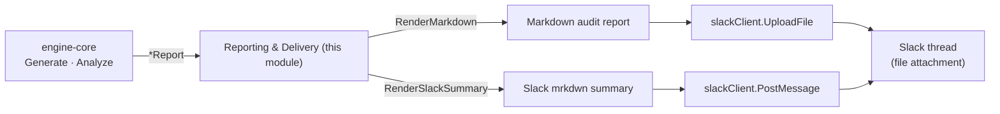
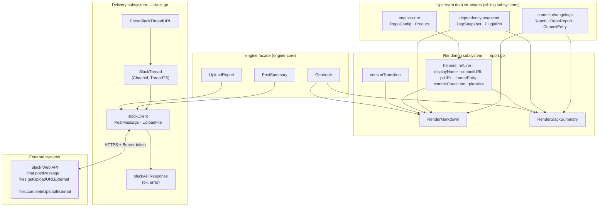
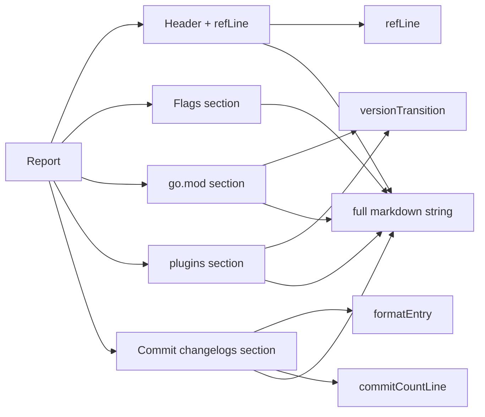
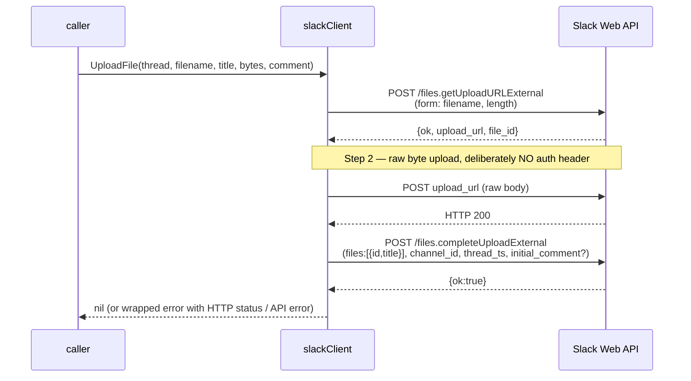

# release-changelog · Reporting & Delivery

> Parent module: [release-changelog](../release-changelog.md) · Sibling subsystems: [engine-core](release-changelog_engine-core.md), [dependency-snapshot](release-changelog_dependency-snapshot.md), [commit-changelogs](release-changelog_commit-changelogs.md), [git-integration](release-changelog_git-integration.md), [ccip-product](release-changelog_ccip-product.md)

## 1. Introduction

The **reporting-delivery** subsystem is the *output* layer of the `release-changelog` tool (`chainlink/tools/release/release-changelog`). While the sibling subsystems — [engine-core](release-changelog_engine-core.md) (orchestration), [dependency-snapshot](release-changelog_dependency-snapshot.md) (go.mod / `plugins.public.yaml` pin extraction), and [commit-changelogs](release-changelog_commit-changelogs.md) (GitHub compare analysis) — are responsible for **producing** a `*Report`, this subsystem is responsible for **consuming** it and getting it in front of release reviewers:

1. **Rendering** — deterministic, human-readable formatting of an analysis `Report`:
   - `RenderMarkdown` — the complete audit document (attached as a file).
   - `RenderSlackSummary` — a compact Slack `mrkdwn` message (posted in a thread).
2. **Delivery** — posting the summary and uploading the report into a Slack thread via the Slack Web API:
   - `ParseSlackThreadURL` — turns a pasted Slack thread link into an addressable `SlackThread`.
   - `slackClient` — authenticated HTTP client for `chat.postMessage` and the 3-step external file-upload flow.
3. **Golden-file testing** — byte-exact regression coverage for both renderers via `testdata/report.golden.md` and `testdata/slack-summary.golden.txt`.

Source files:

| File | Components |
|---|---|
| `chainlink/tools/release/release-changelog/internal/engine/report.go` | `RenderMarkdown`, `RenderSlackSummary`, `versionTransition` (+ unexported helpers `refLine`, `displayName`, `commitURL`, `prURL`, `formatEntry`, `commitCountLine`, `pluralize`) |
| `chainlink/tools/release/release-changelog/internal/engine/slack.go` | `SlackThread`, `ParseSlackThreadURL`, `slackClient`, `slackAPIResponse` |
| `chainlink/tools/release/release-changelog/internal/engine/testdata/` | `report.golden.md`, `slack-summary.golden.txt` |

## 2. Position in the Overall Flow

The tool is invoked as a release workflow step (it reads `GITHUB_SERVER_URL` / `GITHUB_REPOSITORY` / `GITHUB_RUN_ID` in the engine facade's `ActionsRunURL`), analyzes a release range, then renders and delivers the result. Reporting & delivery is the final stage:



## 3. Architecture & Component Relationships



Key relationships:

- **Renderers are pure functions.** `RenderMarkdown` and `RenderSlackSummary` take a `*Report` (defined in [commit-changelogs](release-changelog_commit-changelogs.md)) and return a `string`. No I/O, no clock reads — which is what makes golden-file testing byte-exact possible.
- **Delivery is intentionally thin.** The engine facade ([engine-core](release-changelog_engine-core.md)) exposes `PostSummary` and `UploadReport`, which construct a `slackClient` and delegate. The Slack client's `apiBase` field is overridable, so tests run against `httptest` servers instead of `https://slack.com/api`.
- **Thread addressing is decoupled from credentials.** `ParseSlackThreadURL` is a pure parser; callers supply the bot token separately (`SLACK_BOT_TOKEN`-style input at the workflow layer).

## 4. Rendering Subsystem (`report.go`)

### 4.1 `RenderMarkdown` — the full audit document

Produces the complete release audit document from a `Report`. The document has five fixed sections, mirroring what release reviewers need to approve a rollout:

| Section | Content | Key helpers |
|---|---|---|
| Header | Product name, old/new ref lines (`refLine`), UTC generation timestamp, deep link to `CHANGELOG.md` at the new SHA | `refLine` |
| `## ⚠️ Flags` | Risk flags computed by [commit-changelogs](release-changelog_commit-changelogs.md) (`repoFlags`); "No risk flags for this range. ✅" when empty | — |
| `## go.mod changes (CCIP modules)` | Per-repo version transitions for each tracked Go module from `RepoConfig.GoModules` | `versionTransition`, `shortModule` |
| `## plugins.public.yaml changes (CCIP plugins)` | Per-key git-ref transitions for tracked plugins from `RepoConfig.PluginKeys` | `versionTransition` |
| `## Commit changelogs` | Per-repo commit lists with count header, notes, truncation notice, and error stubs | `displayName`, `commitCountLine`, `formatEntry` |

Notable rendering behaviors:

- **Image-tag normalization is surfaced.** `refLine` prints `` `v2.55.0` (`<sha>`) `` normally, but when a CCIP image tag was resolved to its source git tag it renders `` `tag` (image tag → git tag `resolved`) (`<sha>`) `` — making the provenance of the analyzed pin explicit.
- **Status handling per repo** (`commitCountLine`):
  - compare error → `⚠️ compare failed` (with the error string printed in the section body)
  - `identical` → `no changes` (commit list suppressed)
  - `behind` → `⚠️ rolled back (see flags)`
  - `diverged` → `⚠️ diverged history (see flags)`
  - path-filtered repos → `N commits touching tracked paths (M total in range)` (e.g. the core `chainlink` repo scoped to `core/capabilities/ccip/`)
- **Truncation notice.** When the GitHub compare API capped the commit list (`RepoReport.Truncated`), a blockquote warning states how many of `TotalInRange` commits are shown.
- **Commit entry format** (`formatEntry`): `- Title ([#1234](pr-url)) ([`shortsha`](commit-url)) by @author`, with fallbacks: `(no title)` for empty titles, omitted PR segment when `PR == 0`, git author name when the GitHub login is unknown. URLs are built from `RepoConfig.Owner`/`Name` (`commitURL`, `prURL`).
- **Local-repo display name** (`displayName`): the core repo is shown with its path filter, e.g. `chainlink (core/capabilities/ccip/)`.

### 4.2 `RenderSlackSummary` — the compact thread message

Produces a short Slack `mrkdwn` message designed to be read *inside a thread*, with the full markdown report attached underneath:

```
*CCIP Release Changelog* `v2.55.0` → `v2.56.0`
<https://github.com/smartcontractkit/chainlink/compare/<old>...<new>|core compare> · <CHANGELOG link|core changelog>

:warning: *Flags (5)*
• *chainlink-ccip*: keyword match — feat: add fast lane config ([`deadbeef0000`](…))
…

*Commits per repo*
chainlink-ccip: 2 · chainlink-aptos: ⚠️ error · chainlink-sui: no change · … · chainlink: 1

Full report attached below :point_down:
```

Details worth knowing when modifying this function:

- **mrkdwn conversion**: Slack uses `*bold*`, not `**bold**`, so flag strings are passed through `strings.ReplaceAll(f, "**", "*")` before printing.
- **Per-repo digest**: `commits-per-repo` collapses each `RepoReport` to `name: <count>` / `name: no change` / `name: ⚠️ error`, joined with `·` — a one-glance health check across all tracked repos.
- The golden file `testdata/slack-summary.golden.txt` is the canonical example of this output.

### 4.3 `versionTransition` — shared transition vocabulary

A small formatter used by both the go.mod and plugin sections. It encodes five cases with exact wording that reviewers (and automation reading the changelog) rely on:

| Case | Output |
|---|---|
| module/plugin absent at both refs | `not present at either ref` |
| absent at old ref, present at new | `_(added)_ → `v…`` |
| present at old ref, absent at new | `` `v…` → _(removed)_ `` |
| same version at both refs | `` no change (`v…`) `` |
| version changed | `` `oldV` → `newV` `` |

Because these strings are matched by the golden tests, changing the vocabulary is a deliberate, reviewable act: update the code, then run with `UPDATE_GOLDEN=1` and diff the golden files.



## 5. Slack Delivery Subsystem (`slack.go`)

### 5.1 Thread addressing — `SlackThread` and `ParseSlackThreadURL`

`SlackThread{Channel, ThreadTS}` identifies a destination thread. `ParseSlackThreadURL` accepts a pasted Slack link and extracts both fields:

- **Accepted format**: `https://<workspace>.slack.com/archives/<CHANNEL_ID>/p<16-digit-ts>` (workspace subdomains with hyphens are allowed; trailing query parameters such as `?thread_ts=…&cid=…` are tolerated).
- **Timestamp conversion**: the `p`-prefixed 16-digit value is microseconds; the last six digits become the fractional part, e.g. `p1690000000123456` → `1690000000.123456` — the exact format Slack's `thread_ts` expects.
- **Failure mode**: anything else (including `/messages/` links, empty and non-URL strings) returns an error describing the expected format.

### 5.2 `slackClient` — the Slack Web API client

A minimal client with three design decisions that matter for maintenance:

1. **Bearer-token auth** on every API call (`Authorization: Bearer <token>`), with a 60-second HTTP timeout.
2. **Uniform response envelope** — `slackAPIResponse{OK bool; Error string}` is decoded for every call; `ok:false` surfaces the Slack error string verbatim (e.g. `channel_not_found`), which is what makes misconfigured channels diagnosable from CI logs.
3. **Testability** — `apiBase` defaults to `https://slack.com/api` but is overridden to an `httptest` server URL in tests (see [Testing](#7-testing)).

Two operations are exposed:

- **`PostMessage(ctx, thread, text)`** → `chat.postMessage` with `channel`, `thread_ts`, `text`, and `unfurl_links:false` (release notes contain raw GitHub links that should not expand into previews).
- **`UploadFile(ctx, thread, filename, title, content, comment)`** → the three-step *external upload* flow required by Slack for programmatic file posts:



Notes:

- Step 2 posts the file bytes to the pre-signed `upload_url` **without** the bearer header — adding one is a common integration bug Slack explicitly rejects.
- `comment` maps to `initial_comment` and is omitted entirely when empty.
- Errors are wrapped with the step name (`files.getUploadURLExternal: …`, `uploading file bytes: HTTP <status>: <body truncated to 200 chars>`), so CI failures pinpoint the failing stage.

### 5.3 Facade integration

The [engine-core](release-changelog_engine-core.md) facade wraps this subsystem for CI callers:

- `Generate(...)` → `*Report` (see [engine-core](release-changelog_engine-core.md) for analysis details),
- `PostSummary(ctx, token, thread, text)` → `slackClient.PostMessage`,
- `UploadReport(ctx, token, thread, filename, title, markdown)` → `slackClient.UploadFile` with the bytes of the rendered markdown; the facade documents that an upload failure should be treated as **non-fatal** if the summary was already posted.

A typical delivery sequence end-to-end:

```mermaid
sequenceDiagram
    autonumber
    participant W as release workflow (CI)
    participant E as engine facade
    participant R as report.go renderers
    participant S as slackClient
    participant A as Slack

    W->>E: Generate(ctx, repoDir, product, oldRef, newRef)
    E-->>W: *Report
    W->>R: RenderSlackSummary(report)
    R-->>W: mrkdwn summary
    W->>E: PostSummary(token, thread, summary)
    E->>S: PostMessage
    S->>A: chat.postMessage
    A-->>S: ok
    W->>R: RenderMarkdown(report)
    R-->>W: full markdown report
    W->>E: UploadReport(token, thread, file, title, markdown)
    E->>S: UploadFile (3-step external upload)
    S->>A: getUploadURLExternal → upload → completeUploadExternal
    A-->>S: ok
    Note over W,A: filename from SanitizeForFilename(ref); run URL from ActionsRunURL()
```

## 6. Output Contracts (Golden Examples)

The canonical outputs are checked into the repo and render the exact format described above:

- **`chainlink/tools/release/release-changelog/internal/engine/testdata/report.golden.md`** — full markdown audit: header with old/new SHAs, a five-flag section (keyword match, rollback, plugin gitRef change, plugin/go.mod drift), per-module go.mod transitions (`added` / `removed` / `no change` / `→` / `not present at either ref`), plugin pin transitions, and a commit-changelog section demonstrating every repo status (ahead, compare-failed, no changes, rolled back, filtered core repo).
- **`testdata/slack-summary.golden.txt`** — the compact thread message: title line with ref range, core compare + changelog links, counted flag list with `*`-bold repo names, the `commits-per-repo` digest line, and the "Full report attached below" pointer.

Any change to these files should accompany a deliberate formatting change, never incidental drift.

## 7. Testing

Two complementary test strategies cover this subsystem (`report_test.go`, `slack_test.go`):

**Golden tests for renderers (pure-function, byte-exact):**

- `TestRenderMarkdown_Golden` and `TestRenderSlackSummary_Golden` render `syntheticReport()` — a fixture deliberately covering *plugin change, drift, rollback, keyword hits, divergence note, path-filtered repo, and compare errors* — and diff the output byte-for-byte against the golden files.
- Regenerate goldens after an intentional format change:

  ```sh
  UPDATE_GOLDEN=1 go test ./tools/release/release-changelog/internal/engine/ -run 'Golden'
  ```

  then inspect the diff on `testdata/*.golden.*` — the diff *is* the format-change review artifact.

**Behavioral tests for Slack delivery (httptest-backed):**

| Test | What it verifies |
|---|---|
| `TestParseSlackThreadURL` | Table-driven: valid `/archives/<channel>/p<ts>` links (channel IDs, hyphenated workspaces, query strings), plus `/messages/` links, non-URLs and empty strings rejected |
| `TestSlackPostMessage` | Correct endpoint path, `Bearer` auth header, and JSON payload (`channel`, `thread_ts`, `text`) via `apiBase` override |
| `TestSlackUploadFile` | Full 3-step external upload: upload URL fetch, raw bytes received at the upload endpoint, `completeUploadExternal` payload with `file_id`/`title`/`channel_id`/`thread_ts` |
| `TestSlackAPIError` | `{"ok":false,"error":"channel_not_found"}` surfaces the Slack error string in the returned Go error |

The `apiBase` override is the seam that keeps this module's tests hermetic: no network, no credentials, deterministic failures.

## 8. Operational Notes

- **Where it runs**: the release workflow (see [engine-core](release-changelog_engine-core.md) for `Generate` and [ci-tools](../ci-tools.md) for the surrounding CI tooling). `ActionsRunURL()` provides a link back to the producing run when `GITHUB_*` env vars are present.
- **Credentials**: a bot token with `chat:write` and `files:write` scopes (the facade notes the `files:write` requirement specifically).
- **Failure semantics**: post summary → treat file-upload failure as non-fatal (the thread already contains the actionable summary; the attachment is the long-form record).
- **File naming**: refs are sanitized for filenames via `SanitizeForFilename` (unsafe characters → `-`), so `release/2026-07` style inputs are safe as attachment names.

## 9. Related Documentation

- [release-changelog](../release-changelog.md) — parent module overview.
- [release-changelog engine-core](release-changelog_engine-core.md) — `Product`, `RepoConfig`, `Generate`/`Analyze` orchestration, facade functions.
- [release-changelog dependency-snapshot](release-changelog_dependency-snapshot.md) — `DepSnapshot`, `LoadSnapshot`, go.mod / `plugins.public.yaml` parsing (inputs consumed by `versionTransition` and `refLine`).
- [release-changelog commit-changelogs](release-changelog_commit-changelogs.md) — `Report`, `RepoReport`, `CommitEntry`, flag computation (the data rendered here).
- [release-changelog git-integration](release-changelog_git-integration.md) — ref resolution and local git access feeding the analysis.
- [release-changelog ccip-product](release-changelog_ccip-product.md) — the CCIP product definition that populates repo/module/plugin tracking.
