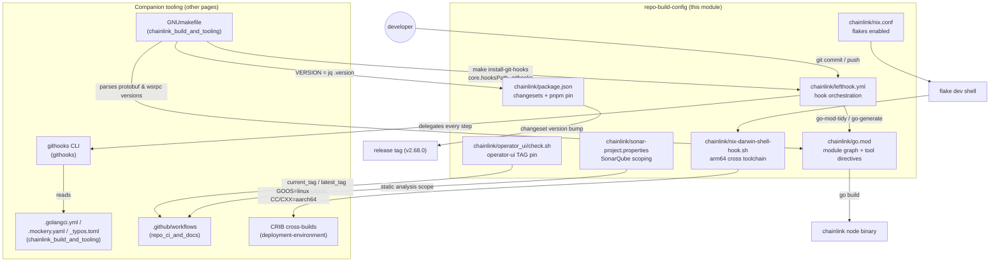
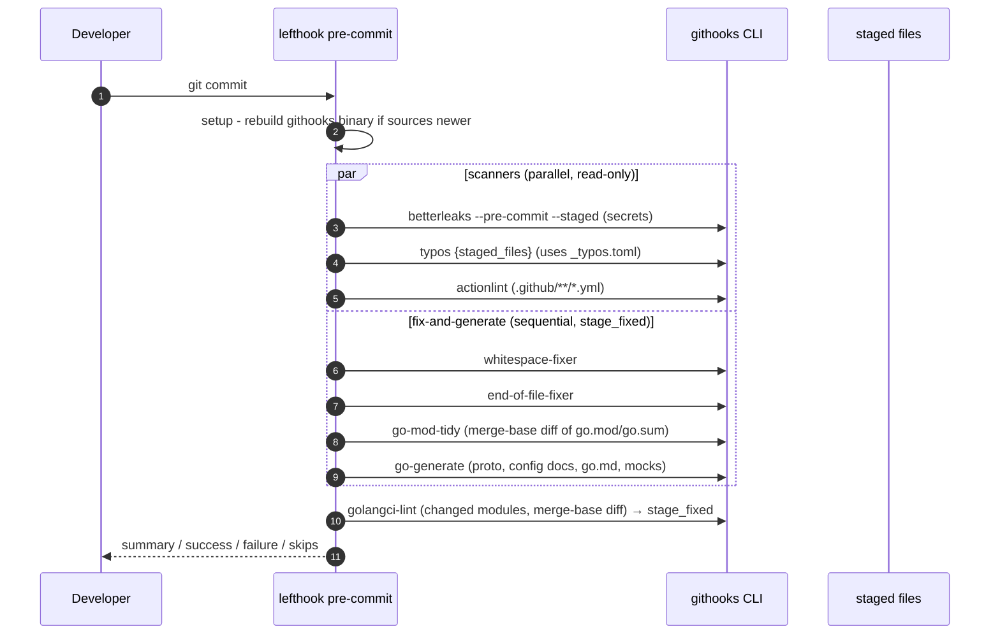
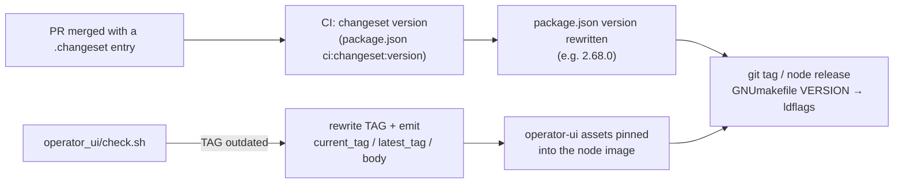

# repo-build-config

> **Module path:** `Build, CI & Release Infrastructure / repo-build-config`
> **Scope:** the seven root-of-repository configuration files of the `chainlink` node repository (`chainlink/`) that govern **Go dependency management**, **local quality gates (git hooks)**, the **reproducible developer environment**, **static analysis scoping**, and **release versioning**.

---

## 1. Purpose

This module is the *root configuration layer* of the `chainlink` node codebase. It contains no application logic — instead, it defines the rules and inputs that every build, lint, test and release of the node binary depend on:

| File | Role | Consumed by |
|---|---|---|
| `chainlink/go.mod` | Defines Go module `github.com/smartcontractkit/chainlink/v2`, the Go `1.27.1` toolchain floor, the direct + indirect dependency graph, one `replace`, two `tool` directives (`loopinstall`, `dependabot`) and one `exclude` | Every `go build`/`go test`, GNUmakefile version parsing, lefthook tidy/generate steps, CI |
| `chainlink/lefthook.yml` | Orchestrates local git hooks: pre-commit secret scanning, typo checks, workflow linting, whitespace/EOL fixing, `go mod tidy`, code generation and `golangci-lint`; pre-push short tests. Nearly all work is delegated to the custom `githooks` CLI | Every `git commit` / `git push` in the repo |
| `chainlink/nix.conf` | Enables the `nix-command flakes` experimental feature so the flake-based dev shell resolves | Nix dev-environment entry (`shell.nix`) |
| `chainlink/nix-darwin-shell-hook.sh` | On macOS, provisions the Homebrew `aarch64-unknown-linux-gnu` toolchain and exports `GOOS=linux`, `CC`/`CXX` arm64 cross-compilers for CRIB builds | `shell.nix` shell hook on darwin hosts |
| `chainlink/sonar-project.properties` | SonarQube project definition: project key `smartcontractkit_chainlink`, UTF-8 sources, plus exclusions for coverage, duplication (CPD) and test analysis | SonarQube CI stage |
| `chainlink/package.json` | Node release metadata: version `2.68.0`, the Changesets entry point `ci:changeset:version` (`pnpm changeset version`), pinned `pnpm@10.11.1` package manager | GNUmakefile `VERSION` variable, release automation |
| `chainlink/operator_ui/check.sh` | Compares the pinned `operator_ui/TAG` against the latest `smartcontractkit/operator-ui` GitHub release, updates the TAG file and exports `GITHUB_OUTPUT` variables in CI | Release/bump automation for the bundled Operator UI |

These files are consumed by (a) every developer workstation (lefthook, nix), (b) CI (Sonar, tag-sync checks), (c) release automation (Changesets, UI pinning) and (d) every Go toolchain invocation (`go.mod`).

---

## 2. Architecture overview

### 2.1 Where this module sits

`repo-build-config` is a **leaf** of the *Build, CI & Release Infrastructure* tree. It supplies the *inputs* that sibling tooling pages operate on:

- **[chainlink build and tooling](chainlink_build_and_tooling.md)** — the `GNUmakefile` and the linter/mock/typo configs (`.golangci.yml`, `.mockery.yaml`, `_typos.toml`) that lefthook and CI consume. The GNUmakefile literally *reads* two of this module's files: it derives `VERSION` from `package.json` (`jq -r '.version' package.json`) and parses `PROTOBUF_VERSION` / `WSRPC_VERSION` out of `go.mod`.
- **[githooks](githooks.md)** — the `githooks` CLI (its own Go module, `github.com/smartcontractkit/chainlink/v2/tools/githooks`) that almost every lefthook step delegates to.
- **[plugout](plugout.md)** — `tools/plugout`, run by the `gomodtidy` make target to refresh plugin manifests after tidy.
- **[repo CI and docs](repo_ci_and_docs.md)** — GitHub Actions workflows; the Sonar stage is scoped by `sonar-project.properties` and the operator-ui tag check emits workflow outputs.
- **[release-changelog](release-changelog.md)** — the internal release changelog engine, complementary to the Changesets-based versioning configured here.
- **[ci-tools](ci-tools.md)** / **[repo maintenance scripts](repo-maintenance-scripts.md)** — CI matrix generation and root-level maintenance scripts.

### 2.2 Configuration landscape

### 2.3 Key coupling points

1. **`package.json` ⇄ `GNUmakefile`** — the Makefile sets `VERSION = $(shell jq -r '.version' package.json)`, so the Changesets-managed version in `package.json` is stamped into every node build's ldflags (`GO_LDFLAGS` via `tools/bin/ldflags`).
2. **`go.mod` ⇄ `GNUmakefile`** — the Makefile parses `google.golang.org/protobuf` and `github.com/smartcontractkit/wsrpc` versions directly out of `go.mod` to pin tool versions, keeping generated gRPC code consistent with the dependency graph.
3. **`go.mod` ⇄ plugin installation** — the `tool github.com/smartcontractkit/chainlink-common/pkg/loop/cmd/loopinstall` directive lets `make install-plugins-*` run `go tool loopinstall` against `plugins/plugins.public|private|testing.yaml`, building LOOPP plugin binaries with the exact module graph of the node (see [loop-plugin-core](../Plugin_Process_Framework_(Loop)/loop-plugin-core.md)).
4. **`lefthook.yml` ⇄ `githooks` CLI** — both `pre-commit` and `pre-push` declare a `setup` step that rebuilds `tools/githooks/.bin/githooks` whenever any `*.go`/`go.mod`/`go.sum` under `tools/githooks` is newer than the binary; all other steps are `tools/githooks/.bin/githooks <subcommand>` invocations.
5. **`nix-darwin-shell-hook.sh` ⇄ CRIB** — the hook is loaded from `shell.nix` on darwin hosts and configures cross-compilation to `linux/arm64`, the deployment target used by CRIB environments.

---

## 3. Sub-module documentation

The module is split into four sub-modules. Each page details its files' structure, responsibilities and interactions:

| Sub-module | Files | Focus |
|---|---|---|
| [Go dependency graph](repo-build-config/repo-build-config_go-dependencies.md) | `chainlink/go.mod` | Module identity, Go 1.27.1 toolchain, direct/indirect dependency groups (web, chains, DB, observability, SmartContract ecosystem), `replace`/`tool`/`exclude` directives, and how the GNUmakefile & lefthook consume it |
| [Git hook pipeline](repo-build-config/repo-build-config_git-hooks.md) | `chainlink/lefthook.yml` | Pre-commit scanner/fixer job graph, ordering invariants (mutators before lint), merge-base diffing, `stage_fixed` semantics, pre-push short tests |
| [Developer environment](repo-build-config/repo-build-config_developer-environment.md) | `chainlink/nix.conf`, `chainlink/nix-darwin-shell-hook.sh` | Flake-based dev shell and macOS → linux/arm64 cross-compilation setup for CRIB |
| [Quality & versioning tooling](repo-build-config/repo-build-config_quality-and-versioning.md) | `chainlink/sonar-project.properties`, `chainlink/package.json`, `chainlink/operator_ui/check.sh` | SonarQube scoping, Changesets/pnpm release versioning, operator-ui TAG pinning |

---

## 4. Operational flows

### 4.1 Local pre-commit quality gate

Defined in `chainlink/lefthook.yml`. The design separates **read-only scanners** (parallel) from **mutating fixers** (sequential), with `golangci-lint` strictly last so it never races code generation or `go mod tidy`:

Notable behaviours:

- `go-mod-tidy` and `go-generate` deliberately run **sequentially** (tidy first) because both use the Go toolchain and rewrite module files — `golangci-lint --fix` must never overlap them.
- `go-mod-tidy`, `go-generate` and `golangci-lint` **do not** take `{staged_files}`; they diff against the merge-base with the default branch so issues introduced by earlier branch commits are still caught.
- Failures surface tool-specific install hints (e.g. `betterleaks`, `typos`, `actionlint` installation URLs) via `fail_text`.
- The hook directory itself is wired with `make install-git-hooks` (`git config core.hooksPath .githooks`, defined in the [GNUmakefile](chainlink_build_and_tooling.md)).

### 4.2 Pre-push test gate

`pre-push` runs the rebuilt `githooks` binary in **parallel** mode with a single job, `short-tests`, gated on Go file/module changes (`*.go`, `go.mod`, `go.sum`) using `{push_files}` — see [githooks](githooks.md) for what the `test` subcommand executes.

### 4.3 Release versioning

- **Node version** flows through Changesets (`@changesets/cli`, `@changesets/get-github-info`, `semver` dev-dependencies, pnpm pinned via `packageManager` with a sha512 hash). The same version is what `GNUmakefile` injects into build ldflags.
- **Operator UI** is a separate frontend repository whose release is pinned into this repo by the `operator_ui/TAG` file; `check.sh` keeps it in sync and, when `CI` is set, writes GitHub-Actions outputs (including the release body via a heredoc delimiter).

---

## 5. Related documentation

- [chainlink build and tooling](chainlink_build_and_tooling.md) — GNUmakefile targets, `.golangci.yml`, `.mockery.yaml`, `_typos.toml`
- [githooks](githooks.md) — the hook CLI binary invoked by `lefthook.yml`
- [plugout](plugout.md) — plugin manifest refresh used by `make gomodtidy`
- [release-changelog](release-changelog.md) — internal changelog generation for releases
- [repo CI and docs](repo_ci_and_docs.md) — GitHub Actions workflows (incl. Sonar / docs jobs)
- [ci-tools](ci-tools.md) — CI matrix tooling
- [repo maintenance scripts](repo-maintenance-scripts.md) — root-level `scripts/*.sh`
- [capabilities workspace tooling](capabilities_workspace_tooling.md) — the parallel toolchain for the `capabilities/` workspace
- [CRIB deployment environment](../Dev,_Test___Simulation_Environments/deployment-environment/deployment-environment_crib.md) — consumer of the darwin cross-compilation setup
- [loop-plugin-core](../Plugin_Process_Framework_(Loop)/loop-plugin-core.md) — the plugin framework whose `loopinstall` tool is declared in `go.mod`
