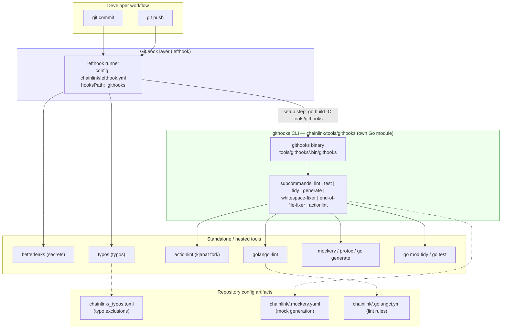
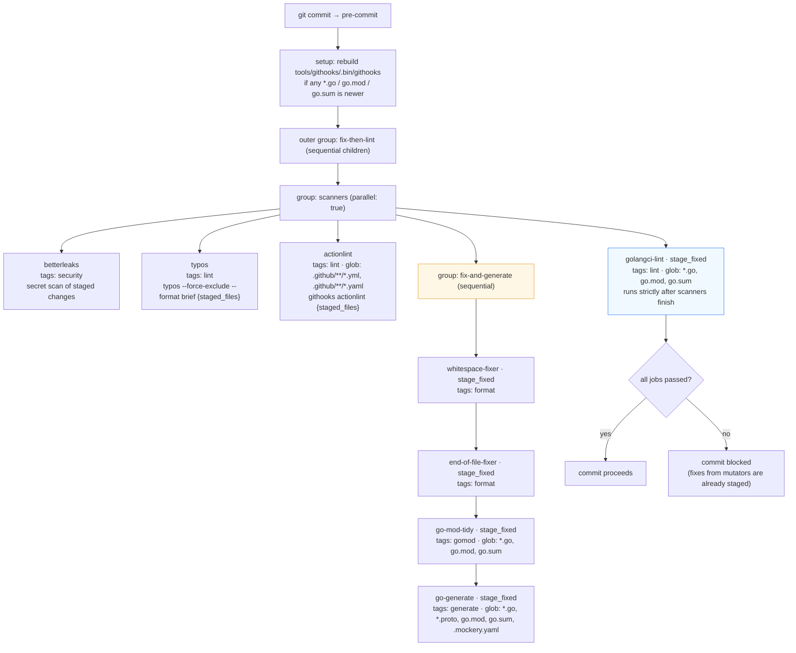
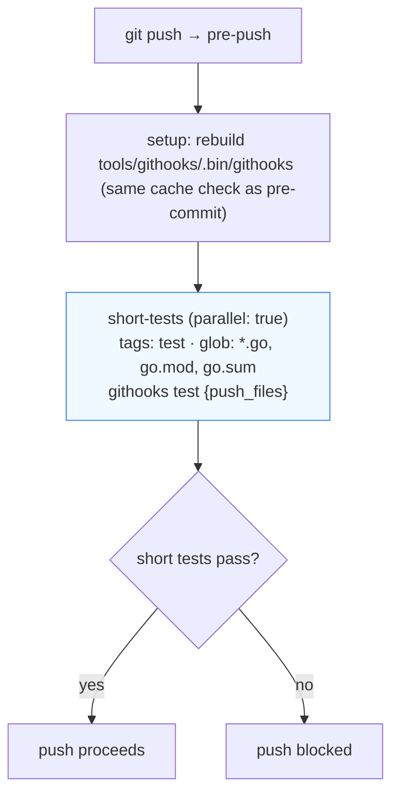
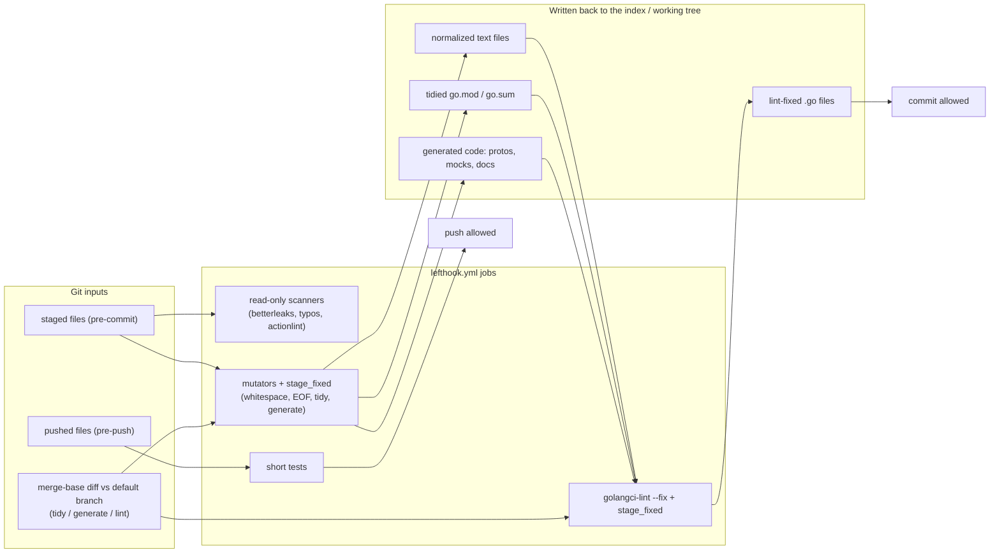
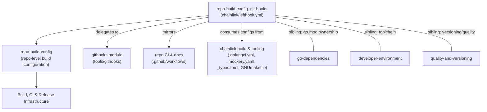

# Git Hooks — Lefthook Pipeline (`chainlink/lefthook.yml`)

## Introduction

The `repo-build-config_git-hooks` module defines the **client-side Git hook enforcement pipeline** for the `chainlink` repository. Its single core component, [`chainlink/lefthook.yml`](../repo-build-config.md), is a [Lefthook](https://github.com/evilmartians/lefthook) configuration that turns `git commit` and `git push` into fast, targeted quality gates:

- **pre-commit** — secret scanning, typo detection, workflow linting, whitespace/EOF normalization, `go mod tidy`, targeted code generation (protos, mocks, docs), and `golangci-lint` — with a strict "mutate first, lint last" ordering.
- **pre-push** — short-mode unit tests on the packages affected by the pushed commits.

The heavy lifting is delegated to the in-repo **`githooks` CLI** (a dedicated Go module under `chainlink/tools/githooks`), which is documented separately in the [githooks module](../githooks.md). This page focuses on the *orchestration contract* expressed by `lefthook.yml`: which commands run, on which files, in what order, and why.

The hooks complement — but never replace — CI: their lint configuration, diff base, and test scope are deliberately aligned with the repository's CI workflows so that what passes locally passes remotely (see [repo CI and docs](../repo_ci_and_docs.md)).

---

## Module scope

| Aspect | Value |
|---|---|
| Core component | `chainlink/lefthook.yml::lefthook.yml` |
| Hook framework | [Lefthook](https://github.com/evilmartians/lefthook) (YAML schema-validated, see header comment in the file) |
| Hook events | `pre-commit`, `pre-push` |
| Delegate tool | `githooks` CLI — module `github.com/smartcontractkit/chainlink/v2/tools/githooks` (`chainlink/tools/githooks/go.mod`) |
| Binary cache | `tools/githooks/.bin/githooks` (rebuilt by a `setup` step when stale) |
| Installation | `make install-git-hooks` (in `chainlink/GNUmakefile`) |
| Config artifacts consumed | `chainlink/_typos.toml`, `chainlink/.mockery.yaml`, `chainlink/.golangci.yml` |

---

## Architecture

### Layers

The module sits between the developer's Git client and the repository's tooling, and composes three kinds of executors:

1. **Lefthook runner** — parses `chainlink/lefthook.yml`, interpolates file templates (`{staged_files}`, `{push_files}`), manages job grouping/parallelism, and re-stages files fixed by mutators (`stage_fixed: true`).
2. **`githooks` CLI** — the Go binary that implements repo-aware mutators and scanners (module resolution, package targeting, parallel module tidy, targeted generation and linting). See the [githooks module](../githooks.md) for its internals.
3. **Standalone external binaries** — `betterleaks` (secret scanning), `typos` (typo checking), plus toolchains invoked *by* the githooks CLI (`golangci-lint`, `mockery`, `protoc`, `actionlint`, `go` itself).



### Installation and wiring

Hooks are opt-in per clone:

1. `make install-git-hooks` (target in `chainlink/GNUmakefile`) runs `git config core.hooksPath .githooks`, pointing Git at lefthook's shim directory (populated by `lefthook install`).
2. From then on, every `git commit` / `git push` is routed through lefthook, which executes the pipelines below.

Tool prerequisites are enforced at runtime via each job's `fail_text`, which points to the tool's install instructions:

| Tool | Failure message links to |
|---|---|
| `betterleaks` | `https://github.com/betterleaks/betterleaks#installation` |
| `typos` | `https://github.com/crate-ci/typos#install` |
| `actionlint` | maintained fork: `https://github.com/kjanat/actionlint#installation` |

---

## Hook pipeline

### Shared setup step (both hooks)

Both `pre-commit` and `pre-push` begin with the same `setup` job:

```sh
test -f tools/githooks/.bin/githooks \
  && [ -z "$(find tools/githooks \( -name '*.go' -o -name 'go.mod' -o -name 'go.sum' \) -newer tools/githooks/.bin/githooks 2>/dev/null)" ] \
  || go build -C tools/githooks -o .bin/githooks .
```

Semantics: if the binary at `tools/githooks/.bin/githooks` exists **and** no `*.go` / `go.mod` / `go.sum` file under `tools/githooks/` is newer than it, the step is a cache hit and no build runs; otherwise the githooks CLI is rebuilt from its own module (`go build -C tools/githooks`). This guarantees that *all* subsequent hook jobs run against a freshly built binary — the githooks tooling itself is kept honest by the same hooks it implements.

### pre-commit pipeline

The `pre-commit` event is declared as a single outer job group, `fix-then-lint`, whose two children run **sequentially**:

1. **`scanners`** — a `parallel: true` group of read-only checks plus the write-mutating `fix-and-generate` sub-group.
2. **`golangci-lint`** — the final read-only lint gate, which runs *strictly after* everything else has finished writing.



#### Scanners (parallel, read-mostly)

| Job | Tag | Scope mechanism | What it does |
|---|---|---|---|
| `betterleaks` | `security` | its own `--pre-commit --staged` flags | Prevents committing secret keys or sensitive information. |
| `typos` | `lint` | `{staged_files}` template | Detects common typos; exclusion rules come from [`chainlink/_typos.toml`](../chainlink_build_and_tooling.md) (generated code, mocks, migrations, vendor, UI bundles). |
| `actionlint` | `lint` | glob `.github/**/*.yml` / `.github/**/*.yaml`, then `{staged_files}` | Lints GitHub Actions workflow files via `githooks actionlint` — skipped unless workflow YAML is staged. |

#### fix-and-generate (sequential mutators)

These jobs **write** to the working tree and use `stage_fixed: true`, so their output is automatically re-added to the index and included in the commit:

| Job (in execution order) | Tag | Glob | Command | Notes |
|---|---|---|---|---|
| `whitespace-fixer` | `format` | — (`{staged_files}`) | `githooks whitespace-fixer {staged_files}` | Strips erroneous trailing whitespace (preserves Markdown 2-space hard breaks). |
| `end-of-file-fixer` | `format` | — (`{staged_files}`) | `githooks end-of-file-fixer {staged_files}` | Ensures eligible files end with exactly one `\n`. |
| `go-mod-tidy` | `gomod` | `*.go`, `go.mod`, `go.sum` | `githooks tidy` | Runs `go mod tidy` in parallel for changed modules. **No `{staged_files}`** — diffs against the merge-base with the default branch, so modules touched by earlier branch commits are still tidied. |
| `go-generate` | `generate` | `*.go`, `*.proto`, `go.mod`, `go.sum`, `.mockery.yaml` | `githooks generate` | Regenerates code for changed packages (protoc, config schema docs, `go.md`, mockery mocks). Also **no `{staged_files}`** — same merge-base diff base as lint. |

> **Why no `{staged_files}` for tidy/generate/lint?** Per the file's comments: the githooks `tidy`, `generate`, and `lint` commands diff against the merge-base with the default branch — the *same base CI's `only-new-issues` uses* — so issues introduced by earlier commits of the branch are still caught and fixed locally, not just the currently staged ones.

#### golangci-lint (final gate)

| Job | Tag | Glob | Command |
|---|---|---|---|
| `golangci-lint` | `lint` | `*.go`, `go.mod`, `go.sum` | `githooks lint` (`stage_fixed: true`) |

It runs `golangci-lint --fix` against the changed packages of affected modules (using [`chainlink/.golangci.yml`](../chainlink_build_and_tooling.md)), then re-stages fixes.

#### Ordering invariants

The file's comments document the invariants the job graph enforces. These are the key design constraints to preserve when editing `lefthook.yml`:

1. **Build the delegate first.** The `setup` step compiles the githooks CLI before any job runs, so all hooks operate on a freshly built binary.
2. **Read-only scanners run in parallel** (with the mutators) for speed: they only inspect the staged snapshot and tolerate concurrent mutation.
3. **Lint strictly after all mutators.** The Go mutators (`go-generate` via mockery, `go-mod-tidy`) write `.go` files and `go.mod`/`go.sum`; `golangci-lint --fix` must never run while those are in flight. The outer `fix-then-lint` group serializes `scanners` before `golangci-lint`.
4. **Tidy before generate.** Both share the Go toolchain and module files, so within `fix-and-generate` they are deliberately kept sequential (tidy first), rather than parallel.
5. **Same diff base as CI.** `tidy`/`generate`/`lint` intentionally omit `{staged_files}` and diff against the merge-base with the default branch, matching CI's `only-new-issues` behavior.

### pre-push pipeline



A single command, `short-tests`, maps pushed Go/module files through `githooks test {push_files}`, which discovers the affected test packages and runs the repo's `tools/test` harness in `-short` mode — the same scope CI uses for unit tests. The `parallel: true` flag and the `test` tag leave room for additional pre-push checks without changing the structure.

### Output and selective execution

- `output: [summary, success, failure, skips]` — lefthook prints a compact summary, successful/failed jobs, and skipped jobs (globs with no matching staged files show up as skips rather than errors).
- Every job carries a **tag** (`security`, `lint`, `format`, `gomod`, `generate`, `test`), enabling selective invocation, e.g. `lefthook run pre-commit --tags lint` for a lint-only pass.

---

## Data flow through the pipeline



Key takeaway: the pre-commit pipeline is *self-healing* — mutators and the lint gate write fixes back and re-stage them (`stage_fixed: true`), so a commit usually succeeds on the immediate retry after the first fix pass. Only genuinely unfixable findings (secrets, typos, unfixable lint issues, failing short tests) block the operation.

---

## The githooks CLI contract

`lefthook.yml` defines the CLI surface the repository relies on. The subcommands referenced by the config are all implemented by the [githooks module](../githooks.md) (registered in `chainlink/tools/githooks/cmd/root.go`): `lint`, `test`, `tidy`, `generate`, `end-of-file-fixer`, `whitespace-fixer`, `actionlint`.

|lefthook job|githooks subcommand|Files passed|Mutating|Diff base|
|---|---|---|---|---|
|`whitespace-fixer`|`whitespace-fixer`|`{staged_files}`|✅ (stage_fixed)|—|
|`end-of-file-fixer`|`end-of-file-fixer`|`{staged_files}`|✅ (stage_fixed)|—|
|`go-mod-tidy`|`tidy`|none|✅ (stage_fixed)|merge-base with default branch|
|`go-generate`|`generate`|none|✅ (stage_fixed)|merge-base with default branch|
|`golangci-lint`|`lint`|none|✅ (`--fix`, stage_fixed)|merge-base with default branch|
|`actionlint`|`actionlint`|`{staged_files}`|❌|explicit files only|
|`short-tests` (pre-push)|`test`|`{push_files}`|❌|explicit files|

Implementation details — module/package resolution, mockery scoping rules (full run on `.mockery.yaml` or `go.mod`/`go.sum` change, scoped run on changed `.go` files in configured packages), parallel module tidy, and the `tools/test` integration — are documented in the [githooks module](../githooks.md) and its README (`chainlink/tools/githooks/README.md`).

---

## Configuration artifacts consumed

The hooks do not live in isolation; they bind together several repo-level build configuration artifacts (detailed in [chainlink build and tooling](../chainlink_build_and_tooling.md)):

- **`chainlink/_typos.toml`** — consumed by the `typos` binary. It excludes generated and vendored sources (`.pb.go`, `_grpc.pb.go`, `mocks/`, `migrations/`, `gethwrappers/`, UI bundles, …) so the typo checker's signal-to-noise ratio stays high in a codegen-heavy monorepo.
- **`chainlink/.mockery.yaml`** — the mock-generation manifest. It appears in the `go-generate` glob, and the githooks `generate` command uses it to scope mockery runs (a changed `.mockery.yaml` triggers a full mockery run; changed `.go` files in listed packages trigger scoped regeneration).
- **`chainlink/.golangci.yml`** — the lint ruleset used by `golangci-lint` through `githooks lint`; the same file is used by CI and by `make lint` in `chainlink/GNUmakefile`, keeping local and CI linting identical.

The module files the tidy hook rewrites (`go.mod`/`go.sum`) are owned by the sibling [go-dependencies](repo-build-config_go-dependencies.md) page; the Nix-based developer environment that supplies the toolchain is covered by [developer-environment](repo-build-config_developer-environment.md).

---

## Relationship to CI and the broader build config



- **CI parity by design.** The pre-push `test` job runs `tools/test -short` "aligned with CI unit test scope", and the `lint`/`generate`/`tidy` diff base matches CI's `only-new-issues` base. The hooks therefore act as a fast local pre-flight for the checks defined in the repository's GitHub workflows — see [repo CI and docs](../repo_ci_and_docs.md).
- **Hooks never run in CI.** Lefthook is purely a client-side guard; CI has its own workflow triggers.
- **Makefile integration.** `make install-git-hooks` (`chainlink/GNUmakefile`) is the documented onboarding step; the `gomodtidy`/`tidy` targets that the `go-mod-tidy` hook partially overlaps with are covered in [chainlink build and tooling](../chainlink_build_and_tooling.md).

---

## Maintenance notes

**Adding a new pre-commit check.** Decide whether it is read-only (put it inside the `scanners` parallel group) or mutating (append it to the `fix-and-generate` sequential group *before* the lint gate, and set `stage_fixed: true`). Assign a tag and, if it can be skipped harmlessly, a glob. Never place a Go-mutating job after `golangci-lint`.

**Binary cache.** The githooks binary is only rebuilt when sources under `tools/githooks/` change (`*.go`, `go.mod`, `go.sum`). If hook behavior seems stale, delete `tools/githooks/.bin/githooks` to force a rebuild.

**"failed or missing" errors.** The `fail_text` on `betterleaks`, `typos`, and `actionlint` indicates the binary is not on `PATH` — follow the linked install instructions. The githooks CLI itself never hits this because the `setup` step builds it on demand.

**Skip behavior.** Jobs with globs (actionlint, tidy, generate, lint, tests) are skipped when no matching files are staged/pushed; the `skips` output section reports this so a quiet run is distinguishable from a failed one.

---

## See also

- [repo-build-config](../repo-build-config.md) — parent: the full repository build configuration set.
- [githooks](../githooks.md) — the CLI tool implementing every delegated command.
- [chainlink build and tooling](../chainlink_build_and_tooling.md) — `GNUmakefile`, lint/mockery/typo configs shared with these hooks.
- [repo CI and docs](../repo_ci_and_docs.md) — the CI workflows these hooks locally pre-flight.
- [go-dependencies](repo-build-config_go-dependencies.md) · [developer-environment](repo-build-config_developer-environment.md) · [quality-and-versioning](repo-build-config_quality-and-versioning.md) — sibling pages under `repo-build-config`.
