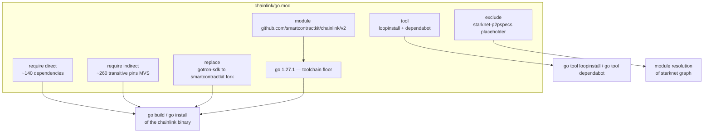
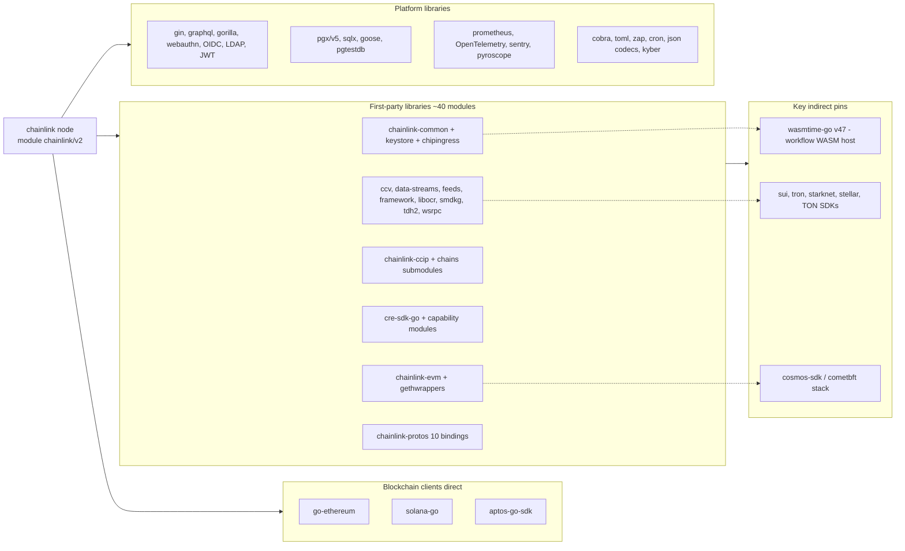
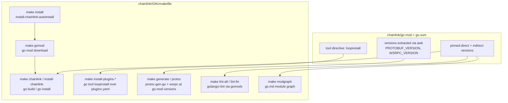
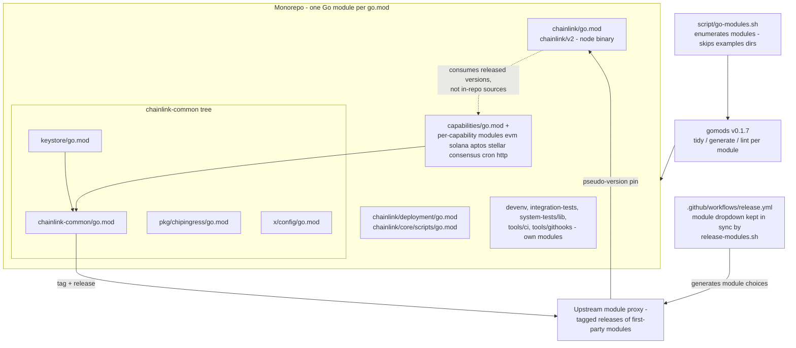
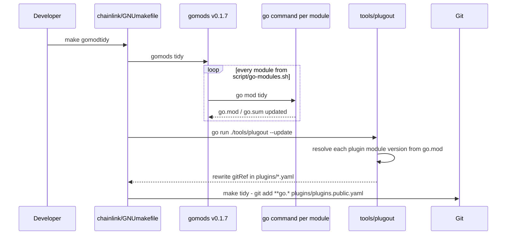
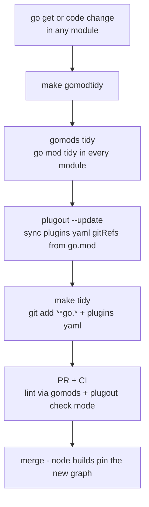

# Go Dependencies (`chainlink/go.mod`)

> **Parent:** [repo-build-config](../repo-build-config.md) · **Area:** [Build, CI & Release Infrastructure](../../Build,_CI___Release_Infrastructure.md)
> **Core component:** `chainlink/go.mod::go.mod`

## Introduction

`chainlink/go.mod` is the Go module manifest for the core Chainlink node binary (`github.com/smartcontractkit/chainlink/v2`). It is the single source of truth for:

- the **Go toolchain version** required to build the node (`go 1.27.1`),
- the **direct dependencies** the node imports — third-party libraries and first-party `smartcontractkit` modules (blockchain clients, oracle plugins, protobuf bindings, web framework, persistence, observability),
- the **transitive dependency closure** (the `// indirect` block) resolved under Go's Minimal Version Selection (MVS),
- **directives that alter module resolution** — one `replace`, two `tool` declarations, and one `exclude`.

Every build, code-generation, lint, and plugin-installation workflow for the node either reads versions from this file or rewrites it. This page documents the manifest's structure, its dependency landscape, how the build consumes it, and the maintenance workflows that keep it consistent across the repository's many Go modules.

The node code itself is documented in [Node Application Core & Interfaces](../../Node_Application_Core___Interfaces.md); the libraries it consumes are documented in [Shared Foundation Libraries & Domain Types](../../Shared_Foundation_Libraries___Domain_Types.md), [Plugin Process Framework (Loop)](../../../Plugin_Process_Framework_(Loop).md), and [CCIP Cross-Chain Protocol](../../CCIP_Cross-Chain_Protocol.md).

## Manifest anatomy

The manifest (`chainlink/go.mod`, 421 lines) is organized into seven sections, each with a distinct effect on module resolution:

| Section | Content in this manifest | Effect |
|---|---|---|
| `module` | `github.com/smartcontractkit/chainlink/v2` | Import-path root for the entire `chainlink/core/...` source tree |
| `go` | `go 1.27.1` | Minimum Go toolchain; governs language features and module semantics used (including `tool` directives) |
| `require` (direct) | ~140 pinned dependencies | Everything the node imports directly — see [Dependency landscape](#dependency-landscape) |
| `require` (indirect) | ~260 `// indirect` entries | Transitive closure pinned by MVS (e.g. Cosmos SDK/CometBft stack, `wasmtime-go` for the WASM workflow host, chain SDKs pulled in transitively) |
| `replace` | `github.com/fbsobreira/gotron-sdk` → `github.com/smartcontractkit/chainlink-tron/relayer/gotron-sdk v0.0.5-0.20260218133534-cbd44da2856b` | Swaps the upstream Tron SDK for SmartContractKit's patched fork at build time |
| `tool` | `chainlink-common/pkg/loop/cmd/loopinstall`, `chainlink-common/script/cmd/dependabot` | Executables invocable as `go tool <name>`, version-locked to this module's dependency graph |
| `exclude` | `github.com/starknet-io/starknet-p2pspecs v0.0.0-00010101000000-000000000000` | Filters out a placeholder version that only exists via Juno's local `replace` directive (per the in-file comment) |

Integrity of the resolved graph is enforced by the companion `go.sum` files (one per module), which the tidy workflow stages alongside `go.mod`.



## Dependency landscape

The direct requirement block groups into seven functional clusters, mirroring the node's runtime architecture:

| Cluster | Representative dependencies | Serves |
|---|---|---|
| **Blockchain clients** | `go-ethereum v1.17.4`, `gagliardetto/solana-go`, `aptos-labs/aptos-go-sdk` | Direct chain connectivity for EVM, Solana, Aptos |
| **First-party SmartContractKit libraries (~40 modules)** | `chainlink-common` (+`keystore`, `pkg/chipingress`), `chainlink-evm` (+`gethwrappers`), `chainlink-ccip` (+`chains/evm`, `chains/solana`, `gobindings`), `chainlink-ccv`, `chainlink-data-streams`, `chainlink-feeds`, `chainlink-framework/chains`, `chainlink-framework/multinode`, `chainlink-sui/codec`, `chainlink-ton/cciplib`, `chainlink-aptos/codec`, `cre-sdk-go` (+`capabilities/networking/http`, `capabilities/scheduler/cron`), `chain-selectors`, `libocr`, `smdkg`, `tdh2`, `wsrpc`, `freeport` | Core oracle engines, keystore, CCIP, CRE/workflow runtime, OCR consensus |
| **Protobuf bindings** | `chainlink-protos/{billing,cre,data-feeds,linking-service,metering,node-platform,orchestrator,ring,storage-service,workflows}/go` | gRPC contracts with platform services (10 separate proto modules) |
| **Web / API / auth** | `gin-gonic/gin` + `gin-contrib/{cors,expvar,sessions,size}`, `danielkov/gin-helmet`, `Depado/ginprom`, `graph-gophers/graphql-go`, `graph-gophers/dataloader`, `manyminds/api2go`, `gorilla/{websocket,sessions,securecookie}`, `go-webauthn/webauthn`, `coreos/go-oidc/v3`, `go-ldap/ldap/v3`, `golang-jwt/jwt/v5`, `unrolled/secure`, `ulule/limiter/v3` | REST + GraphQL API, sessions, LDAP/OIDC/WebAuthn auth (see [web_api](../../Node_Application_Core___Interfaces/web_api.md)) |
| **Persistence** | `jackc/pgx/v5`, `jmoiron/sqlx`, `lib/pq`, `pressly/goose/v3`, `peterldowns/pgtestdb` | PostgreSQL access, migrations, test databases |
| **Observability** | `prometheus/{client_golang,client_model,common,prometheus}`, OpenTelemetry suite (`otel`, `log`, `metric`, `sdk/metric`, `trace`, `otelgin`, Prometheus bridge), `getsentry/sentry-go`, `grafana/pyroscope-go`, `grafana/otel-profiling-go` | Metrics, tracing, continuous profiling (see [Telemetry & Observability Platform](../../Telemetry___Observability_Platform.md)) |
| **Platform utilities** | `spf13/cobra`, `urfave/cli`, `BurntSushi/toml`, `pelletier/go-toml` v1+v2, `go-viper/mapstructure/v2`, `go.uber.org/zap`, `robfig/cron/v3`, `go-co-op/gocron/v2`, `jonboulle/clockwork`, `goccy/go-json`, `tidwall/gjson`, `buger/jsonparser`, `fxamacker/cbor/v2`, `go-json-experiment/json`, `shopspring/decimal`, `holiman/uint256`, `go.dedis.ch/kyber/v3`, `golang.org/x/crypto`, `doyensec/safeurl`, `avast/retry-go/v4`, `buraksezer/consistent`, `stretchr/testify`, `onsi/gomega` | CLI, config parsing, scheduling, JSON/CBOR codecs, crypto, SSRF-safe HTTP, retries, consistent hashing, testing |

Notable members of the **indirect** block record heavyweight transitive stacks the node never imports directly but which must be version-pinned: `bytecodealliance/wasmtime-go/v47` (the WASM host used by workflow execution), the Cosmos SDK / CometBft stack (via chain client SDKs), and additional chain SDKs (`block-vision/sui-go-sdk`, `fbsobreira/gotron-sdk`, `NethermindEth/starknet.go`, `stellar/go-stellar-sdk`, `xssnick/tonutils-go`).



## Versioning conventions

Four version styles coexist in the manifest, each signaling a different supply relationship:

| Convention | Example from `chainlink/go.mod` | Meaning |
|---|---|---|
| Tagged release | `github.com/ethereum/go-ethereum v1.17.4` | Stable upstream release |
| Pseudo-version | `github.com/smartcontractkit/chainlink-common v0.11.2-0.20261007174852-7fabc093ff84` | Unreleased commit of a first-party module (`pre-release base + timestamp + commit SHA`) — the standard way the node tracks in-development SmartContractKit libraries |
| `+incompatible` | `graph-gophers/dataloader v5.0.0+incompatible` | Pre-Go-modules upstream lacking a `go.mod` |
| Pre-release tag | `github.com/smartcontractkit/cre-sdk-go v1.17.0-capdev.1`, `chainlink-ccip v0.1.1-solana.0.20260908155618-…` | Feature-branch pre-releases (`capdev`, `solana`) |

The heavy use of pseudo-versions for `chainlink-*` modules reflects the release model described in [Multi-module repository topology](#multi-module-repository-topology): sibling modules are consumed as *published versions*, never via `replace` (the only `replace` in the file is the Tron SDK fork).

## Directives that alter module resolution

### `replace` — Tron SDK fork

```
replace github.com/fbsobreira/gotron-sdk => github.com/smartcontractkit/chainlink-tron/relayer/gotron-sdk v0.0.5-0.20260218133534-cbd44da2856b
```

Any import of `fbsobreira/gotron-sdk` (pulled indirectly for Tron support) is redirected to SmartContractKit's fork of the SDK. This is the **only** `replace` in the file, keeping the dependency graph otherwise faithful to upstream published versions.

### `tool` — version-locked executables

- **`chainlink-common/pkg/loop/cmd/loopinstall`** — the plugin installer. Because it is declared as a `tool`, `go tool loopinstall` always resolves to the same `chainlink-common` version pinned in this manifest, eliminating drift between the node's dependency graph and the tool that builds its plugins. The `chainlink/GNUmakefile` targets `install-plugins-public`, `install-plugins-private`, and `install-plugins-testing` invoke it with `--concurrency 5` against `./plugins/plugins.{public,private,testing}.yaml`, setting `GOPRIVATE=github.com/smartcontractkit/*` for private plugins.
- **`chainlink-common/script/cmd/dependabot`** — legacy dependency-automation binary. The corresponding `make dependabot` target in `chainlink/GNUmakefile` now prints `Deprecated: manually trigger the CI workflow instead`; the `tool` directive merely keeps the binary reachable.

### `exclude` — Starknet placeholder

```
exclude github.com/starknet-io/starknet-p2pspecs v0.0.0-00010101000000-000000000000
```

Per the in-file comment, Juno (an indirect Starknet dependency) carries a placeholder version of this module that is only meant to be resolved through Juno's own local `replace`. The `exclude` prevents that placeholder from leaking into the node's build list.

## How the build consumes the manifest

`chainlink/GNUmakefile` is the entry point that turns the manifest into binaries and generated code:

- **`make gomod`** installs `gencodec` (if missing) and runs `go mod download` to populate the module cache.
- **`make install`** chains `install-chainlink-autoinstall` → `gomod` + `install-chainlink` (a `go install` of the module root), so dependency download always precedes the first build.
- **`make chainlink` / `make chainlink-dev` / `make install-chainlink-cover`** build the binary with ldflags produced by `tools/bin/ldflags`.
- **Version extraction for codegen tools**: `PROTOBUF_VERSION` and `WSRPC_VERSION` are *read back out of* `go.mod` with `awk` (GNUmakefile lines 23–24) and used to install `protoc-gen-go` and `protoc-gen-go-wsrpc` at exactly the versions the compiled node links against — the manifest is the single source of truth for generator compatibility.
- **`make generate`** runs `gomods -w go generate -x ./...` after `codecgen`, `mockery`, and `protoc`, propagating code generation across all modules.
- **`make lint-all` / `lint-fix`** run `golangci-lint` through `gomods` across every module, emitting checkstyle reports.
- **`make modgraph`** renders the module graph to `go.md` via `github.com/jmank88/modgraph`.



## Multi-module repository topology

The repository is a **multi-module Go tree**: nearly every top-level directory owns its own `go.mod` (`chainlink/`, `chainlink-common/` + submodules, `capabilities/` + per-capability modules, `chainlink/deployment`, `chainlink/core/scripts`, `chainlink/devenv`, `chainlink/integration-tests`, `chainlink/system-tests/lib`, `chainlink/tools/ci`, `chainlink/tools/githooks`, `cre-cli`, …). There is no shared orchestration other than the **`gomods`** utility (`github.com/jmank88/gomods`, pinned at `v0.1.7`), which fans a single `go` command out over every module.

The module inventory is enumerated by `chainlink-common/script/go-modules.sh`, which:

- lists every tracked `*go.mod` via `git ls-files`, relative to the git toplevel;
- treats modules under any `examples/` directory as **modeled downstream consumers** of their nearest enclosing module — they carry their own local `replace` directives and are tidied/built/generated *as part of that parent module*, never checked on their own;
- resolves any directory to its owning module (`parent DIR`).

This same list feeds `chainlink-common/script/release-modules.sh`, which rewrites the module dropdown in `.github/workflows/release.yml` — CI fails if the generated choices fall behind the actual module set (see [build-and-repo-tooling](../build-and-repo-tooling.md)).

Critically, `chainlink/go.mod` depends on sibling modules (`chainlink-common`, `chainlink-evm`, …) **as versioned published modules** — the in-repo sources are developed and released independently (tagged via the `release.yml` workflow), and the node pins their pseudo-versions. The `gomodslocalupdate` target (`go run ./tools/gomod-local-update/…` followed by `gomods -w gomod-local-update` and a tidy) is the tooling used to roll in-repo module version references consistently before tidying.



## Maintenance workflows

### Cross-module tidy and staging

`make gomodtidy` (in `chainlink/GNUmakefile`) is the canonical dependency-refresh workflow. It runs `go mod tidy` in *every* module, then synchronizes plugin manifests, and `make tidy` stages everything for commit:



### Plugin manifest sync (`plugout`)

`chainlink/tools/plugout` keeps the LOOPP plugin manifests honest with respect to `chainlink/go.mod`. In **check mode** it resolves each plugin's module version from the manifest and exits non-zero if the `gitRef` recorded in `plugins/*.yaml` disagrees; with `--update` it rewrites the manifests. Its `ModuleVersion` model normalizes tags, tag prefixes, commit SHAs, and the *indirect* flag — so even a plugin pulled only transitively is verified against what the node's build list actually contains. Details in [plugout](../plugout.md); the release-changelog engine consumes the same plugins file ([release-changelog](../release-changelog.md)).

### Adding or upgrading a dependency

1. Change code / run `go get <module>@<version>` in the relevant module.
2. `make gomodtidy` — tidies all modules and syncs plugin manifests.
3. `make tidy` — stages `**go.*` and `plugins/plugins.public.yaml` for the commit.
4. CI validates the graph: golangci-lint via `gomods`, plus the plugin-manifest check mode inside `plugout`.

For first-party libraries, the flow is inverted: release the sibling module first (via `release.yml`, whose choices are maintained by `release-modules.sh`), then bump its pseudo-version in `chainlink/go.mod` (the `gomodslocalupdate` target assists with rolling these references).



## Operations quick reference

| Target (`chainlink/GNUmakefile`) | Action | Effect on `go.mod` |
|---|---|---|
| `make gomod` | `go mod download` (+ gencodec install) | Downloads only |
| `make gomodtidy` / `make tidy` | `gomods tidy` + `plugout --update` (+ `git add`) | Rewrites all `go.mod`/`go.sum` + `plugins/*.yaml` |
| `make gomodslocalupdate` | `gomod-local-update` across modules, then tidy | Rolls in-repo module version references |
| `make generate` | codecgen, mockery, protoc, `gomods -w go generate` | Read-only (tool versions derived from `go.mod`) |
| `make lint-all` / `lint-fix` | golangci-lint across all modules | Read-only |
| `make modgraph` | `modgraph > go.md` | Read-only (renders the graph) |
| `make install-plugins-*` | `go tool loopinstall` over `plugins/*.yaml` | Consumes the `tool` directive + manifests |
| `make dependabot` | Deprecated stub (CI workflow instead) | — |

## Related documentation

- [repo-build-config](../repo-build-config.md) — parent: overall repo build configuration
- [repo-build-config_git-hooks](repo-build-config_git-hooks.md) — `lefthook.yml` hooks that guard commits (incl. dependency changes)
- [repo-build-config_developer-environment](repo-build-config_developer-environment.md) — Nix-managed toolchain used to run `go` itself
- [repo-build-config_quality-and-versioning](repo-build-config_quality-and-versioning.md) — Sonar, `package.json` versioning (the `VERSION` variable the GNUmakefile reads)
- [chainlink_build_and_tooling](../chainlink_build_and_tooling.md) — full documentation of `chainlink/GNUmakefile`
- [build-and-repo-tooling](../build-and-repo-tooling.md) — `chainlink-common` Makefile, `go-modules.sh`, `release-modules.sh`
- [plugout](../plugout.md) — plugin-manifest/`go.mod` synchronization tool
- [release-changelog](../release-changelog.md) — release notes engine consuming the plugins file
- [Shared Foundation Libraries & Domain Types](../../Shared_Foundation_Libraries___Domain_Types.md) — the `chainlink-common` libraries pinned here
- [Plugin Process Framework (Loop)](../../../Plugin_Process_Framework_(Loop).md) — the `loopinstall` tool and LOOPP plugin model
