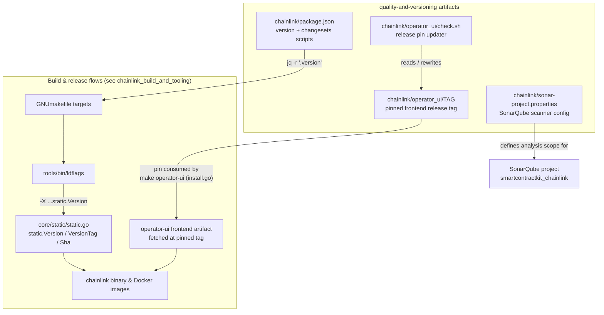
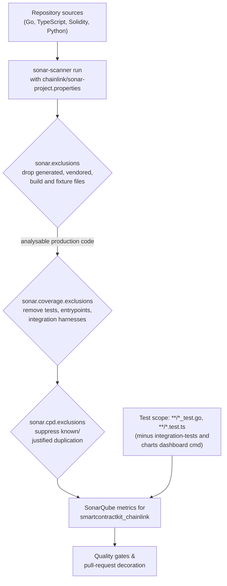
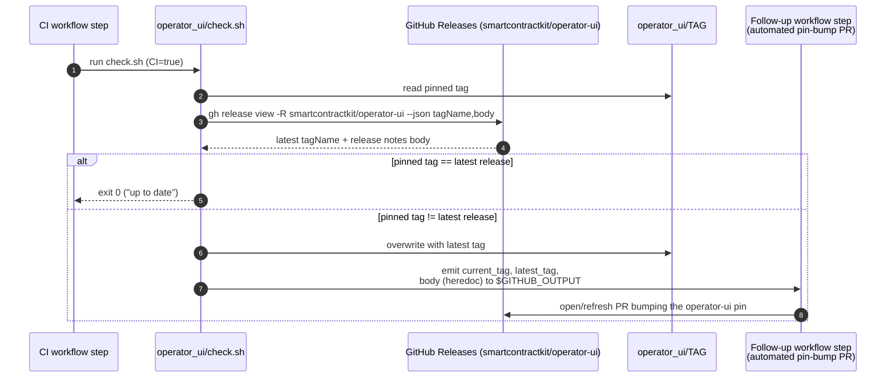

# Repo Build Config: Quality & Versioning

This module documents the repository-level configuration artifacts that govern **code quality analysis**, **release versioning**, and **third-party release pinning** for the `chainlink` node repository:

| Artifact | Role | Quality or Versioning concern |
|---|---|---|
| `chainlink/sonar-project.properties` | SonarQube scanner configuration | Static analysis scope, duplication detection, coverage and test bookkeeping |
| `chainlink/package.json` | Node manifest & changesets anchor | **Single source of truth** for the node's semantic version, consumed by every build |
| `chainlink/operator_ui/check.sh` | Release drift detector | Keeps the pinned `operator-ui` frontend tag aligned with upstream releases |

Together these files answer three operational questions: *what code gets quality-gated*, *what version the node reports and ships as*, and *which externally built frontend artifact the node is compiled against*.

---

## Scope and boundaries

This page is one of four children of the [repo-build-config](../repo-build-config.md) group. The siblings own the other repository-level configuration:

- [repo-build-config_go-dependencies](repo-build-config_go-dependencies.md) — `chainlink/go.mod` module graph and dependency policy.
- [repo-build-config_git-hooks](repo-build-config_git-hooks.md) — `chainlink/lefthook.yml` pre-commit/pre-push automation (which itself invokes golangci-lint, `typos`, and code generators).
- [repo-build-config_developer-environment](repo-build-config_developer-environment.md) — `nix.conf` and the Nix shell hook for reproducible local environments.

Go build tooling that *uses* these configs (the `GNUmakefile`, `.golangci.yml`, `.mockery.yaml`, `_typos.toml`) is documented in [chainlink_build_and_tooling](../chainlink_build_and_tooling.md); CI workflows are covered in [repo_ci_and_docs](../repo_ci_and_docs.md).

---

## Architecture overview

The three artifacts are largely independent *inputs* that feed the shared build pipeline: SonarQube reads sources with the scope defined by the properties file; the make/ldflags chain reads the version from `package.json`; and the operator-ui pin is consumed when assembling node artifacts that embed the frontend.

---

## 1. Static analysis scope — `chainlink/sonar-project.properties`

The file configures the SonarQube scanner for project key `smartcontractkit_chainlink`. Its main job is not to enable analysis but to **carve out everything that should not be analyzed**, so quality metrics and quality gates reflect hand-written production code rather than generated or vendored artifacts.

### Directive summary

| Directive group | Purpose | Highlights |
|---|---|---|
| `sonar.projectKey` / `sonar.sources` / `sonar.sourceEncoding` | Project identity; analyze the whole tree as UTF-8 sources | `smartcontractkit_chainlink`, sources at repo root |
| `sonar.python.version` | Language hint for Python sources in the tree | Pinned to `3.8` |
| `sonar.exclusions` | Files removed from *all* static analysis | Generated code, mocks, fixtures, build outputs, docs, tools |
| `sonar.coverage.exclusions` | Files excluded from *coverage* metrics (still linted) | Test files, integration tests, entrypoints, one historical migration |
| `sonar.cpd.exclusions` | Files excluded from *copy-paste detection*, each with a written justification | Solidity contracts, versioned plugins, transitional Seth helpers |
| `sonar.tests`, `sonar.test.inclusions`, `sonar.test.exclusions` | Declares what counts as a test for coverage accounting | `**/*_test.go`, `**/*.test.ts`; integration tests excluded |

### Analysis pipeline

### What is excluded, and why it matters

**Full exclusions (`sonar.exclusions`)** — content that would add noise without being reviewable hand-written code:

- Generated code: `**/*.pb.go`, `**/*_gen.go`, `**/*_codecgen.go`, `**/generated/**/*`, `**/gen/**/*`.
- Mocks and test scaffolding: `**/mocks/**/*`, `**/mock_*.go`, `**/testutils/**/*`, `**/testdata/**/*`, `**/fixtures/**/*`, `**/testfiles/**/*`, `**/testconfig/**/*`.
- Web/contract build outputs: `**/node_modules/**/*`, `**/core/web/assets/**/*`, `contracts/typechain|artifacts|cache|scripts`, `**/*.abi`, `**/*.bin`, `**/*.config.ts`, `**/tsconfig.json`.
- Non-product trees: `**/docs/**/*`, `**/tools/**/*`, `**/core/scripts/**/*`, `**/fuzz/**/*`, and `**/deployment/ccip/changeset/testhelpers/**/*` (CCIP changeset test helpers).

**Coverage exclusions (`sonar.coverage.exclusions`)** — code that is analyzed but not expected to carry unit-coverage weight: `**/*_test.go`, `**/*.test.ts`, contract tests, `**/core/**/cltest/**/*` (the shared Go test helper package), `**/integration-tests/**/*`, `**/*integration_tests/**/*`, `**/plugins/**/*`, `**/capabilities/**/*test/**/*`, all `main.go` entrypoints, and the single migration `**/0195_add_not_null_to_evm_chain_id_in_job_specs.go`.

**Duplication exclusions (`sonar.cpd.exclusions`)** — the file documents its justifications inline:

- `**/contracts/**/*.sol` — Solidity contracts.
- `**/config.go` — configuration structs are inherently repetitive.
- `core/services/ocr2/plugins/mercury/plugin.go` — the `MercuryProvider`/Factory APIs are *inherently duplicated* because of embedded v1–v4 versioning (the corresponding type families are described in [types-mercury-llo_report-codecs](../../Shared_Foundation_Libraries___Domain_Types/types-mercury-llo/types-mercury-llo_report-codecs.md)).
- `integration-tests/load/**`, `integration-tests/contracts/ethereum_contracts_seth.go`, `integration-tests/actions/seth/actions.go` — *temporary* parallel helpers maintained alongside Seth-based ones during migration; duplicating a few functions was deemed cheaper than fighting cyclic imports.

### Consistency across the workspace

The chainlink scanner config is one of several per-repo Sonar projects; each follows the same pattern (project key, exclusions, test inclusions) tuned to its content:

- `capabilities/sonar-project.properties` (project `smartcontractkit_capabilities`) additionally excludes `**/*.sol`, `gen.go` variants, and CRE consensus/evm internals pending CRE-542 — see [capabilities_workspace_tooling](../capabilities_workspace_tooling.md).
- `chainlink-common/sonar-project.properties` (project `smartcontractkit_chainlink-common`) excludes the `observability-lib` tree from duplication detection — see [build-and-repo-tooling](../build-and-repo-tooling.md).

---

## 2. Version management — `chainlink/package.json`

Although the node is a Go binary and the package is `private: true` (never published to npm), `chainlink/package.json` plays a central role: **its `version` field (`2.68.0` at time of writing) is the single source of truth for the node's semantic version.**

### Version authoring and consumption flow

```mermaid
flowchart LR
    subgraph AUTHORING["Version authoring"]
        CS[".changeset/*.md<br/>(pending changesets)"]
        GCS["make gocs<br/>(gocs generates changesets for Go dep bumps)"]
        CIV["Release automation<br/>pnpm run ci:changeset:version"]
    end
    PJ["chainlink/package.json<br/>version: 2.68.0"]
    subgraph BUILD["Build pipeline (chainlink/GNUmakefile)"]
        MAKE["VERSION = jq -r '.version' package.json"]
        LDF["tools/bin/ldflags"]
    end
    STATIC["core/static/static.go<br/>Version / VersionTag / Sha"]
    BIN["chainlink binary, Docker images,<br/>DB application_name, /health checks"]

    GCS --> CS
    CS --> CIV
    CIV -->|"consumes changesets,<br/>bumps semver, writes changelog"| PJ
    PJ --> MAKE
    MAKE --> LDF
    LDF -->|"-X github.com/.../core/static.Version"| STATIC
    STATIC --> BIN
```

**Authoring side (changesets).** The dev dependency `@changesets/cli` (~2.28.1, plus `@changesets/get-github-info` for GitHub-linked changelog entries and `semver` for version arithmetic) implements the changesets workflow: contributors add intent files under `chainlink/.changeset/`, and release automation runs the `ci:changeset:version` script (`pnpm changeset version`) to consume them, bump the version, and write changelog entries. The `ci:` prefix marks scripts that are invoked from CI rather than by developers. The `.changeset/` directory is normally empty between releases because entries are consumed at release time.

Two related make targets round out the Go-side story in `chainlink/GNUmakefile`:

- `make gocs` — runs `github.com/smartcontractkit/gocs/cmd/gocs` to **generate changeset markdown files for Go module dependency bumps**, so Go dependency updates travel through the same versioning flow as npm-style changesets.
- `make dependabot` — deprecated; prints *"manually trigger the CI workflow instead"*. Dependabot-style bumps are therefore expected to arrive via the CI workflow, not the make target.

**Consumption side (build).** The version is injected into every binary:

1. `GNUmakefile` reads `VERSION = $(shell jq -r '.version' package.json)` (line 4).
2. The build invokes `tools/bin/ldflags`, which echoes `-X github.com/smartcontractkit/chainlink/v2/core/static.Version=$VERSION -X ...static.VersionTag=$VERSION_TAG -X ...static.Sha=$COMMIT_SHA`, where `VERSION_TAG` falls back to `git describe --always` and `COMMIT_SHA` to `git rev-parse HEAD`.
3. `chainlink/core/static/static.go` declares `Version`, `VersionTag`, and `Sha` as compile-time link variables (defaulting to the `Unset` sentinel). These surface in the node's reported version (`static.Short()`), Docker image metadata, and the PostgreSQL `application_name` (`static.SetConsumerName`), which embeds the node version for observability.

Consequence: bumping `package.json` and rebuilding is sufficient to change the version a node reports everywhere — there is no second version constant to keep in sync.

### Package-manager determinism

| Mechanism | Setting | Effect |
|---|---|---|
| `engines` | `node >= 18`, `pnpm >= 10` | Minimum toolchain versions |
| `packageManager` | `pnpm@10.11.1+sha512.e519b9...` | Corepack pins the **exact** pnpm version and verifies its integrity hash, so local dev and CI use byte-identical package management |
| `pnpm.overrides` | `"@babel/runtime": "^7.26.10"` | Forces a floor on `@babel/runtime` across the whole dependency graph (security patch override for the web/contract toolchain) |

### Workspace-wide changesets pattern

The changesets convention (`ci:changeset:version` / `ci:changeset:publish` scripts plus changesets dev dependencies) is replicated across repos in the organization, each adapted to its release vehicle:

| Package | Version | `ci:changeset:version` | `ci:changeset:publish` | Notes |
|---|---|---|---|---|
| `chainlink/package.json` | `2.68.0` | `pnpm changeset version` | *(absent)* | Private manifest; releases are Go binaries/Docker images, not npm artifacts |
| `capabilities/package.json` | `0.1.0` | `pnpm changeset version` | `pnpm changeset publish` | npm workspace root, with `@changesets/changelog-github` and nx — see [capabilities_workspace_tooling](../capabilities_workspace_tooling.md) |
| `cre-cli/package.json` | `1.8.2` | `pnpm changeset version` | `bash ./scripts/tag-and-push.sh` | CLI ships binaries via GoReleaser, so "publish" means git tag + push — see [cre-cli-build-and-release](../../Developer_Toolchain_(CLI,_SDKs___API_Clients)/cre-cli-build-and-release.md) |

---

## 3. Third-party release pinning — `chainlink/operator_ui/check.sh`

The node embeds the **operator-ui** web frontend, which is built and released independently in the `smartcontractkit/operator-ui` repository. The chainlink repo pins a specific upstream release in `chainlink/operator_ui/TAG`, and `check.sh` is the automation that keeps that pin current.

### Roles in the flow

### Behavior details

- **Inputs**: the pinned tag from `operator_ui/TAG` and the latest release from the GitHub API, queried with `gh release view -R smartcontractkit/operator-ui --json 'tagName,body'`. The script header declares its tool dependencies: `gh` CLI ≥ 2.15.0 and `jq` ≥ 1.6.
- **No-op path**: if the pin equals the latest release tag, the script prints "up to date" and exits 0.
- **Update path**: otherwise it rewrites `TAG` with the latest tag, so the *next* fetch of the frontend artifact picks up the new version.
- **CI handoff**: when the `CI` environment variable is set, the script exports three outputs to `$GITHUB_OUTPUT` for subsequent workflow steps — `current_tag`, `latest_tag`, and `body` (the full release notes, written using a random `openssl rand -hex 8` heredoc delimiter, per the GitHub discussion linked in the script, so multi-line notes survive output parsing). A follow-up step can use these to open an automated pull request that updates the pin, giving reviewers the release notes inline.

### Relationship to the build

The pin maintained by `check.sh` is consumed by the `operator-ui` make target:

- `make operator-ui` runs `go run operator_ui/install.go .`, which fetches the frontend artifact for the tag pinned in `TAG`.
- `install-chainlink`, `install-chainlink-dev`, and `install-chainlink-cover` all depend on `operator-ui`, so any local or CI binary install embeds the frontend at the pinned release. This is why a stale pin silently ships an old UI — and why `check.sh` exists to automate the bump.

---

## How this module fits into the system

- **Upstream**: the [repo-build-config](../repo-build-config.md) group; the go dependency policy ([repo-build-config_go-dependencies](repo-build-config_go-dependencies.md)) constrains what `gocs` may generate changesets for, and the git hooks ([repo-build-config_git-hooks](repo-build-config_git-hooks.md)) enforce the same "exclude generated code" philosophy (e.g., the `typos` excludes) at commit time.
- **Downstream**: the [Build, CI & Release Infrastructure](../../Build,_CI___Release_Infrastructure.md) toolchain consumes these files — the `GNUmakefile` and lint tooling are detailed in [chainlink_build_and_tooling](../chainlink_build_and_tooling.md), while cross-module release tooling such as the release changelog generator ([release-changelog](../release-changelog.md)) and the `plugout` plugin manifest tool ([plugout](../plugout.md), also invoked by `make gomodtidy`) operate on the artifacts this module's versioning flow produces.
- **Product impact**: the injected `static.Version` identifies nodes to peers, telemetry pipelines ([Telemetry & Observability Platform](../../Telemetry___Observability_Platform.md)), and database monitoring; the operator-ui pin determines the management UI shipped with every node image.

## File reference

| File | Components | Summary |
|---|---|---|
| `chainlink/sonar-project.properties` | `sonar-project.properties` | SonarQube scanner config: project `smartcontractkit_chainlink`, UTF-8 sources, Python 3.8; exclusion lists for static analysis, coverage, and duplication; test scoping for `*_test.go` / `*.test.ts` |
| `chainlink/package.json` | `package.json` | Private Node manifest; `version` 2.68.0 is the node's semantic source of truth; `ci:changeset:version` → `pnpm changeset version`; pnpm ≥ 10 pinned with integrity hash; `@babel/runtime` override |
| `chainlink/operator_ui/check.sh` | `check.sh` | Compares `operator_ui/TAG` pin against the latest `smartcontractkit/operator-ui` GitHub release; rewrites the pin and exports `current_tag`/`latest_tag`/`body` to `$GITHUB_OUTPUT` in CI |
