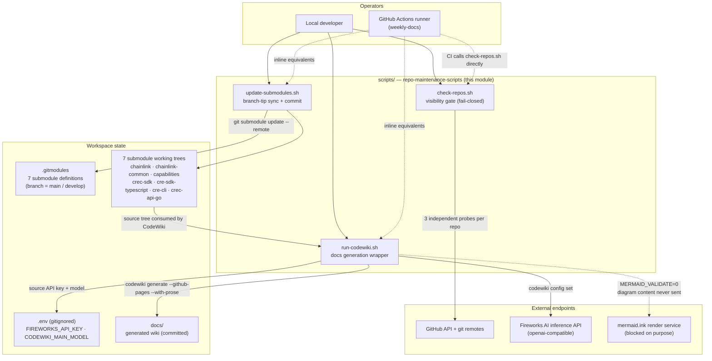
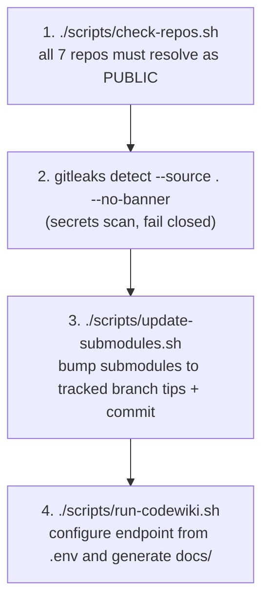
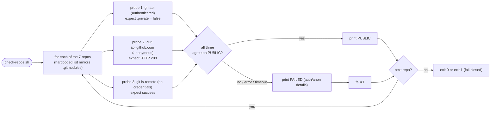

# Repo Maintenance Scripts (`scripts/`)

> **Module path:** `scripts/` · **Type:** Bash operator tooling · **Artifacts:** `scripts/check-repos.sh`, `scripts/run-codewiki.sh`, `scripts/update-submodules.sh`

## 1. Overview

`repo-maintenance-scripts` is a compact module of three Bash scripts that keep the **mahogany-octopus** documentation workspace healthy and safe to operate. The workspace is a *wrapper repository* that pins seven public `smartcontractkit` repositories as git submodules (declared in [`.gitmodules`](.gitmodules)) and renders them as one documentation graph using [CodeWiki](https://github.com/007vasy/CodeWiki) — an LLM-driven documentation generator. Because CodeWiki ships source code to a third-party LLM endpoint, the scripts enforce a **security-first operating model**:

1. **`check-repos.sh`** — a fail-closed, triple-verification gate that proves every submodule still points at a **public** GitHub repository before any content is sent to the LLM.
2. **`update-submodules.sh`** — fast-forwards every submodule to the tip of its `.gitmodules`-declared branch (`develop` for `chainlink`, `main` for the other six) and commits the bump.
3. **`run-codewiki.sh`** — configures the CodeWiki CLI against a Fireworks AI *openai-compatible* endpoint using credentials from a gitignored `.env`, then runs local documentation generation.

All three scripts run under `set -euo pipefail` (strict mode: fail on error, undefined variables, and pipe failures), are idempotent, and require no arguments to perform their default task.

## 2. Context in the overall system

The scripts are the **local-operator counterparts** of the scheduled CI refresh documented in [repo_ci_and_docs](repo_ci_and_docs.md) ([`.github/workflows/weekly-docs.yml`](../.github/workflows/weekly-docs.yml), job `refresh`, Mondays 04:00 UTC). The division of labor is:

| Step | Local (this module) | CI (`weekly-docs.yml`) |
| --- | --- | --- |
| Repo visibility gate | `./scripts/check-repos.sh` | Calls this exact script (step *"Triple-check every submodule is a public repo"*) |
| Secrets scan | `gitleaks detect` (operator-run, per [README](../README.md)) | Pinned, checksum-verified `gitleaks 8.30.1`, fail-closed |
| Submodule bump | `./scripts/update-submodules.sh` | **Inlines the same logic** with a `codewiki-bot` git identity |
| Docs generation | `./scripts/run-codewiki.sh` | **Inlines the same config** with `secrets.FIREWORKS_API_KEY`, fixed model `accounts/fireworks/models/glm-5p3-flash`, and an optional `--update` flag when previous artifacts exist |

> ⚠️ **Maintenance note:** only `check-repos.sh` is invoked by CI as a file; the submodule-bump and codewiki-configuration logic is *duplicated inline* inside [`weekly-docs.yml`](../.github/workflows/weekly-docs.yml). Any behavioral change to `update-submodules.sh` or `run-codewiki.sh` must be mirrored in that workflow (and vice versa).

The submodule sources these scripts feed into CodeWiki are documented elsewhere in this wiki — e.g. the node core in [Node_Application_Core___Interfaces](../Node_Application_Core___Interfaces.md), platform services in [Node_Platform_Services](../Node_Platform_Services.md), the oracle engines in [Oracle_Engines___Data_Pipelines](../Oracle_Engines___Data_Pipelines.md), and the CRE runtime in [Workflow___Capability_Runtime_(CRE_Engine)](../Workflow___Capability_Runtime_(CRE_Engine).md).

## 3. Architecture

### 3.1 Local runbook (end-to-end)

The canonical local sequence, from the repository [README](../README.md):

Each stage is a gate: the pipeline is designed so that private code, leaked secrets, and stale documentation snapshots are caught *before* anything reaches the LLM endpoint or the committed `docs/` tree.

## 4. Components at a glance

| Script | Kind | Core responsibility | Exit behavior |
| --- | --- | --- | --- |
| `scripts/check-repos.sh::check-repos.sh` | Security gate | Triple-checks (authenticated GitHub API, anonymous HTTP API, anonymous `git ls-remote`) that all 7 submodule repositories are public | `exit 1` if **any** repo fails or any probe is inconclusive |
| `scripts/update-submodules.sh::update-submodules.sh` | Repo hygiene | `git submodule update --remote`, stages `.gitmodules` + 7 submodule paths, commits the bump only when there is a diff | No-op commit skipped; fails on any git error |
| `scripts/run-codewiki.sh::run-codewiki.sh` | Generation wrapper | Loads `.env`, exports `MERMAID_VALIDATE=0`, configures CodeWiki for Fireworks, then `exec`s `codewiki generate --github-pages --with-prose` | Hard-fails (with a clear message) if `FIREWORKS_API_KEY` or `CODEWIKI_MAIN_MODEL` are unset |

## 5. High-level functionality

### 5.1 Documentation-generation pipeline — `check-repos.sh` + `run-codewiki.sh`

These two scripts form the safe-execution pipeline for LLM-driven documentation generation: the gate proves the source material is public, and the wrapper guarantees credentials and egress settings are correct before CodeWiki runs. Together they implement the "never leak" invariants of the workspace:

- **`check-repos.sh`** performs three *independent* probes per repository so that a single misconfiguration cannot mask a private repo: (1) authenticated `gh api repos/<org>/<repo>` checking the `private` field, (2) anonymous `curl` against `api.github.com` checking the HTTP status code, (3) anonymous `git ls-remote` with credentials disabled (`GIT_TERMINAL_PROMPT=0`, `credential.helper=` unset). A repo is only `PUBLIC` when all three agree; anything else is `FAILED` and the script exits `1`.
- **`run-codewiki.sh`** resolves the workspace root, sources `.env` when present, hard-fails without the two required variables, disables mermaid remote validation (`MERMAID_VALIDATE=0`) because diagram content is derived from source code, writes the CodeWiki provider configuration (Fireworks base URL, one shared main/cluster/fallback model), and finally `exec`s the generator so extra CLI arguments (`"$@"`) are forwarded verbatim.

➡️ Detailed walkthrough, diagrams, and operational notes: **[repo-maintenance-scripts_docs-pipeline](repo-maintenance-scripts/repo-maintenance-scripts_docs-pipeline.md)**

### 5.2 Submodule synchronization — `update-submodules.sh`

Keeps the wrapper's pins fresh. `git submodule update --remote` fetches and checks out the tip of each submodule's configured branch (`branch = main` for six submodules, `branch = develop` for `chainlink` — see [`.gitmodules`](.gitmodules)). The script then stages `.gitmodules` and all seven submodule paths and creates a single `submodules: bump to latest tracked branch tips` commit **only if** the index actually changed (`git diff --cached --quiet || git commit ...`), making repeated runs idempotent. The `--no-gpg-sign` flag keeps local commits working for operators without commit signing configured (CI uses its own bot identity inline).

➡️ Detailed walkthrough: **[repo-maintenance-scripts_submodule-sync](repo-maintenance-scripts/repo-maintenance-scripts_submodule-sync.md)**

### 5.3 Behavioral flow of the visibility gate

## 6. Cross-cutting concerns: security & secrets

| Invariant | Enforcement | Where |
| --- | --- | --- |
| Private source must never reach the LLM | Triple, independent public-visibility probes; non-zero exit on any ambiguity | `check-repos.sh` (called by CI too) |
| No secrets in git history | `.env` is gitignored and only ever *sourced* locally; CI uses GitHub Actions secrets | `run-codewiki.sh`, [`weekly-docs.yml`](../.github/workflows/weekly-docs.yml) |
| No source-derived content to third-party renderers | `MERMAID_VALIDATE=0` disables the mermaid.ink validation round-trip | `run-codewiki.sh` and the workflow's global `env:` |
| Secrets committed by accident are caught | Complementary `gitleaks` scan is a mandatory pipeline stage (local runbook + pinned CI step) | [README](../README.md), workflow step *"Secrets scan"* |
| Headless environments don't touch OS keyrings | CI sets `CODEWIKI_NO_KEYRING=1` | [`weekly-docs.yml`](../.github/workflows/weekly-docs.yml) |

## 7. Relationship to other modules

- **[repo_ci_and_docs](repo_ci_and_docs.md)** — documents the `weekly-docs` workflow that operationalizes these scripts on a schedule (checkout with submodules → gitleaks → visibility check → bump → generate with `--update` → render `docs/DELTA.md` → open a PR). The scripts documented here are the local, interactive path through the same pipeline.
- **Submodule source trees** — the seven pinned repositories (chainlink, chainlink-common, capabilities, crec-sdk, cre-sdk-typescript, cre-cli, crec-api-go) are the *inputs* this module feeds to CodeWiki; their internals are documented by the corresponding top-level wiki modules (e.g. [Node_Application_Core___Interfaces](../Node_Application_Core___Interfaces.md), [Developer_Toolchain_(CLI,_SDKs___API_Clients)](../Developer_Toolchain_(CLI,_SDKs___API_Clients).md)).
- **No build-time coupling** — the scripts are pure operations tooling: they do not participate in any Makefile target, Docker build, or Go module build of the submodule repositories.

## 8. Sub-module documentation

This module is decomposed into two sub-modules, mirroring the two functional halves of the pipeline:

- **[repo-maintenance-scripts_docs-pipeline](repo-maintenance-scripts/repo-maintenance-scripts_docs-pipeline.md)** — the guarded documentation-generation pipeline (`check-repos.sh`, `run-codewiki.sh`): the triple-probe public-visibility gate, Fireworks/CodeWiki configuration, egress controls, and the end-to-end local generation flow.
- **[repo-maintenance-scripts_submodule-sync](repo-maintenance-scripts/repo-maintenance-scripts_submodule-sync.md)** — submodule branch-tip synchronization and commit automation (`update-submodules.sh`): `git submodule update --remote` semantics, staging policy, idempotent commits, and its inline CI counterpart.
