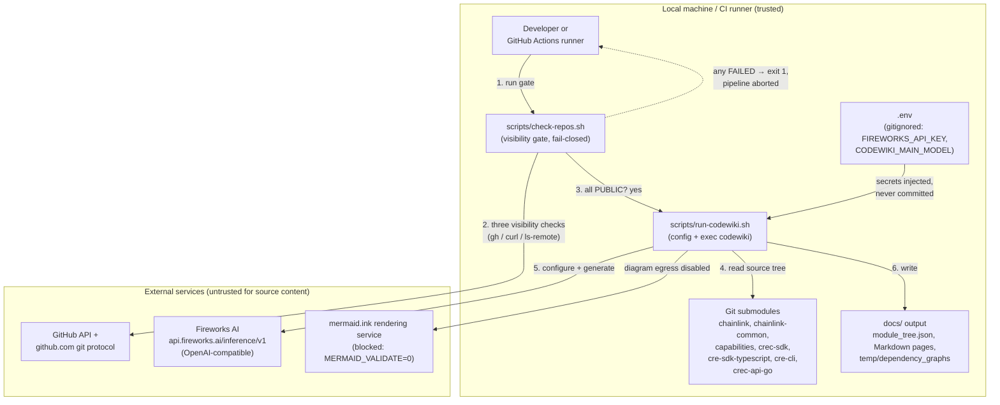
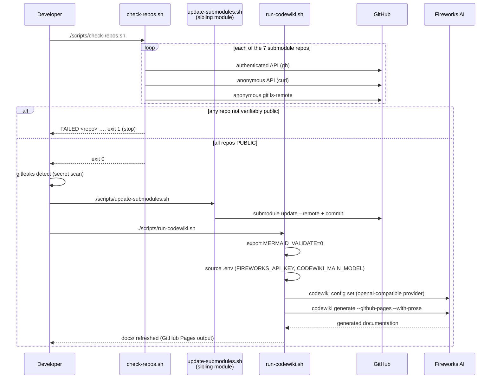
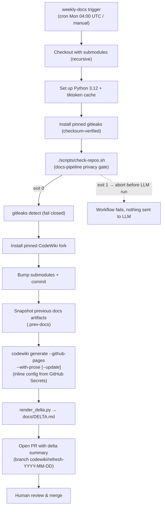

# Repo Maintenance Scripts — Docs Pipeline

## Introduction

`repo-maintenance-scripts_docs-pipeline` is a leaf module of the [Repo Maintenance Scripts](../repo-maintenance-scripts.md) group within [Build, CI & Release Infrastructure](../../Build,_CI___Release_Infrastructure.md). It contains the two shell scripts that drive **automated documentation generation** for the multi-repo workspace:

| Component | File | Role |
| --- | --- | --- |
| `check-repos.sh` | `scripts/check-repos.sh` | **Privacy gate** — triple-checks that every submodule points at a *public* GitHub repository before any source code is sent to an LLM endpoint |
| `run-codewiki.sh` | `scripts/run-codewiki.sh` | **Local generator entry point** — configures the CodeWiki CLI (Fireworks-hosted LLM) with secrets from a gitignored `.env` and runs documentation generation |

Together they form the execution half of the repository's "docs as code" workflow: a scheduled GitHub Actions job ([repo CI & docs](../repo_ci_and_docs.md)) runs the same pipeline weekly, opens a pull request with refreshed docs plus a delta report, and humans review and merge. The scripts exist to make the *local* developer flow identical in behavior to CI while keeping the LLM API key out of the repository.

> Submodule bumping is intentionally **not** part of this module — see the sibling [Submodule Sync](repo-maintenance-scripts_submodule-sync.md) module (`scripts/update-submodules.sh`).

---

## Why this module exists

This workspace documents seven upstream repositories as **git submodules** (`chainlink`, `chainlink-common`, `capabilities`, `crec-sdk`, `cre-sdk-typescript`, `cre-cli`, `crec-api-go` — see the root `README.md`). Documentation is produced by the third-party `codewiki` tool, which reads the full source tree and sends it to a configured LLM endpoint (Fireworks AI, OpenAI-compatible API).

That design creates two risks the module must control:

1. **Private code exfiltration.** If any submodule ever moved to a private repo (e.g., a fork, an access revocation, or a renamed org), its source would be silently shipped to the LLM vendor. `check-repos.sh` prevents this by failing closed before generation starts.
2. **Secret and content leakage through side channels.** The generation pipeline talks to more than one external service. `run-codewiki.sh` disables the Mermaid *validation/rendering* service (which would otherwise receive diagram text derived from source) and keeps the API key in a gitignored `.env` that is never committed.

---

## Components

### `scripts/check-repos.sh` — repository visibility gate

A Bash script with fail-closed semantics (`set -euo pipefail`) that performs **three independent visibility checks** per submodule repository, so no single compromised credential, API outage, or misconfigured git helper can hide a private repo:

| # | Check | Command pattern | Pass condition |
| --- | --- | --- | --- |
| 1 | Authenticated GitHub API | `gh api "repos/$repo" --jq '.private'` | returns `false` |
| 2 | Anonymous HTTP API | `curl -s -o /dev/null -w '%{http_code}' https://api.github.com/repos/$repo` | returns `200` |
| 3 | Anonymous git protocol | `GIT_TERMINAL_PROMPT=0 git -c credential.helper= ls-remote --heads https://github.com/$repo.git` | succeeds (`ok`) |

Design details:

- **Hard-coded repo allow-list.** The `REPOS` array names the exact seven `smartcontractkit/*` submodule repositories. Anything not on the list is never generated from, so the gate cannot be bypassed by adding a new submodule without editing the script (a deliberate friction point for a privacy control).
- **Credential stripping for the git check.** `GIT_TERMINAL_PROMPT=0` disables interactive prompts and `-c credential.helper=` empties the helper, so check 3 truly exercises *anonymous* access — mirroring what an unauthenticated outsider would see.
- **Aggregate exit code.** Each failing repo prints `FAILED <repo> (auth-private=… anon-api=… anon-git=…)` for triage, increments `fail`, and the script exits with `1` if *any* repo failed. Public repos print `PUBLIC <repo>`. The script therefore composes cleanly as a CI gate step: non-zero exit aborts the workflow before the LLM ever runs.

### `scripts/run-codewiki.sh` — local generation entry point

A Bash script (`set -euo pipefail`) that resolves the repository root (`cd "$(dirname "$0")/.."`), hardens egress behavior, injects secrets, configures the `codewiki` CLI, and finally `exec`s the generator so extra CLI arguments are forwarded verbatim:

```bash
exec codewiki generate --github-pages --with-prose "$@"
```

Step-by-step behavior:

1. **Content-egress hardening.** `export MERMAID_VALIDATE=0` disables CodeWiki's Mermaid validation feature, which would otherwise POST diagram content (derived from source code) to the public `mermaid.ink` rendering service. This mirrors the `MERMAID_VALIDATE: "0"` environment setting in the CI workflow.
2. **Secret loading from `.env`.** If a `.env` file exists in the repo root (gitignored by policy — see `README.md`), it is sourced. The script then requires two variables and aborts with a clear message if missing:
   - `FIREWORKS_API_KEY` — the LLM API key. Per the script's own header comment, the key is *never committed* and is *not part of the documentation corpus* sent to the model; it is only the transport credential.
   - `CODEWIKI_MAIN_MODEL` — the Fireworks model identifier used for **all three** model roles (main, cluster, fallback), keeping the pipeline deterministic on a single model.
3. **Provider configuration.** `codewiki config set` is invoked with:
   - `--provider openai-compatible`
   - `--base-url https://api.fireworks.ai/inference/v1`
   - `--api-key "$FIREWORKS_API_KEY"`
   - `--main-model` / `--cluster-model` / `--fallback-model` all set to `"$CODEWIKI_MAIN_MODEL"`
4. **Generation.** `codewiki generate --github-pages --with-prose` writes the GitHub-Pages-ready documentation site (module tree, per-topic Markdown pages, dependency graphs under `docs/temp/dependency_graphs/`) with prose descriptions enabled. Any additional arguments passed to `run-codewiki.sh` are appended — CI uses this mechanism to add `--update` when a previous `docs/module_tree.json` snapshot exists, so only changed modules are regenerated.

---

## Architecture

The scripts sit between the developer (or CI runner) and a set of external services. The privacy gate runs *before* anything leaves the machine; the generator is the only component that talks to the LLM.



Component relationships:

- `check-repos.sh` has **no runtime dependency** on the generator; it is a pure precondition check whose only coupling is the hard-coded repo list, which must match `.gitmodules`.
- `run-codewiki.sh` depends on `codewiki` being installed. Locally the developer installs it themselves; CI installs a **pinned patched fork** (`pip install codewiki @ git+...@v2.0.0-cre-demo.4`, see `.github/workflows/weekly-docs.yml`).
- Both scripts are independent of [build-and-repo-tooling](../build-and-repo-tooling.md) (Makefiles, lint scripts) — they operate on the workspace as a whole, not on any single module's build.

---

## Data flow: local pipeline

The root `README.md` prescribes the local refresh sequence. The docs-pipeline scripts are the first and last steps; submodule bumping belongs to the sibling module.



Failure semantics are fail-closed at every stage: the gate exits non-zero on the first unverifiable repo, the `.env` requirement aborts with an explicit message rather than silently generating unauthenticated, and `set -euo pipefail` stops on any unexpected error.

---

## Process flow: CI mirror (weekly refresh)

The scheduled workflow `.github/workflows/weekly-docs.yml` (job `refresh`, Mondays 04:00 UTC, `workflow_dispatch` enabled) re-implements the same pipeline on a headless runner. The docs-pipeline scripts and their CI counterparts are deliberately kept equivalent:

| Local step | CI workflow step | Notes |
| --- | --- | --- |
| `./scripts/check-repos.sh` | `Triple-check every submodule is a public repo` | **Runs the script verbatim** as the first post-setup gate |
| — | `Secrets scan (gitleaks)` | CI-only defense-in-depth; fails closed on findings |
| `./scripts/update-submodules.sh` | `Bump submodules to tracked branch tips` | Same commands, CI uses `codewiki-bot` identity |
| `./scripts/run-codewiki.sh` | `Generate / update documentation` | Config **duplicated inline**: key comes from `secrets.FIREWORKS_API_KEY` instead of `.env`; adds `--update` when a previous `docs/module_tree.json` snapshot exists |
| — | `Snapshot previous generation artifacts` → `Render the delta report` (`scripts/render_delta.py`) → `Open a pull request with the delta` | Produces `docs/DELTA.md` and a `documentation`-labeled PR for human review |



Environment parity between the two paths:

- `MERMAID_VALIDATE=0` — set by `run-codewiki.sh` locally, by workflow `env` in CI. The same diagram-egress block applies in both.
- `CODEWIKI_NO_KEYRING=1` — CI-only (`env` in the workflow); the headless runner must use file-based (ephemeral) key storage instead of a desktop keyring. Locally the developer's environment handles this.
- Model selection — locally driven by `CODEWIKI_MAIN_MODEL` from `.env`; in CI pinned inline (`accounts/fireworks/models/glm-5p3-flash` for main, cluster, and fallback roles). Both paths set all three roles to a single model.

---

## Security and privacy model

The module implements a layered egress-control posture around the fundamental fact that **the LLM vendor receives the full source tree**:

1. **Visibility gate (precondition).** `check-repos.sh` runs three orthogonal checks — authenticated API, anonymous API, anonymous git with stripped credentials — and requires all three to agree that a repo is public. Any disagreement fails the run.
2. **Side-channel block (generator hardening).** `MERMAID_VALIDATE=0` prevents source-derived diagram text from reaching the third-party Mermaid rendering service.
3. **Secret hygiene.** The API key lives in a gitignored `.env` (local) or GitHub Secrets (CI); it authenticates the transport but is not part of the generated corpus, and it never enters the committed repository. The gitleaks scan in CI (fail-closed on findings) guards against accidental secret capture in the tree that the LLM would otherwise read.
4. **Fail-closed composition.** `set -euo pipefail` in both scripts, non-zero aggregate exit from the gate, and CI step ordering that places the gate *before* gitleaks, tool install, and generation mean the pipeline can only send data after every precondition has verifiably passed.

Maintenance guidance:

- **Adding or removing a submodule** requires updating the `REPOS` array in `scripts/check-repos.sh` *and* the repo lists in `scripts/update-submodules.sh` / the CI `git add` lines. Keeping these in sync is the main manual invariant of the module.
- **Changing LLM provider/model** is a one-line change locally (`CODEWIKI_MAIN_MODEL` in `.env`) but must be mirrored in the inline `codewiki config set` block of `.github/workflows/weekly-docs.yml`.
- The gate intentionally verifies **repository identity and visibility only** — it does not pin commit SHAs. Integrity of *what* is generated from is handled by the submodule bump + human PR review flow.

---

## Related documentation

- [Repo Maintenance Scripts](../repo-maintenance-scripts.md) — parent group and overview of all maintenance scripts
- [Repo Maintenance Scripts — Submodule Sync](repo-maintenance-scripts_submodule-sync.md) — sibling module owning `scripts/update-submodules.sh` (the bump step)
- [Repo CI & Docs](../repo_ci_and_docs.md) — the `weekly-docs.yml` workflow, checkout, and docs PR mechanics
- [Build & Repo Tooling](../build-and-repo-tooling.md) — Makefile-driven build, lint, and code-generation tooling for the individual modules
- [Build, CI & Release Infrastructure](../../Build,_CI___Release_Infrastructure.md) — top-level index of the infrastructure domain
- Root `README.md` — the canonical local runbook (`check-repos.sh` → `gitleaks` → `update-submodules.sh` → `run-codewiki.sh`)
