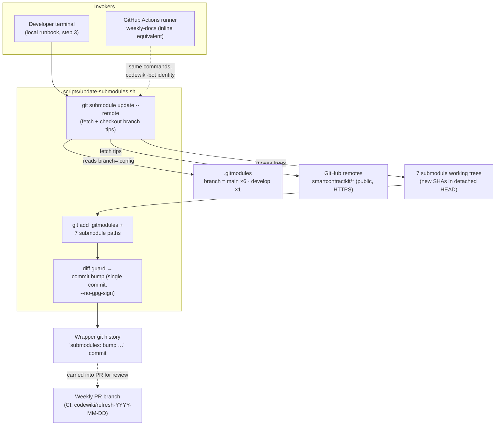
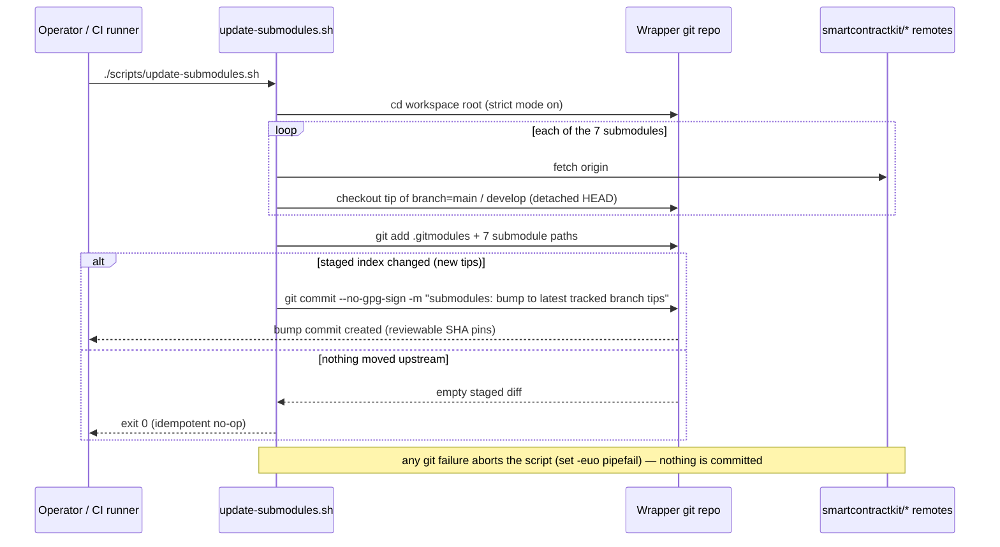
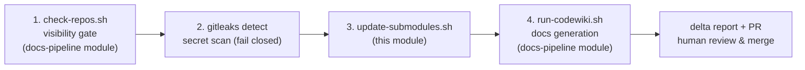

# Repo Maintenance Scripts — Submodule Sync

## Introduction

`repo-maintenance-scripts_submodule-sync` is a leaf module of the [Repo Maintenance Scripts](../repo-maintenance-scripts.md) group within [Build, CI & Release Infrastructure](../../Build,_CI___Release_Infrastructure.md). It contains a single component:

| Component | File | Role |
| --- | --- | --- |
| `update-submodules.sh` | `scripts/update-submodules.sh` | **Pin refresher** — fast-forwards every git submodule in the workspace to the tip of its `.gitmodules`-declared branch and records the new pins in a single commit |

The **mahogany-octopus** workspace is a wrapper repository that pins seven public `smartcontractkit/*` repositories as git submodules and generates documentation from them as one graph (see the [parent overview](../repo-maintenance-scripts.md)). Documentation freshness therefore depends entirely on how current those pins are. This module owns the *input-refresh* half of the maintenance story: it moves every submodule to the tip of its tracked branch (`main` for six of them, `develop` for `chainlink`) and commits the bump so the new SHAs are reviewable. The other two maintenance scripts — the privacy gate and the generation wrapper — belong to the sibling [Docs Pipeline](repo-maintenance-scripts_docs-pipeline.md) module.

```bash
#!/usr/bin/env bash
# Move every submodule to the tip of its tracked branch (.gitmodules branch=).
# chainlink tracks develop; the rest track main. Commits the bumps.
set -euo pipefail
cd "$(dirname "$0")/.."

git submodule update --remote
git add .gitmodules chainlink chainlink-common capabilities crec-sdk \
    cre-sdk-typescript cre-cli crec-api-go
git diff --cached --quiet || git commit --no-gpg-sign -m "submodules: bump to latest tracked branch tips"
```

---

## What the module maintains: the submodule contract

The script's behavior is defined by `.gitmodules`, which declares one tracked branch per submodule. This is the exact surface the script reads:

| Submodule path | Upstream repository | Tracked `branch=` |
| --- | --- | --- |
| `chainlink` | `smartcontractkit/chainlink` | `develop` |
| `chainlink-common` | `smartcontractkit/chainlink-common` | `main` |
| `capabilities` | `smartcontractkit/capabilities` | `main` |
| `crec-sdk` | `smartcontractkit/crec-sdk` | `main` |
| `cre-sdk-typescript` | `smartcontractkit/cre-sdk-typescript` | `main` |
| `cre-cli` | `smartcontractkit/cre-cli` | `main` |
| `crec-api-go` | `smartcontractkit/crec-api-go` | `main` |

The contents of these submodule trees are the source corpus for the generated wiki — e.g. the node core ([Node_Application_Core___Interfaces](../../Node_Application_Core___Interfaces.md)), platform services ([Node_Platform_Services](../../Node_Platform_Services.md)), and the developer toolchain ([Developer_Toolchain_(CLI,_SDKs___API_Clients)](../../../Developer_Toolchain_(CLI,_SDKs___API_Clients).md)). Bumping the pins is what makes the weekly docs refresh pick up upstream changes.

---

## Component reference: `scripts/update-submodules.sh`

The script takes **no arguments** and reads **no environment variables**; its only runtime dependency is `git` itself (plus network reachability and read access to the seven remotes, which are HTTPS URLs per `.gitmodules`).

### Step-by-step behavior

| Step | Command | Purpose |
| --- | --- | --- |
| 1 | `set -euo pipefail` | Strict mode: abort on any command failure, undefined variable, or pipeline failure |
| 2 | `cd "$(dirname "$0")/.."` | Resolve the workspace root from the script's own location, so the script works from any working directory |
| 3 | `git submodule update --remote` | For each submodule: fetch its `origin` and check out the commit at the tip of the branch declared in `.gitmodules`. Submodules end up in detached-HEAD state at the new SHAs (the branch is *tracked*, not checked out locally) |
| 4 | `git add .gitmodules <7 submodule paths>` | Stage the updated gitlinks. Staging `.gitmodules` is defensive: `update --remote` never rewrites it, but any hand-edited branch configuration gets included in the same bump commit |
| 5 | `git diff --cached --quiet \|\| git commit --no-gpg-sign -m "submodules: bump to latest tracked branch tips"` | **Idempotency guard.** The commit is created only when the staged index actually changed (i.e., at least one submodule moved). A re-run with no upstream movement is a clean no-op that exits `0` |

### Behavioral properties

- **Idempotent.** The `git diff --cached --quiet` guard means repeated runs never accumulate empty "bump" commits. Only genuine upstream movement produces a commit.
- **Fail-fast.** Any git error (network outage, fetch failure on one of the seven remotes, a missing submodule checkout) aborts the script under `set -euo pipefail` — a partially bumped workspace is left for the operator to inspect rather than committed.
- **One commit for the whole bump.** All seven submodule gitlinks (plus `.gitmodules` if touched) land in a single commit with the fixed message `submodules: bump to latest tracked branch tips`, keeping history flat and greppable.
- **`--no-gpg-sign`.** The commit explicitly opts out of GPG signing so the script works for operators without a signing key configured. (The CI equivalent omits this flag — see [CI mirror](#ci-mirror-weekly-docs-workflow) below.)
- **Hard-coded path list.** The `git add` list names exactly the seven submodules. It deliberately does *not* use `git add -A` or `git add .`: the script stages only the submodule pins and `.gitmodules`, so unrelated local changes can never be swept into a bump commit.

---

## Architecture

The script is pure git plumbing over the wrapper repository: it reads branch declarations from `.gitmodules`, pulls new state from the GitHub remotes, and writes a commit into the wrapper's history. It talks to no LLM, renders nothing, and has no coupling to any Makefile, Docker image, or Go module build ([Build & Repo Tooling](../build-and-repo-tooling.md)).



Relationship summary:

- **Reads:** `.gitmodules` (branch configuration) and the seven GitHub remotes.
- **Writes:** submodule working trees and, when tips moved, exactly one commit in the wrapper repository.
- **Depends on:** `git` only. It does not invoke, and is not invoked by, the sibling scripts programmatically — the *runbook ordering* (gate → scan → bump → generate) is a convention documented in the root `README.md` and enforced by step order in CI.

---

## Execution flow



---

## Position in the weekly refresh pipeline

The bump sits in the middle of the four-step refresh runbook: it runs **after** the safety gates and **before** documentation generation, so CodeWiki always reads fresh tips that have already passed the visibility check.



### CI mirror: `weekly-docs` workflow

The scheduled workflow documented in [Repo CI & Docs](../repo_ci_and_docs.md) (`.github/workflows/weekly-docs.yml`, job `refresh`, Mondays 04:00 UTC) runs the identical bump logic **inlined** in its *"Bump submodules to tracked branch tips"* step rather than calling the script. The two are kept equivalent by convention:

| Aspect | `update-submodules.sh` (local) | CI inline step |
| --- | --- | --- |
| Commands | `git submodule update --remote` → staged `git add` → guarded commit | Identical, verbatim |
| Git identity | Operator's own `user.name` / `user.email` | `codewiki-bot <codewiki-bot@users.noreply.github.com>` (configured inline — runners have none) |
| Commit signing | `--no-gpg-sign` | Default (unsigned on the runner) |
| Commit scope | Bump only | Bump only; the later PR commit additionally stages `docs/` |
| Downstream handoff | Operator continues with `./scripts/run-codewiki.sh` | The bump commit precedes the `git checkout -b codewiki/refresh-…` step, so it is carried into the weekly pull request and reviewed together with the regenerated docs |

> ⚠️ **Maintenance note:** the bump logic is duplicated between `scripts/update-submodules.sh` and `.github/workflows/weekly-docs.yml`. Any behavioral change (commit message, path list, flags) must be mirrored in **both** places.

---

## Operational notes & maintenance invariants

- **Adding or removing a submodule** requires touching the hard-coded `git add` list in this script **and** in the CI workflow step. A submodule present in `.gitmodules` but missing from these lists would have its tip updated in the working tree but *never committed* — a silent staleness bug. The sibling privacy gate has its own hard-coded `REPOS` array that must be kept in sync too (see [Docs Pipeline](repo-maintenance-scripts_docs-pipeline.md)).
- **Network and auth requirements.** All seven remotes are public HTTPS GitHub URLs, so no credentials are needed for the fetch. An offline run aborts at step 3 with nothing committed.
- **Scan-coverage ordering.** In both the local runbook and the CI workflow, the gitleaks scan runs on the *checkout-time* pins and precedes the bump; newly fetched tip content is therefore covered by the repository-visibility gate (`check-repos.sh`) but not re-scanned by gitleaks before generation. This is a property of the pipeline ordering to keep in mind when auditing.
- **Pins are the human control point.** The bump commit only reaches the default branch through the weekly pull request (CI) or an explicit operator push. Reviewing the submodule SHA changes in that PR is how humans decide *what content* enters the LLM generation — the privacy gate covers *where it comes from*, not *what changed*.
- **Pure operations tooling.** The script participates in no build, test, or release target; it operates on the workspace as a whole.

---

## Related documentation

- [Repo Maintenance Scripts](../repo-maintenance-scripts.md) — parent group: overview of all three maintenance scripts and the security operating model
- [Repo Maintenance Scripts — Docs Pipeline](repo-maintenance-scripts_docs-pipeline.md) — sibling module owning `check-repos.sh` (visibility gate) and `run-codewiki.sh` (generation wrapper)
- [Repo CI & Docs](../repo_ci_and_docs.md) — the `weekly-docs.yml` scheduled workflow, including the inlined bump step and PR mechanics
- [Build, CI & Release Infrastructure](../../Build,_CI___Release_Infrastructure.md) — top-level index of the infrastructure domain
- Root `README.md` — the canonical local runbook (`check-repos.sh` → `gitleaks` → `update-submodules.sh` → `run-codewiki.sh`)
- `.gitmodules` — the branch-tracking contract this script consumes
