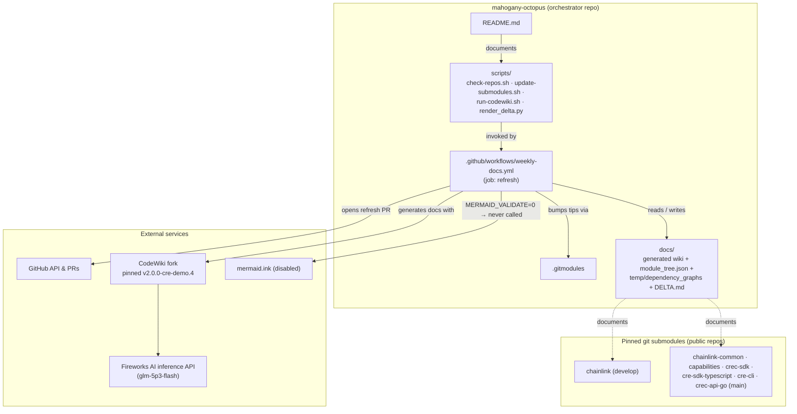
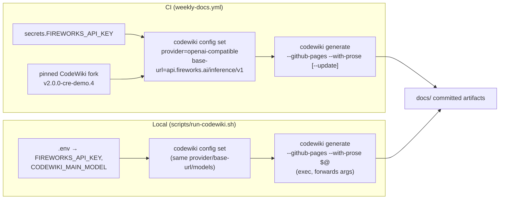
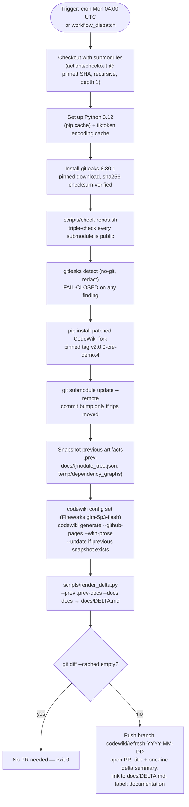

# Repo CI & Documentation Automation (`repo_ci_and_docs`)

> **Module page:** `Build,_CI___Release_Infrastructure/repo_ci_and_docs.md`
> **Parent:** [Build, CI & Release Infrastructure](../Build,_CI___Release_Infrastructure.md)

## 1. Purpose

This module implements the **automated documentation pipeline** for the `mahogany-octopus`
multi-repo workspace. It is a deliberately small module — two components — that answers two
questions:

1. **How is the wiki (re)generated and kept current?** — A scheduled GitHub Actions workflow
   (`.github/workflows/weekly-docs.yml`, job `refresh`) bumps all git submodules to their
   tracked branch tips, regenerates the CodeWiki documentation with an LLM, computes a
   deterministic *delta report*, and opens a pull request for human review.
2. **How do humans run and understand the pipeline?** — The top-level `README.md` documents
   the workspace layout, the supporting scripts, the weekly refresh contract ("bots propose,
   humans merge"), and the local, key-safe generation workflow.

Everything else that supports the pipeline lives in the sibling module
[`repo-maintenance-scripts`](repo-maintenance-scripts.md): the scripts
`scripts/check-repos.sh`, `scripts/update-submodules.sh`, `scripts/run-codewiki.sh`, and
`scripts/render_delta.py` that the workflow invokes and the README references.

## 2. Core Components

| Component | File | Responsibility |
| --- | --- | --- |
| `weekly-docs.yml` (workflow) / `refresh` (job) | `.github/workflows/weekly-docs.yml` | Scheduled (Mondays 04:00 UTC) + manual trigger. Security gates → submodule bump → LLM doc generation → delta report → pull request. |
| `README.md` | `README.md` | Human-facing entry point: workspace layout, script table, weekly-refresh contract, local-run instructions, secret-handling rules. |

Supporting artifacts (owned by sibling modules, consumed here):

| Artifact | Used by | Documented in |
| --- | --- | --- |
| `scripts/check-repos.sh` | workflow step "Triple-check every submodule is a public repo"; README local run | [repo-maintenance-scripts](repo-maintenance-scripts.md) |
| `scripts/update-submodules.sh` | README local run (workflow inlines the equivalent `git submodule update --remote`) | [repo-maintenance-scripts](repo-maintenance-scripts.md) |
| `scripts/run-codewiki.sh` | README local run | [repo-maintenance-scripts](repo-maintenance-scripts.md) |
| `scripts/render_delta.py` | workflow step "Render the delta report" | [repo-maintenance-scripts](repo-maintenance-scripts.md) |
| `.gitmodules` | submodule bump steps | [repo-build-config](repo-build-config.md) |

## 3. Architecture Overview

The workspace is a thin orchestrating repository holding seven **pinned git submodules**
(`.gitmodules`): `chainlink` (tracks `develop`) and `chainlink-common`, `capabilities`,
`crec-sdk`, `cre-sdk-typescript`, `cre-cli`, `crec-api-go` (all track `main`). The
generated documentation lives in `docs/` (viewer: `docs/index.html`) and is **committed**,
while the delta report lands in `docs/DELTA.md`.



### Generation topology

Both the scheduled workflow and the local script configure the CodeWiki tool identically:
an `openai-compatible` provider pointed at `https://api.fireworks.ai/inference/v1`, with the
same model used for main generation, clustering, and fallback. The only difference is where
the API key comes from — GitHub secrets in CI, a gitignored `.env` locally
(`scripts/run-codewiki.sh`).



## 4. The Weekly Refresh Pipeline (`refresh` job)

The `refresh` job in `.github/workflows/weekly-docs.yml` runs on `schedule`
(`0 4 * * 1` — Mondays 04:00 UTC) and on manual `workflow_dispatch`. It uses
`concurrency: weekly-docs` with `cancel-in-progress: false`, so overlapping runs queue
rather than clobber each other. Timeout is 350 minutes. Permissions are declared empty at
the workflow level and granted per job (`contents: write`, `pull-requests: write`) — the
minimum needed to push the refresh branch and open a PR.

Two environment hardening switches are set for the whole run:

| Env | Effect |
| --- | --- |
| `MERMAID_VALIDATE=0` | Diagram content is never sent to the mermaid.ink rendering service (prevents source-code leakage through third-party validation). |
| `CODEWIKI_NO_KEYRING=1` | Headless runner uses ephemeral file-based key storage instead of an OS keyring. |

### Step-by-step flow



### Pipeline stages in detail

**1. Security gates (before any LLM call).** Because the pipeline sends repository source
code to an LLM endpoint, two gates run first:

- *Public-repo triple check* — `scripts/check-repos.sh` verifies, for each of the seven
  submodules, three independent signals: authenticated GitHub API visibility (`gh api …
  --jq '.private'`), anonymous API reachability (HTTP `200` without a token), and anonymous
  git access (`git ls-remote` with credential helpers disabled). All three must agree on
  "public" or the job fails, ensuring no private code can slip into an LLM prompt.
- *Secret scan* — pinned gitleaks (version `8.30.1`, downloaded with a `sha256sum -c`
  checksum check from its release page) scans the working tree (`--no-git`, `--redact`).
  Any finding aborts the job with an actionable `::error::` annotation: the run is
  fail-closed, so leaks are triaged *before* generation, never after.

**2. Pinned tooling.** Every third-party input is pinned: actions are referenced by commit
SHA (checkout v5, setup-python v6, cache v4), gitleaks by version + checksum, and the
CodeWiki generator itself is installed from a specific fork and tag
(`git+https://github.com/007vasy/CodeWiki.git@v2.0.0-cre-demo.4`) — the LLM pipeline is
reproducible and immune to upstream tool drift.

**3. Submodule refresh.** The workflow configures a bot identity
(`codewiki-bot`) and runs `git submodule update --remote` to move every submodule to the
tip of its tracked branch (`develop` for `chainlink`, `main` for the rest per
`.gitmodules`). A commit is created only when the tips actually moved
(`git diff --cached --quiet` guard), which keeps runs idempotent. This mirrors the local
helper `scripts/update-submodules.sh`.

**4. Incremental generation.** Before generating, the previous run's comparison inputs are
snapshotted to `.prev-docs/` (`module_tree.json` and `temp/dependency_graphs/`). If a
snapshot exists, generation runs in `--update` mode — only what changed is regenerated —
otherwise it is a full first generation. The `TIKTOKEN_CACHE_DIR` env points at the cached
`.tiktoken-cache` so tokenizers are never fetched at runtime.

**5. Deterministic delta report.** `scripts/render_delta.py` diffs the previous artifacts
against the new ones **without any LLM calls** and writes `docs/DELTA.md` at four levels:

| Level | What is compared |
| --- | --- |
| Architecture | modules added / removed / renamed / re-parented (via `module_tree.json`) |
| Components | components added / removed / changed (source-code hash diff), grouped per submodule |
| API | exported callables (`function`, `method`) and types (`class`, `interface`, `struct`) added / removed |
| Interface | cross-submodule dependency edges (`depends_on`) added / removed |

The report also embeds the JSON "update decisions" record (truncated to 4000 chars) when an
`--update` generation produced `docs/update_record.json`. A summary table
(`| Components | added | removed | changed | unchanged |`) at the top of `DELTA.md` is what
the PR body quotes, giving reviewers an at-a-glance diff size.

**6. Pull request.** On branch `codewiki/refresh-YYYY-MM-DD`, the workflow commits
`docs/`, `.gitmodules`, and the seven submodule pointers, and opens a PR to `main` labelled
`documentation`. If nothing changed, it exits cleanly without a PR. **Humans review and
merge** — the workflow never pushes to `main` directly.

## 5. Security & Reliability Posture

| Concern | Mitigation (where) |
| --- | --- |
| Private code sent to LLM | Triple public-repo check fails the job first (`scripts/check-repos.sh`, workflow step 5) |
| Secret leakage in repo or prompts | Fail-closed gitleaks scan with pinned, checksum-verified binary (workflow step 6); `--redact` in report output |
| Source leakage via diagram rendering | `MERMAID_VALIDATE=0` (workflow env; also exported in `scripts/run-codewiki.sh`) |
| Secret sprawl in CI | Empty workflow-level `permissions`; job-scoped `contents: write` / `pull-requests: write` only |
| Supply-chain drift | All actions pinned by SHA; gitleaks pinned + checksum-verified; CodeWiki pinned to a fork tag |
| Flaky/overlapping runs | Concurrency group `weekly-docs` (queued, not cancelled); 350-min job timeout |
| API key exposure | CI: GitHub secret; local: gitignored `.env` (never committed, per README) |
| Irreproducible docs | Idempotent submodule bump (commit only on change) and incremental `--update` generation from snapshotted artifacts |

## 6. Local Development Workflow (from `README.md`)

The README defines the local equivalent of the CI pipeline:

```bash
brew install gitleaks   # or equivalent
./scripts/check-repos.sh
gitleaks detect --source . --no-banner
./scripts/update-submodules.sh
./scripts/run-codewiki.sh
```

Key rules it enforces:

- `scripts/run-codewiki.sh` sources the gitignored `.env` for `FIREWORKS_API_KEY` and
  `CODEWIKI_MAIN_MODEL`, exports `MERMAID_VALIDATE=0`, applies the same `codewiki config set`
  as CI, and `exec`s `codewiki generate --github-pages --with-prose` — forwarding any extra
  arguments (e.g. `--update`).
- The `.env` file **must never be committed**; generated `docs/` **are committed**.
- The repository is intentionally public-only: every submodule must be a public
  `smartcontractkit/*` repository, checked by `check-repos.sh` before any generation.

## 7. Module Tree & Documented Output

`docs/module_tree.json` produced by CodeWiki is the source for the module hierarchy in this
wiki — the parent page [Build, CI & Release Infrastructure](../Build,_CI___Release_Infrastructure.md)
lists this module's siblings. The generated wiki itself covers the documented products:

- [Node Application Core & Interfaces](../Node_Application_Core___Interfaces.md) — `chainlink/` core node
- [Node Platform Services](../Node_Platform_Services.md) — job service, keystore, gateway, …
- [Oracle Engines & Data Pipelines](../Oracle_Engines___Data_Pipelines.md) — OCR/OCR2, VRF, LLO, pipeline, streams
- [Workflow & Capability Runtime (CRE Engine)](../Workflow___Capability_Runtime_(CRE_Engine).md) — workflows, capabilities
- [CCIP Cross-Chain Protocol](../CCIP_Cross-Chain_Protocol.md) — `ccip` + `types-ccip`
- [Plugin Process Framework (Loop)](../Plugin_Process_Framework_(Loop).md) — `chainlink-common/pkg/loop`
- [Shared Foundation Libraries & Domain Types](../Shared_Foundation_Libraries___Domain_Types.md)
- [Telemetry & Observability Platform](../Telemetry___Observability_Platform.md)
- [CCIP Deployment Suite](../CCIP_Deployment_Suite.md) and [CRE & Keystone Deployment Suite](../CRE___Keystone_Deployment_Suite.md), [Deployment Framework Core & Product Deployments](../Deployment_Framework_Core___Product_Deployments.md)
- [Dev, Test & Simulation Environments](../Dev,_Test___Simulation_Environments.md)
- [Developer Toolchain (CLI, SDKs & API Clients)](../Developer_Toolchain_(CLI,_SDKs___API_Clients).md)

Within the parent module, the closely related sibling pages are:

- [`repo-maintenance-scripts`](repo-maintenance-scripts.md) — the four shell/Python scripts this pipeline orchestrates
- [`repo-build-config`](repo-build-config.md) — `.gitmodules`-adjacent root configs (lefthook, nix, package.json) of the `chainlink` submodule
- [`chainlink_build_and_tooling`](chainlink_build_and_tooling.md) / [`capabilities_workspace_tooling`](capabilities_workspace_tooling.md) / [`build-and-repo-tooling`](build-and-repo-tooling.md) — the Makefiles and lint/tooling configs of the documented submodules, which are what the weekly docs pipeline *reads* as input

## 8. Key Takeaways

1. **Docs-as-code with a human gate**: bots regenerate weekly and propose; humans merge. The only write path is a PR.
2. **Security-first ordering**: public-repo verification and fail-closed secret scanning happen *before* any code leaves the workspace for the LLM.
3. **Everything pinned**: actions (SHA), gitleaks (version + checksum), CodeWiki (fork tag), submodules (tracked branches, committed pointers).
4. **Reviewable change reports**: `docs/DELTA.md` is produced by a deterministic, LLM-free differ at four levels (architecture / components / API / interfaces), so documentation drift is as easy to review as code.
5. **CI ≡ local**: the same CodeWiki configuration is used in the workflow and by `scripts/run-codewiki.sh`, so a local run predicts the weekly PR.
