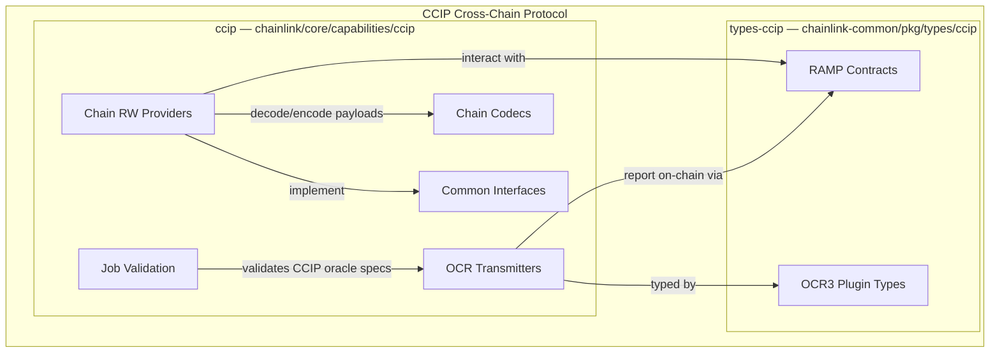
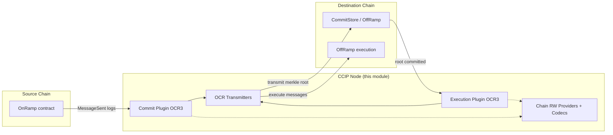

# CCIP Cross-Chain Protocol

## Purpose

The `CCIP_Cross-Chain_Protocol` module contains the Chainlink node-side implementation and shared type definitions for **CCIP (Cross-Chain Interoperability Protocol)** — Chainlink's protocol for secure, decentralized cross-chain messaging and token transfers. The module provides the chain-agnostic abstraction layer that allows CCIP's OCR3 commit and execution plugins to observe, validate, and transmit cross-chain messages across heterogeneous blockchain networks (EVM, Solana, Aptos, etc.) plugged into the node via the Loop plugin framework.

It is composed of two subpackages:

- **`ccip`** (`chainlink/core/capabilities/ccip`) — the in-node CCIP capability: chain-specific codecs, chain read/write providers, common interfaces, CCIP job spec validation, and OCR transmitters used to relay commit/execution reports on-chain.
- **`types-ccip`** (`chainlink-common/pkg/types/ccip`) — shared, dependency-free type definitions: RAMP contract interfaces (OnRamp / OffRamp / Router) and OCR3 plugin types consumed by both the node core and the external plugin processes.

## Architecture

### Module composition

### Cross-chain message lifecycle (node view)

The commit phase observes messages on the source chain and posts a merkle root to the destination chain's CommitStore; the execution phase then proves and executes the individual messages on the destination OffRamp. All chain interactions in both phases are funneled through the chain read/write providers and codecs defined in this module, keeping the OCR3 plugins chain-agnostic.

## Core Components

| Component | Location | Description |
|---|---|---|
| [ccip](<CCIP_Cross-Chain_Protocol/ccip.md>) | `chainlink/core/capabilities/ccip` | Node-side CCIP capability: chain codecs, chain read/write providers, common interfaces, job validation, and OCR transmitters. |
| [types-ccip](<CCIP_Cross-Chain_Protocol/types-ccip.md>) | `chainlink-common/pkg/types/ccip` | Shared CCIP type definitions: RAMP contract interfaces and OCR3 plugin types. |