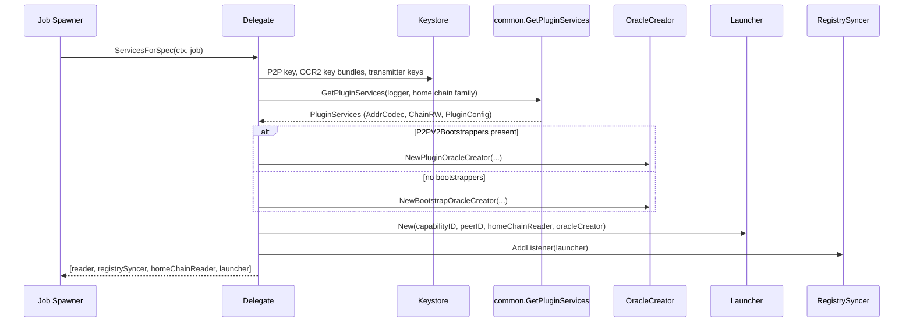
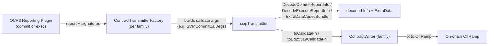

# CCIP Core Capability (`chainlink/core/capabilities/ccip`)

## 1. Introduction and Purpose

The `ccip` module is the **off-chain node-side implementation of the Chainlink Cross-Chain Interoperability Protocol (CCIP)**. It implements the CCIP *capability* that runs inside the Chainlink node (`chainlink` core binary), turning a standard node into a CCIP oracle participant. It is responsible for:

- **Job lifecycle** — defining and validating the `ccip` job spec and wiring all required services when a CCIP job is created (`delegate.go`).
- **DON membership tracking** — watching the CCIP Home chain capabilities registry for OCR3 configuration updates that affect this node (via `launcher` + `registrysyncer`).
- **Oracle lifecycle** — creating, starting and stopping OCR3 *commit* and *execute* plugin oracles (and *bootstrap* oracles) for every DON the node participates in (`oraclecreator`).
- **Multi-chain adaptation** — providing chain-family-specific implementations (EVM, Solana/SVM, Sui, Aptos, TON, plus a no-op family for testing) of everything the chain-agnostic CCIP plugins need: address encoding/decoding, extra-args decoding, message hashing, contract readers/writers and OCR contract transmitters (`ccipevm`, `ccipsolana`, `ccipsui`, `ccipaptos`, `ccipton`, `ccipnoop`, `ocrimpls`).

> **Relation to other modules:** the chain-agnostic CCIP domain types and contract interfaces consumed by this module (on-ramps/off-ramps, commit store, price registry, fee quoter, plugin codec types, `ccipocr3` interfaces) are documented in [types-ccip](types-ccip.md). The gRPC/plugin-process machinery that can host the CCIP plugins in a separate process is documented in [Plugin_Process_Framework_(Loop)](../Plugin_Process_Framework_(Loop).md), and the on-chain deployment tooling for CCIP networks lives in [CCIP_Deployment_Suite](../CCIP_Deployment_Suite.md).

## 2. How the Module Fits in the Node

A CCIP job is created through the node's job spawner (see [job_service](../Node_Platform_Services/job_service.md)). The `Delegate` in this module is the job-type delegate for `job.CCIP`; `ServicesForSpec` returns the long-running services that constitute one CCIP job:

1. A **home-chain contract reader** (retried until healthy) that observes the CCIP Home capabilities registry.
2. A **registry syncer** that polls the registry and notifies listeners on OCR3 config changes (see [registry_syncer](../Node_Platform_Services/registry_syncer.md)).
3. An **oracle creator** — either a plugin oracle creator (node is in a plugin DON) or a bootstrap oracle creator.
4. A **capability launcher** that listens to registry updates and creates/destroys `CCIPOracle` instances as DONs are added, updated or removed.

Everything chain-specific is isolated behind the interfaces in the `common` and `types` packages, so the plugins and the launcher never touch chain-specific SDKs directly.

```mermaid
flowchart TB
    subgraph Node["Chainlink Node (chainlink core binary)"]
        JS["Job Spawner"] -->|creates ccip job| Delegate["ccip.Delegate"]
        Delegate --> HCR["Home Chain Contract Reader"]
        Delegate --> RS["RegistrySyncer<br/>(home chain)"]
        Delegate --> OC["OracleCreator<br/>(plugin | bootstrap)"]
        Delegate --> L["Launcher"]
        RS -->|registry updates| L
        L -->|Create(donID, OCR3Config)| OC
        OC --> O["CCIPOracle<br/>(OCR3 commit / exec / bootstrap)"]
    end

    subgraph ChainFamilyAdapters["Per-chain family adapters (PluginConfig)"]
        PC["common.PluginConfig:<br/>codecs, hasher, transmitter factory,<br/>ChainRW, address/extra-data codecs"]
    end

    subgraph Chains["Destination & source chains"]
        EVM["EVM"]
        SVM["Solana (SVM)"]
        SUI["Sui"]
        APT["Aptos"]
        TON["TON"]
    end

    O -->|reads onchain config,<br/>events, prices| Chains
    O -->|signed reports via<br/>ContractTransmitter| Chains
    PC -.registered per family.-> OC
    Chains -.implemented by.-> ChainFamilyAdapters
```

## 3. Architecture Overview

### 3.1 Registration and plugin services (`common` package)

The module is structured around a **plugin-config factory registry**:

- Each chain family package (`ccipevm`, `ccipsolana`, `ccipsui`, `ccipaptos`, `ccipton`, `ccipnoop`) exposes an `init()` that calls `common.RegisterPluginConfig(family, factory)` with an `InitFunction` producing a `common.PluginConfig`.
- `common.GetPluginServices(logger, chainFamily)` (see `common/pluginconfig.go`) iterates **all** registered factories, invokes them with the shared `ExtraDataCodecBundle`, and builds a `PluginServices` bundle containing:
  - the destination-family `PluginConfig` (commit/exec codec, message hasher, token-data encoder, gas estimator, transmitter factory, chain reader/writer provider, address & extra-data codecs, optional `PriceOnlyCommitFn`);
  - a multi-family `AddressCodec` dispatcher;
  - a multi-family `ChainRW` (multi-chain contract reader/writer provider);
  - the map of families that support the CCIP provider (LOOPP compatibility).
- `oraclecreator/plugin.go` imports all chain-family packages for their side-effect registration (`_ "chainlink/v2/core/capabilities/ccip/ccipevm"` etc.), guaranteeing the registry is populated before oracles are created.

### 3.2 The two codec interfaces every chain family implements

Defined in `common/msgfieldscodec.go` (see [ccip_common_interfaces.md](ccip/ccip_common_interfaces.md)):

| Interface | Purpose |
|---|---|
| `ChainSpecificAddressCodec` | Convert between raw bytes and the chain's canonical address string (hex for EVM, base58 for Solana), and synthesize a valid address from an OCR oracle ID (used for offramp members that don't support the destination chain). |
| `SourceChainExtraDataCodec` | Decode source-chain-encoded `extraArgs` and token `destExecData` blobs into a chain-agnostic `map[string]any` representation. |

Concrete implementations per family (see [ccip_chain_codecs.md](ccip/ccip_chain_codecs.md)): `ccipevm.ExtraDataDecoder` (ABI tags `EVMExtraArgsV1/V2`, SVM/Sui tags), `ccipsolana.ExtraDataDecoder` (Borsh, `SVMExtraArgsV1`, `GenericExtraArgsV2`, `SuiExtraArgsV1`), plus Aptos/Sui/TON equivalents, and `common.NoOpSourceChainExtraDataCodec` as a placeholder registered by `ExtraDataCodecRegistry.RegisterFamilyNoopCodec` until a real codec is loaded.

### 3.3 Oracle abstraction (`types` package)

`types/types.go` (see [ccip_common_interfaces.md](ccip/ccip_common_interfaces.md)) defines the minimal oracle contract used by the launcher:

- `CCIPOracle` — `Start() / Close()` handle to a running commit/exec/bootstrap oracle.
- `OracleCreator` — `Create(ctx, donID, OCR3ConfigWithMeta)` returning an **unstarted** oracle, plus `Type()` (`OracleTypePlugin` or `OracleTypeBootstrap`).
- `PluginType` aliases `ccipocr3.PluginType` (`PluginTypeCCIPCommit = 0`, `PluginTypeCCIPExec = 1`), mirroring `OCRPluginType` in `Internal.sol`.

### 3.4 OCR transmission (`ocrimpls` package)

Signed OCR3 reports are transmitted to the destination OffRamp through `ocrimpls` (see [ccip_ocr_transmitters.md](ccip/ccip_ocr_transmitters.md)), which provides per-family **calldata structs** (`EVMCommitCallArgs`, `SVMCommitCallArgs`, `AptosCommitCallArgs`, `SuiCommitCallArgs`, and their exec counterparts), `ToCalldataFunc` / `ToEd25519CalldataFunc` builders (ECDSA vs Ed25519 signature schemes), and a shared `ccipTransmitter` that submits reports via the family's `ContractWriter`. Field names/types are `mapstructure`-tagged and must match the chainwriter bindings exactly.

## 4. Sub-modules

Detailed documentation for each sub-module lives in this folder:

| Sub-module | Documentation | Core contents |
|---|---|---|
| Chain-family codecs | [ccip_chain_codecs.md](ccip/ccip_chain_codecs.md) | `ccipevm`, `ccipsolana`, `ccipnoop` address codecs, extra-data decoders and the Solana message hasher |
| Chain reader/writer providers | [ccip_chain_rw_providers.md](ccip/ccip_chain_rw_providers.md) | `ccipevm.ChainCWProvider` and `ccipsui.ChainCWProvider` (contract reader/writer provisioning) |
| OCR contract transmitters | [ccip_ocr_transmitters.md](ccip/ccip_ocr_transmitters.md) | `ocrimpls` per-family calldata args & transmitter factories (EVM, SVM, Aptos, Sui) |
| Common interfaces & oracle types | [ccip_common_interfaces.md](ccip/ccip_common_interfaces.md) | `common.ChainSpecificAddressCodec`, `common.SourceChainExtraDataCodec`, `types.CCIPOracle`, `types.OracleCreator` |
| Job spec validation | [ccip_job_validation.md](ccip/ccip_job_validation.md) | `validate.ValidatedCCIPSpec`, `validate.NewCCIPSpecToml`, deterministic `ExternalJobID` |

Other (non-split) parts of the module, referenced where relevant:

- **`delegate.go`** — `ccip.Delegate`, the `job.CCIP` job-type delegate. `ServicesForSpec` resolves the home-chain relayer, builds the registry syncer, loads OCR key bundles and transmitter keys from the [keystore](../Node_Platform_Services/keystore.md), and chooses between the plugin and bootstrap oracle creators based on the presence of `P2PV2Bootstrappers` in the job spec.
- **`oraclecreator/`** — `NewPluginOracleCreator` (in-process OCR3 plugins wrapped with `promwrapper` and observation metrics collection) and `NewBootstrapOracleCreator`; `wrapped_oracle.go` adds start/stop resilience around raw oracles.
- **`launcher/`** — diffs successive `OCR3ConfigWithMeta` snapshots from the home-chain registry and invokes the `OracleCreator` to add/remove/update oracles (see `launcher/README.md` for the architecture diagram).
- **`configs/`** — static chain-reader/chain-writer JSON configs for EVM, Sui and Aptos, consumed by the `ChainCWProvider` implementations.

## 5. Key Flows

### 5.1 CCIP job startup



### 5.2 Oracle creation on registry change

1. `RegistrySyncer` receives an OCR3 config for a DON from the home chain and notifies the `Launcher`.
2. The `Launcher` diffs old vs new config; for newly added DONs it calls `OracleCreator.Create(ctx, donID, OCR3ConfigWithMeta)`.
3. The plugin oracle creator resolves the destination chain family from the config's chain selector, obtains `PluginServices` for it, constructs chain readers/writers through the family's `ChainRWProvider`, and assembles the OCR3 reporting plugin (commit or exec) with the family's codec/hasher/transmitter factory.
4. The wrapped oracle is returned unstarted and started by the launcher; stale oracles are closed on config removal.

### 5.3 Report transmission (chain-specific adaptors)



## 6. Build & Packaging Notes

- This module compiles into the `chainlink` core binary (`make chainlink` in `chainlink/GNUmakefile`); a dedicated `docker-ccip` target (`chainlink/GNUmakefile`) builds the CCIP-flavoured node container image (`chainlink/core/chainlink.Dockerfile`).
- The commit/exec plugin logic that these oracles run lives in the `chainlink-ccip` module (`commitocr3`, `execocr3` imports in `oraclecreator/plugin.go`); whether it runs in-process or via a LOOPP is an implementation detail behind `OracleCreator` (see [Plugin_Process_Framework_(Loop)](../Plugin_Process_Framework_(Loop).md)).
- Mocks for `types.CCIPOracle`/`OracleCreator` and the `common` codecs are generated with mockery (`.mockery.yaml` in `chainlink/`).
