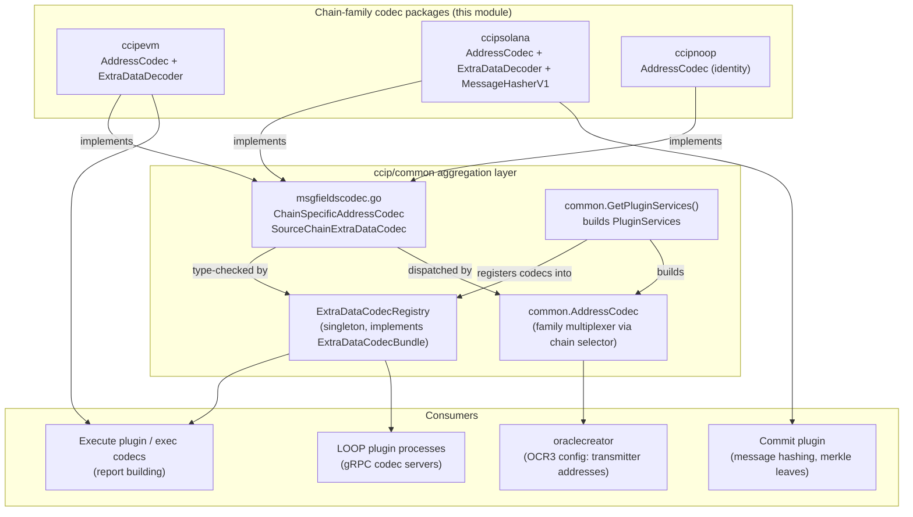
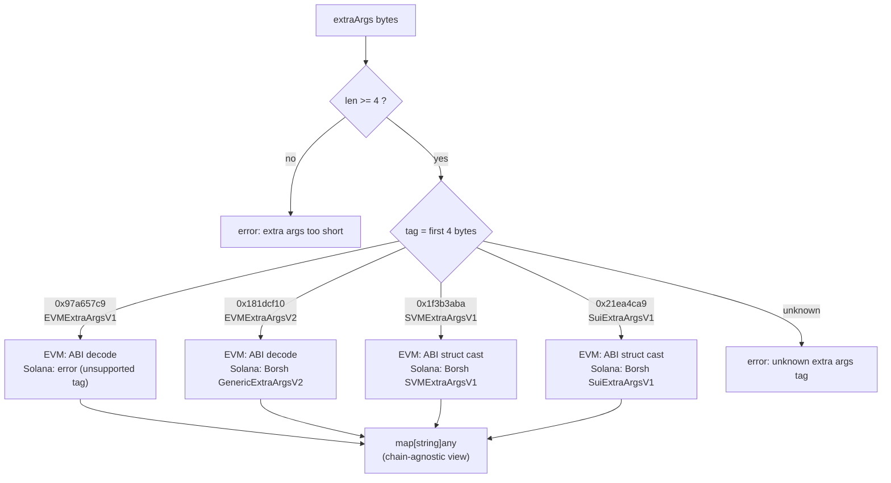
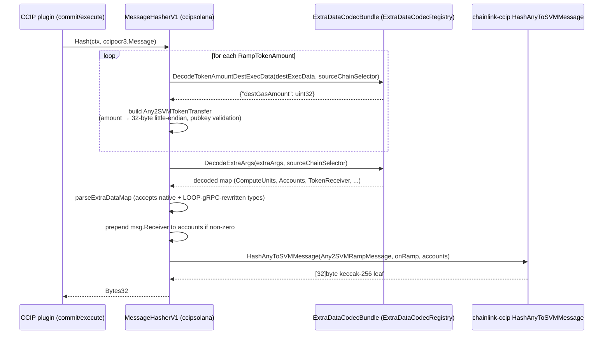

# CCIP Chain Codecs (`ccip_chain_codecs`)

## 1. Overview

The `ccip_chain_codecs` module implements the **chain-family-specific codecs** used by the Chainlink CCIP off-chain stack. CCIP's core domain model (`ccipocr3.Message`, `UnknownAddress`, `Bytes`, ...) is deliberately chain-agnostic, while every real chain family (EVM, Solana/SVM, Sui, Aptos, TON) encodes addresses, message parameters ("extra args"), destination execution data, and message hashes differently. This module provides the concrete translation layer between those two worlds for the families implemented in this repository:

| Package | Family | Components | Native encodings handled |
|---|---|---|---|
| `chainlink/core/capabilities/ccip/ccipevm` | EVM | `AddressCodec`, `ExtraDataDecoder` | 20-byte hex addresses, ABI encoding |
| `chainlink/core/capabilities/ccip/ccipsolana` | Solana (SVM) | `AddressCodec`, `ExtraDataDecoder`, `MessageHasherV1` (with the `extraData` helper struct) | 32-byte Ed25519 pubkeys, Base58 strings, Borsh encoding |
| `chainlink/core/capabilities/ccip/ccipnoop` | Noop/test | `AddressCodec` | Identity (raw byte passthrough) |

All codecs are **stateless structs** implementing small, focused interfaces declared in the shared `ccip/common` package (see [ccip_common_interfaces](ccip_common_interfaces.md)). They are aggregated into family-dispatching multiplexers at node startup, consumed by the CCIP OCR3 commit/execute plugins, and are also callable over gRPC from external plugin processes via the LOOP framework (see [Plugin Process Framework (Loop)](../../Plugin_Process_Framework_(Loop).md)).

For the sibling subsystems of the `ccip` package — chain read/write providers, OCR contract transmitters, shared interfaces and job validation — see [ccip_chain_rw_providers](ccip_chain_rw_providers.md), [ccip_ocr_transmitters](ccip_ocr_transmitters.md), [ccip_common_interfaces](ccip_common_interfaces.md) and [ccip_job_validation](ccip_job_validation.md). The parent page is [ccip](../ccip.md).

---

## 2. Component Inventory

| Component | File | Implements | Purpose |
|---|---|---|---|
| `ccipevm.AddressCodec` | `chainlink/core/capabilities/ccip/ccipevm/addresscodec.go` | `common.ChainSpecificAddressCodec` | EVM address conversions (20-byte ↔ checksummed hex) |
| `ccipevm.ExtraDataDecoder` | `chainlink/core/capabilities/ccip/ccipevm/extradatacodec.go` | `common.SourceChainExtraDataCodec` | ABI-decodes message extra args and destination execution data |
| `ccipsolana.AddressCodec` | `chainlink/core/capabilities/ccip/ccipsolana/addresscodec.go` | `common.ChainSpecificAddressCodec` | SVM address conversions (32-byte pubkey ↔ Base58) |
| `ccipsolana.ExtraDataDecoder` | `chainlink/core/capabilities/ccip/ccipsolana/extradatacodec.go` | `common.SourceChainExtraDataCodec` | Borsh-decodes extra args and destination execution data |
| `ccipsolana.MessageHasherV1` / `extraData` | `chainlink/core/capabilities/ccip/ccipsolana/msghasher.go` | `ccipocr3.MessageHasher` | Reproduces the on-chain `HashAnyToSVMMessage` hash for Solana destinations |
| `ccipnoop.AddressCodec` | `chainlink/core/capabilities/ccip/ccipnoop/addresscodec.go` | `common.ChainSpecificAddressCodec` | Identity codec for chains/tests without a native format |

Compile-time interface compliance is enforced with package-level assertions (e.g. `var _ ccipcommon.SourceChainExtraDataCodec = &ExtraDataDecoder{}` and `var _ ccipocr3.MessageHasher = (*MessageHasherV1)(nil)`), so any interface drift fails the build immediately.

---

## 3. Interfaces & Contracts

The codecs satisfy the following contracts. The first two are defined in `chainlink/core/capabilities/ccip/common/msgfieldscodec.go` (detailed in [ccip_common_interfaces](ccip_common_interfaces.md)); the others live in `chainlink-common/pkg/types/ccipocr3` (detailed in [types-ccip](../types-ccip.md)).

```mermaid
classDiagram
    class ChainSpecificAddressCodec {
        <<interface>>
        +AddressBytesToString(bytes) string
        +AddressStringToBytes(string) bytes
        +OracleIDAsAddressBytes(oracleID uint8) bytes
        +TransmitterBytesToString(bytes) string
    }
    class SourceChainExtraDataCodec {
        <<interface>>
        +DecodeExtraArgsToMap(extraArgs Bytes) map
        +DecodeDestExecDataToMap(destExecData Bytes) map
    }
    class MessageHasher {
        <<interface>>
        +Hash(ctx, Message) Bytes32
    }
    class AddressCodecBundle {
        <<interface - ccipocr3.AddressCodec>>
        +AddressBytesToString(addr, chainSelector) string
        +AddressStringToBytes(string, chainSelector) bytes
    }
    class ExtraDataCodecBundle {
        <<interface - ccipocr3>>
        +DecodeExtraArgs(extraArgs, sourceChainSelector) map
        +DecodeTokenAmountDestExecData(destExecData, sourceChainSelector) map
    }
    class EVMAddressCodec ["ccipevm.AddressCodec"]
    class SolanaAddressCodec ["ccipsolana.AddressCodec"]
    class NoopAddressCodec ["ccipnoop.AddressCodec"]
    class EVMExtraDataDecoder ["ccipevm.ExtraDataDecoder"]
    class SolanaExtraDataDecoder ["ccipsolana.ExtraDataDecoder"]
    class SolanaMessageHasherV1 ["ccipsolana.MessageHasherV1"]

    ChainSpecificAddressCodec <|.. EVMAddressCodec
    ChainSpecificAddressCodec <|.. SolanaAddressCodec
    ChainSpecificAddressCodec <|.. NoopAddressCodec
    SourceChainExtraDataCodec <|.. EVMExtraDataDecoder
    SourceChainExtraDataCodec <|.. SolanaExtraDataDecoder
    MessageHasher <|.. SolanaMessageHasherV1
    AddressCodecBundle <|.. CCIPCommonAddressCodec ["common.AddressCodec multiplexer"]
    ExtraDataCodecBundle <|.. ExtraDataCodecRegistry ["common.ExtraDataCodecRegistry singleton"]
```

Key contract semantics:

- **`ChainSpecificAddressCodec`** — per-family address translation. `OracleIDAsAddressBytes` produces a syntactically valid address for an OCR oracle ID; per the doc comment in `common/addresscodec.go`, it is "used for making nil transmitters in the OCR config valid", i.e. a placeholder address for an oracle that does not support the destination chain. `TransmitterBytesToString` decodes OCR transmitter accounts (which, for both EVM and Solana, are ordinary chain addresses).
- **`SourceChainExtraDataCodec`** — decodes *source-chain-encoded* variable payloads into a chain-agnostic `map[string]any`:
  - `ExtraArgs` — message-level parameters set by the sender on the source chain (e.g. gas limits, out-of-order execution flags, writable-account bitmaps).
  - `DestExecData` — per-token-transfer destination execution data (currently a `destGasAmount`).
- **`MessageHasher`** — computes the canonical keccak-256 message hash that must byte-for-byte match the on-chain `_hash` implementation of the corresponding ramp family (`OnRamp 1.6.0` for both EVM and Solana V1 hashers). This hash is the merkle leaf used by the commit plugin and is verified on the destination chain during execution.
- **`ccipocr3.Codec`** (`chainlink-common/pkg/types/ccipocr3/plugincodec.go`) is the composite of all chain-specific codec interfaces (`ChainSpecificAddressCodec`, `CommitPluginCodec`, `ExecutePluginCodec`, `TokenDataEncoder`, `SourceChainExtraDataCodec`, `MessageHasher`); each family package assembles a full `PluginConfig` of this shape in its `InitializePluginConfig` (e.g. `ccipevm/pluginconfig.go`), with the non-codec members documented in the sibling modules.

---

## 4. Architecture



### 4.1 Registration and aggregation flow

Each family package registers its `PluginConfig` factory in a package `init()` (see `ccipevm/pluginconfig.go` — `ccipcommon.RegisterPluginConfig(chainsel.FamilyEVM, InitializePluginConfig)`; the same pattern is used by the Solana, Sui, Aptos, TON and Noop packages). When a CCIP job starts, `common.GetPluginServices(lggr, chainFamily)` (in `ccip/common/pluginconfig.go`) drives the aggregation:

1. Lazily initializes the `ExtraDataCodecRegistry` singleton.
2. For every registered family, invokes the factory with the registry, then:
   - `RegisterFamilyNoopCodec(family)` — reserves the family with `NoOpSourceChainExtraDataCodec` so decoding over gRPC never nil-panics before real codecs are registered;
   - `RegisterCodec(family, config.ExtraDataCodec)` — replaces the no-op with the family's real decoder (e.g. `ccipevm.ExtraDataDecoder{}`);
   - collects `config.AddressCodec` into a `map[family]ChainSpecificAddressCodec`.
3. Wraps the collected codecs into two multiplexers returned in `PluginServices`:
   - `AddrCodec = common.NewAddressCodec(addressCodecMap)` — resolves the chain **family from the chain selector** (`chainsel.GetSelectorFamily`) on every call and delegates to the family codec;
   - `ChainRW = NewCRCW(chainRWProviderMap)` — see [ccip_chain_rw_providers](ccip_chain_rw_providers.md).

```mermaid
flowchart LR
    A["ccipevm init()"] --> R["ccipcommon.RegisterPluginConfig(family, factory)"]
    B["ccipsolana init()"] --> R
    R --> G["GetPluginServices(lggr, chainFamily)"]
    G --> H["invoke each factory with ExtraDataCodecRegistry"]
    H --> I["registry.RegisterFamilyNoopCodec(family)<br/>then RegisterCodec(family, ExtraDataDecoder)"]
    I --> J["AddrCodec = NewAddressCodec(map)<br/>ChainRW = NewCRCW(map)"]
    J --> K["delegate.go ServicesForSpec"]
    K --> L["oraclecreator.NewPluginOracleCreator(..., pluginServices.AddrCodec, ...)"]
    L --> M["CCIP OCR3 oracle (commit / execute / bootstrap)"]
```



This wiring is invoked from `chainlink/core/capabilities/ccip/delegate.go` (`ServicesForSpec`), which constructs either a plugin oracle creator (when `P2PV2Bootstrappers` are present) or a bootstrap oracle creator — both receive `pluginServices.AddrCodec` for OCR configuration.

### 4.2 LOOP / gRPC exposure

The same codec interfaces are projected over gRPC by generated LOOP bindings in `chainlink-common/pkg/loop/internal/pb/ccipocr3/` — notably `UnsafeChainSpecificAddressCodecServer`, `UnsafeSourceChainExtraDataCodecServer`, `UnsafeExtraDataCodecBundleServer`, `UnsafeMsgHasherServer`, `UnsafeCommitPluginCodecServer` and `UnsafeTokenDataEncoderServer` (see [loop-grpc-bindings](../../Plugin_Process_Framework_(Loop).md)). The `ExtraDataCodecRegistry` doc comment is explicit that `ExtraDataCodecBundle` "can be called over gRPC", which allows CCIP plugins running as separate processes (for example a TON relay) to decode source-chain extra args through the node's codecs. A direct consequence appears in §5.3: values crossing the gRPC boundary are protobuf-serialized, which changes Go types, and consumers must accept both representations.

---

## 5. Component Deep Dives

### 5.1 Address codecs

| Behaviour | `ccipevm` | `ccipsolana` | `ccipnoop` |
|---|---|---|---|
| Canonical string form | Checksummed `common.Address.Hex()` (`0x…`) | Base58 `solana.PublicKey.String()` | Raw string passthrough |
| Byte length / validation | 20 bytes; rejects non-hex-address strings via `common.IsHexAddress` | Exactly `solana.PublicKeyLength` (32 bytes); decodes Base58 or errors | None — identity mapping |
| `OracleIDAsAddressBytes` | Big-endian `uint32` oracle ID written into the high-order bytes of a 20-byte address | **Little-endian** `uint32` oracle ID in the first 4 bytes of a 32-byte pubkey (Solana is little-endian); result is an off-curve pubkey — flagged by a `TODO` in the source | Single byte `[]byte{oracleID}` |
| `TransmitterBytesToString` | Same as address conversion (transmitters are addresses) | Same as address conversion | Raw passthrough |

Note the deliberate endian asymmetry for oracle IDs between EVM (big-endian) and Solana (little-endian); both exist only to satisfy OCR on-chain config type checks and never carry real account semantics.

### 5.2 Extra data decoders (tag-based dispatch)

Both decoders dispatch on the **4-byte extra-args tag** prefixing the payload. The tags are `bytes4(keccak256("CCIP <Type>"))` constants:

| Tag | Type | Recognized by `ccipevm.ExtraDataDecoder` | Recognized by `ccipsolana.ExtraDataDecoder` |
|---|---|---|---|
| `0x97a657c9` | `EVMExtraArgsV1` | ✅ (ABI method `decodeEVMExtraArgsV1`) | ❌ (unknown-tag error) |
| `0x181dcf10` | `EVMExtraArgsV2` | ✅ (ABI method `decodeEVMExtraArgsV2`) | ✅ (Borsh `fee_quoter.GenericExtraArgsV2`) |
| `0x1f3b3aba` | `SVMExtraArgsV1` | ✅ (ABI method `decodeSVMExtraArgsStruct`) | ✅ (Borsh `fee_quoter.SVMExtraArgsV1`) |
| `0x21ea4ca9` | `SuiExtraArgsV1` | ✅ (ABI method `decodeSuiExtraArgsStruct`) | ✅ (Borsh `fee_quoter.SuiExtraArgsV1`) |



**Why each decoder understands foreign-family tags.** A plugin node on one chain must process messages originating from *any* source chain (e.g. the Solana `MessageHasherV1` hashes messages sent from EVM, Sui, or Solana sources into a Solana destination leaf). Each family decoder is therefore self-sufficient: the EVM decoder uses the ABI from `message_hasher.MessageHasherABI` (`ccipevm/msghasher.go`) to ABI-decode all four known formats, while the Solana decoder uses `agbinary` Borsh decoding with the `fee_quoter` Go bindings from `chainlink-ccip`. Additionally, the `ExtraDataCodecBundle` used by plugins dispatches by *source chain selector* through the `ExtraDataCodecRegistry`, so the source family's decoder is preferred when available.

Notable type-normalisation behaviour:

- The Solana decoder converts the Borsh-native `agbinary.Uint128` gas limit to `*big.Int` so EVM-style `GasLimit` consumers see a uniform type.
- Output map keys differ by decoder: the EVM decoder emits ABI/JSON-tag keys (e.g. `computeUnits`, `allowOutOfOrderExecution`, `tokenReceiver`), while the Solana decoder emits Go struct field names (e.g. `ComputeUnits`, `GasLimit`). Consumers such as `parseExtraDataMap` (§5.3) normalise by lower-casing keys.

**Destination execution data (`DecodeDestExecDataToMap`):**

| Decoder | Encoding assumption | Output |
|---|---|---|
| EVM | ABI-encoded `uint32` (decoded via `abiDecodeUint32`, errors on malformed input) | `{"destGasAmount": uint32}` |
| Solana | Raw big-endian `uint32` (`binary.BigEndian.Uint32`, no explicit length check — inputs shorter than 4 bytes will panic rather than return an error) | `{"destGasAmount": uint32}` |

### 5.3 Solana message hasher (`ccipsolana.MessageHasherV1`)

`MessageHasherV1` implements `ccipocr3.MessageHasher` for Solana destinations (compatible with `OnRamp 1.6.0-dev`). The `extraData` struct is its decoded-extra-args carrier (`extraArgs`, `accounts`, `tokenReceiver`). The hashing pipeline:



Implementation highlights:

- **Message translation** — the generic `ccipocr3.Message` is rebuilt as `ccip_offramp.Any2SVMRampMessage` (the exact Solana on-chain type from the `chainlink-ccip` gobindings), validating receiver/dest-token pubkey lengths (32 bytes) and encoding token amounts as fixed-length little-endian 32-byte values.
- **`parseExtraDataMap` type tolerance** — because this hasher runs inside OCR3 plugins, the decoded map may have crossed a LOOP gRPC boundary, where protobuf serialization rewrites Go types: `uint32 → int64`, `[32]byte → []byte`, `[][32]byte → []interface{}` (or `[][]byte`). Every field switch handles both the native and the wire-rewritten representations, with explicit range checks (e.g. `ComputeUnits` must fit `uint32`; arrays must be exactly 32 bytes) — see the "LOOP gRPC converts …" comments in `ccipsolana/msghasher.go`.
- **Receiver/account handling** — if the logical receiver is non-zero (`!msg.Receiver.IsZeroOrEmpty()`), it is prepended to the decoded `accounts` list before hashing, matching the on-chain account ordering.
- **Serialization helper** — package-level `SerializeExtraArgs(tag, data)` delegates to `chainlink-ccip`'s `ccip.SerializeExtraArgs`, providing the inverse (Borsh encode + tag prefix) operation used when constructing messages.

The EVM-side counterpart (`ccipevm.MessageHasherV1`, same file family as the tags in §5.2) mirrors this design for EVM destinations and is exercised against `chainlink/core/capabilities/ccip/ccipevm/msgs_test_vector.json`.

---

## 6. End-to-End Data Flow

How the codecs participate in a cross-chain message lifecycle (chains A → B):

1. **Source chain A** — the OnRamp emits a message whose `ExtraArgs` and per-token `DestExecData` are encoded in chain-A format.
2. **Ingest** — the CCIP reader on each node wraps the event data into the agnostic `ccipocr3.Message` (raw bytes preserved; see `EVM2AnyToCCIPMsg` in `ccipevm/helpers.go` for the EVM direction).
3. **Commit plugin** — for a chain-B destination, the family-B `MessageHasher` (e.g. `ccipsolana.MessageHasherV1`) decodes chain-A extra args via the `ExtraDataCodecBundle` and produces the canonical merkle leaf hash that is committed on B.
4. **Execute plugin** — report building re-decodes `DestExecData` (to size destination gas) and extra args (e.g. to derive `GasLimit`), translating the message into chain-B native report types via the execute codecs and helpers (`CCIPMsgToAny2EVMMessage` for EVM destinations).
5. **Transmission** — the chain-family contract transmitters serialize the signed report for the destination chain's runtime — see [ccip_ocr_transmitters](ccip_ocr_transmitters.md).
6. **On-chain verification (B)** — the OffRamp recomputes the hash; it must match the committed leaf, which is why these off-chain codecs are byte-for-byte compatible with the on-chain `_hash`/`_typeAndData` implementations.

---

## 7. Build, Test & Operational Context

- **Module membership** — the module is part of the main `chainlink` Go module (`chainlink/go.mod`); it is compiled into any node binary and into the CCIP-enabled container image built by the `docker-ccip` target of `chainlink/GNUmakefile`.
- **Generated bindings dependency** — the Solana codecs depend on Borsh types from `chainlink-ccip/chains/solana/gobindings/latest/{fee_quoter,ccip_offramp}` and the EVM decoder on the `message_hasher.MessageHasherABI` from `chainlink-ccip/chains/evm/gobindings/generated/v1_6_3`; upgrading those libraries can change decode behaviour and requires tag/struct parity.
- **Test assets** — `ccipevm/encodingUtilsAbi.json` (the ABI used to build encode/decode test utilities) and `ccipevm/msgs_test_vector.json` (golden message-hash vectors) guard cross-language compatibility of the hashing scheme; per-package tests (`addresscodec_test.go`, `extradatacodec_test.go`, `msghasher_test.go`) cover each codec.
- **Interface assertions as tests** — because every codec file carries a `var _ Interface = …` assertion, a failing interface (e.g. after a `chainlink-common` types bump) surfaces at compile time rather than runtime.

---

## 8. Design Notes & Gotchas

- **Two different "no-ops"** — `ccipnoop` (a registered chain family with identity address semantics, used by tests/scaffolding) is distinct from `common.NoOpSourceChainExtraDataCodec` (a registry-level placeholder returned by `RegisterFamilyNoopCodec` until a real decoder is registered; it silently returns empty maps).
- **Endian asymmetry** — EVM oracle-ID addresses are big-endian, Solana oracle-ID pubkeys are little-endian (§5.1). Do not "fix" one to match the other; both mimic their chain's convention.
- **Unknown-tag strictness** — both decoders hard-error on unknown or truncated tags (payload shorter than the 4-byte tag). Adding a new extra-args type requires updating *every* family decoder plus the tag tables, and usually new tags are introduced on-chain first (`bytes4(keccak256("CCIP …"))`).
- **Map-key conventions** — decoded maps intentionally lose Go typing; consumers must normalise case (§5.2) and accept LOOP-gRPC-rewritten types (§5.3). Prefer the typed accessors (`extractDestGasAmountFromMap`, `parseExtraArgsMap`) over raw map lookups.
- **Family dispatch is selector-driven** — `common.AddressCodec` resolves the family via `chainsel.GetSelectorFamily(chainSelector)`; an unknown selector or an unregistered family surfaces as `"unsupported family …"` errors, not silent fallbacks.

---

## 9. Related Documentation

- [ccip](../ccip.md) — parent module: CCIP oracles, delegates and plugin configuration.
- [ccip_common_interfaces](ccip_common_interfaces.md) — `ChainSpecificAddressCodec`, `SourceChainExtraDataCodec`, `CCIPOracle`/`OracleCreator`.
- [ccip_chain_rw_providers](ccip_chain_rw_providers.md) — per-family chain read/write providers (`ChainCWProvider`).
- [ccip_ocr_transmitters](ccip_ocr_transmitters.md) — per-family OCR3 contract transmitters that consume decoded reports.
- [ccip_job_validation](ccip_job_validation.md) — CCIP job spec validation.
- [types-ccip](../types-ccip.md) — shared CCIP domain types and `ccipocr3` interfaces (`MessageHasher`, `ExtraDataCodecBundle`, `Codec`).
- [Plugin Process Framework (Loop)](../../Plugin_Process_Framework_(Loop).md) — gRPC bindings (`codec_grpc.pb.go`, `msghasher_grpc.pb.go`) through which these codecs are exposed to external plugin processes.
- [Shared Foundation Libraries — codec](../../Shared_Foundation_Libraries___Domain_Types/codec.md) — the generic chain-agnostic codec toolkit used by capabilities other than CCIP.
