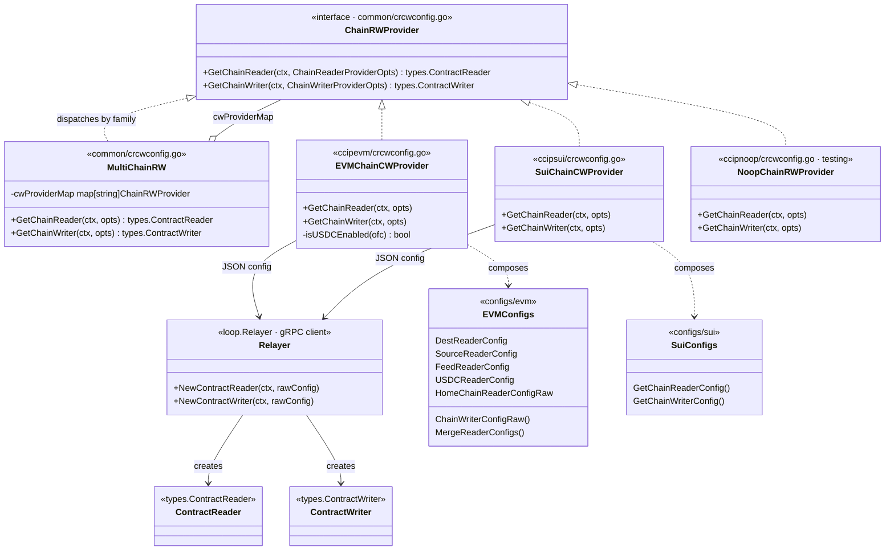
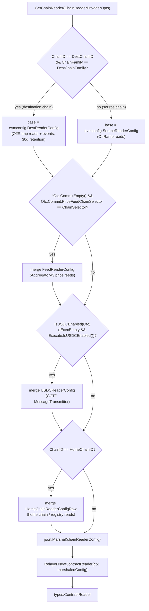
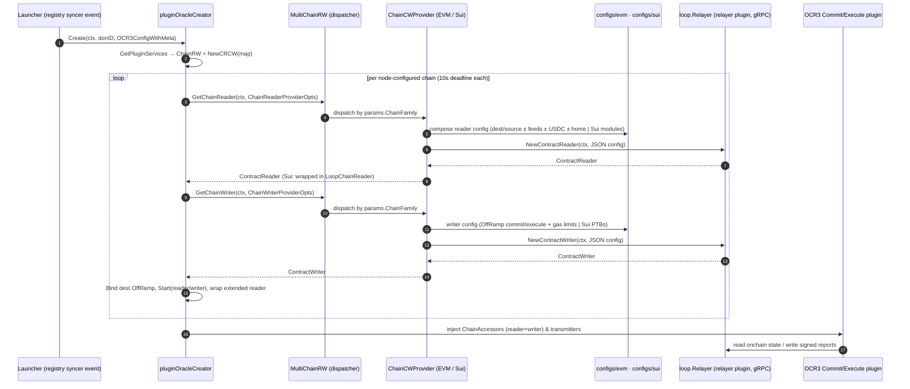

# CCIP Chain R/W Providers

## 1. Overview

The **`ccip_chain_rw_providers`** module implements the chain-family-specific factories that construct **`types.ContractReader`** and **`types.ContractWriter`** instances for CCIP OCR3 plugins (Commit and Execute). It is the layer where CCIP decides *which onchain contracts a plugin can read, which events it can observe, and how reports are written* — all expressed as JSON-serialized chain-reader/chain-writer configurations handed to a [loop.Relayer](../../Plugin_Process_Framework_(Loop)/loop-relayer-services.md).

Two implementations are provided, both named `ChainCWProvider` and both satisfying the `ccipcommon.ChainRWProvider` interface (see [CCIP Common Interfaces](ccip_common_interfaces.md)):

| Implementation | File | Chain family |
|---|---|---|
| `ccipevm.ChainCWProvider` | `chainlink/core/capabilities/ccip/ccipevm/crcwconfig.go` | EVM |
| `ccipsui.ChainCWProvider` | `chainlink/core/capabilities/ccip/ccipsui/crcwconfig.go` | Sui |

The providers are deliberately thin: they contain no chain connectivity logic of their own. They *compose configuration* (which contracts, methods, events, gas limits, signer addresses) and *delegate execution* to the relayer plugin process (LOOPP) for the corresponding chain family. Other chain families follow the same pattern with their own providers (`ccipnoop` returns relayer defaults with `nil` config and is used for testing/simulation; Aptos has its own `ccipaptos/crcwconfig.go`).

### Where this fits in the CCIP stack

CCIP is covered end-to-end in [CCIP Cross-Chain Protocol](../ccip.md). Within that scope, this module sits between the OCR3 oracle lifecycle (see [OCR](../../Oracle_Engines___Data_Pipelines/ocr.md)) and the chain-specific relayers:

- **Upstream (consumers):** the `oraclecreator` package instantiates the providers during oracle creation; the resulting readers/writers back the **chain accessors** and **contract transmitters** used by the Commit/Execute plugins (transmitters are documented in [CCIP OCR Transmitters](ccip_ocr_transmitters.md)).
- **Downstream (dependencies):** the `loop.Relayer` gRPC client from the [Plugin Process Framework (Loop)](../../Plugin_Process_Framework_(Loop)/loop-plugin-core.md), and the `types.ContractReader`/`types.ContractWriter` abstractions from [Shared Foundation Types](../../Shared_Foundation_Libraries___Domain_Types/types-core.md).

---

## 2. Core Components

### 2.1 EVM: `ccipevm.ChainCWProvider`

**File:** `chainlink/core/capabilities/ccip/ccipevm/crcwconfig.go`

A stateless struct (`ChainCWProvider{}`) registered under the `evm` chain family (registration is shown in [§5](#5-registration--wiring-flow)).

#### `GetChainReader(ctx, ccipcommon.ChainReaderProviderOpts) (types.ContractReader, error)`

Composes an EVM `config.ChainReaderConfig` by merging conditional sub-configs from the `configs/evm` package:

1. **Base config — source vs. destination:**
   - If the chain being serviced is the **destination chain** of the plugin's lane (`params.ChainID == params.DestChainID && params.ChainFamily == params.DestChainFamily`) → `evmconfig.DestReaderConfig` (OffRamp reads: execution states, merkle roots, static/dynamic config, source-chain configs, plus `CommitReportAccepted` / `ExecutionStateChanged` event polling with a 30-day log retention, `DefaultCCIPLogsRetention`).
   - Otherwise → `evmconfig.SourceReaderConfig` (OnRamp reads for source-chain message observation).
2. **Price feeds:** if a commit plugin offchain config is present (`!params.Ofc.CommitEmpty()`) and `params.Ofc.Commit.PriceFeedChainSelector == params.ChainSelector`, merge `evmconfig.FeedReaderConfig` (AggregatorV3Interface price-feed readers).
3. **USDC (CCTP):** if `isUSDCEnabled(params.Ofc)` → merge `evmconfig.USDCReaderConfig` (Circle `MessageTransmitter` `MessageSent` event ABI, see `configs/evm/usdc.go`).
4. **Home chain:** if `params.ChainID == params.HomeChainID` → merge `evmconfig.HomeChainReaderConfigRaw` (CCIPHome / registry reads needed by the DON's home chain).

The merged config is `json.Marshal`-ed and passed to `params.Relayer.NewContractReader(ctx, marshaledConfig)`, returning the relayer's gRPC-backed contract reader.

> Config merging is a plain map-copy of contract definitions: `evmconfig.MergeReaderConfigs(configs ...)` (in `configs/evm/contract_reader.go`) unions each config's `Contracts` map, so later configs win on key collisions.

#### `GetChainWriter(ctx, ccipcommon.ChainWriterProviderOpts) (types.ContractWriter, error)`

1. Resolves the transmitter address: `params.Transmitters[types.NewRelayID(params.ChainFamily, params.ChainID)][0]` → `common.HexToAddress(...)`.
2. Builds the writer config via `evmconfig.ChainWriterConfigRaw(fromAddress, params.CommitEvmBatchGasLimit, params.ExecBatchGasLimit)`. This produces a `config.ChainWriterConfig` for the **OffRamp** contract with two methods, each with a `FromAddress` and `GasLimit`:
   - `consts.MethodCommit` → onchain `commit(...)`, gas limit = `CommitEvmBatchGasLimit`
   - `consts.MethodExecute` → onchain `execute(...)`, gas limit = `ExecBatchGasLimit`
3. Marshals to JSON and calls `params.Relayer.NewContractWriter(ctx, ...)`.

#### `isUSDCEnabled(ofc ccipcommon.OffChainConfig) bool`

Returns `false` when the execute offchain config is empty (`ofc.ExecEmpty()`); otherwise delegates to `ofc.Execute.IsUSDCEnabled()`.

### 2.2 Sui: `ccipsui.ChainCWProvider`

**File:** `chainlink/core/capabilities/ccip/ccipsui/crcwconfig.go`

A stateless struct registered under the `sui` chain family. Unlike EVM, the Sui configurations are generated from the **transmitter public key** rather than a hex address. (Note: the doc comments in this file say "for EVM chains" — this is a copy-paste artifact; the package and behavior are Sui-specific.)

#### `GetChainReader(ctx, ccipcommon.ChainReaderProviderOpts) (types.ContractReader, error)`

1. Resolves the transmitter: `params.Transmitters[types.NewRelayID(params.ChainFamily, params.ChainID)][0]`.
2. Builds the reader config via `suiconfig.GetChainReaderConfig(transmitter[0])` (`configs/sui/contract_reader.go`), which:
   - Derives the Sui signer address from the transmitter's public key (`PublicKeyToAddress`, prefixed `0x`).
   - Defines a **module-based** config (Sui Move packages) for:
     - **RMNRemote** — `get_report_digest_header`, `get_versioned_config`, `get_cursed_subjects`, `get_arm`
     - **RMNProxy** — `get_arm`
     - **FeeQuoter** — `get_token_price`, `get_token_prices`, `get_static_config`, `get_dest_chain_gas_price`
     - **OffRamp** — `latest_config_details`, `get_latest_price_sequence_number`, `get_static_config`, `get_dynamic_config`, `get_source_chain_config`; events `ExecutionStateChanged`, `CommitReportAccepted`, `ConfigSet`, `SourceChainConfigSet`
     - **OnRamp** — `get_dynamic_config`, `get_static_config`, `get_dest_chain_config`, `get_expected_next_sequence_number`; event `CCIPMessageSent`
   - Each Move call declares typed `SuiFunctionParam`s; shared-state parameters use **pointer tags** (`CCIPObjectRefPointer` / `OffRampStatePointer` / `OnRampStatePointer`) to resolve onchain object IDs, and several functions map result tuples to struct fields via `ResultTupleToStruct`.
   - Sets indexer/sync cadence: `EventsIndexer`/`TransactionsIndexer` polling 10s, `EventSyncInterval` 12s, `EventSyncTimeout`/`TxSyncTimeout` 10s.
3. Marshals to JSON, creates the reader with `params.Relayer.NewContractReader(ctx, marshaledConfig)`.
4. **Wraps** the reader with `suiloop.NewLoopChainReader(params.Lggr, cr)` — the LOOP adapter (`chainlink-sui/codec/loop`) required for the Sui relayer's plugin-based reader.

#### `GetChainWriter(ctx, ccipcommon.ChainWriterProviderOpts) (types.ContractWriter, error)`

1. Resolves the transmitter public key as above.
2. Builds the writer config via `suiconfig.GetChainWriterConfig(transmitter[0])` (`configs/sui/chain_writer.go`), which:
   - Decodes the hex public key into an `ed25519.PublicKey` used as the signing key.
   - Defines the **OffRamp** module with PTB (Programmable Transaction Block) commands:
     - `commit` — a single `offramp::commit` Move call taking object refs, the clock, `ReportContext`, `Report`, and `Signatures`.
     - `execute` — a chained pair of Move calls, `offramp::init_execute` followed by `offramp::finish_execute`, where `finish_execute` consumes a `ptb_dependency` on the result of command index `0`.
3. Marshals to JSON and calls `params.Relayer.NewContractWriter(ctx, ...)`.

---

## 3. Interface & Data Contracts

The `ChainRWProvider` interface, its parameter structs, and the `MultiChainRW` dispatcher live in `chainlink/core/capabilities/ccip/common/crcwconfig.go` and are described in [CCIP Common Interfaces](ccip_common_interfaces.md). Summary:

```go
type ChainRWProvider interface {
    GetChainReader(ctx context.Context, params ChainReaderProviderOpts) (types.ContractReader, error)
    GetChainWriter(ctx context.Context, params ChainWriterProviderOpts) (types.ContractWriter, error)
}
```

Key parameters consumed by the implementations in this module:

| `ChainReaderProviderOpts` field | Used by | Purpose |
|---|---|---|
| `Lggr` | EVM, Sui | Structured logging for config decisions / LOOP reader wrapper |
| `Relayer` (`loop.Relayer`) | EVM, Sui | The relayer client that materializes readers/writers |
| `ChainID`, `ChainFamily` | EVM, Sui | Chain being serviced; selects the provider via `MultiChainRW` |
| `DestChainID`, `DestChainFamily` | EVM | Destinaton-chain detection → `DestReaderConfig` |
| `HomeChainID` | EVM | Home-chain detection → `HomeChainReaderConfigRaw` merge |
| `Ofc` (`OffChainConfig`) | EVM | Commit/Execute plugin offchain config; gates feed & USDC configs |
| `ChainSelector` | EVM | Matched against `Ofc.Commit.PriceFeedChainSelector` |
| `Transmitters` | EVM, Sui | `map[types.RelayID][]string`; first entry is the signer/from key |

| `ChainWriterProviderOpts` field | Used by | Purpose |
|---|---|---|
| `Relayer`, `ChainID`, `ChainFamily`, `Transmitters` | EVM, Sui | As above (writer side) |
| `ExecBatchGasLimit` | EVM | Gas limit for OffRamp `execute` (from `Ofc.Execute.BatchGasLimit`, default `6_500_000`) |
| `CommitEvmBatchGasLimit` | EVM | Gas limit for OffRamp `commit` (from `Ofc.Commit.EvmGasLimit`, default `500_000`) |
| `OfframpProgramAddress` | — (reserved) | Raw OffRamp program address; consumed by non-EVM writers (e.g., Solana SVM), not by EVM/Sui |

The `OffChainConfig` wrapper (`common/common.go`) carries `*pluginconfig.CommitOffchainConfig` / `*pluginconfig.ExecuteOffchainConfig` with helpers `CommitEmpty()`, `ExecEmpty()`, `IsValid()` (exactly one of the two must be set).

### Component relationships



---

## 4. Registration & Wiring Flow

The providers are registered via the **plugin-config registry** (`common/pluginconfig.go`) and wired into oracle creation by the `oraclecreator` package.

```mermaid
flowchart TD
    subgraph init["Package init (per chain family)"]
        A1["ccipevm.init():<br/>RegisterPluginConfig(evm, InitializePluginConfig)<br/>→ PluginConfig{ChainRW: ChainCWProvider{}, …}"]
        A2["ccipsui.init():<br/>RegisterPluginConfig(sui, …)"]
        A3["Other families:<br/>ccipaptos, ccipsolana, ccipton, ccipnoop"]
    end

    A1 --> R
    A2 --> R
    A3 --> R
    R[("registeredFactories<br/>map[chainFamily]InitFunction")]

    subgraph oracle["Oracle creation (oraclecreator/plugin.go)"]
        B["pluginOracleCreator.Create(ctx, donID, OCR3ConfigWithMeta)"] --> C["ccipcommon.GetPluginServices(lggr, destChainFamily)"]
        C --> D["run every registered InitFunction →<br/>collect ChainRW per family"]
        D --> E["PluginServices.ChainRW = NewCRCW(chainRWProviderMap)<br/>(MultiChainRW dispatcher)"]
        E --> F["createReadersAndWriters(ctx, ChainRW, …)"]
        F --> G["For each node-configured relayer<br/>(per-chain 10s deadline):<br/>ChainRW.GetChainReader / GetChainWriter"]
        G --> H["Bind dest OffRamp + Start readers/writers<br/>wrap readers as observed extended readers"]
        H --> I["getChainAccessorsAndContractTransmittersFromProviders<br/>(default accessors when no LOOP CCIP provider)"]
        I --> J["OCR3 Commit / Execute plugin factories<br/>+ contract transmitters"]
    end
```



Notable behaviors in `createReadersAndWriters` (`oraclecreator/plugin.go`):

- **Per-chain timeout:** each chain's reader/writer creation is bounded by `readerWriterCreationTimeout` (10 s) so an unavailable relayer plugin fails fast instead of stalling the launcher context.
- **Graceful skipping:** if `GetChainReader`/`GetChainWriter` returns an error (e.g., the family doesn't support local CR/CW because it uses a LOOP CCIP provider instead — see `CCIPProviderSupported`), the chain is skipped with a debug log; the accessor creation step later fails hard only if the chain truly needs a reader/writer.
- **Destination binding:** for the destination chain, the reader is `Bind`-ed to the OffRamp contract address before `Start`.

---

## 5. EVM Reader Configuration Composition

The EVM `GetChainReader` decision logic:



Error paths: JSON marshal failure or `NewContractReader` failure propagate the error to the oracle creator (which may skip the chain, see [§4](#4-registration--wiring-flow)).

---

## 6. Data Flow: Provider to Plugin I/O



The writers produced here are the transmission substrate for [CCIP OCR Transmitters](ccip_ocr_transmitters.md): when no LOOP CCIP provider supplies a contract transmitter, `pluginConfig.ContractTransmitterFactory.NewCommitTransmitter` / `NewExecTransmitter` wrap the destination-chain writer together with the first transmitter account.

---

## 7. Error Handling & Validation

| Check | Location | Behavior |
|---|---|---|
| Unsupported chain family | `MultiChainRW.GetChainReader/GetChainWriter` | Returns `"unsupported chain family %s"` |
| Zero transmitter address | `evmconfig.ChainWriterConfigRaw` | `"fromAddress cannot be zero"` |
| Zero gas limits | `evmconfig.ChainWriterConfigRaw` | `"commitGasLimit must be greater than zero"` / `"execBatchGasLimit must be greater than zero"` |
| Invalid Sui public key hex | `suiconfig.GetChainWriterConfig` | wrapped `"invalid public key hex"` error |
| Sui address derivation failure | `suiconfig.GetChainReaderConfig` | wrapped `"unable to derive Sui address from public key"` error |
| Missing transmitter for relay ID | EVM `GetChainWriter` (ok-check), Sui (direct index) | EVM falls back to zero address (rejected downstream); Sui will panic-index if absent — callers always populate `Transmitters` from node keystore |
| Marshal / relayer creation failures | both providers | Propagated wrapped errors |
| Reader/writer `Bind`/`Start` failure | `oraclecreator.createReadersAndWriters` | Fails oracle creation for that chain |

Gas-limit defaults (applied by the oracle creator when the plugin offchain config omits them): commit `500_000`, execute `6_500_000`.

---

## 8. Implementation Notes for Maintainers

- **Adding a chain family:** create a `crcwconfig.go` implementing `ccipcommon.ChainRWProvider`, expose an `InitializePluginConfig` that sets `PluginConfig.ChainRW`, and call `ccipcommon.RegisterPluginConfig(family, ...)` in `init()`. The oraclecreator import list in `oraclecreator/plugin.go` (blank imports) is what keeps the registrations alive.
- **Config-driven readers:** all onchain read surface is data (JSON `ChainReaderConfig`), so extending reads is a config change, not a protocol change — but EVM configs embed ABIs from generated go-bindings (`chains/evm/gobindings/...`), so ABI drift requires regenerating bindings.
- **Sui LOOP wrapper:** the Sui reader must be wrapped in `suiloop.NewLoopChainReader` after creation; forgetting this yields a reader the Sui plugin cannot use.
- **USDC support is opt-in per lane** via the execute plugin's offchain config; the reader config only includes CCTP contracts when enabled, keeping log polling surface minimal.
- **Doc-comment drift:** the Sui provider's comments still say "for EVM chains" — safe to fix when touching the file.
- **Noop provider:** `ccipnoop.chainRWProvider` passes `nil` config to the relayer and exists for tests/simulation harnesses.

---

## 9. Related Documentation

- [CCIP Cross-Chain Protocol](../ccip.md) — protocol overview and module map
- [CCIP Common Interfaces](ccip_common_interfaces.md) — `ChainRWProvider`, provider opts, `CCIPOracle`, `OracleCreator`
- [CCIP Chain Codecs](ccip_chain_codecs.md) — per-family codecs consuming the same chain-specific abstractions
- [CCIP OCR Transmitters](ccip_ocr_transmitters.md) — transmitters built on top of the writers from this module
- [CCIP Job Validation](ccip_job_validation.md) — job spec validation that precedes oracle creation
- [Shared Foundation: Types Core](../../Shared_Foundation_Libraries___Domain_Types/types-core.md) — `ContractReader`/`ContractWriter`, `Relayer` contracts
- [Plugin Process Framework (Loop): Core](../../Plugin_Process_Framework_(Loop)/loop-plugin-core.md) and [Relayer Services](../../Plugin_Process_Framework_(Loop)/loop-relayer-services.md) — LOOP/gRPC transport for relayer calls
- [OCR](../../Oracle_Engines___Data_Pipelines/ocr.md) — OCR/OCR3 oracle lifecycle that drives plugin creation
