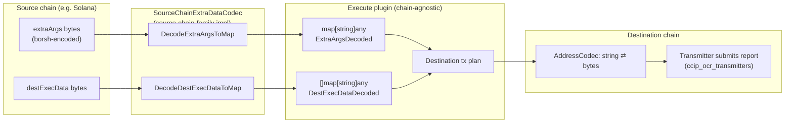
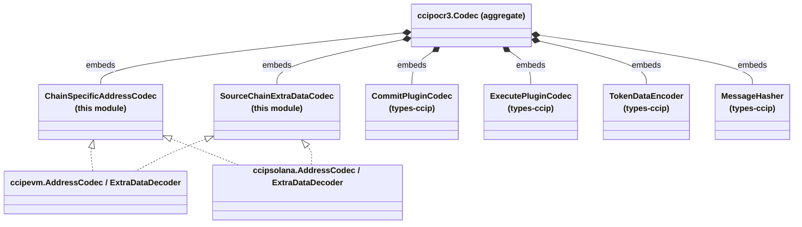
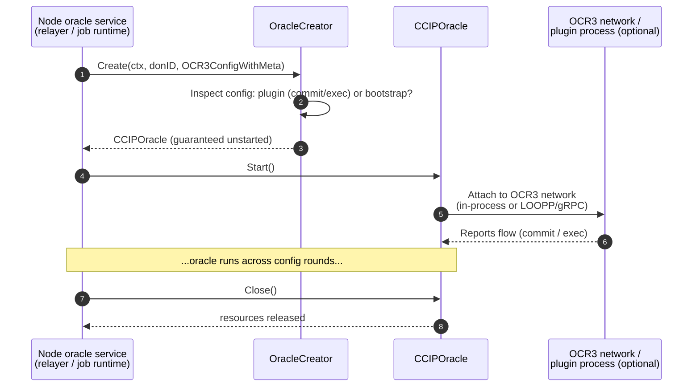

# CCIP Common Interfaces

## Introduction

The `ccip_common_interfaces` module defines the **chain-family-agnostic contracts that sit at the center of CCIP's cross-chain message pipeline and oracle lifecycle**. It lives in two small files inside `chainlink/core/capabilities/ccip/`:

| File | Components | Role |
|---|---|---|
| `chainlink/core/capabilities/ccip/common/msgfieldscodec.go` | `ChainSpecificAddressCodec`, `SourceChainExtraDataCodec` | Interfaces for translating chain-specific wire formats (addresses, extra args, destination execution data) into chain-agnostic representations used by CCIP plugins |
| `chainlink/core/capabilities/ccip/types/types.go` | `CCIPOracle`, `OracleCreator` (plus `OCR3ConfigWithMeta`, `PluginType`, `OracleType`) | Interfaces and enumerations for constructing and running CCIP OCR3 oracles (commit / execute / bootstrap) |

The module itself contains **no business logic** — it is a pure contract (interface) module. Its value is that it allows the generic CCIP plugin code (commit and execute plugins, message hashers, transmitters) to remain independent of any particular blockchain, while per-chain implementations are supplied by sibling modules (see [ccip_chain_codecs](ccip_chain_codecs.md)).

---

## Position in the System

CCIP (Cross-Chain Interoperability Protocol) runs as a set of OCR3-based plugins — a **commit** plugin and an **execute** plugin — orchestrated per DON. Because CCIP supports EVM, Solana, Sui, Aptos and other chain families, the plugin code cannot hard-code any chain's serialization rules. Instead:

1. **Generic plugin code** (in `chainlink-common/pkg/types/ccipocr3` and the CCIP plugin repositories) programs against the interfaces in *this* module.
2. **Chain-family adapters** (in [ccip_chain_codecs](ccip_chain_codecs.md), [ccip_chain_rw_providers](ccip_chain_rw_providers.md) and [ccip_ocr_transmitters](ccip_ocr_transmitters.md)) provide the concrete implementations.
3. **Oracle construction** is abstracted behind `OracleCreator` so the node does not need to know whether an oracle runs in-process or in a separate plugin process (LOOPP — see [loop-plugin-core](../../Plugin_Process_Framework_(Loop)/loop-plugin-core.md)).

The broader module family is documented on the parent pages [CCIP](../ccip.md) and [types-ccip](../types-ccip.md).

---

## Architecture

```mermaid
flowchart TB
    subgraph module["ccip_common_interfaces (this module)"]
        direction TB
        subgraph codecs["Message-field codecs (common/msgfieldscodec.go)"]
            CSAC["ChainSpecificAddressCodec<br/>(interface)"]
            SEDC["SourceChainExtraDataCodec<br/>(interface)"]
        end
        subgraph oracle["Oracle abstractions (types/types.go)"]
            OC["OracleCreator<br/>(interface)"]
            CO["CCIPOracle<br/>(interface)"]
            CT["PluginType / OracleType<br/>(enums)"]
            CFG["OCR3ConfigWithMeta<br/>(type alias)"]
        end
    end

    subgraph impls["Chain-family implementations (ccip_chain_codecs)"]
        EVM["ccipevm.AddressCodec<br/>ccipevm.ExtraDataDecoder"]
        SOL["ccipsolana.AddressCodec<br/>ccipsolana.ExtraDataDecoder"]
        SUI["ccipsui / ccipnoop codecs"]
    end

    subgraph generic["Generic CCIP plugin code (types-ccip)"]
        CODEC["ccipocr3.Codec<br/>(aggregate struct)"]
        MH["ccipocr3.MessageHasher"]
        AC["ccipocr3.AddressCodec"]
    end

    subgraph node["Node runtime"]
        REL["CCIP oracle service<br/>(Relayer / Job spawner)"]
        TX["OCR3 contract transmitters<br/>(ccip_ocr_transmitters)"]
    end

    CSAC -.implemented by.-> EVM
    CSAC -.implemented by.-> SOL
    SEDC -.implemented by.-> EVM
    SEDC -.implemented by.-> SOL
    EVM --- SUI

    CODEC -->|embeds| CSAC
    CODEC -->|embeds| SEDC
    CODEC -->|embeds| MH
    CODEC -->|embeds| AC

    REL -->|calls Create()| OC
    OC -->|returns unstarted| CO
    CT -->|uses transmitters with| CO
    CT -.uses address codecs.-> CSAC

    CFG -->|input to| OC
    CT -->|selects plugin| CT
```

### Component interaction overview

- `ChainSpecificAddressCodec` and `SourceChainExtraDataCodec` are **plugs** consumed by the aggregate `ccipocr3.Codec` bundle (see [types-ccip](../types-ccip.md)) and by the OCR3 transmitters (see [ccip_ocr_transmitters](ccip_ocr_transmitters.md)).
- `OracleCreator` is the **factory** the node's job/oracle infrastructure uses to instantiate a `CCIPOracle` for a given DON and OCR3 configuration.

---

## Core Components

### 1. `ChainSpecificAddressCodec`

```go
type ChainSpecificAddressCodec interface {
    AddressBytesToString([]byte) (string, error)
    AddressStringToBytes(string) ([]byte, error)
    OracleIDAsAddressBytes(oracleID uint8) ([]byte, error)
    TransmitterBytesToString([]byte) (string, error)
}
```

Defines encoding/decoding of addresses for **one specific chain family**. Each method exists to satisfy a distinct consumer:

| Method | Purpose | Typical consumer |
|---|---|---|
| `AddressBytesToString` | Render an on-chain address (bytes) as its canonical string form (e.g., hex with `0x` prefix for EVM, base58 for Solana). | Log/report formatting, on-chain config reading |
| `AddressStringToBytes` | Parse a user/config-supplied address string into on-chain bytes. | Job spec validation ([ccip_job_validation](ccip_job_validation.md)), plugin configuration |
| `OracleIDAsAddressBytes` | Synthesize a *valid address for this chain family* whose bytes encode an OCR oracle ID. Used where plugins must represent participating oracles as addresses even on chains whose native address format differs. | OCR3 reporting/transmission setup |
| `TransmitterBytesToString` | Render a transmitter account (the key that signs/reports on the destination chain) in human-readable form. | OCR transmitters ([ccip_ocr_transmitters](ccip_ocr_transmitters.md)) |

> **Distinction from the multi-chain codec:** the generic interface `ccipocr3.AddressCodec` in `chainlink-common/pkg/types/ccipocr3/interfaces.go` takes a `(UnknownAddress, ChainSelector)` pair because it serves *all* chains. `ChainSpecificAddressCodec` drops the selector — it is bound to a single chain family — which makes it embeddable in per-family `Codec` bundles.

### 2. `SourceChainExtraDataCodec`

```go
type SourceChainExtraDataCodec interface {
    DecodeExtraArgsToMap(extraArgs ccipocr3.Bytes) (map[string]any, error)
    DecodeDestExecDataToMap(destExecData ccipocr3.Bytes) (map[string]any, error)
}
```

Decodes the **source-chain-specific opaque fields** of a CCIP message into a chain-agnostic `map[string]any`:

- **`DecodeExtraArgsToMap`** — decodes the per-message `extraArgs` blob (gas limits, allow OOO execution flags, etc.). For a message from chain A to chain B, the chain-A implementation of this interface is used.
- **`DecodeDestExecDataToMap`** — decodes the per-token-transfer `destExecData` blob that the destination executor needs (e.g., expected receiver amounts).

The decoded shape matches `ccipocr3.ExtraDataDecoded` (`ExtraArgsDecoded` / `DestExecDataDecoded []map[string]any` in `chainlink-common/pkg/types/ccipocr3/generic_types.go`), which the execute plugin consumes to build destination transactions.

### 3. `CCIPOracle`

```go
type CCIPOracle interface {
    Close() error
    Start() error
}
```

Represents **a running CCIP oracle instance** — either:

- a **plugin oracle** running the commit plugin or the execute plugin, or
- a **bootstrap node** for the OCR3 network.

The interface is deliberately minimal (the standard `Start`/`Close` service lifecycle, consistent with `chainlink-common/pkg/types/types.go::Service` — see [types-core](../../Shared_Foundation_Libraries___Domain_Types/types-core.md)). All plugin internals are hidden behind the implementation; **whether the oracle executes in-process or via the LOOPP plugin-process framework is an implementation detail** of the concrete oracle, not something callers need to know.

### 4. `OracleCreator`

```go
type OracleCreator interface {
    Create(ctx context.Context, donID uint32, config OCR3ConfigWithMeta) (CCIPOracle, error)
    Type() OracleType
}
```

Factory for CCIP oracles:

- **`Create`** builds a new oracle for a given `donID` from an `OCR3ConfigWithMeta` (an OCR3 on/off-chain config bundle together with its metadata, aliased from `chainlink-ccip/pkg/reader.OCR3ConfigWithMeta`). The returned oracle **must be unstarted**; the caller owns the `Start()`/`Close()` lifecycle. This two-phase contract keeps construction side-effect free and testable.
- **`Type`** reports which oracle flavor this creator produces, constrained to the `OracleType` values below.

#### Supporting types (`types/types.go`)

| Type | Definition | Notes |
|---|---|---|
| `OCR3ConfigWithMeta` | `type OCR3ConfigWithMeta ccipreaderpkg.OCR3ConfigWithMeta` | Package-local alias so code-generated mocks (see [Testing](#testing--mocks)) target this package's type. |
| `PluginType` | Alias of `ccipocr3.PluginType`; `PluginTypeCCIPCommit = 0`, `PluginTypeCCIPExec = 1` | Mirrors `OCRPluginType` in the `Internal.sol` CCIP contract library — the on-chain/off-chain type values are intentionally identical. |
| `OracleType` | `uint8`; `OracleTypePlugin = 0`, `OracleTypeBootstrap = 1` | Disambiguates what a given `OracleCreator` produces. |

---

## Data Flow: Decoding Message Fields

The two codec interfaces turn chain-specific opaque bytes into neutral maps. The flow below shows a cross-chain message's `extraArgs` and `destExecData` being normalized before plugin logic runs:



### Integration with the `ccipocr3.Codec` bundle

The generic plugin code aggregates all codec capabilities into a single struct, `ccipocr3.Codec` (in `chainlink-common/pkg/types/ccipocr3/plugincodec.go`), which **embeds both interfaces from this module**:



This embedding means a single `Codec` value exposes every serialization capability a plugin needs; swapping the chain family only requires swapping the implementations of the embedded interfaces.

---

## Process Flow: Oracle Creation and Lifecycle



Key behavioral rules encoded in the contracts:

1. **`Create` never starts the oracle.** Callers control lifetime explicitly, which prevents orphaned goroutines during job reconciliation or rollbacks.
2. **Exactly one `OracleType` per creator.** A creator producing `OracleTypePlugin` oracles never produces bootstrap oracles, and vice versa; the node consults `Type()` when wiring the job.
3. **`PluginType` values mirror `Internal.sol`.** `PluginTypeCCIPCommit (0)` / `PluginTypeCCIPExec (1)` must remain numerically aligned with the on-chain enum.

---

## Relationship to the Plugin Process (Loop) Framework

When a CCIP oracle or its codecs run in an **out-of-process plugin** (LOOPP), the same contracts are bridged over gRPC. The generated bindings in `chainlink-common/pkg/loop/internal/pb/ccipocr3/codec_grpc.pb.go` include servers such as `UnsafeChainSpecificAddressCodecServer`, `UnsafeSourceChainExtraDataCodecServer`, `UnsafeExtraDataCodecBundleServer`, and `UnsafeMsgHasherServer`, and the relayer-side `CCIPProviderServer` exposes commit/exec providers. The interfaces in this module are therefore the **shared vocabulary** that both in-process and out-of-process oracle implementations must satisfy — see [loop-grpc-bindings](../../Plugin_Process_Framework_(Loop)/loop-grpc-bindings.md) and [loop-relayer-services](../../Plugin_Process_Framework_(Loop)/loop-relayer-services.md).

---

## Chain-Family Implementations

Concrete implementations supplied by sibling modules (all details in [ccip_chain_codecs](ccip_chain_codecs.md) and [ccip_chain_rw_providers](ccip_chain_rw_providers.md)):

| Chain family | `ChainSpecificAddressCodec` impl | `SourceChainExtraDataCodec` impl |
|---|---|---|
| EVM | `ccipevm.AddressCodec` | `ccipevm.ExtraDataDecoder` |
| Solana | `ccipsolana.AddressCodec` | `ccipsolana.ExtraDataDecoder` (paired with `ccipsolana.extraData` in the message hasher) |
| Sui | via `ccipsui.ChainCWProvider` wiring | via chain-writer/reader codecs |
| Noop (testing) | `ccipnoop.AddressCodec` | — |

---

## Testing & Mocks

All four interfaces are registered for automated mock generation in `chainlink/.mockery.yaml` (packages `core/capabilities/ccip/types` → `CCIPOracle`, `OracleCreator`; `core/capabilities/ccip/common` → `SourceChainExtraDataCodec`, `ChainSpecificAddressCodec`). This is the reason `OCR3ConfigWithMeta` is declared as a package-local type alias: mocks generated for `OracleCreator` reference a stable, local type rather than an external one. Run mock generation via the `mockery` tooling described in [chainlink_build_and_tooling](../../Build,_CI___Release_Infrastructure/chainlink_build_and_tooling.md).

---

## Extension Guide: Adding a New Chain Family

1. Implement `ChainSpecificAddressCodec` and `SourceChainExtraDataCodec` for the new family in the appropriate package (model the code on the EVM/Solana codecs).
2. Register the implementations in the chain-family wiring so they flow into the `ccipocr3.Codec` bundle and the chain accessors ([ccip_chain_codecs](ccip_chain_codecs.md)).
3. Provide an `OracleCreator` implementation (plugin and/or bootstrap) so the node can construct oracles for jobs on that family; wire it alongside the chain RW providers ([ccip_chain_rw_providers](ccip_chain_rw_providers.md)) and the OCR3 transmitter ([ccip_ocr_transmitters](ccip_ocr_transmitters.md)).
4. If the plugin runs out-of-process, ensure the new codec satisfies the gRPC contract used by the Loop bindings.

---

## Related Documentation

- [CCIP module overview](../ccip.md) — parent module: chain codecs, RW providers, OCR transmitters, job validation.
- [types-ccip](../types-ccip.md) — generic multi-chain CCIP types (`ccipocr3.Codec`, `MessageHasher`, `ExtraDataDecoded`, `ChainConfigSnapshot`, RMN types).
- [loop-plugin-core](../../Plugin_Process_Framework_(Loop)/loop-plugin-core.md) / [loop-grpc-bindings](../../Plugin_Process_Framework_(Loop)/loop-grpc-bindings.md) — where oracle implementations may be bridged across process boundaries.
- [types-core](../../Shared_Foundation_Libraries___Domain_Types/types-core.md) — the `Service` lifecycle and `PluginProvider` contracts that contextualize `CCIPOracle`.
