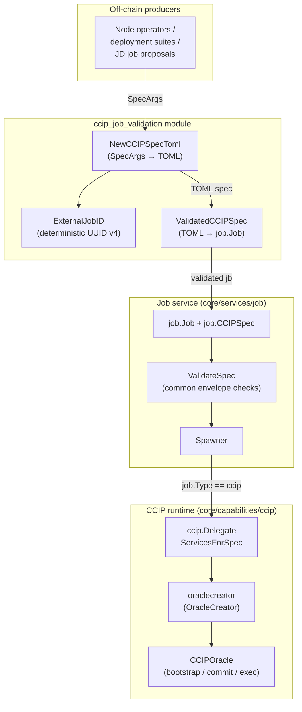
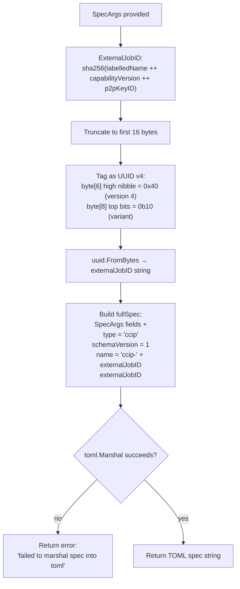
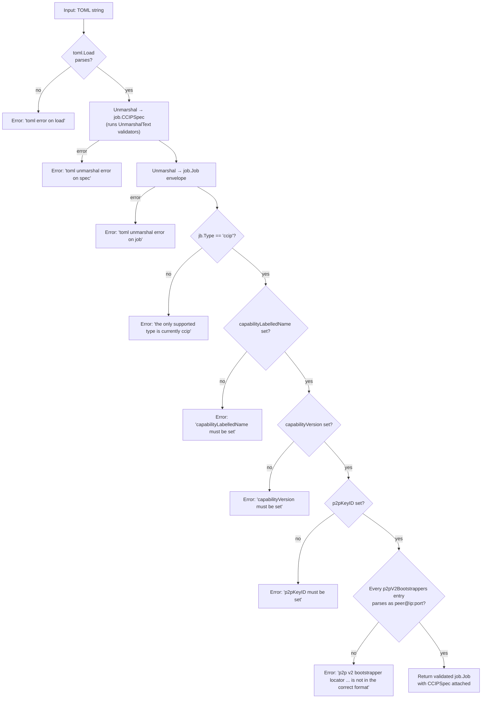
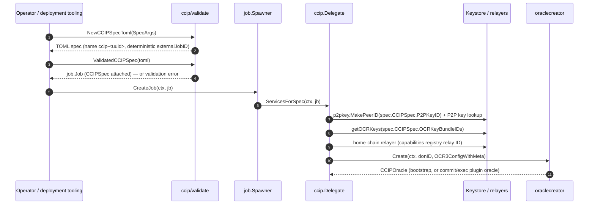
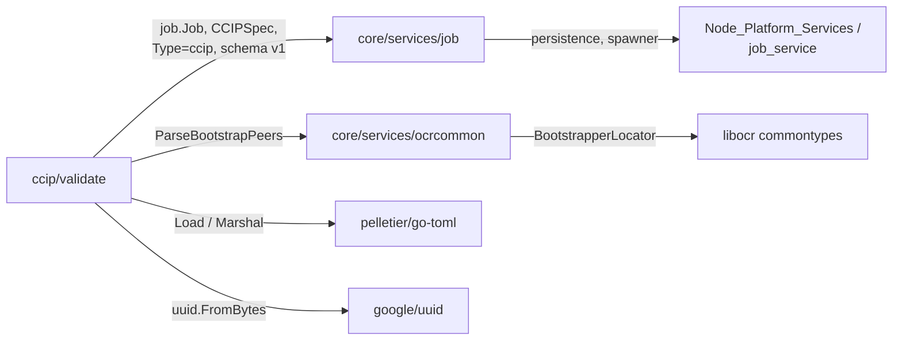

# CCIP Job Validation (`core/capabilities/ccip/validate`)

## Introduction

The `ccip_job_validation` module is the **canonical generator and validator of CCIP OCR3 job specs** on the Chainlink node. It lives in `chainlink/core/capabilities/ccip/validate/` and exposes a small, dependency-free API with exactly two responsibilities:

1. **Spec generation** — build a well-formed TOML CCIP job spec from structured arguments (`NewCCIPSpecToml`), including a *deterministic* external job ID (`ExternalJobID`).
2. **Spec validation** — parse and validate a TOML CCIP job spec into the node's `job.Job` domain model (`ValidatedCCIPSpec`).

Everything downstream — the job spawner, the CCIP delegate, the oracle creator, and the chain codecs — relies on the guarantees established here: a validated spec always has a `ccip` job type, a capability name/version that matches the on-chain capability registry, a P2P key ID, and syntactically valid P2P v2 bootstrapper locators.

This module is a sub-module of the [CCIP capability](../ccip.md). For how the validated spec is consumed at runtime, see [CCIP Common Interfaces](ccip_common_interfaces.md) and the [Job Service](../../Node_Platform_Services/job_service.md).

---

## Module at a Glance

| Aspect | Detail |
|---|---|
| Package | `github.com/smartcontractkit/chainlink/v2/core/capabilities/ccip/validate` |
| Go module | `chainlink` (see `chainlink/go.mod`) |
| Source | `chainlink/core/capabilities/ccip/validate/validate.go` |
| Tests | `chainlink/core/capabilities/ccip/validate/validate_test.go` |
| Produces | TOML job-spec strings, validated `job.Job` values |
| Job type | `ccip` (`job.CCIP`), schema version `1`, no pipeline spec required |
| Consumers | Job creation entry points (node web API/CLI, deployment tooling), `job.Spawner` → CCIP `Delegate` |

---

## Architecture

The module sits at the boundary between **off-chain tooling** (operators, deployment suites, Job Distributor proposals) and the **node's job runtime**. It converts between the portable TOML representation of a CCIP job and the in-memory `job.Job`/`job.CCIPSpec` model that the node executes.

### Component responsibilities

| Symbol | Signature | Responsibility |
|---|---|---|
| `SpecArgs` | `struct` | Structured inputs for spec generation (bootstrappers, capability name/version, OCR key bundles, P2P key, relay/plugin configs). |
| `NewCCIPSpecToml` | `func(SpecArgs) (string, error)` | Renders a complete, canonical TOML CCIP job spec, deriving `externalJobID`, `name`, `type`, and `schemaVersion`. |
| `ExternalJobID` | `func(SpecArgs) (string, error)` | Derives a deterministic UUID-v4 external job ID from the spec arguments. |
| `ValidatedCCIPSpec` | `func(string) (job.Job, error)` | Parses a TOML spec, applies all CCIP-specific validation rules, and returns a `job.Job` with `CCIPSpec` attached. |

---

## Spec Generation Flow

`NewCCIPSpecToml` embeds `SpecArgs` into an internal `fullSpec` struct that adds the job envelope fields, so all arguments are serialized as top-level TOML keys — mirroring the flat key layout that the node's TOML decoding expects (the same reason `job.ValidateSpec` in `chainlink/core/services/job/validate.go` cannot use strict decoding).

Key properties:

- **Determinism.** The same `SpecArgs` always yield the same `externalJobID`, job name, and TOML output. Re-submitting an identical spec is idempotent from the node's perspective — the external job ID is a pure function of `(CapabilityLabelledName, CapabilityVersion, P2PKeyID)`, *not* of relay configs or bootstrappers.
- **Canonical shape.** Generated specs always declare `type = "ccip"` and `schemaVersion = 1`, matching the constants registered for `job.CCIP` in `chainlink/core/services/job/models.go` (where `CCIP` is registered with `RequiresPipelineSpec: false` and schema version `1`).
- **Naming convention.** The job name is `ccip-<externalJobID>`, making CCIP jobs easy to identify in listings and telemetry.

---

## Validation Pipeline

`ValidatedCCIPSpec` is the CCIP-specific validator invoked when a CCIP job spec is submitted for creation (alongside the common envelope checks in `job.ValidateSpec`). It returns a fully populated `job.Job` with `jb.CCIPSpec = &spec`.

### Validation rules

| # | Check | Mechanism | Failure error |
|---|---|---|---|
| 1 | TOML syntax | `toml.Load(tomlString)` | `toml error on load: %w` |
| 2 | CCIP-spec field types | `tree.Unmarshal(&spec)` into `job.CCIPSpec`; fields implementing `UnmarshalText` validate themselves during decoding | `toml unmarshal error on spec: %w` |
| 3 | Job envelope fields | `tree.Unmarshal(&jb)` into `job.Job` | `toml unmarshal error on job: %w` |
| 4 | Job type | `jb.Type != job.CCIP` → reject; `ccip` is the only supported value | `the only supported type is currently 'ccip', got %s` |
| 5 | `capabilityLabelledName` | Must be non-empty (must exist in the on-chain capability registry) | `capabilityLabelledName must be set` |
| 6 | `capabilityVersion` | Must be non-empty (must exist in the on-chain capability registry) | `capabilityVersion must be set` |
| 7 | `p2pKeyID` | Must be non-empty (must resolve to a node P2P key at start-up) | `p2pKeyID must be set` |
| 8 | P2P v2 bootstrappers | Each entry must parse via `ocrcommon.ParseBootstrapPeers`, i.e. `peer_id@ip:port` (libocr `BootstrapperLocator` text format) | `p2p v2 bootstrapper locator %s is not in the correct format: %w` |

Notes:

- Rule 2 is the *only* structural deep-validation performed here. `RelayConfigs` and `PluginConfig` are free-form JSON maps at this layer; their chain-family-specific interpretation happens later (see [Integration](#integration-with-the-chainlink-node)).
- Bootstrapper locators are validated one-by-one (each in a single-element slice) so the error message pinpoints the offending entry.
- The bootstrapper format check is shared with OCR2 job specs (`core/services/ocrcommon/config.go`), keeping locator handling uniform across OCR-based job types.

---

## Data Model

`ValidatedCCIPSpec` materializes `job.CCIPSpec` (defined in `chainlink/core/services/job/models.go`) and attaches it to `job.Job`:

| Field | TOML key | Type | Meaning (per source comments) |
|---|---|---|---|
| `P2PV2Bootstrappers` | `p2pV2Bootstrappers` | `pq.StringArray` | `peer_id@ip:port` locators that bootstrap all CCIP DONs' P2P networks. |
| `CapabilityVersion` | `capabilityVersion` | `string` | Semantic version of the CCIP capability; must exist in the on-chain capability registry. |
| `CapabilityLabelledName` | `capabilityLabelledName` | `string` | Labelled name of the CCIP capability in the on-chain capability registry. |
| `OCRKeyBundleIDs` | `ocrKeyBundleIDs` | `JSONConfig` | Explicit chain-family → OCR key bundle ID mapping (e.g. `{"evm": "...", "solana": "..."}`), avoiding ambiguous auto-detection. |
| `RelayConfigs` | `relayConfigs` | `JSONConfig` | Per-chain-family chain-reader/chain-writer configuration (e.g. `{"evm": {"chainReader": {...}, "chainWriter": {...}}}`). |
| `P2PKeyID` | `p2pKeyID` | `string` | The node's P2P key ID; must be present in the capability registry or the job will not start correctly. |
| `PluginConfig` | `pluginConfig` | `JSONConfig` | Plugin-specific config, e.g. token price pipelines and RMN network info for off-chain blessing. |

The corresponding generation-side `SpecArgs` mirrors these fields exactly (plus the envelope fields added by `NewCCIPSpecToml`), so generation and validation are lossless round-trip partners — `NewCCIPSpecToml` output is designed to pass `ValidatedCCIPSpec`.

---

## Integration with the Chainlink Node

The validated `job.Job` enters the standard job lifecycle. The `Spawner` (see [Job Service](../../Node_Platform_Services/job_service.md)) routes `ccip`-typed jobs to the CCIP `Delegate` (`chainlink/core/capabilities/ccip/delegate.go`), which consumes exactly the fields this module validated:

Downstream consumers of the validated spec:

- **`P2PKeyID`** → resolved against the node P2P keyring by the delegate (see [Keystore](../../Node_Platform_Services/keystore.md)).
- **`OCRKeyBundleIDs`** → OCR2 signing keys fetched per chain family from the keystore ([Keystore](../../Node_Platform_Services/keystore.md)).
- **`RelayConfigs`** → parsed by the chain-family codec and chain-reader/writer provider implementations: [CCIP Chain Codecs](ccip_chain_codecs.md) and [CCIP Chain RW Providers](ccip_chain_rw_providers.md).
- **`CapabilityLabelledName` / `CapabilityVersion`** → identify the CCIP capability in the on-chain registry; oracle creation contracts are described in [CCIP Common Interfaces](ccip_common_interfaces.md) (`OracleCreator`, `CCIPOracle`).
- **`PluginConfig`** → forwarded into the OCR3 reporting plugin configuration (token price pipelines, RMN blessing info).
- **`P2PV2Bootstrappers`** → libocr oracle networking for both bootstrap and plugin oracles.

Deployment-side, CCIP/OCR3 job specs are proposed to nodes through the Job Distributor as part of the deployment suites (see [CRE & Keystone Jobs](../../CRE___Keystone_Deployment_Suite/cre-jobs.md)); the specs they propose must satisfy exactly the rules enforced by this module.

---

## Dependencies

Direct dependencies of `validate.go`:

- **`core/services/job`** — the `Job`/`CCIPSpec` domain model and `CCIP` job type ([Job Service](../../Node_Platform_Services/job_service.md)).
- **`core/services/ocrcommon`** — `ParseBootstrapPeers`, the shared libocr bootstrapper-locator parser ([OCR common](../../Oracle_Engines___Data_Pipelines/ocr/ocrcommon_shared.md)).
- **`github.com/pelletier/go-toml`** — TOML load/unmarshal/marshal.
- **`github.com/google/uuid`** — deterministic UUID-v4 formatting.

Notably, the module has **no** dependency on chain-specific CCIP packages (`ccipevm`, `ccipsolana`, …), keystores, or relayers — validation is deliberately chain-agnostic. Chain-family specifics are deferred to the codecs and providers linked above.

---

## Testing

`chainlink/core/capabilities/ccip/validate/validate_test.go` defines the two table-driven test functions that mirror the public API:

- `TestNewCCIPSpecToml` — cases of `SpecArgs` → expected TOML (or error).
- `TestValidatedCCIPSpec` — cases of TOML string → expected `job.Job` (or error).

The case tables are currently placeholders (`// TODO: Add test cases.`), i.e. the test harness (including the `args` wrapper struct that carries the TOML input) is in place but individual cases still need to be added. Treat the current coverage as **structural, not behavioral** until cases are populated.

Tests run with standard Go tooling from the `chainlink` module (e.g. `go test ./core/capabilities/ccip/validate/...`); the surrounding build targets are defined in `chainlink/GNUmakefile` (`make chainlink` for the node binary, `make docker-ccip` for CCIP-enabled node images built from `ccip/ccip.Dockerfile`).

---

## References

- Parent module: [CCIP](../ccip.md)
- Sibling sub-modules: [CCIP Chain Codecs](ccip_chain_codecs.md) · [CCIP Chain RW Providers](ccip_chain_rw_providers.md) · [CCIP Common Interfaces](ccip_common_interfaces.md) · [CCIP OCR Transmitters](ccip_ocr_transmitters.md)
- Runtime host: [Job Service](../../Node_Platform_Services/job_service.md) · [Keystore](../../Node_Platform_Services/keystore.md) · [Registry Syncer](../../Node_Platform_Services/registry_syncer.md)
- Shared contract types consumed via the plugin boundary: [Types: Core](../../Shared_Foundation_Libraries___Domain_Types/types-core.md)
- Deployment-side spec proposals: [CRE & Keystone — Jobs](../../CRE___Keystone_Deployment_Suite/cre-jobs.md)
- Source files: `chainlink/core/capabilities/ccip/validate/validate.go`, `chainlink/core/capabilities/ccip/validate/validate_test.go`, `chainlink/core/services/job/models.go`, `chainlink/core/services/job/validate.go`, `chainlink/core/services/ocrcommon/config.go`, `chainlink/core/capabilities/ccip/delegate.go`
