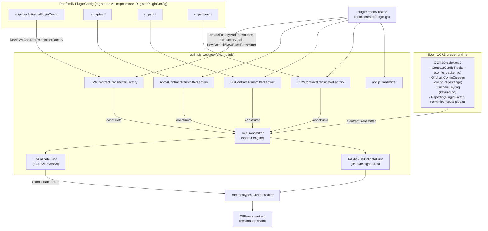
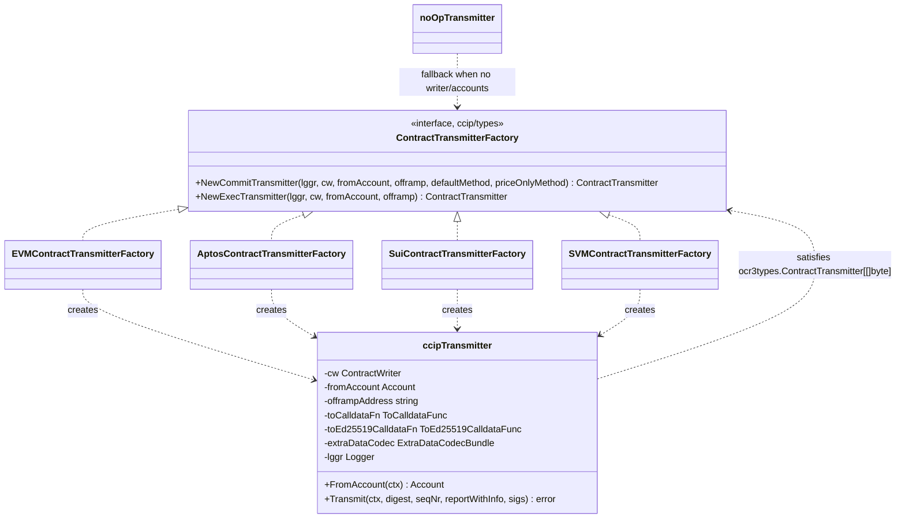
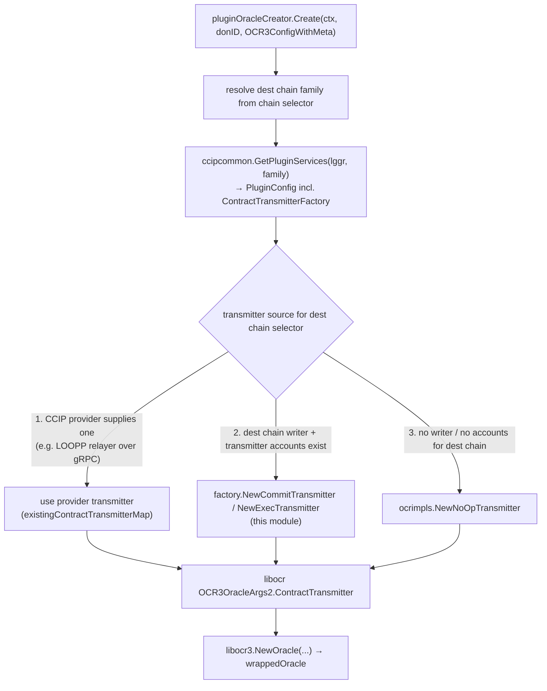

# CCIP OCR Contract Transmitters (`ocrimpls`)

The `ccip_ocr_transmitters` module — implemented by the Go package `chainlink/core/capabilities/ccip/ocrimpls` — provides the **on-chain transmission layer for CCIP's OCR3 reporting oracles**. When a CCIP commit or execute plugin produces a report that reaches quorum, the libocr OCR3 runtime invokes a `ContractTransmitter` to write the signed report to the destination chain's `OffRamp` contract. Because CCIP spans multiple chain families with different signature schemes, address formats, and calldata conventions, this module pairs one shared transmission engine (`ccipTransmitter`) with per-family factories and calldata builders for **EVM, Aptos, Sui, and SVM (Solana)**.

All code in this module lives under `chainlink/go.mod` (the core `chainlink/v2` Go module). This page is part of the [CCIP capability documentation](../ccip.md); the plugin/contract type contracts it depends on are described in [CCIP common interfaces](ccip_common_interfaces.md) and [types-ccip](../types-ccip.md).

---

## Purpose and Responsibilities

| Responsibility | Detail |
|---|---|
| **OCR3 report transmission** | Implements `ocr3types.ContractTransmitter[[]byte]` for each supported destination chain family, called by libocr after quorum on a report. |
| **Signature adaptation** | Splits ECDSA signatures into `r/s/v` components (EVM, SVM) or collects 96-byte Ed25519 signature bundles (Aptos, Sui) before calldata generation. |
| **Calldata construction** | Translates `ReportContext` + report + signatures into chain-writer-compatible `(contract, method, args)` tuples, with `mapstructure`-tagged arg structs. |
| **Commit vs. execute duality** | Each factory produces a *commit* transmitter (merkle roots + price updates) and an *execute* transmitter (message execution reports), using the appropriate OffRamp method. |
| **Extra-data decoding (where required)** | Sui and SVM execute calldata embeds decoded `ExecuteReportInfo`/`ExtraDataDecoded` derived from the report's `Info` payload via the `ExtraDataCodecBundle`. |
| **Fail-safe transmission** | Provides a `noOpTransmitter` for role-DON nodes that cannot transmit to the destination chain (e.g., missing `readers` in `CCIPHome` `ChainConfig`). |

Out of scope for this module (handled elsewhere in the `ocrimpls` package and documented on the parent [CCIP](../ccip.md) page): `config_tracker.go` (OCR config sourcing), `config_digester.go` (config digest), and `keyring.go` (report signing — the complementary *signing* half of the OCR3 stack, adapted from `ocr2key` key bundles described in [keystore core keys](../../Node_Platform_Services/keystore/keystore_core_keys.md)).

---

## Architecture

### Component relationships



### Class view



The `ContractTransmitterFactory` interface is defined in `chainlink/core/capabilities/ccip/types/contract_transmitter_factory.go` (see [CCIP common interfaces](ccip_common_interfaces.md)). Every concrete factory holds only one dependency: an `ccipocr3.ExtraDataCodecBundle` (chain-family registry of extra-args/dest-exec-data codecs — see [types-ccip](../types-ccip.md)), which it forwards into every constructed transmitter.

---

## Core Components

### 1. Shared transmitter engine — `contract_transmitter.go`

The `ccipTransmitter` struct is the single implementation of `ocr3types.ContractTransmitter[[]byte]` shared by all chain families. A transmitter is constructed in exactly one of two modes, selected by which calldata function is injected:

- **`ToCalldataFunc`** — ECDSA mode. Receives report context, report, and `rs []`, `ss []`, `vs` signature arrays.
- **`ToEd25519CalldataFunc`** — Ed25519 mode. Receives report context, report, and `signatures [][96]byte` (64-byte signature + 32-byte public key).

Both functions return the triple `(contract string, method string, args any)` consumed by the chain writer. The chain writer packs the raw args itself (the transmitter does not ABI-encode).

### 2. Per-family factories and calldata builders

| Chain family | Factory | Calldata fn type | Commit method selection | Commit args | Execute args |
|---|---|---|---|---|---|
| **EVM** | `EVMContractTransmitterFactory` | `ToCalldataFunc` (rs/ss/vs via `evmutil.SplitSignature`) | `commitMethod` passed in; price-only variant **ignored** | `ReportContext`, `Report`, `Rs`, `Ss`, `RawVs` | `ReportContext`, `Report` |
| **Aptos** | `AptosContractTransmitterFactory` | `ToEd25519CalldataFunc` | `commitMethod` passed in; price-only variant **ignored** | `ReportContext`, `Report`, `Signatures` | `ReportContext`, `Report` |
| **Sui** | `SuiContractTransmitterFactory` | `ToEd25519CalldataFunc` | `commitMethod` passed in; price-only variant **ignored** | `ReportContext`, `Report`, `Signatures` | `ReportContext`, `Report`, `Info` (`ExecuteReportInfo`), `ExtraData` (`ExtraDataDecoded`) |
| **SVM (Solana)** | `SVMContractTransmitterFactory` | `ToCalldataFunc` (rs/ss/vs shape) | `NewSVMCommitCalldataFunc(defaultMethod, priceOnlyMethod)` — **switches to the price-only method** when there are no Merkle roots but token/gas price updates exist | `ReportContext`, `Report`, `Rs`, `Ss`, `RawVs`, `Info` (`CommitReportInfo`) | `ReportContext`, `Report`, `Info`, `ExtraData` |

Common properties of all builders:

- Target contract and method names come from the canonical constants `consts.ContractNameOffRamp` and `consts.MethodExecute` (`chainlink-common/pkg/types/ccip/consts`).
- `rawReportCtx` is computed once per transmission by `ocr2key.RawReportContext3(configDigest, seqNr)`: `reportContext[0]` = OCR config digest, `reportContext[1]` = 24-byte padding + 8-byte sequence number.
- For Sui/SVM execute reports, `decodeExecData*` decodes `report.Info` via `ccipocr3.DecodeExecuteReportInfo`, then decodes per-message extra args and token-amount destination-exec data through the `ExtraDataCodecBundle`. This is currently a **stop-gap constrained to exactly one report with one message** per transmission (a limitation inherited from the Solana integration; flagged for future replacement in the source).

### 3. No-op transmitter — `no_op_transmitter.go`

`NewNoOpTransmitter(lggr, myP2PID, fakeTransmitAccount)` yields a transmitter that logs a *critical* message and returns `nil` on both `FromAccount` and `Transmit`. It is used for role-DON nodes that participate in consensus but are not configured as readers/transmitters for the destination chain; returning without error keeps the OCR transmission schedule healthy so that a capable node eventually transmits. The returned `fakeTransmitAccount` must match the account reported by `configTracker.PublicConfig()` so OCR setup still succeeds.

### 4. Keyring adapter (companion, same package)

`keyring.go` adapts an `ocr2key.OCR3SignerVerifier` (plus `PublicKey`/`MaxSignatureLength`) into an `ocr3types.OnchainKeyring[[]byte]`. It signs and verifies the same `(configDigest, seqNr, report)` triple the transmitter later proves on-chain, using the OCR key bundle selected for the destination chain family. Key bundles themselves are managed by the node's [keystore](../../Node_Platform_Services/keystore.md).

---

## Transmission Flow

```mermaid
sequenceDiagram
    autonumber
    participant OCR as OCR3 oracle (libocr)
    participant XT as ccipTransmitter
    participant CF as Chain-specific calldata func
    participant CW as ContractWriter
    participant ON as OffRamp (dest chain)

    OCR->>XT: Transmit(ctx, configDigest, seqNr, reportWithInfo, sigs)
    XT->>XT: validate: len(sigs) <= 32
    XT->>XT: rawReportCtx = RawReportContext3(configDigest, seqNr)
    alt toCalldataFn set (EVM, SVM)
        XT->>XT: evmutil.SplitSignature per sig → rs[], ss[], vs
        XT->>CF: (rawReportCtx, report, rs, ss, vs, extraDataCodec)
    else toEd25519CalldataFn set (Aptos, Sui)
        XT->>XT: copy each 96-byte Ed25519 signature
        XT->>CF: (rawReportCtx, report, signatures, extraDataCodec)
    end
    CF-->>XT: (contract, method, args)  e.g. (OffRamp, execute/commit, args struct)
    XT->>XT: txID = uuid.NewRandom(); meta = TxMeta{}; value = 0
    XT->>CW: SubmitTransaction(ctx, contract, method, args, "contract-offramp-txID", offrampAddress, meta, 0)
    CW->>ON: encode args via mapstructure/chain-writer config and broadcast
    XT-->>OCR: error only on validation/calldata/submit failure
```

Failure semantics: invalid signature counts, signature splitting errors, calldata-function errors (e.g., undecodable `Info`), and chain-writer submission errors are all returned to libocr; everything else is logged and submitted with an auto-generated UUID transaction id used by the chain writer's idempotency/dedup bookkeeping.

---

## Integration: how a transmitter is selected at oracle startup

The wiring happens in `chainlink/core/capabilities/ccip/oraclecreator/plugin.go` (`createFactoryAndTransmitter`), driven by the destination chain family resolved from the OCR config's chain selector:



Registration path (step 2): each chain-family package (e.g. `ccipevm/pluginconfig.go`) builds its `PluginConfig` with `ocrimpls.New<Family>ContractTransmitterFactory(extraDataCodec)` and registers it under its chain family via `ccipcommon.RegisterPluginConfig` in a package `init()`. The `oraclecreator` package blank-imports all family packages (`ccipaptos`, `ccipevm`, `ccipsolana`, `ccipsui`, `ccipton`) so the registrations run before any oracle is created. The chain families' codecs, hashers, and reader/writer providers that sit alongside the transmitter factory are documented in [CCIP chain codecs](ccip_chain_codecs.md) and [CCIP chain RW providers](ccip_chain_rw_providers.md); job-spec validation for these oracles is covered in [CCIP job validation](ccip_job_validation.md).

---

## Dependencies

| Dependency | Used for | Documented in |
|---|---|---|
| `ocr3types.ContractTransmitter`, `ReportWithInfo`, `AttributedOnchainSignature` (libocr) | OCR3 runtime contracts | [Oracle Engines — OCR](../../Oracle_Engines___Data_Pipelines/ocr.md) |
| `commontypes.ContractWriter`, `TxMeta` (`chainlink-common/pkg/types`) | Transaction submission to the destination chain | [types-core](../../Shared_Foundation_Libraries___Domain_Types/types-core.md) |
| `ccipocr3.ExtraDataCodecBundle`, `ExecuteReportInfo`, `CommitReportInfo` | Extra-args / dest-exec-data decoding in Sui & SVM exec calldata | [types-ccip](../types-ccip.md) |
| `ccipcommon.ExtraDataDecoded`, `PluginConfig`/`RegisterPluginConfig` | Decoded extra-data arg payload; factory registration | [CCIP common interfaces](ccip_common_interfaces.md) |
| `consts.ContractNameOffRamp`, `consts.MethodExecute` | Canonical contract/method names for calldata | [types-ccip](../types-ccip.md) |
| `ocr2key` key bundles (`RawReportContext3`, `OCR3SignerVerifier`) | Report-context computation; report signing via `keyring.go` | [keystore core keys](../../Node_Platform_Services/keystore/keystore_core_keys.md) |
| LOOPP relayer stack | Case 1 above: contract transmitters provided across the plugin process boundary (`UnsafeContractTransmitterServer` bindings) | [loop-relayer services](../../Plugin_Process_Framework_(Loop)/loop-relayer-services.md), [loop gRPC bindings](../../Plugin_Process_Framework_(Loop)/loop-grpc-bindings.md) |
| `oraclecreator` | Consumer: selects and injects the transmitter into the OCR3 oracle | [CCIP capability](../ccip.md) |

---

## Maintainer Notes and Invariants

1. **`mapstructure` tags are load-bearing.** `EVMCommitCallArgs`, `EVMExecCallArgs`, `SVMCommitCallArgs`, and `SVMExecCallArgs` carry prominent warnings in the source: the chain writer maps these struct fields onto the on-chain contract's parameter names using `mapstructure`. Renaming fields, changing types, or dropping tags can silently produce transactions with wrong arguments — treat these structs as wire-contract definitions, not internal types.
2. **Signature-count ceiling of 32** is enforced in `ccipTransmitter.Transmit` regardless of chain family.
3. **One transmitter per direction per mode.** A commit transmitter and an execute transmitter are separate instances; both target `OffRamp` but differ in method and args.
4. **Price-only commit switching is SVM-specific today.** `NewSVMCommitCalldataFunc` is the only builder that can swap the commit method based on report contents; EVM/Aptos/Sui ignore the `priceOnlyMethod` parameter (the `ContractTransmitterFactory` interface still requires it, keeping the door open for other families).
5. **Single-message stop-gap in exec decoding.** `decodeExecData`/`decodeExecDataSui` reject reports with more than one abstract report or message; multi-message SVM/Sui exec transmission requires replacing this (noted in source as a future change).
6. **No-op is not an error path.** When a node cannot transmit, deliberately returning `nil` avoids surfacing spurious OCR errors; monitor the *critical* log emitted by `noOpTransmitter` instead.
7. **In-process vs. LOOPP symmetry.** For plugins running as separate processes (LOOPP), the equivalent transmitter arrives over gRPC from the relayer plugin host; this module covers the in-process path. Both paths implement the same `ocr3types.ContractTransmitter[[]byte]` consumed identically by the oracle (see [loop-relayer services](../../Plugin_Process_Framework_(Loop)/loop-relayer-services.md)).

**Testing:** behavior is covered by `contract_transmitter_test.go` in the same package, and end-to-end transmission behavior is exercised by the CCIP integration suites in the [Dev/Test environments](../../Dev,_Test___Simulation_Environments/integration-tests.md) documentation. Module composition for this package is declared in `chainlink/go.mod`.

---

## See Also

- [CCIP capability overview](../ccip.md) — parent module: oracle types (`CCIPOracle`, `OracleCreator`), delegate, and launcher.
- [CCIP common interfaces](ccip_common_interfaces.md) — `PluginConfig` registry, address codecs, and `SourceChainExtraDataCodec` used by this module's extra-data decoding.
- [CCIP chain codecs](ccip_chain_codecs.md) — per-family commit/execute codecs and message hashers that produce the reports these transmitters submit.
- [types-ccip](../types-ccip.md) — `ccipocr3` interfaces and plugin report types referenced by calldata builders.
- [Plugin Process Framework (Loop)](../../Plugin_Process_Framework_(Loop)/loop-plugin-core.md) — how plugins (and their transmitters) run out-of-process.
