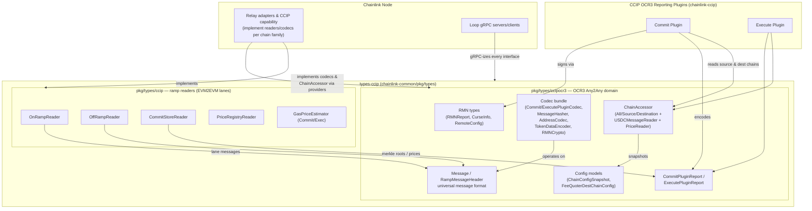
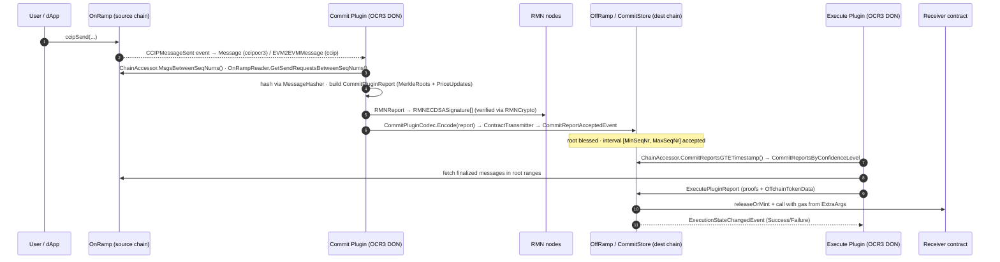
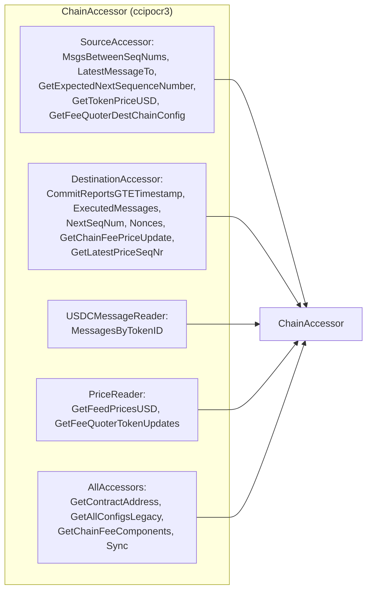

# types-ccip — Shared CCIP Type Definitions & Oracle Interfaces

> **Source packages:** `chainlink-common/pkg/types/ccip` and `chainlink-common/pkg/types/ccipocr3` (Go module: `chainlink-common`)
> **Parent module:** [CCIP Cross-Chain Protocol](../CCIP_Cross-Chain_Protocol.md)

## 1. Purpose & Scope

`types-ccip` is the **shared contract layer** of the Chainlink CCIP (Cross-Chain Interoperability Protocol). It contains the chain-agnostic Go interfaces and data structures that define *what* CCIP nodes and plugins exchange — without containing any chain-specific or protocol logic. It is the vocabulary that allows three very different parties to interoperate:

| Consumer | What it does with these types |
|---|---|
| **CCIP OCR3 plugins** (the Commit/Execute reporting plugins, developed in the `chainlink-ccip` repo) | Consume `ChainAccessor`, `Message`, codec and RMN interfaces to produce `CommitPluginReport` / `ExecutePluginReport` payloads |
| **Chainlink node** (relay adapters, CCIP capability — see sibling module [ccip](ccip.md)) | *Implement* the reader interfaces (`OnRampReader`, `OffRampReader`, `CommitStoreReader`, `PriceRegistryReader`, per-chain codecs/transmitters) |
| **Loop plugin-process framework** | Serialize every interface call across gRPC using the generated bindings in [loop-grpc-bindings](../Plugin_Process_Framework_(Loop)/loop-grpc-bindings.md) |

The module deliberately contains **interfaces + plain data models only**. This keeps the ABI/wire/behavioral contract stable across repos and across process boundaries, and makes the plugin binaries small (plugins never link chain client libraries).

The module is split across two packages that mirror the two generations of CCIP:

1. **`pkg/types/ccip` — EVM2EVM ramp contract readers (v1.x lane contracts).** Reader interfaces and config/value models for the classic per-lane contracts: `OnRamp`, `OffRamp`, `CommitStore`, `PriceRegistry`, and the `GasPriceEstimator`. Documented in [types-ccip_ramp_contracts](types-ccip/types-ccip_ramp_contracts.md).
2. **`pkg/types/ccipocr3` — OCR3 "Any2Any" plugin domain.** The universal `Message` format, the `ChainAccessor` facade, plugin report structures, the codec bundle, FeeQuoter configuration models and RMN (Risk Management Network) types. Documented in [types-ccip_ocr3_plugin_types](types-ccip/types-ccip_ocr3_plugin_types.md).

---

## 2. Architecture Overview

### 2.1 Package composition and consumers



### 2.2 The two packages and how they relate

```mermaid
flowchart LR
    subgraph A["pkg/types/ccip<br/>(legacy EVM2EVM ramps)"]
        direction TB
        A1[CommitStoreReader]
        A2[OffRampReader]
        A3[OnRampReader]
        A4[PriceRegistryReader]
        A5[GasPriceEstimator]
    end

    subgraph B["pkg/types/ccipocr3<br/>(OCR3 Any2Any)"]
        direction TB
        B1[ChainAccessor]
        B2[Message + MsgHasher]
        B3[Plugin reports + codecs]
        B4[RMN types]
    end

    C["pkg/types (types-core)<br/>CCIPCommitProvider /<br/>CCIPExecProvider /<br/>CCIPFactoryGenerator"]

    C -->|"factory methods return"| A
    C -->|"provider methods return<br/>codec + hasher"| B
    B1 -->|"redeclares ChainFeeComponents<br/>(avoids import cycle)":::note --> B
    classDef note fill:#fff3cd,stroke:#b8860b;
```

Key facts:

* The two packages are **independent** — neither imports the other. Both are consumed from `chainlink-common/pkg/types` via the provider interfaces [`CCIPCommitProvider`](../Shared_Foundation_Libraries___Domain_Types/types-core.md) (which returns `ccip.CommitStoreReader`, `ccip.OffRampReader`, `ccip.OnRampReader`, `ccip.PriceRegistryReader`) and `CCIPOCR3CommitProvider` / `CCIPOCR3ExecuteProvider` (which return `ccipocr3.CommitPluginCodec` and `ccipocr3.MessageHasher`).
* `ccipocr3.ChainFeeComponents` is intentionally **redeclared** instead of imported from `pkg/types` because `provider_ccip_ocr3.go` imports `ccipocr3`, which would create an import cycle (see the comment in `chainaccessor.go`).
* `ccipocr3.UnknownEncodedAddress` is an alias of `libocr.Account`, anchoring the Any2Any types to the OCR2/OCR3 signing/transmission world.
* `plugincodec.go` resolves per-family codecs at runtime via `github.com/smartcontractkit/chain-selectors` (`ExtraDataCodecMap.DecodeExtraArgs` maps a `ChainSelector` → chain family → `SourceChainExtraDataCodec`).

---

## 3. Core Domain Concepts

### 3.1 Chain-agnostic primitives (`common_types.go`)

These underpin every structure in the module and are the reason plugins can handle EVM, Solana, Aptos, Sui, Stellar and TON uniformly:

| Type | Meaning |
|---|---|
| `UnknownAddress` | Raw address bytes with **unknown encoding** (family-specific: 20-byte EVM, 32-byte Solana pubkey, …) |
| `UnknownEncodedAddress` | Alias of `libocr.Account` — address as it appears in OCR signing/transmission |
| `Bytes` / `Bytes32` | Hex-string-serializable byte slices (`0x…` JSON marshalling) |
| `BigInt` | JSON-safe wrapper over `math/big.Int` |
| `ChainSelector` | `uint64` globally unique chain identifier used by all CCIP contracts |
| `SeqNum` / `SeqNumRange` | Per-lane sequence numbers with inclusive-range algebra (`Contains`, `Overlaps`, `Limit`, `ToSlice`, …) |
| `TimestampedUnixBig` | On-chain `(value, unixTimestamp)` pair used by FeeQuoter/price updates |

### 3.2 The universal message

`ccipocr3.Message` (+ `RampMessageHeader`, `RampTokenAmount`) is the family-agnostic representation of a cross-chain message emitted by any OnRamp and consumed by any OffRamp:

* `Header` carries `MessageID`, source/dest `ChainSelector`, `SequenceNumber`, `Nonce`, and plugin-populated `MsgHash` / `OnRamp` / `TxHash`.
* `Sender`/`Receiver` are `UnknownAddress` (destination-family encoded), `ExtraArgs` is source-family encoded, `TokenAmounts` carry per-token `ExtraData` and `DestExecData`.
* `Message.IsPseudoDeleted()` detects stripped messages retained for sequencing bookkeeping.
* The older EVM2EVM equivalent is `ccip.EVM2EVMMessage` (see the [ramp contracts sub-module](types-ccip/types-ccip_ramp_contracts.md)).

### 3.3 The `WithTxMeta` pattern

Every on-chain payload that a plugin must observe together with its confirmation status is wrapped in a `*WithTxMeta` struct:

```go
type EVM2EVMMessageWithMeta struct { TxMeta; EVM2EVMMessage }          // onramp.go
type CommitStoreReportWithTxMeta struct { TxMeta; CommitStoreReport }  // commitstore.go
type TokenPriceUpdateWithTxMeta / GasPriceUpdateWithTxMeta             // priceregistry.go
type ExecutionStateChangedWithTxMeta struct { TxMeta; … }              // offramp.go
```

`TxMeta` (defined in `chainlink-common/pkg/types/contract_writer.go`) carries source-chain, transaction hash, block height and finality information so readers can filter by `confirmations` — every query method takes a `confirmations int` parameter for exactly this purpose.

### 3.4 Plugin reports, versioned encoding, and codecs

* `CommitPluginReport` bundles `PriceUpdates` + blessed/unblessed `MerkleRootChain`s + optional `RMNSignatures`; `ExecutePluginReport` bundles per-source-chain `Message`s with merkle `Proofs`/`ProofFlagBits` and `OffchainTokenData` (e.g. USDC attestations).
* On-chain "info" payloads (`CommitReportInfo`, `ExecuteReportInfo`) use a **single leading version byte** (`01`) followed by strict JSON (`json.Decoder.DisallowUnknownFields`), giving forward-compatible on-chain storage.
* The `Codec` struct (in `plugincodec.go`) composes all chain-facing codec interfaces a chain family must provide: `ChainSpecificAddressCodec`, `CommitPluginCodec`, `ExecutePluginCodec`, `TokenDataEncoder`, `SourceChainExtraDataCodec`, `MessageHasher`.

### 3.5 RMN security model

`rmn_types.go` models the Risk Management Network: `RMNReport` (signed by RMN nodes, `F+1`-of-`N` via `RMNECDSASignature`), `RemoteConfig` (signers, thresholds, report-version digest fetched from `RMNRemote`), and `CurseInfo` (per-source-chain, destination or `GlobalCurse`halt). Curse checking is what makes `IsSourceCursed`/`IsDestChainHealthy` gates on the readers meaningful.

---

## 4. Sub-module Documentation

The module is documented in two sub-modules matching its packages:

| Sub-module | Source package | Contents | Documentation |
|---|---|---|---|
| **Ramp Contract Readers** | `chainlink-common/pkg/types/ccip` | Reader interfaces for the EVM2EVM lane contracts — `CommitStoreReader` (blessed merkle roots, price reports), `OffRampReader` (execution states, rate limiter, exec report codecs), `OnRampReader` (send requests, dynamic config, health/cursed checks), `PriceRegistryReader` / `PriceRegistryFactory`, and the `GasPriceEstimator` (Commit/Exec/Common) with the `*WithTxMeta` value models (`CommitStoreReportWithTxMeta`, `EVM2EVMMessageWithTxMeta`, `TokenPriceUpdateWithTxMeta`, `GasPriceUpdateWithTxMeta`) and config models (`ExecOnchainConfig`, `ExecOffchainConfig`, `OnRampDynamicConfig`, `OffRampStaticConfig`, `OffRampTokens`, `CommitStoreStaticConfig`, `CommitOffchainConfig`) | [types-ccip_ramp_contracts.md](types-ccip/types-ccip_ramp_contracts.md) |
| **OCR3 Plugin Types (Any2Any)** | `chainlink-common/pkg/types/ccipocr3` | The OCR3 plugin domain — universal `Message` format and `SeqNumRange`/`ChainSelector` algebra (`generic_types.go`), the composed `ChainAccessor` facade and its event models (`SendRequestedEvent`, `CommitReportAcceptedEvent`, `ExecutionStateChangedEvent`), `CommitPluginReport` / `ExecutePluginReport` with versioned encodings, the `Codec` bundle (`plugincodec.go`) and codec interfaces (`interfaces.go`: `AddressCodec`, `MessageHasher`, `RMNCrypto`, `EstimateProvider`), RMN security types (`RMNReport`, `RMNECDSASignature`, `CurseInfo`, `RemoteConfig`), `ChainConfigSnapshot` / `SourceChainConfig` / `RMNCurseResponse`, and FeeQuoter models (`FeeQuoterDestChainConfig`, `DataAvailabilityGasConfig`, `TokenInfo`, `ExtraDataDecoded`) | [types-ccip_ocr3_plugin_types.md](types-ccip/types-ccip_ocr3_plugin_types.md) |

Both sub-module pages are self-contained: each lists its components' responsibilities, invariants (ordering contracts, version-byte encoding, finality/confirmation semantics), and the node-side implementations in the [ccip](ccip.md) module plus the gRPC bindings in [loop-grpc-bindings](../Plugin_Process_Framework_(Loop)/loop-grpc-bindings.md) that carry them across process boundaries.

---

## 5. Cross-Chain Message Lifecycle

The types below trace one message through the protocol; the interface names are exactly what each step calls.



Read-side support for this flow:



`ChainAccessor` is composed of five orthogonal sub-interfaces and its `Sync(contractName, address)` method lets plugins dynamically bind discovered contracts (OnRamp/OffRamp, FeeQuoter, RMNRemote) — configuration snapshots arrive as `ChainConfigSnapshot` / `SourceChainConfig` from `GetAllConfigsLegacy`.

---

## 6. Integration With Other Modules

| Related module | Relationship |
|---|---|
| [ccip](ccip.md) (sibling, node side) | **Implements** these interfaces per chain family: [ccip_chain_codecs](ccip/ccip_chain_codecs.md) (`ccipevm`/`ccipsolana`/`ccipnoop` `AddressCodec`, `ExtraDataDecoder`, `msghasher`), [ccip_ocr_transmitters](ccip/ccip_ocr_transmitters.md) (per-chain `*ExecCallArgs` transmitters), [ccip_chain_rw_providers](ccip/ccip_chain_rw_providers.md) (`ChainCWProvider`), [ccip_common_interfaces](ccip/ccip_common_interfaces.md) (`CCIPOracle`, `OracleCreator`, shared `msgfieldscodec`) |
| [types-core](../Shared_Foundation_Libraries___Domain_Types/types-core.md) | `CCIPCommitProvider` / `CCIPExecProvider` / `CCIPFactoryGenerator` are the factory contracts relays implement to hand readers/codecs to plugins; `TxMeta` used by all `*WithTxMeta` types lives here |
| [loop-grpc-bindings](../Plugin_Process_Framework_(Loop)/loop-grpc-bindings.md) | gRPC client/server pairs for every interface here (`UnsafeChainAccessorServer`, `UnsafeMsgHasherServer`, `UnsafeCommitPluginCodecServer`, `UnsafeCommitStoreReaderServer`, `UnsafeOffRampReaderServer`, `UnsafeOnRampReaderServer`, `UnsafePriceRegistryReaderServer`, `UnsafeGasPriceEstimator{Commit,Exec}Server`, …) so plugins run in separate processes |
| [CCIP Deployment Suite](../CCIP_Deployment_Suite.md) | Deploys/updates the on-chain contracts these readers mirror (OnRamp/OffRamp/FeeQuoter/PriceRegistry changesets) |
| [Oracle Engines & Data Pipelines](../Oracle_Engines___Data_Pipelines.md) | OCR2/OCR3 engine (`ocr2/delegate.go`, plugin framework) drives the plugins that consume these types |

---

## 7. Design Notes for Maintainers

1. **No implementation code.** The only executable logic is range algebra (`SeqNumRange`), validation (`ExecOnchainConfig.Validate`, `TokenInfo.Validate`), report emptiness checks and codec-map dispatch — everything else is contracts.
2. **Cyclic-dependency discipline.** `ChainFeeComponents` is duplicated in `ccipocr3` (documented in-file) precisely because `pkg/types/provider_ccip_ocr3.go` imports `ccipocr3`. Don't "fix" the duplication by importing `pkg/types` from `ccipocr3`.
3. **Versioned on-chain encodings.** `CommitReportInfo.Encode`/`DecodeCommitReportInfo` and `ExecuteReportInfo.Encode`/`DecodeExecuteReportInfo` prepend a version byte and decode with unknown-field rejection — preserve this scheme when evolving report shapes.
4. **Sorting contracts.** Several readers document required ordering (commit reports sorted by `Interval.Min/Max` ascending, price updates by timestamp ascending). Implementations in the `ccip` module must honor these or pagination/merkle-interval logic breaks.
5. **Family dispatch.** `ExtraDataCodecMap` resolves the codec by `chain-selectors.GetSelectorFamily(selector)`; a missing family codec is a hard error, not a silent pass-through.
