# types-ccip — OCR3 Plugin Types (`chainlink-common/pkg/types/ccipocr3`)

## Overview

`chainlink-common/pkg/types/ccipocr3` is the **shared type & interface vocabulary for CCIP's OCR3 reporting plugins** (the "ccipocr3" contract). CCIP Cross-Chain Protocol DONs run two kinds of OCR3 reporting plugins — the **Commit** plugin (merkle roots + price updates) and the **Execute** plugin (message execution with merkle proofs). This package defines the chain-agnostic, family-agnostic data structures and interfaces those plugins exchange with:

- the **chain access layer** (`ChainAccessor` and friends), which translates on-chain representations into plugin representations,
- the **encoding layer** (`CommitPluginCodec`, `ExecutePluginCodec`, `MessageHasher`, `AddressCodec`, …), which converts between plugin structs and chain-family-specific wire formats,
- the **Risk Management Network (RMN)** layer (`RMNReport`, `RMNCrypto`, `CurseInfo`, `RemoteConfig`).

Because everything here is pure Go types and interfaces (no DB, no service lifecycle, no I/O), the package is safe to import from both the **node binary** and the **out-of-process plugin binary**, and it is the common denominator that keeps the node (`chainlink/core/capabilities/ccip`), the plugin process (`chainlink-ccip`), and the [Loop plugin framework](../../Plugin_Process_Framework_(Loop)/loop-grpc-bindings.md) binary-compatible across process boundaries.

- **Go module:** `github.com/smartcontractkit/chainlink-common` (see `chainlink-common/go.mod`)
- **Package:** `chainlink-common/pkg/types/ccipocr3`
- **External dependencies:** `github.com/smartcontractkit/chain-selectors v1.0.104` (chain-family routing), `github.com/smartcontractkit/chainlink-common/pkg/types/query/primitives` (finality/confidence primitives)

For the sibling package that models the on-chain **ramp contract readers/writers** (OnRamp, OffRamp, CommitStore, PriceRegistry), see [types-ccip_ramp_contracts](types-ccip_ramp_contracts.md). For the node-side implementations of the interfaces defined here, see [ccip](../ccip.md).

---

## Component inventory

| File | Key components | Responsibility |
|---|---|---|
| `chainaccessor.go` | `ChainAccessor`, `AllAccessors`, `SourceAccessor`, `DestinationAccessor`, `USDCMessageReader`, `PriceReader`, `ChainFeeComponents` | Read-side access to CCIP on-chain state, translated to plugin representations |
| `chainaccessor_event.go` | `SendRequestedEvent`, `CommitReportAcceptedEvent`, `ExecutionStateChangedEvent`, `MerkleRoot`, `AccessorPriceUpdates` | Typed decodings of on-chain events emitted by the ramps |
| `contractconfigsnapshot.go` | `ChainConfigSnapshot`, `SourceChainConfig`, `RMNCurseResponse`, OnRamp/OffRamp/FeeQuoter/RMN config structs | Legacy aggregate snapshot of all chain configuration |
| `fee_quoter.go` | `FeeQuoterDestChainConfig`, `DataAvailabilityGasConfig` | Destination-chain fee configuration read from FeeQuoter |
| `generic_types.go` | `Message`, `RampMessageHeader`, `RampTokenAmount`, `SeqNum(Range)`, `ChainSelector`, `TokenInfo`, `TokenPriceMap`, `TimestampedUnixBig`, `PluginType`, `ExtraDataDecoded` | The Any2Any CCIP domain model and shared primitives |
| `interfaces.go` | `CommitPluginCodec`, `ExecutePluginCodec`, `MessageHasher`, `AddressCodec`, `RMNCrypto`, `TokenDataEncoder`, `EstimateProvider` | Codec, hashing, crypto and estimation contracts |
| `plugin_commit_types.go` | `CommitPluginReport`, `MerkleRootChain`, `PriceUpdates`, `CommitReportInfo`, `CommitReportsByConfidenceLevel` | Commit plugin report structures + versioned offchain encoding |
| `plugin_execute_types.go` | `ExecutePluginReport`, `ExecutePluginReportSingleChain`, `ExecuteReportInfo` | Execute plugin report structures + versioned offchain encoding |
| `plugincodec.go` | `Codec` aggregate, `ChainSpecificAddressCodec`, `SourceChainExtraDataCodec`, `ExtraDataCodecBundle`, `ExtraDataCodecMap` | Chain-family dispatch for encoding/decoding |
| `rmn_types.go` | `RMNReport`, `RMNLaneUpdate`, `RMNECDSASignature`, `CurseInfo`, `RemoteConfig`, `RemoteSignerInfo` | RMN report payload, signatures and curse state |

Generic byte primitives used throughout the package — `Bytes`, `Bytes32`, `BigInt`, `UnknownAddress` (raw, source-family-encoded), and `UnknownEncodedAddress` (chain-family-native encoded string) — are defined in the same package and treated as opaque by all consumers.

---

## Architecture

### Position in the system

The OCR3 plugin types are the **contract seam** between four runtimes: the OCR3 oracle core in the node, the node's CCIP capability (chain-family codecs/transmitters), the out-of-process plugin binary, and the CCIP contracts on each chain.

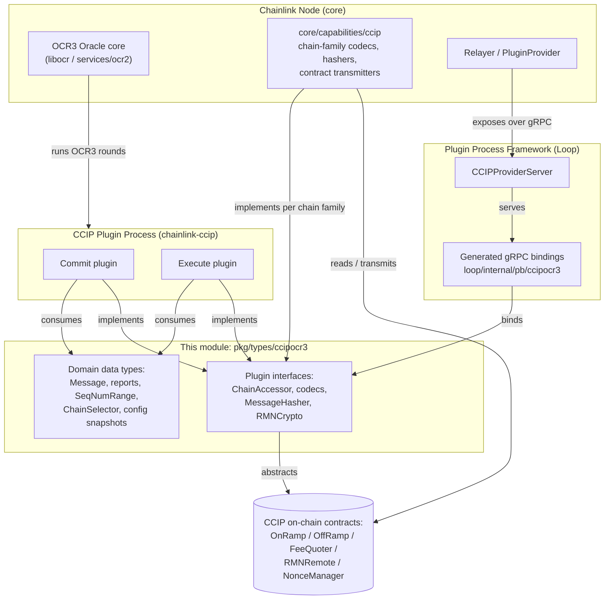

### Internal layering

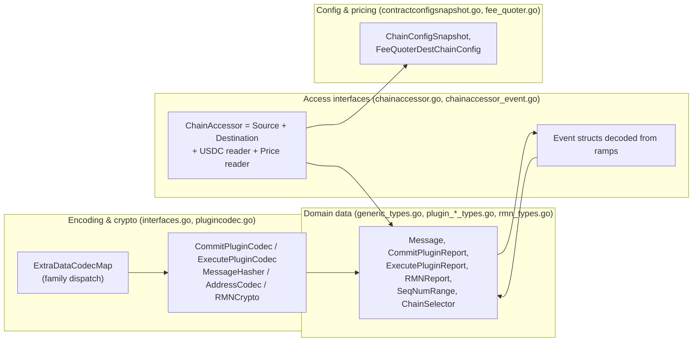

---

## Core interface groups

### 1. Chain access — the `ChainAccessor` composite

`ChainAccessor` is the plugin's single window into a chain. It composes five role interfaces; concrete implementations exist per chain family in `core/capabilities/ccip` (see [ccip_chain_codecs](../ccip/ccip_chain_codecs.md)).

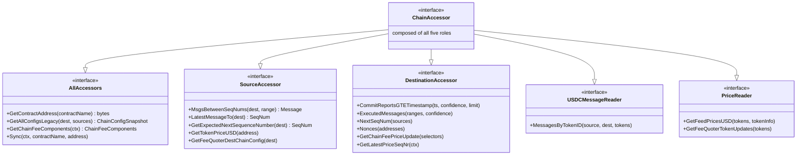

Key semantics (each method is annotated on-chain with its *Access Type / Contract / Confidence*):

- **Source side** reads `CCIPMessageSent` events from the OnRamp (`MsgsBetweenSeqNums` — *Finalized*), plus OnRamp sequence numbers and FeeQuoter prices (*Unconfirmed*).
- **Destination side** reads `CommitReportAccepted` and `ExecutionStateChanged` events from the OffRamp (*Unconfirmed* or *Finalized*), the next expected sequence number per source, inbound nonces from the NonceManager, and chain-fee price updates from the FeeQuoter.
- **Confidence levels** (`primitives.Finalized`, `primitives.Unconfirmed`, `primitives.Safe`) come from `chainlink-common/pkg/types/query/primitives` and map to different finality concepts per chain family.
- **`Sync`** binds a contract name to an address for dynamic contract discovery (OnRamps, FeeQuoter, RMNRemote), enabling the address registry kept in `ContractAddresses`.
- **`USDCMessageReader`** retrieves CCTPv1 `MessageSent` events produced when the USDC token pool calls the third-party MessageTransmitter.

`ChainFeeComponents` (ExecutionFee + DataAvailabilityFee) is **deliberately re-declared** in this package: the original lives in `chainlink-common/pkg/types` ([types-core](../../Shared_Foundation_Libraries___Domain_Types/types-core.md)), but `provider_ccip_ocr3.go` imports `ccipocr3`, so re-using the original type would create an import cycle.

### 2. Encoding, hashing & crypto

`interfaces.go` defines the wire-format contracts; `plugincodec.go` bundles them and adds chain-family routing.

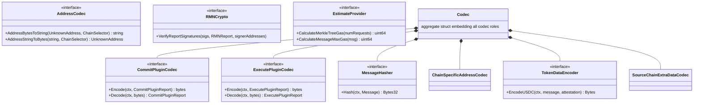

Notable behaviors:

- **`MessageHasher`** hashes a `Message` for the source chain family (e.g. keccak-based ABI hashing on EVM, borsh-compatible hashing elsewhere). The resulting `MsgHash` is populated into `RampMessageHeader` by the plugin — it is *not* emitted on-chain.
- **`RMNCrypto`** verifies RMN ECDSA report signatures chain-agnostically (ABI-encoded payloads on EVM, borsh on Solana, …); any invalid signature aborts immediately.
- **`TokenDataEncoder`** currently supports USDC/CCTP offchain data; new tokens requiring offchain data are added here and implemented downstream.
- **`EstimateProvider`** lets the execute plugin compute gas for merkle-tree verification and per-message execution — feeding the FeeQuoter destination config below.

### 3. Extra-data decoding — chain-family dispatch

`ExtraDataCodecMap` routes decoding requests to the codec of the **source chain's family**, resolved via `chain-selectors` (`chainsel.GetSelectorFamily(uint64(sourceChainSelector))`). Empty inputs short-circuit to `nil`; unknown families produce an explicit error.

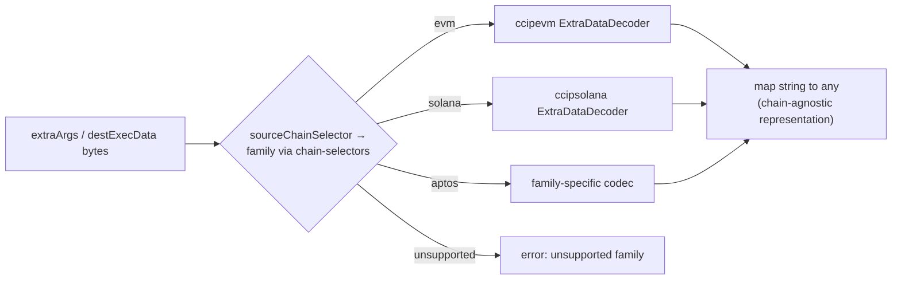

`SourceChainExtraDataCodec` exposes `DecodeExtraArgsToMap` and `DecodeDestExecDataToMap`; `ExtraDataCodecMap` implements `ExtraDataCodecBundle` on top of it. A `Codec` value per chain family aggregates all of the above (a consolidation of these interfaces into one `Codec` interface is tracked as a TODO in `interfaces.go`).

---

## Domain data types

### The Any2Any `Message`

`Message` is the canonical, family-agnostic representation of a CCIP message emitted by any OnRamp and consumed by any OffRamp:

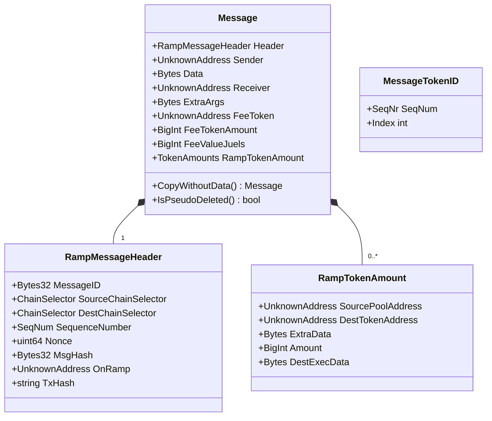

Design points to remember:

- `Sender` is encoded in the **source** family scheme; `Receiver` in the **destination** scheme. `FeeToken` is raw (non-ABI-encoded) for EVM sources.
- `ExtraArgs` (e.g. EVM `gasLimit`) is source-family encoded; `RampTokenAmount.DestExecData` is destination-family encoded and **must be decoded** (via `ExtraDataCodecBundle`) before use.
- `MsgHash` is empty on the wire and filled by the plugin through `MessageHasher`; `MessageID` may come from a different ramp family and is not guaranteed to equal `MsgHash`.
- `CopyWithoutData()` strips the payload (used in execute-report dedup via `CopyNoMsgData`), while `IsPseudoDeleted()` detects fully-stripped messages that retain only metadata (zero selectors/addresses).
- `MessageTokenID` is a composite `(SeqNr, token index)` key used to correlate CCTP token data without nested maps.

### Sequence numbers, ranges & selectors

| Type | Meaning |
|---|---|
| `ChainSelector` (`uint64`) | Global chain identifier across all families. |
| `SeqNum` (`uint64`) | Auto-incrementing, **per-lane** (source→dest) message sequence number. |
| `SeqNumRange` `[2]SeqNum` | Inclusive range with `Contains`, `Overlaps`, `Limit` (truncate to *n* elements), `FilterSlice`, `ToSlice`, `Length`. |
| `MessageTokenID` | Composite message/token index key (see above). |

### Prices & timestamps

- `TokenPrice` / `TokenPriceMap` — token ID → USD price, with `ToSortedSlice()` for deterministic iteration (required for stable report hashing).
- `TokenInfo` — feed aggregator address, deviation (PPB), token decimals; `Validate()` enforces a 20-byte hex aggregator address, positive deviation and non-zero decimals.
- `GasPriceChain` — gas price keyed by the *destination* chain selector it applies to.
- `TimestampedBig` (offchain, `time.Time`) and `TimestampedUnixBig` (on-chain mirror of `Internal.sol`'s packed `uint224` value + unix seconds), bridged by `TimeStampedBigFromUnix`.
- `PriceReader.GetFeedPricesUSD` normalizes to 1e18 (e.g. 1 USDC = 1e6 units → `1e30`).

### Contract addresses & plugin type

- `ContractAddresses` — `map[contractName]map[ChainSelector]UnknownAddress` with an `Append` builder used by accessor `Sync`.
- `PluginType` — mirrors `OCRPluginType` in `Internal.sol`: `PluginTypeCCIPCommit = 0`, `PluginTypeCCIPExec = 1`.

---

## Plugin report types

### Commit plugin report

A `CommitPluginReport` carries merkle roots and/or price updates from many source chains to one destination chain, plus optional RMN signatures. It is **empty** (and must not be transmitted) when all core fields are absent; RMN signatures **without merkle roots are invalid**.

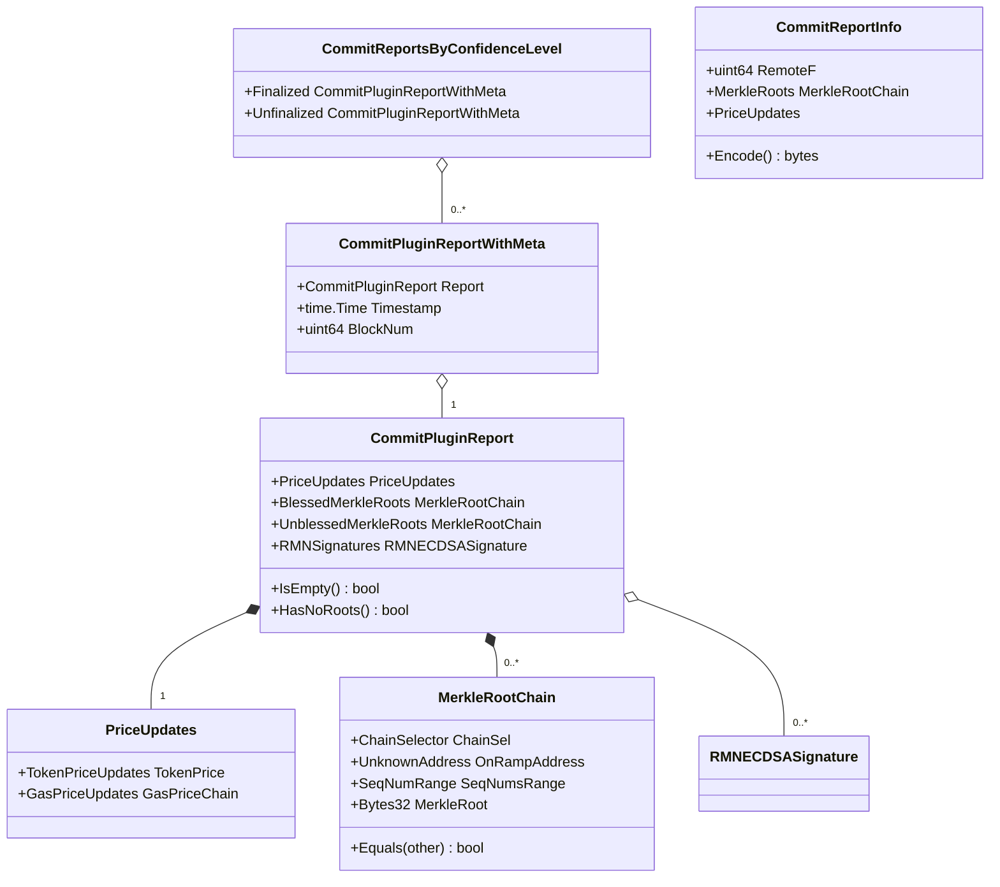

**Offchain versioned encoding.** `CommitReportInfo.Encode()` and `DecodeCommitReportInfo()` (and the execute-report pair below) use a self-describing envelope: the first byte is a schema **version** (`0x01` today), followed by strict JSON (`DisallowUnknownFields`). This is the offchain→offchain (transmitter-input) encoding, distinct from the onchain report encodings produced by the chain-family `CommitPluginCodec` implementations.

`CommitReportsByConfidenceLevel` is how the destination accessor returns observed commit reports grouped by finality bucket (`Finalized` / `Unfinalized`), matching the confidence levels the plugin requested.

### Execute plugin report

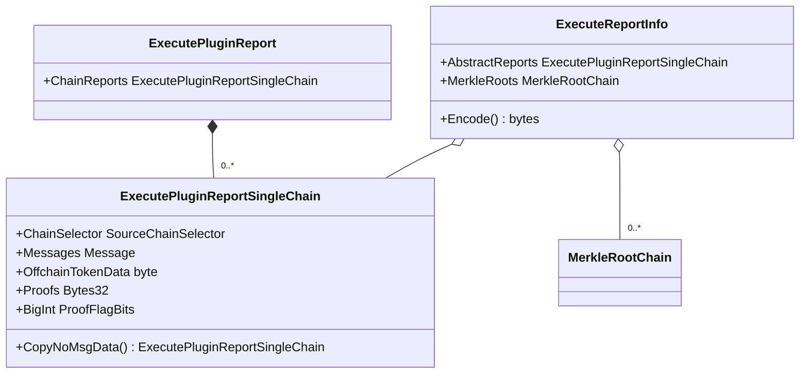

`ExecuteReportInfo` bundles the abstract per-chain reports with the merkle roots they prove against; `MerkleRoots` is metadata needed by the transmitter / contract writer. `OffchainTokenData[i][j]` carries per-message, per-token offchain data (e.g. USDC attestations, produced by `TokenDataEncoder`).

---

## Chain configuration snapshots & fee quoting

`GetAllConfigsLegacy` returns a **legacy aggregate snapshot** (to be superseded by a `ChainConfigInterface`-based `GetAllConfig`). The snapshot shape depends on whether the accessor is bound to a source or destination chain:

| Accessor bound to | Snapshot returns | Source-chain config map |
|---|---|---|
| **Destination** | `Offramp` (commit/exec OCR configs, static & dynamic config), `RMNProxy`, `RMNRemote`, `FeeQuoter`, `CurseInfo` | Populated `SourceChainConfig` per requested source (router, enabled, RMN verification, `MinSeqNr`, OnRamp address) |
| **Source** | `OnRamp` (dynamic config + dest-chain config), `FeeQuoter`, `Router` (wrapped-native address) | Empty |

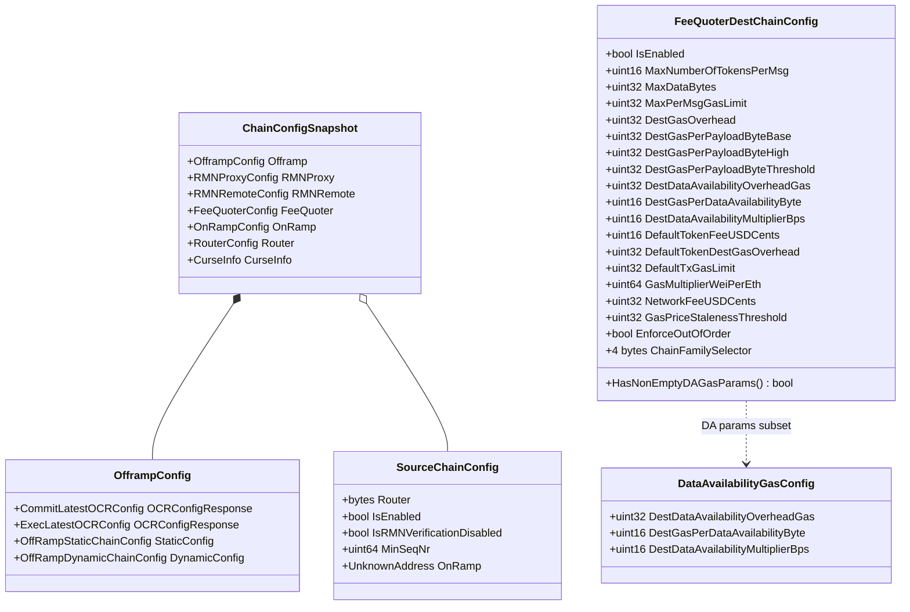

These structs intentionally mirror the on-chain getter return types (`OffRamp.getStaticConfig`, `OnRamp` dynamic config, `FeeQuoter` static/dest-chain config, `RMNRemote.getVersionedConfig`) with `mapstructure`/JSON tags used by the chain-family codecs — e.g. `RMNCurseResponse.CursedSubjects` carries a `mapstructure:"subjects"` tag because the contract return field is named `subjects`.

`FeeQuoterDestChainConfig` drives execute-side gating: token/data/gas limits, destination gas overheads and data-availability params (`HasNonEmptyDAGasParams`), out-of-order execution enforcement, and the `ChainFamilySelector` that identifies the destination family.

---

## RMN (Risk Management Network) types

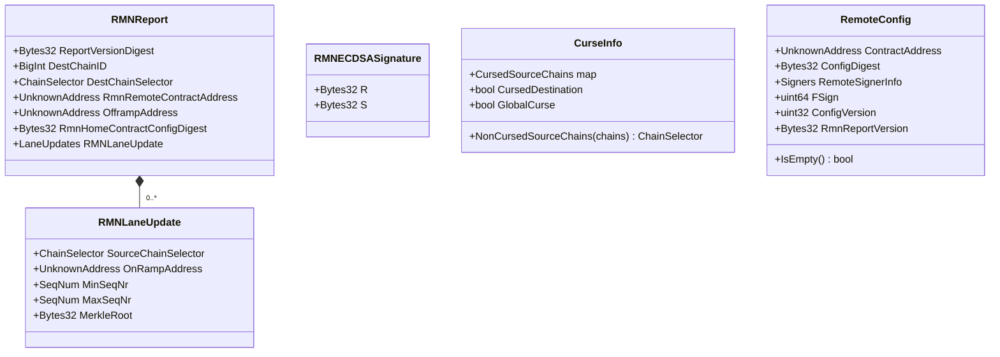

- **`RMNReport`** is the payload signed by RMN nodes and verified on-chain (version digest e.g. `keccak256("RMN_V1_6_ANY2EVM_REPORT")`).
- **`RMNECDSASignature`** holds only `R`/`S`; the `V` recovery value is carried as a bitmap in the top-level commit report.
- **`CurseInfo`** is fetched from RMNRemote: per-source-chain curses, destination curse, or a **global curse** (`GlobalCurseSubject = [16]byte{0: 0x01, 15: 0x01}`, mirroring the RMNRemote.sol constant). `NonCursedSourceChains` filters an input chain list (returns nothing under global curse).
- **`RemoteConfig` / `RemoteSignerInfo`** mirror `RMNRemote.getVersionedConfig`: signer public keys + node indexes, `FSign` (max faulty nodes; F+1 signatures required), config digest/version, and the report version digest. `IsEmpty()` relies on the contract address always being populated by the reader.

---

## End-to-end flows

### Commit plugin round

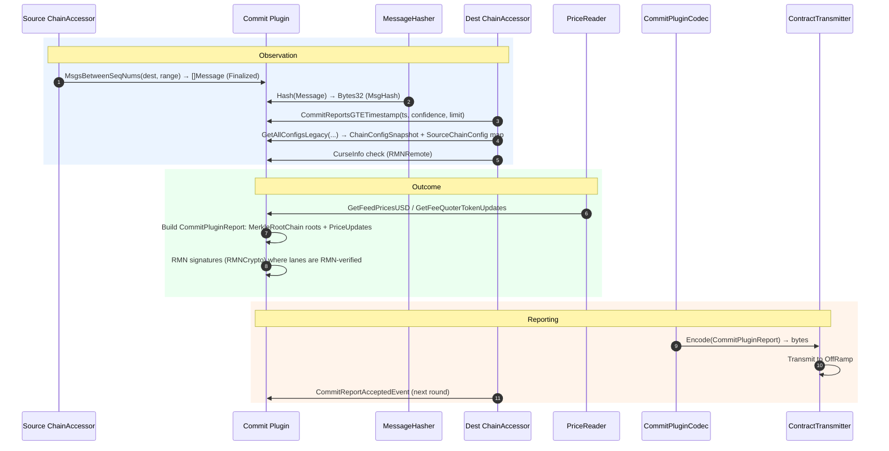

### Execute plugin round

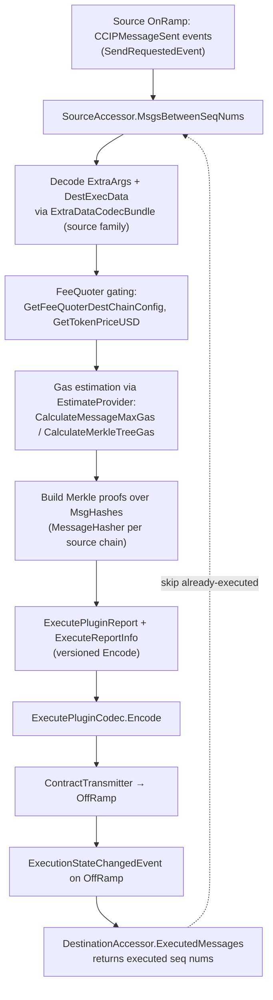

The `ExecutedMessages` → `MsgsBetweenSeqNums` feedback loop is the execute plugin's idempotency mechanism: any sequence number with an `ExecutionStateChanged` event counts as "attempted" and is excluded from new reports.

---

## Cross-module integration

| Consumer | How it uses this module |
|---|---|
| [types-core](../../Shared_Foundation_Libraries___Domain_Types/types-core.md) | `CCIPOCR3CommitProvider.ReportCodec()` returns `ccipocr3.CommitPluginCodec`; `CCIPOCR3ExecuteProvider.ReportCodec()` returns `ccipocr3.ExecutePluginCodec`; both expose `MsgHasher()` returning `ccipocr3.MessageHasher`. This is also why `ChainFeeComponents` is mirrored here (import-cycle avoidance). |
| [loop-grpc-bindings](../../Plugin_Process_Framework_(Loop)/loop-grpc-bindings.md) | Generated gRPC servers (`UnsafeChainAccessorServer`, `UnsafeCommitPluginCodecServer`, `UnsafeMsgHasherServer`, codec/extra-data/token-encoder servers in `loop/internal/pb/ccipocr3`) let these interfaces cross the node↔plugin process boundary transparently. |
| [loop-relayer-services](../../Plugin_Process_Framework_(Loop)/loop-relayer-services.md) | `CCIPProviderServer` serves the OCR3 CCIP provider (chain accessors + codecs + hasher) to the plugin process. |
| [ccip](../ccip.md) (node capability) | Chain-family implementations: `ccipevm`/`ccipsolana` `AddressCodec` & `ExtraDataDecoder`, `ccipsolana` `MessageHasher`, and the OCR3 contract transmitters (`ocrimpls.*ExecCallArgs`) — see [ccip_chain_codecs](../ccip/ccip_chain_codecs.md) and [ccip_ocr_transmitters](../ccip/ccip_ocr_transmitters.md). |
| [types-ccip_ramp_contracts](types-ccip_ramp_contracts.md) | On-chain reader/writer interfaces (`OnRampReader`, `OffRampReader`, `CommitStore`, `PriceRegistry`) that accessors wrap; e.g. `OffRampStaticConfig`/`ExecOnchainConfig` complement the snapshot structs defined here. |
| [ocr](../../Oracle_Engines___Data_Pipelines/ocr.md) | The OCR2/OCR3 oracle engine and reporting-plugin lifecycle that drives the rounds producing/consuming these types. |

---

## Dependency & build notes

- **Module membership:** the package belongs to the `github.com/smartcontractkit/chainlink-common` Go module (`chainlink-common/go.mod`, `go 1.27.1`). All types live in one flat package, so no import-path churn when types are shared between node and plugin builds.
- **External dependency:** `github.com/smartcontractkit/chain-selectors v1.0.104` is used solely by `ExtraDataCodecMap` to resolve `ChainSelector → chain family`.
- **No runtime dependencies:** no database, no services, no logging — the package is safe to import in Wasm/plugin targets and in generated gRPC servers.
- **Wire-format stability:** onchain compatibility is pinned by struct tags that mirror Solidity getter returns (URLs to the contract sources are kept in the comments, e.g. `OffRamp.getSourceChainConfig`, `FeeQuoter.getStaticConfig`, `RMNRemote.getVersionedConfig`); offchain compatibility is pinned by the first-byte version prefix in `CommitReportInfo`/`ExecuteReportInfo` encodings with strict unknown-field rejection.

## Related documentation

- Parent module: [types-ccip](../types-ccip.md) — CCIP shared types entry point
- Sibling: [types-ccip_ramp_contracts](types-ccip_ramp_contracts.md) — ramp contract reader/writer types
- [CCIP Cross-Chain Protocol](../../CCIP_Cross-Chain_Protocol.md) — protocol overview
- [types-core](../../Shared_Foundation_Libraries___Domain_Types/types-core.md) — CCIP OCR3 provider interfaces and shared `ChainFeeComponents`
- [loop-grpc-bindings](../../Plugin_Process_Framework_(Loop)/loop-grpc-bindings.md) — gRPC surfaces for these interfaces
