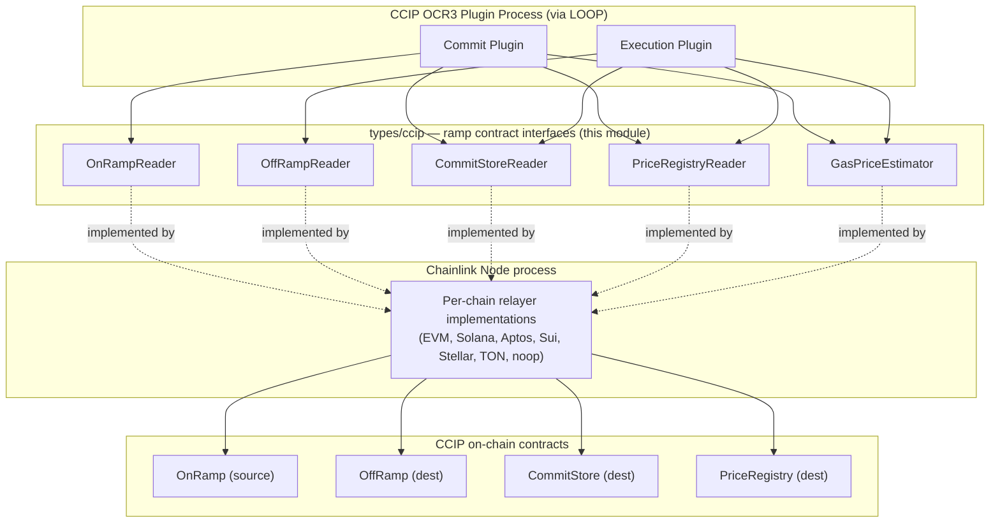
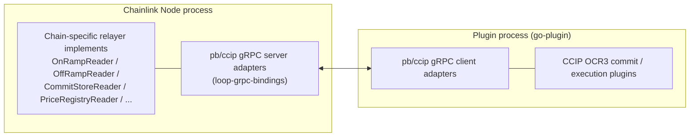

# types-ccip — Ramp Contract Types (`chainlink-common/pkg/types/ccip`)

> **Module path:** `chainlink-common/pkg/types/ccip`
> **Parent:** [types-ccip](../types-ccip.md) · **Area:** [CCIP Cross-Chain Protocol](../../CCIP_Cross-Chain_Protocol.md)

## Introduction

This module defines the **Go-native abstractions of the CCIP on-chain "ramp" contracts**: the `OnRamp` (source chain), `OffRamp` (destination chain), `CommitStore` (destination chain), and `PriceRegistry` (destination chain), plus the `GasPriceEstimator` used to price gas across chains. It exposes these contracts as **reader interfaces and plain data structs**, so that:

- **CCIP OCR3 plugins** (commit and execution) can operate against *any* supported chain and *any* lane contract version that satisfies the interfaces — e.g. `EVM2EVMMessage` is documented as: *"Plugin can operate against any lane version which has a message satisfying this interface."*
- **Chain-specific relayers** (EVM, Solana, Aptos, Sui, Stellar, TON, noop) implement the interfaces natively, hiding chain and contract-version differences behind a stable contract.
- The same interfaces are **mirrored across the LOOP gRPC boundary** so plugins running in separate processes can call them transparently (see [loop-grpc-bindings](../../Plugin_Process_Framework_(Loop)/loop-grpc-bindings.md)).

The module is deliberately **implementation-free and chain-agnostic**: it contains interfaces, config structs, message/price/report DTOs, and a single `Validate()` rule — all encoding/decoding and chain specifics live elsewhere (see [ccip chain codecs](../ccip/ccip_chain_codecs.md) and [ccip OCR transmitters](../ccip/ccip_ocr_transmitters.md)).

---

## 1. Purpose & Core Functionality

### 1.1 Files at a glance

| File | Responsibility |
|---|---|
| `onramp.go` | Source-chain messaging: `OnRampReader`, `OnRampDynamicConfig`, `EVM2EVMMessage`(+`WithTxMeta`), `TokenAmount` |
| `offramp.go` | Destination-chain execution: `OffRampReader`, `ExecReport`, execution state & configs, rate limiter state |
| `commitstore.go` | Commit/blessing layer: `CommitStoreReader`, `CommitStoreReport`(+`WithTxMeta`), commit config & static config |
| `priceregistry.go` | Token & gas price history: `PriceRegistryReader`, `PriceRegistryFactory`, price-update DTOs |
| `gaspriceestimator.go` | Gas pricing facets: `GasPriceEstimator` (Commit/Exec/Common), send-request wrapper with tx metadata |

Sibling files in the same package (not covered by this page) provide additional readers used by the execution provider — e.g. `TokenDataReader` (`ReadTokenData` for attestation bytes of a token transfer) and `PriceGetter` (`FilterConfiguredTokens`, `TokenPricesUSD`), plus the shared `Address`/`Hash` chain-agnostic primitives.

### 1.2 Design principles

1. **Context + error convention.** Every reader method takes a `context.Context` and returns an `error` (documented explicitly on `OffRampReader`).
2. **IoU lifecycle.** All readers embed `io.Closer` — readers are scoped resources created per plugin/job and released on shutdown.
3. **Timestamp + confirmations polling.** Event-history methods (`GetAcceptedCommitReportsGteTimestamp`, `GetTokenPriceUpdatesCreatedAfter`, `GetExecutionStateChangesBetweenSeqNums`, …) take a `time.Time` and a `confirmations` count and **must return results sorted ascending** by timestamp / sequence interval.
4. **Tx-meta enrichment.** Event DTOs wrap the payload with `TxMeta` (Keystone `WorkflowExecutionID` + optional `GasLimit`, defined in [types-core](../../Shared_Foundation_Libraries___Domain_Types/types-core.md)) so upstream consumers can correlate on-chain events with workflow executions and transaction constraints.
5. **Version tolerance.** Encode/decode methods on the readers (`DecodeExecutionReport`/`EncodeExecutionReport`, `DecodeCommitReport`/`EncodeCommitReport`) explicitly error on incompatible contract versions rather than silently misinterpreting bytes.

---

## 2. Architecture & Component Relationships

### 2.1 Where the module sits



The plugins never touch chain SDKs or RPC endpoints directly; they consume only these interfaces. The concrete implementations are produced by the **CCIP provider factories** — `CCIPCommitProvider` and `CCIPExecProvider` (defined in `chainlink-common/pkg/types/provider_ccip.go`, documented in [types-core](../../Shared_Foundation_Libraries___Domain_Types/types-core.md)) — whose `NewOnRampReader`, `NewOffRampReader`, `NewCommitStoreReader`, `NewPriceRegistryReader` methods return this module's interfaces. Those providers are assembled by the CCIP oracle bootstrap in `chainlink/core/capabilities/ccip` (see [ccip](../ccip.md)).

### 2.2 Component reference

The diagram below shows the type-level relationships: interface dependencies, struct embedding of `TxMeta`, and interface inheritance of the estimator facets.

```mermaid
classDiagram
    class OnRampReader {
        <<interface>>
        +Address(ctx) Address
        +GetDynamicConfig(ctx) OnRampDynamicConfig
        +GetSendRequestsBetweenSeqNums(ctx, min, max, finalized) []EVM2EVMMessageWithTxMeta
        +IsSourceChainHealthy(ctx) bool
        +IsSourceCursed(ctx) bool
        +RouterAddress(ctx) Address
        +SourcePriceRegistryAddress(ctx) Address
    }
    class EVM2EVMMessageWithTxMeta {
        +TxMeta
        +EVM2EVMMessage
    }
    class EVM2EVMMessage {
        +SequenceNumber uint64
        +Nonce uint64
        +MessageID Hash
        +SourceChainSelector uint64
        +Sender Address
        +Receiver Address
        +Strict bool
        +FeeTokenAmount *big.Int
        +Data []byte
        +TokenAmounts []TokenAmount
        +SourceTokenData [][]byte
        +Hash Hash
    }
    class OffRampReader {
        <<interface>>
        +DecodeExecutionReport(ctx, bytes) ExecReport
        +EncodeExecutionReport(ctx, ExecReport) []byte
        +GetExecutionState(ctx, seqNo) uint8
        +GetExecutionStateChangesBetweenSeqNums(ctx, min, max, confirmations) []ExecutionStateChangedWithTxMeta
        +CurrentRateLimiterState(ctx) TokenBucketRateLimit
        +ListSenderNonces(ctx, senders) map_Address_uint64
        +GetSourceToDestTokensMapping(ctx) map_Address_Address
        +GetStaticConfig(ctx) OffRampStaticConfig
        +GetTokens(ctx) OffRampTokens
        +OffchainConfig(ctx) ExecOffchainConfig
        +OnchainConfig(ctx) ExecOnchainConfig
        +GasPriceEstimator(ctx) GasPriceEstimatorExec
    }
    class ExecReport {
        +Messages []EVM2EVMMessage
        +OffchainTokenData [][][]byte
        +Proofs []uint8_32
        +ProofFlagBits *big.Int
    }
    class CommitStoreReader {
        <<interface>>
        +DecodeCommitReport(ctx, bytes) CommitStoreReport
        +EncodeCommitReport(ctx, CommitStoreReport) []byte
        +GetAcceptedCommitReportsGteTimestamp(ctx, ts, confirmations) []CommitStoreReportWithTxMeta
        +GetCommitReportMatchingSeqNum(ctx, seqNo, confirmations) []CommitStoreReportWithTxMeta
        +GetExpectedNextSequenceNumber(ctx) uint64
        +IsBlessed(ctx, root) bool
        +IsDestChainHealthy(ctx) bool
        +IsDown(ctx) bool
        +VerifyExecutionReport(ctx, ExecReport) bool
        +GetCommitStoreStaticConfig(ctx) CommitStoreStaticConfig
        +GasPriceEstimator(ctx) GasPriceEstimatorCommit
    }
    class CommitStoreReport {
        +TokenPrices []TokenPrice
        +GasPrices []GasPrice
        +Interval CommitStoreInterval
        +MerkleRoot uint8_32
    }
    class PriceRegistryReader {
        <<interface>>
        +GetTokenPriceUpdatesCreatedAfter(ctx, ts, confirmations) []TokenPriceUpdateWithTxMeta
        +GetGasPriceUpdatesCreatedAfter(ctx, chainSel, ts, confirmations) []GasPriceUpdateWithTxMeta
        +GetAllGasPriceUpdatesCreatedAfter(ctx, ts, confirmations) []GasPriceUpdateWithTxMeta
        +GetTokenPrices(ctx, tokens) []TokenPriceUpdate
        +GetFeeTokens(ctx) []Address
        +GetTokensDecimals(ctx, tokens) []uint8
        +Address(ctx) Address
    }
    class PriceRegistryFactory {
        <<interface>>
        +NewPriceRegistryReader(ctx, addr) PriceRegistryReader
    }
    class GasPriceEstimator {
        <<interface>>
    }
    class GasPriceEstimatorCommit {
        <<interface>>
        +Deviates(ctx, p1, p2) bool
    }
    class GasPriceEstimatorExec {
        <<interface>>
        +EstimateMsgCostUSD(ctx, p, wrappedNative, msg) *big.Int
    }
    class CommonGasPriceEstimator {
        <<interface>>
        +GetGasPrice(ctx) *big.Int
        +DenoteInUSD(ctx, p, wrappedNative) *big.Int
        +Median(ctx, prices) *big.Int
    }

    OnRampReader ..> EVM2EVMMessageWithTxMeta : returns
    EVM2EVMMessageWithTxMeta *-- EVM2EVMMessage : embeds
    EVM2EVMMessageWithTxMeta *-- TxMeta : embeds
    OffRampReader ..> ExecReport : decode/encode
    ExecReport o-- EVM2EVMMessage
    CommitStoreReader ..> CommitStoreReport : decode/encode
    PriceRegistryReader ..> GasPriceUpdateWithTxMeta : returns
    PriceRegistryFactory ..> PriceRegistryReader : creates
    GasPriceEstimator --|> GasPriceEstimatorCommit
    GasPriceEstimator --|> GasPriceEstimatorExec
    GasPriceEstimatorCommit --|> CommonGasPriceEstimator
    GasPriceEstimatorExec --|> CommonGasPriceEstimator
```



### 2.3 The four contract facets

| Facet | Chain | Interface | Key responsibilities |
|---|---|---|---|
| **OnRamp** | Source | `OnRampReader` | Expose dynamic config, fetch finalized send requests (`GetSendRequestsBetweenSeqNums`), report source-chain health and **RMN curse status** (`IsSourceCursed`), surface router & price-registry addresses |
| **CommitStore** | Dest | `CommitStoreReader` | Decode/encode commit reports (Merkle root + gas/token price batches over a `CommitStoreInterval`), query accepted reports, `IsBlessed` (RMN blessing), `VerifyExecutionReport`, health/down checks, expected next sequence number |
| **OffRamp** | Dest | `OffRampReader` | Decode/encode execution reports (`ExecReport`), per-message `ExecutionState`, execution-state change history, rate-limiter state, sender nonces, source→dest token mapping, static/onchain/offchain configs, dest token lists |
| **PriceRegistry** | Dest | `PriceRegistryReader` / `PriceRegistryFactory` | Historical gas & token price updates (timestamp-sorted), latest prices, fee-token list, token decimals; factory instantiates readers at arbitrary addresses |

The **`GasPriceEstimator`** is chain-specific pricing logic injected into both plugins: the *commit* facet (`Deviates`) drives price-deviation-based report triggering, while the *exec* facet (`EstimateMsgCostUSD`) computes message cost in USD (1e18-scaled) for fee validation. The *common* facet supplies `GetGasPrice`, `DenoteInUSD` and `Median` (median per price component for multi-component chains). Both concrete facets are also returned *from* the contracts themselves (`CommitStoreReader.GasPriceEstimator` → commit facet, `OffRampReader.GasPriceEstimator` → exec facet). Note: the code carries an open reconciliation item for this surface (`TODO CCIP-1882`).

### 2.4 Configuration models

The module distinguishes three configuration layers, each exposed by its reader:

| Layer | Type | Notable fields |
|---|---|---|
| **Static** (immutable after deploy) | `CommitStoreStaticConfig`, `OffRampStaticConfig` | Chain selectors, counterpart `OnRamp`/`CommitStore`/`PrevOffRamp` addresses, `ArmProxy` |
| **Onchain** (contract state, plugin-cached) | `ExecOnchainConfig` (with `Validate()`: requires `PermissionLessExecutionThresholdSeconds > 0`; `Router` may be zero), `OnRampDynamicConfig` | Limits (`MaxDataBytes`, `MaxNumberOfTokensPerMsg`, gas overheads, DA multipliers), router & price-registry addresses |
| **Offchain** (OCR config, opaque on-chain) | `CommitOffchainConfig`, `ExecOffchainConfig` | Deviation thresholds & heartbeats, `BatchGasLimit`, `RelativeBoostPerWaitHour`, `RootSnoozeTime`, `MessageVisibilityInterval`, `DestOptimisticConfirmations`, `BatchingStrategyID` |

Readers also expose runtime state: `TokenBucketRateLimit` (rate-limiter tokens/capacity/rate), `OffRampTokens` (source/destination token lists), `MessageExecutionState` enum (`Untouched → InProgress → Success | Failure`), and `CommitStoreInterval` (`Min`/`Max` sequence numbers covered by a commit).

---

## 3. Data Flow — End-to-End Message Lifecycle

This sequence shows where each reader is exercised during a cross-chain message's lifetime. The on-chain write side (transmitting reports) is handled by the OCR contract transmitters described in [ccip OCR transmitters](../ccip/ccip_ocr_transmitters.md).

```mermaid
sequenceDiagram
    autonumber
    participant User as User / Router
    participant ON as OnRampReader (source)
    participant CP as CCIP Commit Plugin
    participant PR as PriceRegistryReader
    participant CS as CommitStoreReader (dest)
    participant RMN as RMN (blessing)
    participant EP as CCIP Execution Plugin
    participant OFF as OffRampReader (dest)

    User->>ON: ccipSend (data + tokens)
    Note over ON: CCIPSendRequested log emitted
    CP->>ON: GetSendRequestsBetweenSeqNums(min, max, finalized)
    CP->>PR: GetGasPriceUpdatesCreatedAfter / GetTokenPriceUpdatesCreatedAfter
    CP->>CS: GasPriceEstimatorCommit.Deviates(p1, p2)
    CP->>CS: commit report (MerkleRoot over seq interval + price updates)
    RMN->>CS: bless report root
    EP->>CS: GetAcceptedCommitReportsGteTimestamp + IsBlessed
    EP->>CS: VerifyExecutionReport(ExecReport)
    EP->>OFF: GetExecutionStateChangesBetweenSeqNums (skip done/failed)
    EP->>OFF: GasPriceEstimatorExec.EstimateMsgCostUSD (fee sufficiency)
    EP->>OFF: execute report (messages encoded via EncodeExecutionReport)
    Note over OFF: ExecutionStateChanged events; CurrentRateLimiterState throttles batch rate
```

Key ordering guarantees encoded in the interfaces:

- `GetAcceptedCommitReportsGteTimestamp` must return reports **sorted by `Interval.Min`/`Interval.Max` ascending**.
- `GetCommitReportMatchingSeqNum` returns **zero or exactly one** report (intervals are non-overlapping).
- Price-history getters return updates **sorted by timestamp ascending**.
- `IsSourceCursed` / `IsBlessed` delegate to the underlying **RMN**, providing the pause/safety mechanism consumed by both plugins.

---

## 4. Process Boundary — LOOP gRPC Mirroring

Plugins run in separate OS processes managed by the LOOP plugin framework. Every reader interface in this module has a corresponding protobuf service and generated client/server pair under `chainlink-common/pkg/loop/internal/pb/ccip/`:

| Go interface (this module) | LOOP pb server |
|---|---|
| `CommitStoreReader` | `pb/ccip/commitstore_grpc.pb.go` → `UnsafeCommitStoreReaderServer` |
| `OnRampReader` | `pb/ccip/onramp_grpc.pb.go` → `UnsafeOnRampReaderServer` |
| `OffRampReader` | `pb/ccip/offramp_grpc.pb.go` → `UnsafeOffRampReaderServer` |
| `PriceRegistryReader` | `pb/ccip/priceregistry_grpc.pb.go` → `UnsafePriceRegistryReaderServer` |
| `GasPriceEstimatorCommit` / `GasPriceEstimatorExec` | `pb/ccip/gaspriceestimator_grpc.pb.go` → `UnsafeGasPriceEstimatorCommitServer` / `UnsafeGasPriceEstimatorExecServer` |
| `PriceGetter` | `pb/ccip/pricegetter_grpc.pb.go` → `UnsafePriceGetterServer` |
| `TokenDataReader` / `TokenPoolBatchedReader` | `pb/ccip/tokendata_grpc.pb.go` / `pb/ccip/tokenpool_grpc.pb.go` |



Details of the marshalling machinery and the `CCIPProviderServer` that wraps the provider factories live in [loop-relayer-services](../../Plugin_Process_Framework_(Loop)/loop-relayer-services.md); the generated bindings are catalogued in [loop-grpc-bindings](../../Plugin_Process_Framework_(Loop)/loop-grpc-bindings.md). The in-process provider server (`chainlink-common/pkg/loop/inprocess_provider_server.go`) lets tests run the same wiring without a subprocess (see [Dev, Test & Simulation Environments](../../Dev,_Test___Simulation_Environments/devenv.md)).

---

## 5. Dependencies

### 5.1 Depends on (inbound dependencies of this module)

| Dependency | Used for | Documentation |
|---|---|---|
| `TxMeta` (`pkg/types/contract_writer.go`) | Embedded in `EVM2EVMMessageWithTxMeta`, `CommitStoreReportWithTxMeta`, `ExecutionStateChangedWithTxMeta`, `TokenPriceUpdateWithTxMeta`, `GasPriceUpdateWithTxMeta` | [types-core](../../Shared_Foundation_Libraries___Domain_Types/types-core.md) |
| `config.Duration` (`pkg/config`) | Offchain-config duration fields (`InflightCacheExpiry`, `RootSnoozeTime`, `MessageVisibilityInterval`) | [config-validation](../../Shared_Foundation_Libraries___Domain_Types/config-validation.md) |
| Chain-agnostic primitives (`Address`, `Hash`, `TokenAmount`) | Address- and hash-typed fields throughout; interchangeable with `ccipocr3.UnknownAddress` (cf. `CCIPProviderArgs.OffRampAddress`) | [types-ccip OCR3 plugin types](types-ccip_ocr3_plugin_types.md) |

### 5.2 Consumed by (outbound dependencies)

| Consumer | Usage | Documentation |
|---|---|---|
| `CCIPCommitProvider` / `CCIPExecProvider` / `CCIPFactoryGenerator` / `CCIPProviderArgs` | Factory interfaces that instantiate the readers per chain & job | [types-core](../../Shared_Foundation_Libraries___Domain_Types/types-core.md) |
| CCIP OCR3 commit & execution plugins | Sole mechanism for reading ramp contract state and messages | [CCIP overview](../../CCIP_Cross-Chain_Protocol.md) |
| CCIP oracle bootstrap & chain codecs | Wire reader factories into `CCIPOracle`; codecs implement the address/extra-data conversions the reader DTOs leave abstract | [ccip](../ccip.md) · [ccip chain codecs](../ccip/ccip_chain_codecs.md) |
| OCR transmitters | Convert `ExecReport`/commit reports into chain-specific calls (e.g. `EVMExecCallArgs`, `SVMExecCallArgs`) | [ccip OCR transmitters](../ccip/ccip_ocr_transmitters.md) |
| LOOP gRPC bindings & provider servers | Cross-process exposure of the reader interfaces | [loop-grpc-bindings](../../Plugin_Process_Framework_(Loop)/loop-grpc-bindings.md) |
| CCIP Deployment Suite | Deploys/upgrades the contracts these readers model (`CommitStoreView`, `ops_onramp.go`, `ops_offramp.go`, …); deployment views must stay aligned with these types | [CCIP Deployment Suite](../../CCIP_Deployment_Suite.md) |
| Integration & smoke tests (e.g. `ccip_cs_rmn_curse_uncurse_test.go`) | Exercise the cursed/un-cursed and health paths exposed by the readers | [integration-tests](../../Dev,_Test___Simulation_Environments/integration-tests.md) |

---

## 6. Extension Guidance

**Adding a new chain family** (implementer's checklist):

1. Implement `OnRampReader`, `OffRampReader`, `CommitStoreReader`, `PriceRegistryReader`, `GasPriceEstimator` (or the facet(s) required) against the chain's ramp contracts, inside the relayer for that family.
2. Reuse the package's chain-agnostic `Address`/`Hash` primitives at the interface boundary; convert to/from chain-native formats internally (chain-native codecs belong in [ccip chain codecs](../ccip/ccip_chain_codecs.md)).
3. Wire the implementations into the family's `CCIPCommitProvider`/`CCIPExecProvider`; if the plugin runs out-of-process, add the matching pb plumbing under `pkg/loop` (see [loop-grpc-bindings](../../Plugin_Process_Framework_(Loop)/loop-grpc-bindings.md)).
4. Preserve the documented contracts: context-aware methods, `io.Closer`, ascending sort order for history getters, and zero-or-one semantics for `GetCommitReportMatchingSeqNum`.

**Changing a contract version / lane:** extend or evolve the message & report structs rather than breaking the reader interfaces; encode/decode methods must fail loudly on incompatible versions, and static/onchain/offchain config types should gain fields with explicit `Validate()` rules where correctness depends on them (see `ExecOnchainConfig.Validate()` as the pattern).

**Historical note:** the `EVM2EVM*` naming reflects the original EVM-to-EVM lanes; the interfaces are now family-agnostic — the names are retained for compatibility with the deployed contract ABI lineage and prior CCIP versions.

---

## Related documentation

- [types-ccip](../types-ccip.md) — parent module: CCIP type definitions overview
- [types-ccip OCR3 plugin types](types-ccip_ocr3_plugin_types.md) — sibling: `ccipocr3` interfaces (codecs, chain accessors, RMN types, plugin report types)
- [ccip](../ccip.md) — oracle bootstrap, chain codecs, RW providers and OCR transmitters
- [types-core](../../Shared_Foundation_Libraries___Domain_Types/types-core.md) — provider factories and `TxMeta`
- [Plugin Process Framework (Loop)](../../Plugin_Process_Framework_(Loop).md) — plugin isolation and gRPC transport
- [CCIP Deployment Suite](../../CCIP_Deployment_Suite.md) — deployment of the contracts modeled here
