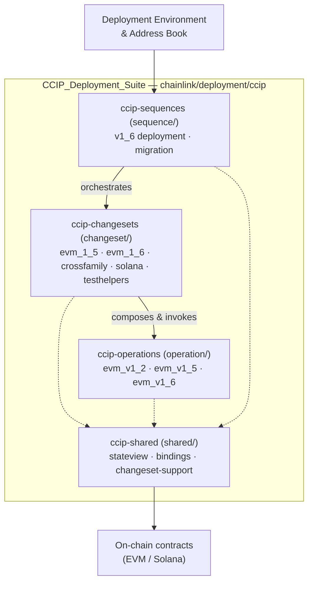
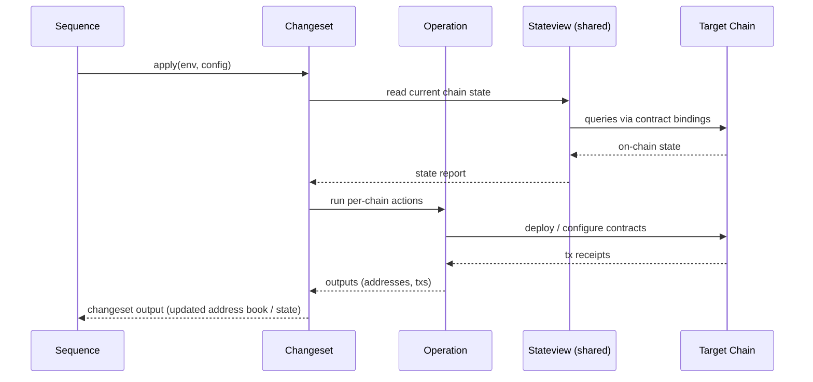

# CCIP Deployment Suite (`chainlink/deployment/ccip`)

## Purpose

The **CCIP Deployment Suite** is the deployment and configuration toolkit for Chainlink's **Cross-Chain Interoperability Protocol (CCIP)**. Built on top of the shared Deployment Framework (environment, address book, contract binding management), it replaces ad-hoc, script-driven rollouts with a **composable, code-first deployment model**:

- **Operations** — the smallest units of work: single-chain, single-purpose actions (deploy or configure one contract), organized per CCIP contract version (v1.2, v1.5, v1.6).
- **Changesets** — atomic, validated state transitions that compose one or more operations across chains, versioned per contract release (EVM 1.5, EVM 1.6) and chain family (EVM, Solana), including cross-family configuration.
- **Sequences** — top-level orchestration that chains multiple changesets into complete workflows, such as a full CCIP v1.6 rollout or a migration from an older contract version.
- **Shared infrastructure** — on-chain state readers (`stateview`), generated contract bindings, and changeset-support utilities used by all layers.

This structure makes CCIP deployments **deterministic, auditable, and testable**: the same changesets run against simulated environments, CI test helpers, and production chains.

## Architecture

The suite is a strict three-layer stack with a shared support layer at the bottom:

At runtime, a sequence drives changesets, which read current state via `stateview`, execute operations through generated bindings, and record results back into the address book:

## Core Components

| Component | Path | Role | Documentation |
|---|---|---|---|
| **ccip-sequences** | `chainlink/deployment/ccip/sequence` | High-level workflows composing changesets: full v1.6 chain deployment and version migration (e.g., v1.5 → v1.6). | [ccip-sequences](<CCIP_Deployment_Suite/ccip-sequences.md>) |
| **ccip-changesets** | `chainlink/deployment/ccip/changeset` | Atomic, validated changesets for EVM 1.5/1.6, cross-family (EVM/Solana) configuration, and test helpers for simulating deployments. | [ccip-changesets](<CCIP_Deployment_Suite/ccip-changesets.md>) |
| **ccip-operations** | `chainlink/deployment/ccip/operation` | Lowest-level single-chain actions, grouped per contract version (v1.2, v1.5, v1.6) — contract deployment and configuration primitives. | [ccip-operations](<CCIP_Deployment_Suite/ccip-operations.md>) |
| **ccip-shared** | `chainlink/deployment/ccip/shared` | Cross-cutting infrastructure: on-chain state viewers (`stateview`), generated contract bindings, and changeset-support utilities. | [ccip-shared](<CCIP_Deployment_Suite/ccip-shared.md>) |

## Position in the Repository

The suite sits alongside the **CRE / Keystone Deployment Suite** and the **Deployment Framework Core** under `chainlink/deployment`, reusing the framework's environment, address book, and binding management. Its changesets' test helpers are consumed by the **Dev, Test & Simulation Environments** (integration tests, system tests) to exercise real deployment flows without touching live chains.