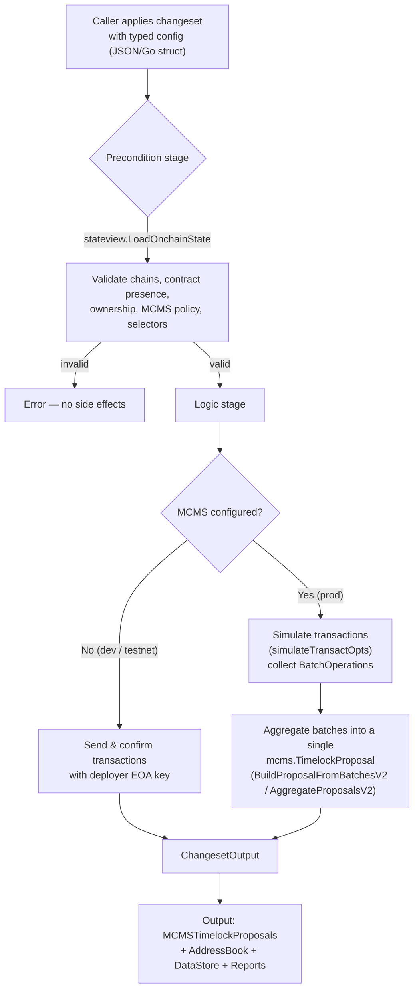
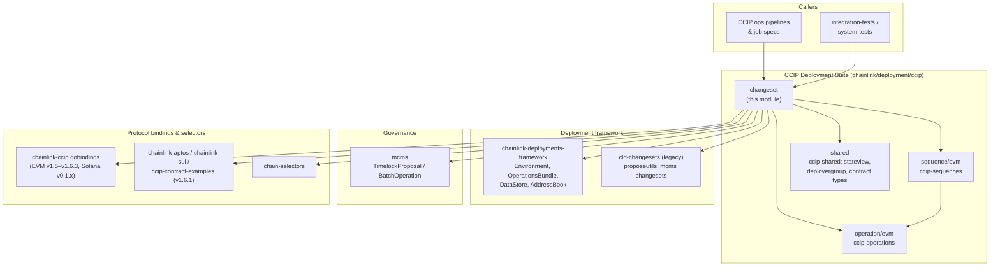
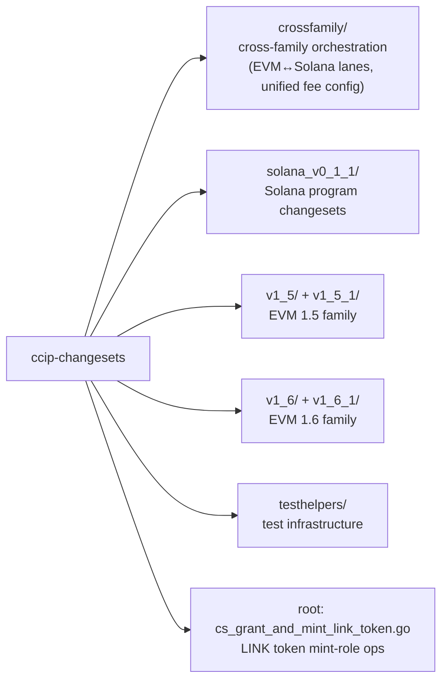

# CCIP Changesets (`ccip-changesets`)

> **Source:** `chainlink/deployment/ccip/changeset/` (Go module `github.com/smartcontractkit/chainlink/deployment`, see [chainlink/deployment/go.mod](../../../repo/chainlink/deployment/go.mod))
> **Parent module:** [CCIP Deployment Suite](../CCIP_Deployment_Suite.md)

---

## 1. Purpose

The `ccip-changesets` module is the library of **changesets** — atomic, reviewable deployment operations used to deploy, configure, wire, upgrade, and operate the CCIP (Cross-Chain Interoperability Protocol) on-chain stack across all supported chain families.

While the CCIP protocol contracts and plugins are defined in [CCIP Cross-Chain Protocol](../CCIP_Cross-Chain_Protocol.md) and the node runtime services in [Node Platform Services](../Node_Platform_Services.md), this module answers the operational question: *how does an existing network state get transformed into a desired state — safely, idempotently, and under governance control?*

Typical operations include:

- **Deploying** contracts and programs (tokens, token pools, FeeQuoter, OnRamps/OffRamps, Routers, CCIPHome, DonIDClaimer, TokenGovernor, proxies).
- **Wiring lanes** between chains (OnRamp destinations, OffRamp sources, Router ramp bindings, FeeQuoter destination configs and prices).
- **Configuring token pools** across families (rate limiters, remote pools/tokens, allow lists, liquidity, CCTP domains).
- **Managing DON lifecycle** on CCIPHome (add DON, set/promote/revoke candidate OCR3 configs, chain reader configs).
- **Governance & security operations** (MCMS timelock proposals, RMN curse/uncurse, ownership transfers, perma-blessed commit stores).
- **Version migrations** (v1.5 → v1.6: FeeQuoter translation, NonceManager previous-ramp registration, test-router-then-main-router cutover).

### What is a changeset?

A changeset is a typed, two-stage function registered with the deployment framework (`cldf.CreateChangeSet(logic, precondition)`):

```go
// Stage 1 — validation: pure checks against fresh on-chain state; no side effects on failure.
func precondition(env cldf.Environment, cfg T) error
// Stage 2 — application: builds and (maybe) executes transactions or emits proposals.
func logic(env cldf.Environment, cfg T) (cldf.ChangesetOutput, error)

var MyChangeset = cldf.CreateChangeSet(logic, precondition)
```

### Design principles

| Principle | How it is realized |
|---|---|
| **Validation-first** | Preconditions load state via `stateview.LoadOnchainState` / `LoadOnchainStateSolana` and validate chain selectors, contract presence, ownership (`ValidateOwnership`), MCMS policy (`EnforceMCMSUsageIfProd`), and cross-field invariants before any transaction is built. |
| **Dual execution modes** | With an `MCMS *cldfproposalutils.TimelockConfig`: transactions are simulated (`cldf.SimTransactOpts`), encoded as `BatchOperation`s and aggregated into a single `mcms.TimelockProposal`. Without MCMS (dev/testnets): transactions are sent and confirmed directly with the deployer EOA key. |
| **Recorded outputs** | Every changeset returns `ChangesetOutput{MCMSTimelockProposals, AddressBook, DataStore, Reports}` so downstream stages and callers can discover addresses, qualified lane refs, and op reports. |
| **Multi-family, multi-version** | EVM (v1.5.x, v1.5.1, v1.6.x, v1.6.1), Solana/SVM (v0.1.0, v0.1.1), Aptos, Sui and TON are first-class. Cross-family changesets route per chain family with explicit version hints. |
| **Idempotency / no-op friendliness** | Already-applied configurations are detected and skipped: `FilterOutExistingDestChainConfigs`, `isChainConfigEqual`, on-chain-derived `IsUpdate` flags (Solana), `IsOCR3ConfigSetOnOffRamp` digest comparison, empty-input early exits. |
| **Planned datastore refs** | Configs declare `PlannedRefs()` up front; `shared.ReserveRefs` / `ValidateAddressRefs(Strict)` reject duplicate or conflicting lane/lookup-table/governor refs **before** any on-chain instruction is sent. |

---

## 2. Architecture

### 2.1 Changeset execution flow



### 2.2 Dependency context — where this module sits



Dependency facts (from [chainlink/deployment/go.mod](../../../repo/chainlink/deployment/go.mod)):

- `github.com/smartcontractkit/chainlink-deployments-framework v0.123.3` — `Environment`, `ChangeSet`/`ChangeSetV2`, `operations` (ops/sequences), `datastore`, `AddressBook`.
- `github.com/smartcontractkit/mcms v0.55.2` + `github.com/smartcontractkit/ccip-owner-contracts` — multi-chain multi-sig timelock proposals.
- `github.com/smartcontractkit/cld-changesets` — legacy `proposeutils` (`BuildProposalFromBatchesV2`, `AggregateProposalsV2`) and ownership validation.
- `github.com/smartcontractkit/chainlink-ccip` (+ `chains/evm`, `chains/solana/gobindings`) — generated CCIP contract bindings; `chainlink-aptos`, `chainlink-sui`, `ccip-contract-examples/chains/evm` (v1.6.1 bindings) for the other families; `chain-selectors` for selector→family resolution.

### 2.3 Internal layout and sub-modules



| Sub-module | Source directories | Documentation |
|---|---|---|
| Cross-family orchestration | `changeset/crossfamily/` | [ccip-changesets_crossfamily.md](ccip-changesets/ccip-changesets_crossfamily.md) — unified EVM+Solana token transfer fee config with version hints; orchestrated EVM↔Solana lane bring-up with proposal aggregation. |
| Solana (SVM) changesets | `changeset/solana_v0_1_1/` | [ccip-changesets_solana.md](ccip-changesets/ccip-changesets_solana.md) — remote-chain onboarding (Router/OffRamp/FeeQuoter), token-pool lifecycle incl. CCTP domains, lookup tables, liquidity and authority management. |
| EVM v1.5 family | `changeset/v1_5/`, `changeset/v1_5_1/` | [ccip-changesets_evm_1_5.md](ccip-changesets/ccip-changesets_evm_1_5.md) — token & pool deployment, multi-family pool configuration, fast-transfer pools, legacy RMN perma-bless, plus their test suites. |
| EVM v1.6 family | `changeset/v1_6/`, `changeset/v1_6_1/` | [ccip-changesets_evm_1_6.md](ccip-changesets/ccip-changesets_evm_1_6.md) — lane wiring & FeeQuoter management, CCIPHome/DON lifecycle, v1.5→v1.6 migration, RMN curse/uncurse, TokenGovernor and proxy ownership. |
| Test helpers | `changeset/testhelpers/` | [ccip-changesets_testhelpers.md](ccip-changesets/ccip-changesets_testhelpers.md) — end-to-end messaging test harness, Sui send/token-pool helpers, Solana receiver counter decoder. |

---

## 3. Changeset catalog

The module is large; the table below groups the major changesets by functional area. Detailed behavior, configs, and validation rules are documented per sub-module (links above).

| Area | Key changesets | Sub-module |
|---|---|---|
| **Lane wiring (EVM)** | `UpdateBidirectionalLanesChangeset` / `UpdateLanesLogic`, `UpdateOnRampsDestsChangeset`, `UpdateOffRampSourcesChangeset`, `UpdateRouterRampsChangeset` | EVM 1.6 |
| **Lane wiring (cross-family)** | `AddEVMAndSolanaLaneChangeset` (sequence + proposal aggregation) | Cross-family |
| **FeeQuoter (EVM)** | `UpdateFeeQuoterPricesChangeset`, `UpdateFeeQuoterDestsChangeset`, `ApplyFeeTokensUpdatesFeeQuoterChangeset`, `UpdateTokenPriceFeedsFeeQuoterChangeset`, `ApplyPremiumMultiplierWeiPerEthUpdatesFeeQuoterChangeset`, `ApplyTokenTransferFeeConfigUpdatesFeeQuoterChangeset(V2)` | EVM 1.6 |
| **Token transfer fees (unified)** | `SetTokenTransferFeeConfig` (EVM v1.5.1/v1.6.0 + Solana v0.1.1 in one proposal, version hints) | Cross-family |
| **CCIPHome / DON lifecycle** | `AddDonAndSetCandidateChangeset`, `SetCandidateChangeset`, `PromoteCandidateChangeset`, `RevokeCandidateChangeset`, `UpdateChainConfigChangeset`, `SetOCR3OffRampChangeset`, `DeployDonIDClaimerChangeset`, `DonIDClaimerOffSetChangeset` | EVM 1.6 |
| **OCR3/DON migration (v1.5→v1.6)** | `InitChainUpgradesChangeset`, `PromoteChainUpgradesChangeset` | EVM 1.6 |
| **Ramp dynamic config / allow lists** | `UpdateOnRampDynamicConfigChangeset`, `UpdateDynamicConfigOffRampChangeset`, `UpdateOnRampAllowListChangeset`, `WithdrawOnRampFeeTokensChangeset`, `UpdateNonceManagersChangeset`, `UpdateWrappedNativeOnRouterChangeset` | EVM 1.6 |
| **RMN** | `PermaBlessCommitStoreChangeset` (legacy v1.5), `RMNCurseChangeset` / `RMNUncurseChangeset` (multi-family emergency actions) | EVM 1.5 / EVM 1.6 |
| **Token pools (EVM)** | `DeployTokenPoolContractsChangeset`, `ConfigureTokenPoolContractsChangeset` (EVM/Solana/Aptos/Sui remote pools, partial rate-limit updates), `ConfigureMultipleTokenPools`, fast-transfer lane config / filler allowlist / fee withdrawal, `UpdateGroupsOnHybridWithExternalMinterTokenPool` | EVM 1.5 / EVM 1.6 |
| **Token pools (Solana)** | `AddTokenPoolAndLookupTable`, `SetupTokenPoolForRemoteChain`, `InitGlobalConfigTokenPoolProgram`, self-served enable/disable, allow-list config, liquidity ops, `TokenPoolOps`, `SyncDomain` (CCTP), multisig & mint-authority management, lookup-table ops | Solana |
| **Tokens & proxies (EVM)** | `DeployBurnMintERC20Transparent` (v1.5), `DeployTransparentUpgradeableProxy` / `SaveProxyAdmin` / admin transfers / role grants (v1.6.1), `TransferProxyAdminOwnership` (v1.6.1), `DeployTokenGovernor` + role & ownership changesets (v1.6) | EVM 1.5 / EVM 1.6 |
| **LINK token ops** | `GrantMintRole`, `GrantMintRoleAndMint` (testnet-only ERC677 mint/role management) | root (below) |
| **Test infrastructure** | `messagingtest.Run` end-to-end message harness, Sui send/token-pool deployment helpers, Solana `ReceiverCounter` decoder | Test helpers |

### Root-level changeset: LINK token grant & mint

`changeset/cs_grant_and_mint_link_token.go` provides two ERC677 LINK-token changesets used in test environments:

- **`GrantMintRole`** (`GrantMintRoleInput` → `GrantMintRoleConfig{ToAddress}`): multi-chain precondition-checked grant of mint/burn roles, delegating to `ccipseqs.GrantMintAndBurnRoleOnERC677Sequence` with MCMS-aware output aggregation (`opsutils.AddEVMCallSequenceToCSOutput`).
- **`GrantMintRoleAndMint`**: a self-contained, **testnet-only** sequence that (1) grants the deployer mint/burn roles if it owns the token, (2) mints `Amount` to `ToAddress` and verifies the balance on-chain, then (3) revokes the mint/burn roles. Precondition hard-fails on any `mainnet` environment — minting on LINK is never allowed in production.

---

## 4. Governance & MCMS integration

Production changes are never executed directly. The standard pattern across the module:

1. **Ownership validation** — preconditions assert the target contracts are owned by the MCMS timelock (`mcmschangesets.ValidateOwnership`, `stateview.ValidateChain`, `EnforceMCMSUsageIfProd`).
2. **Simulation** — transactions are built with `cldf.SimTransactOpts()` so no EOA key is used.
3. **Batching** — each simulated call becomes an `mcmstypes.BatchOperation` via `cldfproposalutils.BatchOperationForChain`, keyed by chain, target address, and contract type (`shared.OnRamp`, `shared.OffRamp`, `shared.FeeQuoter`, `shared.RMN`, ...).
4. **Aggregation** — `proposeutils.BuildProposalFromBatchesV2` / `AggregateProposalsV2` combine per-chain batches (including cross-family EVM + Solana + Aptos states) into **one** `mcms.TimelockProposal` for a single governance vote.
5. **Signers/transmitters verification** — helpers such as `McmsInspectorForChain` validate that proposed calls only touch expected contracts.

## 5. Relation to the rest of the system

- **[ccip-shared](ccip-shared.md)** — foundational building blocks consumed everywhere in this module: `stateview.CCIPOnChainState` / Solana & EVM state views, `deployergroup.DeployerGroup` (uniform EOA-vs-MCMS execution), contract-type constants (`shared.OnRamp`, `shared.BurnMintTokenPool`, ...), address-ref reservation/validation helpers.
- **[ccip-operations](ccip-operations.md)** and **[ccip-sequences](ccip-sequences.md)** — the atomic on-chain operations and their multi-chain compositions; changesets are thin orchestration layers that validate, translate configs, and delegate to these (`operations.ExecuteOperation` / `ExecuteSequence`), then wrap results via `opsutils.AddEVMCallSequenceToCSOutput`.
- **[CCIP Cross-Chain Protocol](../CCIP_Cross-Chain_Protocol.md)** — the contracts/plugins being deployed and configured; changesets bind to their generated gobindings.
- **[Deployment Framework Core & Product Deployments](../Deployment_Framework_Core___Product_Deployments.md)** — the generic `chainlink-deployments-framework` contracts (changeset registration, operations framework, datastore/address book) that this module builds on.
- **[Dev, Test & Simulation Environments](../Dev,_Test___Simulation_Environments.md)** — `integration-tests` and `system-tests` consume `changeset/testhelpers` (messaging harness, Sui/Solana helpers) to run end-to-end CCIP message flows.
- **[Shared Foundation Libraries & Domain Types](../Shared_Foundation_Libraries___Domain_Types.md)** — logging and configuration-validation conventions are shared with the node runtime.

## 6. Operational notes

- **Version routing is explicit.** Cross-family changesets expose `OptionalVersions` / version hints; unsupported combinations are rejected in preconditions rather than guessed at apply time.
- **Datastore qualifiers matter.** Lane refs (`RemoteDest`/`RemoteSource` qualified by remote selector), token-pool lookup tables (qualified by mint/pool-type/metadata), token governors and proxies (qualified by symbol) are validated strictly — overwrites require explicit `ForceDatastoreOverwrite`.
- **Test-router first.** Lane bring-up flows (notably the v1.5→v1.6 migration and EVM↔Solana lanes) enable lanes on test routers, validate, and only then promote to main routers, preserving traffic during upgrades.

---

## Related documentation

- Parent: [CCIP Deployment Suite](../CCIP_Deployment_Suite.md)
- Siblings: [ccip-shared](ccip-shared.md) · [ccip-operations](ccip-operations.md) · [ccip-sequences](ccip-sequences.md)
- Sub-modules: [Cross-family](ccip-changesets/ccip-changesets_crossfamily.md) · [Solana](ccip-changesets/ccip-changesets_solana.md) · [EVM 1.5 family](ccip-changesets/ccip-changesets_evm_1_5.md) · [EVM 1.6 family](ccip-changesets/ccip-changesets_evm_1_6.md) · [Test helpers](ccip-changesets/ccip-changesets_testhelpers.md)
