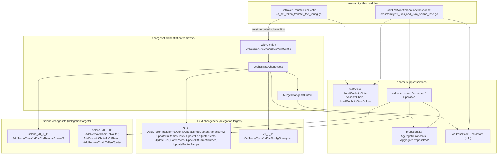
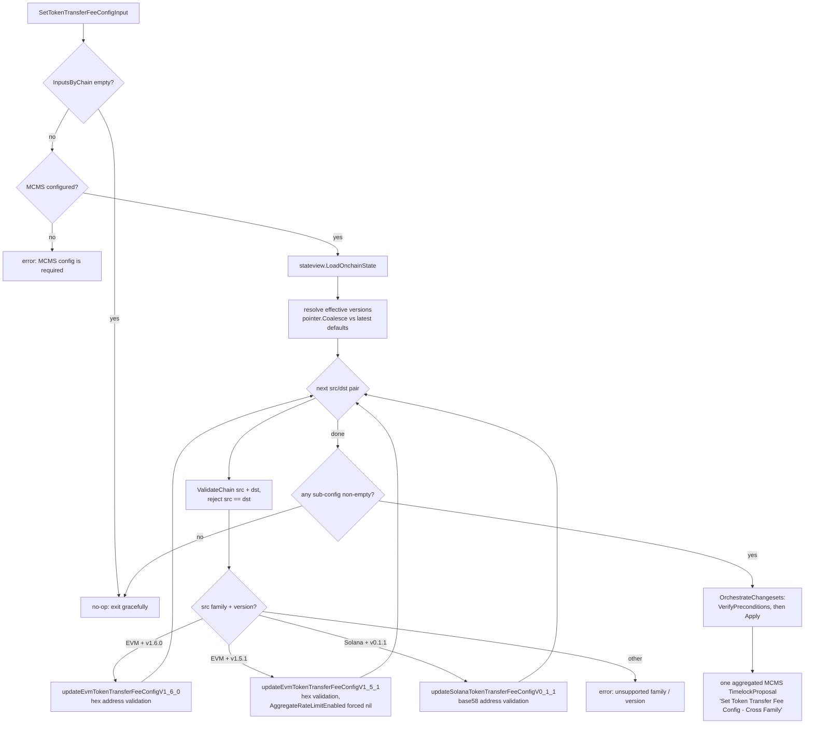
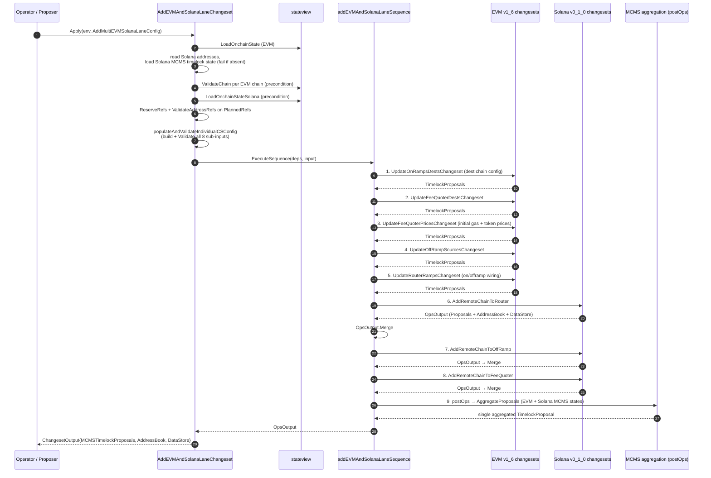
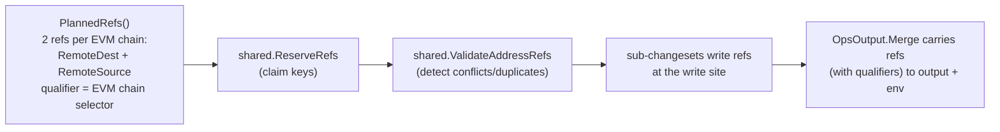

# CCIP Changesets — Cross-Family (`crossfamily`)

> **Module path:** `chainlink/deployment/ccip/changeset/crossfamily`
> **Parent module:** [ccip-changesets](../ccip-changesets.md) · **Grandparent:** [CCIP Deployment Suite](../../CCIP_Deployment_Suite.md)

## 1. Purpose and Scope

The `crossfamily` module contains **cross-chain-family changesets**: deployment operations that must coordinate contract state across *different* chain families (EVM and Solana) — and across contract *versions* within a family — in a single, atomic, governance-friendly operation.

The module exposes two public changesets:

| Changeset | File | Outcome |
|---|---|---|
| `SetTokenTransferFeeConfig` | `cs_set_token_transfer_fee_config.go` | One aggregated MCMS timelock proposal that updates per-token transfer-fee (FeeQuoter) configuration for any mix of EVM (v1.6.0 / v1.5.1) and Solana (v0.1.1) **source chains**. |
| `AddEVMAndSolanaLaneChangeset` | `v1_6/cs_add_evm_solana_lane.go` | One aggregated MCMS timelock proposal that establishes a bidirectional CCIP lane between one or more EVM chains and a Solana chain (OnRamp, OffRamp, Router, FeeQuoter on both sides). |

### Key design principles

1. **Orchestrators, not executors.** Neither changeset contains on-chain logic of its own. They validate a chain-agnostic input, translate it into family/version-specific sub-configurations, and delegate to the existing family changesets ([ccip-changesets_evm_1_6](ccip-changesets_evm_1_6.md), [ccip-changesets_evm_1_5](ccip-changesets_evm_1_5.md), [ccip-changesets_solana](ccip-changesets_solana.md)).
2. **Single-proposal governance.** All MCMS timelock proposals emitted by the sub-changesets are merged and aggregated into **one** `TimelockProposal`, so a cross-family change is approved and executed as a single governance action.
3. **Fail-fast validation.** Input building, chain validation, and preconditions run completely *before* anything is applied; an invalid token address, chain selector, or conflicting lane ref aborts the operation with no partial state.
4. **Unified input schema.** Token addresses are plain strings; they are interpreted per destination family (hex for EVM via `common.IsHexAddress`, base58 for Solana via `solana.PublicKeyFromBase58`).
5. **Version-aware routing.** Per-family contract versions are resolved from optional `VersionHints` with safe defaults (`pointer.Coalesce`), so a single input works against a heterogeneous estate.
6. **No-op friendliness.** Empty inputs, or inputs that produce no sub-changesets, exit both the precondition and apply stages gracefully without error.
7. **Planned refs / idempotency.** The lane changeset declares the datastore address refs it *will* write up front (`PlannedRefs`) and reserves/validates them in preconditions, so a duplicated lane config fails validation before any instruction is sent.

---

## 2. Position in the System

This module is a leaf of the [CCIP Deployment Suite](../../CCIP_Deployment_Suite.md), which layers on top of the shared [Deployment Framework Core](../../Deployment_Framework_Core___Product_Deployments/deployment-common.md) (changeset/operation/sequence primitives, MCMS tooling, address book and datastore).

```
CCIP_Deployment_Suite
└── ccip-changesets            ← parent: changeset registry per family/version
    ├── ccip-changesets_crossfamily   ← THIS MODULE (EVM↔Solana coordination)
    ├── ccip-changesets_evm_1_6       ← delegation target (v1.6.0 EVM changesets)
    ├── ccip-changesets_evm_1_5       ← delegation target (v1.5.1 EVM changesets)
    ├── ccip-changesets_solana        ← delegation target (Solana v0.1.0 / v0.1.1 changesets)
    └── ccip-changesets_testhelpers   ← shared test fixtures (messaging tests, counters)
```

Where the sibling modules provide **family-scoped** changesets (one chain family, one contract version), this module provides the **coordinating layer** that composes them.

---

## 3. Architecture Overview



Two orchestration styles are used, both ending in MCMS proposal aggregation:

- **`SetTokenTransferFeeConfig`** builds an [`OrchestrateChangesetsConfig`](#52-orchestration-framework-cs_orchestrate_changesetsgo) — an ordered list of type-erased `WithConfig` sub-changesets — and hands it to `OrchestrateChangesets` (a `ChangeSetV2[OrchestrateChangesetsConfig]`).
- **`AddEVMAndSolanaLaneChangeset`** executes a `cldf` **operations sequence** (`addEVMAndSolanaLaneSequence`) of nine named operations, each wrapping a family changeset, followed by a `postOps` operation that aggregates all emitted proposals.

---

## 4. Component Reference

### 4.1 `SetTokenTransferFeeConfig` — cross-family FeeQuoter transfer fees

Declared as `cldf.ChangeSetV2[SetTokenTransferFeeConfigInput]` via `cldf.CreateChangeSet(setTokenTransferFeeLogic, setTokenTransferFeePrecondition)`.

#### Input model

| Type | Fields | Notes |
|---|---|---|
| `SetTokenTransferFeeConfigInput` | `InputsByChain map[uint64]map[uint64]TokenTransferFeeConfigArgs` (source → destination → per-token args), `VersionHints *OptionalVersions`, `MCMS *cldfproposalutils.TimelockConfig` | `MCMS` is **required**; the map key order is source selector → destination selector. |
| `TokenTransferFeeConfigArgs` | `TokenAddressToFeeConfig map[string]OptionalTokenTransferFeeConfig` | Token addresses are strings, interpreted per source-chain family. |
| `OptionalTokenTransferFeeConfig` | `DestBytesOverhead *uint32`, `DestGasOverhead *uint32`, `MinFeeUsdCents *uint32`, `MaxFeeUsdCents *uint32`, `DeciBps *uint16`, `IsEnabled *bool` | All-pointer fields mean **partial updates**: only supplied values are changed on chain. |
| `OptionalVersions` | `Solana *string`, `Evm *string` | Per-family version overrides; `nil` falls back to `SetTokenTransferFeeLatestSupportedVersions` (EVM `1.6.0`, Solana `v0.1.1`) via `pointer.Coalesce`. |

#### Processing pipeline

The changeset performs **validation, version routing, and type conversion only** (`buildOrchestrateChangesetsConfig`), then delegates:



Stage-by-stage behavior:

1. **Preconditions** (`setTokenTransferFeePrecondition`) and **apply** (`setTokenTransferFeeLogic`) both start with the same two graceful no-op guards (empty input; no sub-changesets produced), then reuse the *same* `buildOrchestrateChangesetsConfig` — guaranteeing that what was verified is exactly what is applied.
2. **Per source/destination pair**, `stateview.ValidateChain` checks selector validity, family resolution, chain presence in the environment and in loaded state, and MCMS timelock config consistency. A destination equal to the source selector is rejected.
3. **Routing** is a two-level switch on `chainsel.GetSelectorFamily(srcSelector)` × effective version:
   - EVM v1.6.0 → `ApplyTokenTransferFeeConfigUpdatesFeeQuoterChangesetV2` config
   - EVM v1.5.1 → `SetTokenTransferFeeConfigChangeset` config (with `TokensToUseDefaultFeeConfigs: []` and `AggregateRateLimitEnabled: nil` — "the sensible default")
   - Solana v0.1.1 → `AddTokenTransferFeeForRemoteChainV2` config
4. **Address conversion per family**: EVM entries must be hex (`common.IsHexAddress` → `common.HexToAddress`); Solana entries must be base58 (`solana.PublicKeyFromBase58`). Entries with no valid tokens are skipped (`len(configs) > 0` guard), so the corresponding sub-changeset is only appended if it has work to do.
5. **Composition**: non-empty sub-configs are appended, in order, as `ccip_cs_common.CreateGenericChangeSetWithConfig(...)` entries (EVM v1.6.0 → EVM v1.5.1 → Solana v0.1.1) with the shared `MCMS` config and description `"Set Token Transfer Fee Config - Cross Family"`.
6. **Execution** is fully delegated to `OrchestrateChangesets` (§5.2): sequential precondition verification, sequential apply with validated output merging, then aggregation of every emitted timelock proposal into a single MCMS proposal.

Because the entire input is built and validated *before* any sub-changeset applies, an invalid token address anywhere in the map aborts the run before any proposal is produced.

---

### 4.2 `AddEVMAndSolanaLaneChangeset` — EVM ↔ Solana lane establishment

Declared as `cldf.CreateChangeSet(addEVMAndSolanaLaneLogic, addEVMSolanaPreconditions)`. Although it lives under `crossfamily/v1_6/` (the EVM side is v1.6), it deliberately drives the **Solana v0.1.0** changesets (`changeset/solana_v0_1_0` import alias `solana`) — note this differs from `SetTokenTransferFeeConfig`, which uses `solana_v0_1_1`.

#### Input model

| Type | Fields | Notes |
|---|---|---|
| `AddMultiEVMSolanaLaneConfig` | `Configs []AddRemoteChainE2EConfig`, `SolanaChainSelector uint64`, `MCMSConfig *cldfproposalutils.TimelockConfig` | One Solana chain, many EVM chains. `MCMSConfig` optional (test-router mode). |
| `AddRemoteChainE2EConfig` | `EVMChainSelector`, `IsTestRouter`, `EVMOnRampAllowListEnabled`, `EVMFeeQuoterDestChainInput fee_quoter.FeeQuoterDestChainConfig` (chainlink-ccip gobindings v1.6.3), `InitialSolanaGasPriceForEVMFeeQuoter *big.Int`, `InitialEVMTokenPricesForEVMFeeQuoter map[common.Address]*big.Int`, `IsRMNVerificationDisabledOnEVMOffRamp`, `SolanaRouterConfig`, `SolanaOffRampConfig`, `SolanaFeeQuoterConfig` | Per-EVM-chain lane parameters for both directions. |
| `Dependencies` | `Env`, `EVMMCMSState map[uint64]evmstate.MCMSWithTimelockState`, `SolanaMCMSState map[uint64]solstate.MCMSWithTimelockState`, `changesetInput csInputs` | Injected into the operations sequence. |
| `OpsOutput` | `Proposals []mcmslib.TimelockProposal`, `AddressBook cldf.AddressBook`, `DataStore datastore.MutableDataStore` | Merged across sub-operations via `OpsOutput.Merge`. |

#### Preconditions (`addEVMSolanaPreconditions`)

1. Load EVM on-chain state (`stateview.LoadOnchainState`).
2. For each configured EVM chain: `stateview.ValidateChain(env, evmState, selector, timelockConfig)`.
3. Confirm the Solana chain exists **in the environment** (`env.BlockChains.SolanaChains()`) **and in the loaded state** (`stateview.LoadOnchainStateSolana` → `state.SolChains`).
4. **Reserve and validate planned refs**: `shared.ReserveRefs(input.PlannedRefs())` then `shared.ValidateAddressRefs(env, input.PlannedRefs())`. `PlannedRefs` computes, per EVM chain, two datastore address refs on the Solana chain — `RemoteDest` and `RemoteSource`, qualified by the remote EVM chain selector (string form), version `1.0.0`. Declaring these up front means a **duplicated lane config fails validation before any instruction is sent**.

#### Execution flow (`addEVMAndSolanaLaneLogic` + `addEVMAndSolanaLaneSequence`)



Highlights:

- **Input fan-out** (`populateAndValidateIndividualCSConfig`): each `AddRemoteChainE2EConfig` is expanded into eight per-contract sub-inputs — EVM OnRamp dest (enable, test router, allow-list), EVM FeeQuoter dest-chain config, EVM FeeQuoter prices (Solana gas price + EVM token prices), EVM OffRamp source (enable, test router, RMN-verification flag), EVM Router ramps (both directions), and the three Solana configs. Every sub-input is then `.Validate(...)`-ed before execution. (The test router case clears `MCMS` on the EVM router input since the test router is owned by the deployer key.)
- **Proposal aggregation is split**: the five EVM sub-operations return raw `[]mcmslib.TimelockProposal` appended to `finalOutput.Proposals`; the three Solana sub-operations return a full `OpsOutput` merged via `OpsOutput.Merge`. The `postOps` operation then collapses everything into one proposal using the **legacy** `proposeutils.AggregateProposals` against `deps.EVMMCMSState` + `deps.SolanaMCMSState` (a `nolint:staticcheck // SA1019` note tracks the pending `AggregateProposalsV2` migration — see §5.2 for the framework-level V2 equivalent).
- **DataStore lane refs**: the Solana sub-changesets record `RemoteDest`/`RemoteSource` refs, qualified by the remote EVM chain selector, at the write site. These ride through `OpsOutput.DataStore` to the final changeset output rather than being re-derived from the address book, which cannot carry qualifiers. `OpsOutput.Merge` merges the address book (also publishing to `env.ExistingAddresses`), merges the data store (also publishing refs into `env.DataStore` when it is writable, warning when it is not), and appends proposals.
- **Result**: `cldf.ChangesetOutput{MCMSTimelockProposals, AddressBook, DataStore}` — one aggregated proposal plus a fully merged registry of what the lane operation touched.

---

## 5. Cross-Cutting Mechanisms

### 5.1 State validation — `stateview`

Both changesets validate every involved chain before touching anything, via `stateview` (`chainlink/deployment/ccip/shared/stateview`):

- `LoadOnchainState(env)` / `LoadOnchainStateSolana(env)` reconstruct `CCIPOnChainState` from the environment's datastore address refs (active, versioned, non-superseded refs only).
- `ValidateChain(env, state, chainSel, mcmsCfg)` verifies selector validity, family resolution (`chain-selectors`), chain presence in both the environment and loaded state, and — when an MCMS config is supplied — that the config matches the on-chain MCMS/timelook contracts for that family (EVM, Solana, Aptos, TON).

### 5.2 Orchestration framework — `cs_orchestrate_changesets.go`

`SetTokenTransferFeeConfig` is built on the framework-level orchestrator in `chainlink/deployment/ccip/changeset`:

| Element | Role |
|---|---|
| `OrchestrateChangesets` | A `ChangeSetV2[OrchestrateChangesetsConfig]`. Logic: load state → apply each sub-changeset in order → merge outputs via `MergeChangesetOutput` → aggregate all `MCMSTimelockProposals` into one via `proposeutils.AggregateProposalsV2` (MCMS states resolved for EVM / Solana / Aptos / TON) → return output with only the aggregated proposal. Precondition: non-empty description, non-nil MCMS, then per-sub-changeset precondition verification. |
| `WithConfig{Config any, ChangeSet cldf.ChangeSetV2[any]}` | Ordered (changeset, config) pairs; applied in slice order. |
| `CreateGenericChangeSetWithConfig[C]` | Type-erases a typed changeset so heterogeneous family changesets can share one orchestration list. |
| `MergeChangesetOutput` | **Plan-validated** merge of address book and data store into the destination *and* the environment (so later sub-changesets can resolve contracts deployed by earlier ones). Rejects, before any mutation: an address recorded with a different type/version, refs without a version, and refs with an empty address (unfilled reservations). |
| `OrchestrateChangesetsConfig.MCMSOverridesForEVMChains` | Optional per-chain MCMS contract overrides resolved by `EVMMCMSStateByChain`. |

Note the aggregation-version asymmetry: the framework uses `AggregateProposalsV2`, while the lane changeset's `postOps` still uses the legacy `AggregateProposals` (tracked for migration via a `nolint:staticcheck // SA1019` annotation).

### 5.3 MCMS / governance

All on-chain mutations are expressed as **MCMS timelock proposals** rather than direct transactions, so cross-family changes are batched into a single governance approval. `TimelockConfig` (from `chainlink-deployments-framework/engine/cld/mcms/proposalutils`) is threaded unchanged through every sub-changeset. EVM MCMS contract state comes from `evmstate.MCMSWithTimelockState` (cld-changesets legacy), Solana state from `solstate.MCMSWithTimelockState` — loaded in `addEVMAndSolanaLaneLogic` via `solstate.MaybeLoadMCMSWithTimelockChainState` (hard failure if absent).

### 5.4 Datastore refs and idempotency

The deployment datastore (`chainlink-deployments-framework/datastore`) tracks qualified contract refs. The lane changeset is the reference implementation of the "planned refs" pattern:



This makes re-running a lane config safe-by-default: the second run collides with the reserved refs during **preconditions**, before any instruction is generated.

### 5.5 Address-format handling

| Family | Token address format | Validation / conversion |
|---|---|---|
| EVM | hex string | `common.IsHexAddress` → `common.HexToAddress` |
| Solana | base58 string | `solana.PublicKeyFromBase58` |

Rejecting wrong-format addresses early (in the routing helpers) keeps the underlying family changesets' typed address maps clean.

---

## 6. Dependencies

### Internal

| Dependency | Used for |
|---|---|
| [ccip-changesets_evm_1_6](ccip-changesets_evm_1_6.md) (`v1_6`) | FeeQuoter transfer-fee V2 changeset; lane sub-changesets (`UpdateOnRampsDests`, `UpdateFeeQuoterDests`, `UpdateFeeQuoterPrices`, `UpdateOffRampSources`, `UpdateRouterRamps`). |
| [ccip-changesets_evm_1_5](ccip-changesets_evm_1_5.md) (`v1_5_1`) | `SetTokenTransferFeeConfigChangeset`. |
| [ccip-changesets_solana](ccip-changesets_solana.md) (`solana_v0_1_1`, `solana_v0_1_0`) | `AddTokenTransferFeeForRemoteChainV2`; lane sub-changesets (`AddRemoteChainToRouter`, `AddRemoteChainToOffRamp`, `AddRemoteChainToFeeQuoter`). |
| `deployment/ccip/changeset` (framework file `cs_orchestrate_changesets.go`) | `OrchestrateChangesets`, `WithConfig`, `CreateGenericChangeSetWithConfig`, `MergeChangesetOutput`. |
| `deployment/ccip/shared` + `shared/stateview` | `ValidateChain`, `LoadOnchainState(Solana)`, `ReserveRefs`, `ValidateAddressRefs`, `RemoteDest`/`RemoteSource` contract types. |
| `deployment/ccip/internal/pointer` | `Coalesce` for version-hint defaults. |
| [ccip-changesets_testhelpers](ccip-changesets_testhelpers.md) | Messaging test harnesses used to exercise lanes end-to-end. |
| Related suites | [ccip-operations](../ccip-operations.md) (per-contract ops such as `ops_fee_quoter.go`), [ccip-sequences](../ccip-sequences.md) (e.g. `seq_fee_quoter.go`), [ccip-shared](../ccip-shared.md) (bindings). |

### External (module `chainlink/deployment/go.mod`)

The module compiles within the `chainlink/deployment` Go module, whose `go.mod` pins the following relevant dependencies:

| Dependency | Role |
|---|---|
| `github.com/smartcontractkit/chainlink-deployments-framework v0.123.3` | `cldf` changeset/operation/sequence primitives, `datastore`, MCMS `proposalutils`. |
| `github.com/smartcontractkit/mcms` | `TimelockProposal` type. |
| `github.com/smartcontractkit/ccip-owner-contracts` | MCMS gethwrappers (used by orchestration state loading). |
| `github.com/smartcontractkit/cld-changesets` (legacy) | `proposeutils.AggregateProposals`, `evmstate`, `solstate` MCMS state types. |
| `github.com/smartcontractkit/chain-selectors` | `GetSelectorFamily` family routing. |
| `github.com/smartcontractkit/chainlink-ccip/chains/evm/gobindings` (v1.6.3) | `fee_quoter.FeeQuoterDestChainConfig` input type. |
| `github.com/ethereum/go-ethereum` / `github.com/gagliardetto/solana-go` | EVM hex addresses / Solana base58 keys. |

---

## 7. Testing

- `crossfamily/cs_set_token_transfer_fee_config_test.go` — routing, validation, and address-format coverage for the fee-config changeset (family/version dispatch, hex vs base58 handling, no-op behavior).
- `crossfamily/v1_6/cs_add_evm_solana_lane_test.go` — lane-establishment coverage (input fan-out, ref planning, proposal aggregation).
- Cross-family lanes are additionally exercised end-to-end through [ccip-changesets_testhelpers](ccip-changesets_testhelpers.md) messaging harnesses (e.g. `messagingtest.TestCaseOutput`) and the CCIP smoke suites ([integration-tests](../../Dev,_Test___Simulation_Environments/integration-tests.md)).

---

## 8. Extension Guide

**Adding support for a new EVM/Solana contract version in `SetTokenTransferFeeConfig`:**
1. Add a versioned helper `update<TokenTransferFeeConfig><Version>` that converts `TokenTransferFeeConfigArgs` into the version-specific config type (mirroring the address-format rules of §5.5).
2. Extend the version `switch` inside `buildOrchestrateChangesetsConfig` and the `default` error message.
3. Extend `OptionalVersions` handling and `SetTokenTransferFeeLatestSupportedVersions` if the new version becomes the default.
4. Append the new sub-changeset with `CreateGenericChangeSetWithConfig` in the composition block (order matters: sub-changesets apply sequentially).

**Adding a new cross-family changeset:**
- For pure *configuration* changes across families, prefer the `SetTokenTransferFeeConfig` pattern: chain-agnostic string-keyed input → per-family routing helpers → `OrchestrateChangesets` via `WithConfig` entries sharing one `TimelockConfig`.
- For *multi-step* mutations that must interleave deployments and ref publication, prefer the lane pattern: `operations.NewSequence` + named `operations.NewOperation` wrappers around existing changesets, an `OpsOutput` type with a `Merge` that publishes to the environment, planned-refs reservation in preconditions, and a final aggregation op.

---

## 9. Related Documentation

- [ccip-changesets](../ccip-changesets.md) — parent module: the full changeset registry and how it is wired into CCIP deployment pipelines.
- [ccip-changesets_evm_1_6](ccip-changesets_evm_1_6.md) / [ccip-changesets_evm_1_5](ccip-changesets_evm_1_5.md) / [ccip-changesets_solana](ccip-changesets_solana.md) — the family/version changesets this module delegates to.
- [ccip-operations](../ccip-operations.md) and [ccip-sequences](../ccip-sequences.md) — the per-contract operations and sequences underlying the delegated changesets.
- [ccip-shared](../ccip-shared.md) — shared bindings, deployer groups, and token utilities.
- [CCIP Cross-Chain Protocol](../../CCIP_Cross-Chain_Protocol.md) — the on-chain protocol (OnRamp/OffRamp/FeeQuoter/RMN) these deployments configure.
- [Deployment Framework Core](../../Deployment_Framework_Core___Product_Deployments/deployment-common.md) — changeset/operation/MCMS primitives inherited by this suite.
