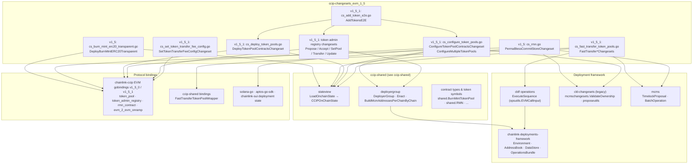
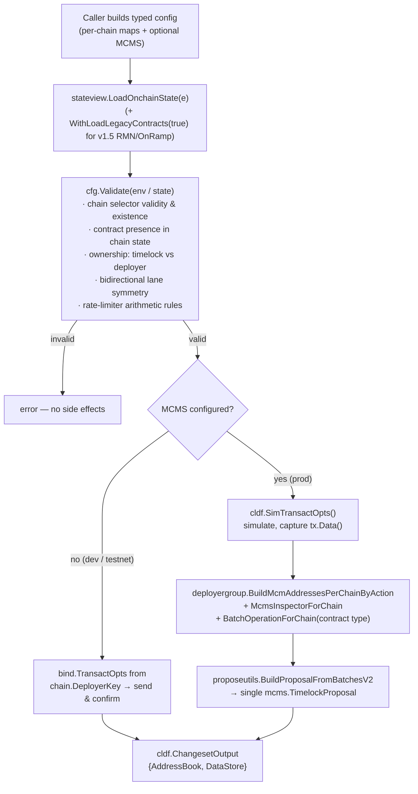
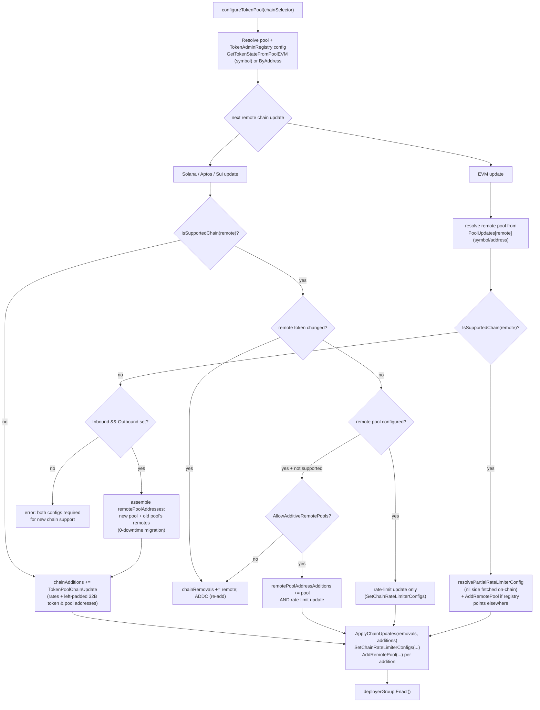
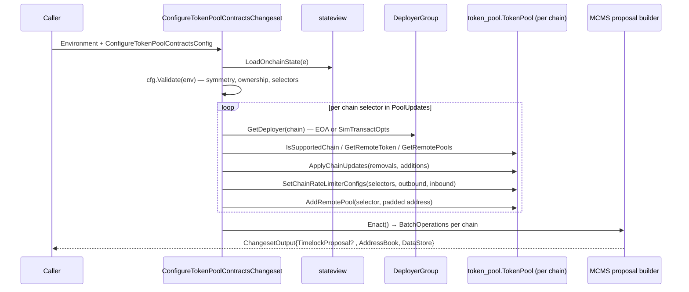

# CCIP Changesets — EVM 1.5 Family (`v1_5` / `v1_5_1`)

> **Module path:** `chainlink/deployment/ccip/changeset/v1_5` + `chainlink/deployment/ccip/changeset/v1_5_1` (Go module `github.com/smartcontractkit/chainlink/deployment`, see [chainlink/deployment/go.mod](../../../repo/chainlink/deployment/go.mod))
> **Parent module:** [ccip-changesets](../ccip-changesets.md) · **Grandparent:** [CCIP Deployment Suite](../../CCIP_Deployment_Suite.md)

## 1. Purpose and Scope

The `ccip-changesets_evm_1_5` module implements the **EVM v1.5-family deployment changesets** for CCIP. It is the workhorse for the *token layer* of a v1.5 deployment — deploying tokens and token pools, wiring pools across chains and chain families, administering the TokenAdminRegistry, configuring per-token transfer fees on v1.5 OnRamps, and performing RMN governance actions on the legacy v1.5 stack — plus the **fast-transfer token pool** operations (lane configs, filler allowlists, fee withdrawals).

Every exported entry point satisfies the framework contract `cldf.ChangeSet[T]` (or `ChangeSetV2[T]`):

```go
func(e cldf.Environment, cfg T) (cldf.ChangesetOutput, error)
```

and follows the common **validate → build transactions → execute (EOA) or propose (MCMS)** pipeline described in [ccip-changesets](../ccip-changesets.md).

### Module at a glance

| Area | Package / File | Key entry points |
|---|---|---|
| Transparent burn-mint token deployment | `v1_5/cs_burn_mint_erc20_transparent.go` | `DeployBurnMintERC20Transparent` (`BurnMintERC20TransparentChangesetConfig`) |
| RMN governance (legacy v1.5) | `v1_5/cs_rmn.go` | `PermaBlessCommitStoreChangeset` (`PermaBlessCommitStoreConfig`, `PermaBlessConfigPerSourceChain`) |
| Token pool deployment | `v1_5_1/cs_deploy_token_pools.go` | `DeployTokenPoolContractsChangeset` (`DeployTokenPoolContractsConfig`, `DeployTokenPoolInput`) |
| Token pool configuration (EVM/Solana/Aptos/Sui) | `v1_5_1/cs_configure_token_pools.go` | `ConfigureTokenPoolContractsChangeset`, `ConfigureMultipleTokenPools` (`TokenPoolConfig`, `RateLimiterConfig`, `SolChainUpdate`, `AptosChainUpdate`, `SuiChainUpdate`) |
| Fast-transfer token pool ops | `v1_5_1/cs_fast_transfer_token_pools.go` | `FastTransferUpdateLaneConfigChangeset`, `FastTransferFillerAllowlistChangeset`, `FastTransferWithdrawPoolFeesChangeset` |
| TokenAdminRegistry wiring | `v1_5_1/cs_propose_admin_role.go`, `cs_accept_admin_role.go`, `cs_set_pool.go`, `cs_transfer_admin_role.go`, `cs_update_admin_role.go` | `ProposeAdminRoleChangeset`, `AcceptAdminRoleChangeset`, `SetPoolChangeset` (shared `TokenAdminRegistryChangesetConfig`) |
| Per-token transfer fees on v1.5 OnRamps | `v1_5_1/cs_set_token_transfer_fee_config.go` | `SetTokenTransferFeeConfigChangeset` (delegation target of the cross-family orchestrator) |
| Composite "add token" flow | `v1_5_1/cs_add_token_e2e.go` | `AddTokensE2E` |
| Token pool factory / USDC pools / USDC domain sync / hybrid groups | `cs_deploy_token_pool_factory.go`, `cs_deploy_usdc_token_pools.go`, `cs_sync_usdc_domains_with_chains.go`, `cs_hybrid_token_pool_groups.go` | — |
| Test suites | `cs_configure_token_pools_test.go`, `cs_deploy_token_pools_test.go`, + per-file `*_test.go` | see [§4.7](#47-test-suite) |

---

## 2. Position in the System

```
CCIP_Deployment_Suite
└── ccip-changesets                    ← parent: changeset registry per family/version
    ├── ccip-changesets_crossfamily    ← composes this module (SetTokenTransferFeeConfig routes EVM v1.5.1 work here)
    ├── ccip-changesets_evm_1_5        ← THIS MODULE (EVM v1.5 / v1.5.1 changesets)
    ├── ccip-changesets_evm_1_6        ← successor family (FeeQuoter, CCIPHome, bidirectional lanes)
    ├── ccip-changesets_solana         ← Solana counterparts configured *by* this module (remote pools/rate limits)
    └── ccip-changesets_testhelpers    ← shared fixtures used by this module's tests
```

### 2.1 Component relationships



### 2.2 Dependency facts

From [chainlink/deployment/go.mod](../../../repo/chainlink/deployment/go.mod) (module `github.com/smartcontractkit/chainlink/deployment`):

- `github.com/smartcontractkit/chainlink-deployments-framework v0.123.3` — `Environment`, `ChangeSet`/`CreateChangeSet`, `AddressBook`, `datastore`, `operations.ExecuteSequence`.
- `github.com/smartcontractkit/mcms v0.55.2` + `ccip-owner-contracts v0.2.1` — timelock proposals and ownership checks.
- `github.com/smartcontractkit/cld-changesets v0.9.1-...` — legacy `mcms/changesets` (`ValidateOwnership`) and `mcms/proposeutils` (`BuildProposalFromBatchesV2`, `AggregateProposals`).
- `github.com/smartcontractkit/chainlink-ccip/chains/evm` — generated gobindings `v1_5_0`/`v1_5_1` (`token_pool.TokenPool`, `token_admin_registry`, `rmn_contract.RMNContract`, `evm_2_evm_onramp`).
- `github.com/smartcontractkit/chainlink-evm` — shared token wrappers (`burn_mint_erc20_transparent`, `burn_mint_erc677`).
- `gagliardetto/solana-go`, `aptos-labs/aptos-go-sdk`, `chainlink-sui/deployment` — remote pool/PDA resolution for Solana, Aptos and Sui chain updates.
- `Masterminds/semver/v3` — pool version keys used throughout the state maps.

The contract interfaces being configured are documented in [CCIP Cross-Chain Protocol](../../CCIP_Cross-Chain_Protocol.md) (ramp/registry contracts: [types-ccip_ramp_contracts](../../CCIP_Cross-Chain_Protocol/types-ccip/types-ccip_ramp_contracts.md); OCR3 plugin types used by the RMN/commit layer: [types-ccip_ocr3_plugin_types](../../CCIP_Cross-Chain_Protocol/types-ccip/types-ccip_ocr3_plugin_types.md)).

---

## 3. Common Execution Model

All changesets in this module share one pipeline. The two execution modes (direct EOA vs. MCMS timelock) are selected per changeset by the presence of the `MCMS *cldfproposalutils.TimelockConfig` field in the config.



Invariants observed across the module:

1. **State-first validation.** Configs are validated against fresh on-chain state (`stateview.LoadOnchainState`, see [ccip-shared](../ccip-shared.md)); nothing is sent until every cross-field invariant holds.
2. **Ownership gating.** `mcmschangesets.ValidateOwnership(ctx, useMcms, deployer, timelock, contract)` guarantees the actor that will sign (deployer EOA or timelock) actually owns the target contract. Some configs allow opting out (`SkipOwnershipValidation`) for e2e flows where the pool is not yet timelock-owned.
3. **Dual execution modes.** `DeployerGroup` resolves the `TransactOpts` per chain and `Enact()` either confirms transactions or aggregates `BatchOperation`s into proposals — changeset logic stays mode-agnostic.
4. **Recorded outputs.** Deployed contracts are returned in `ChangesetOutput.AddressBook` + `DataStore` with typed contract versions (`deployment.Version1_5_0`, `Version1_5_1`, ...), enabling idempotency checks and downstream discovery.
5. **One proposal per operation.** Multi-token / multi-chain flows aggregate every emitted `TimelockProposal` into a single governance action.

---

## 4. Component Reference

### 4.1 `v1_5` — Transparent burn-mint token deployment (`cs_burn_mint_erc20_transparent.go`)

Registered as `cldf.ChangeSet[BurnMintERC20TransparentChangesetConfig]`.

| Type | Fields | Meaning |
|---|---|---|
| `BurnMintERC20Transparent` | `MaxSupply *big.Int`, `PreMint *big.Int` | Token economics for one token on one chain. |
| `BurnMintERC20TransparentChangesetConfig` | `Tokens map[uint64]map[string]BurnMintERC20Transparent` | Chain selector → token symbol → config. |

**Validation** (`Validate`): loads on-chain state, defaults `PreMint` to zero, requires `MaxSupply`, verifies the chain selector exists in the environment and in state, and rejects re-deployment when `chainState.BurnMintERC20Transparent[symbol]` already exists.

**Apply** (`DeployBurnMintERC20Transparent`): for each `(chain, token)` pair, deploys via `shared.DeployContractAndRecord` with `cldf.NewTypeAndVersion(shared.BurnMintERC20TransparentToken, deployment.Version1_5_0)` and the `burn_mint_erc20_transparent.DeployBurnMintERC20Transparent` binding, returning a fresh `MemoryAddressBook` + `MemoryDataStore` (deployer-key mode only — no MCMS path; production tokens are governed via the proxy/admin changesets of the v1.6 family).

> Note: `Validate` mutates the inner map to default `PreMint`; the changeset copies semantics are safe because the config is validated immediately before use.

### 4.2 `v1_5` — RMN perma-bless (`cs_rmn.go`)

Registered as `cldf.ChangeSet[PermaBlessCommitStoreConfig]`. Perma-blessed commit stores are *automatically blessed* on the legacy v1.5 RMN — this changeset adds to or removes from that list.

**Input model**

| Type | Fields | Meaning |
|---|---|---|
| `PermaBlessConfigPerSourceChain` | `SourceChainSelector uint64`, `PermaBless bool` | `true` → add the commit store to the perma-blessed list; `false` → remove it. |
| `PermaBlessCommitStoreConfigPerDest` | `Sources []PermaBlessConfigPerSourceChain` | All source-chain actions for one destination chain. |
| `PermaBlessCommitStoreConfig` | `Configs map[uint64]PermaBlessCommitStoreConfigPerDest`, `MCMSConfig *TimelockConfig` | Destination chain selector keyed. |

**Validation**: loads state with `stateview.WithLoadLegacyContracts(true)`; per destination chain requires a valid selector, existing chain state, an `RMN` contract, and a `CommitStore` map; fetches the live `RMN.GetPermaBlessedCommitStores` list and rejects *no-op* entries (adding an already-blessed store, removing a non-blessed one); finally asserts ownership (`ValidateOwnership` against timelock or deployer key).

**Apply** (`PermaBlessCommitStoreChangeset`): builds `adds`/`removes` address lists and calls `RMN.OwnerRemoveThenAddPermaBlessedCommitStores`:

- **EOA mode** — confirms via `cldf.ConfirmIfNoErrorWithABI(..., rmn_contract.RMNContractABI, ...)` and logs the diff.
- **MCMS mode** — simulates with `SimTransactOpts`, records the dest-chain `Timelock` address and `McmsInspectorForChain`, wraps `tx.Data()` in `BatchOperationForChain` with contract type `shared.RMN`, and emits one `TimelockProposal` via `BuildProposalFromBatchesV2` (mcm addresses built by `deployergroup.BuildMcmAddressesPerChainByAction`).

### 4.3 `v1_5_1` — Token pool deployment (`cs_deploy_token_pools.go`)

`DeployTokenPoolContractsChangeset` deploys pools for a token across chains. Key properties (verified by `TestDeployTokenPoolContracts` in [§4.7](#47-test-suite)):

- **Planned datastore refs.** All address-ref keys are reserved *before* the first transaction (`c.reserveRefs()`); the store is only filled in as deployments confirm, so there is no post-deploy step that can fail.
- **Parallel deployment.** Per-chain work runs in an `errgroup`.
- **Token permission bootstrap.** After deploying, the pool is granted mint/burn roles when the token is `shared.BurnMintERC20Token`, and mint roles for `ERC677TokenHelper` / LINK tokens.
- **Test-router support.** `IsTestRouter` deploys pools bound to the test router (used during staged migrations).
- `DeployTokenPoolInput` carries: `Type` (pool contract type), `Version` (semver — the same package deploys v1_5_1 pools and v1_6.x fast-transfer pools), `TokenAddress`, `TokenType`, optional `AllowList`, `LocalTokenDecimals`, `AcceptLiquidity` (lock-release only), `ExternalMinter` and `TokenGovernor` (external-minter fast-transfer pools), `CCIPAdmin`.

Its exhaustive validation table (`TestValidateDeployTokenPoolInput`) enforces: token address required, pool type known, on-chain symbol/decimals consistency, `AcceptLiquidity` present for lock-release and absent for burn-mint, external minter present for external-minter pool types, and no duplicate pool for `(symbol, type, version)`.

### 4.4 `v1_5_1` — Token pool configuration (`cs_configure_token_pools.go`)

The core changeset of the module. It configures a deployed token pool's **remote chains**: chain support additions, rate limits, and remote pool addresses — for EVM, Solana, Aptos and Sui remotes — with zero-downtime pool migration support.

#### Input model

| Type | Fields | Notes |
|---|---|---|
| `ConfigureTokenPoolContractsConfig` | `MCMS *TimelockConfig`, `PoolUpdates map[uint64]TokenPoolConfig`, `TokenSymbol`, `Unidirectional bool` | One entry per EVM chain hosting a pool to configure. `Unidirectional=true` relaxes the reciprocal-update check. |
| `TokenPoolConfig` | `Address` (direct targeting) · `ChainUpdates` (EVM) · `SolChainUpdates` · `AptosChainUpdates` · `SuiChainUpdates` · `Type` · `Version` · `OverrideTokenSymbol` · `SkipOwnershipValidation` · `AllowAdditiveRemotePools` | The pool is identified by token symbol (+type+version) *or* explicit address — never both. |
| `RateLimiterConfig` | `Inbound *token_pool.RateLimiterConfig`, `Outbound *token_pool.RateLimiterConfig` | Pointer-typed: **partial updates** for EVM remotes (missing side read from on-chain); Solana/Aptos/Sui require both sides. |
| `SolChainUpdate` | `RateLimiterConfig`, `TokenAddress`, `Type`, `Metadata` | `Metadata` disambiguates multiple pools per token (e.g. `"CLL"`, partner pools). Pool program resolved from `solanastateview` maps (or `CCTPTokenPool`), then the pool **config PDA** is derived via `solTokenUtil.TokenPoolConfigAddress`. |
| `AptosChainUpdate` | `RateLimiterConfig`, `TokenAddress`, `Type` | Pool resolved from `aptosstate` maps (managed/regulated/burn-mint/lock-release) keyed by token address; token parsed with `token.ParseStringRelaxed`. |
| `SuiChainUpdate` | `RateLimiterConfig`, `TokenAddress`, `TokenSymbol`, `Type` | Pool `PackageID` resolved from `suistate` maps keyed by token symbol (BnM/Managed/LnR). |

#### Rate-limiter rules (mirror `RateLimiter.sol`)

`validateRateLimiterConfig`: when `IsEnabled`, `0 < Rate < Capacity`; when disabled, `Rate == 0 && Capacity == 0`. `RateLimiterPerChain.Validate` additionally requires at least one of inbound/outbound. For EVM remotes with an already-supported chain, `resolvePartialRateLimiterConfig` fetches the unspecified side via `GetCurrentInbound/OutboundRateLimiterState` so it is left unchanged (covered by `TestPartialRateLimiterUpdate`).

#### Configuration decision flow (`configureTokenPool`)



**Top-level validation** (`ConfigureTokenPoolContractsConfig.Validate`) additionally enforces:

- every `PoolUpdates` key is a valid selector present in the environment and in state;
- **bidirectional symmetry**: unless `Unidirectional`, a `ChainUpdates` entry pointing at remote selector R requires a `PoolUpdates[R]` entry whose `ChainUpdates` points back (exact error: *"expecting pool update on chain ... to define a chain config pointing back to it"*);
- `TokenAdminRegistry` exists on every chain; when MCMS is used, `Timelock` and `ProposerMcm` must exist;
- per-pool checks: known pool type (`shared.TokenPoolTypes`) and version (`shared.TokenPoolVersions`), symbol-or-address exclusivity, and ownership validation (skippable).

**Multi-token aggregation.** `ConfigureMultipleTokenPools` (`ConfigureMultipleTokenPoolsConfig{Tokens []*ConfigureTokenPoolContractsConfig, MCMS}`) runs the single-token changeset per token, merges outputs via `ccipcommoncs.MergeChangesetOutput`, and — when several proposals result — aggregates them into one `TimelockProposal` via `proposeutils.AggregateProposals` (description `"Add Tokens E2E"`).

**Exported helpers.** `GetTokenStateFromPoolEVM` / `GetTokenStateFromPoolByAddressEVM` resolve `(pool, tokenAddress, tokenAdminRegistryConfig)` triples and are reused by the token-admin-registry changesets.

#### End-to-end sequence (single apply)



### 4.5 `v1_5_1` — Fast-transfer token pools (`cs_fast_transfer_token_pools.go`)

Three changesets for the fast-transfer pool family (BurnMintFastTransfer, BurnMintWithExternalMinterFastTransfer, HybridWithExternalMinterFastTransfer), all built with `cldf.CreateChangeSet(logic, precondition)` where the precondition simply runs the config `Validate`:

| Changeset | Config | Purpose |
|---|---|---|
| `FastTransferUpdateLaneConfigChangeset` | `FastTransferUpdateLaneConfigConfig{TokenSymbol, ContractType, ContractVersion, Updates map[src]map[dst]UpdateLaneConfig, MCMS}` | Per `(source, destination)` lane: filler fee (`FastTransferFillerFeeBps`), pool fee (`FastTransferPoolFeeBps`), `MaxFillAmountPerRequest`, `FillerAllowlistEnabled`, `SettlementOverheadGas` (default `0`), `CustomExtraArgs`, and optional per-destination pool type/version overrides. |
| `FastTransferFillerAllowlistChangeset` | `FastTransferFillerAllowlistConfig{..., Updates map[uint64]FillerAllowlistConfig}` | Add/remove filler addresses on a pool's allowlist (`AddFillers` / `RemoveFillers`). |
| `FastTransferWithdrawPoolFeesChangeset` | `FastTransferWithdrawPoolFeesConfig{..., Withdrawals map[uint64]common.Address, MCMS}` | Withdraw accumulated pool fees to a per-chain recipient. |

**Validation highlights**

- Constants: `MaxFastTransferFillerFeeBps = 10000`; both fee fields must not exceed it; `FillAmountMaxRequest` must be a positive integer; when `FillerAllowlistEnabled`, the on-chain allowed-filler list must be non-empty (unless `SkipAllowlistValidation`).
- `FillerAllowlistConfig`: at least one add/remove, no zero addresses, adds must not already be allowlisted, removes must be.
- All configs resolve pools via `bindings.GetFastTransferTokenPoolContract` and `validateFastTransferTokenPoolExists` checks the `(symbol, type, version)` triple in the appropriate chain-state map (`BurnMintFastTransferTokenPools`, `BurnMintWithExternalMinterFastTransferTokenPools`, `HybridWithExternalMinterFastTransferTokenPools`).
- MCMS-consistency checks: `Timelock` and `ProposerMcm` must exist on every touched chain when MCMS is set.

**Execution** — these changesets are thin orchestration over the operations framework: per chain they assemble an `opsutils.EVMCallInput[T]` (with `NoSend: c.MCMS != nil`), execute the corresponding sequence — `ccipseq.FastTransferTokenPoolUpdateDestChainConfigSequence`, `...UpdateFillerAllowlistSequence`, `...WithdrawPoolFeesSequence` — through `operations.ExecuteSequence(env.OperationsBundle, ...)`, and wrap the report via `opsutils.AddEVMCallSequenceToCSOutput` (direct execution vs. MCMS proposal decided by `state.EVMMCMSStateByChain()` + the `MCMS` config). Lane-config calls carry `ChainFamilySelectorEVM = {0x28, 0x12, 0xd5, 0x2c}` and the destination pool address left-padded to 32 bytes.

### 4.6 `v1_5_1` — Supporting changesets

- **TokenAdminRegistry suite** (`cs_propose_admin_role.go`, `cs_accept_admin_role.go`, `cs_set_pool.go`, `cs_transfer_admin_role.go`, `cs_update_admin_role.go`) — the canonical v1.5.1 token onboarding flow, all sharing `TokenAdminRegistryChangesetConfig` (chain → symbol → `TokenPoolInfo{Version, ExternalAdmin}`):
  - `ProposeAdminRoleChangeset` — `TokenAdminRegistry.ProposeAdministrator(token, desiredAdmin)` where `desiredAdmin` is the timelock (MCMS mode), deployer EOA, or `ExternalAdmin` override.
  - `AcceptAdminRoleChangeset` — accept the proposed role.
  - `SetPoolChangeset` — `TokenAdminRegistry.SetPool(token, pool)` (invoked *after* admin acceptance).
  Each uses `DeployerGroup` for dual-mode execution and `poolInfo.GetPoolAndTokenAddress` for state resolution.
- **`SetTokenTransferFeeConfigChangeset`** (`cs_set_token_transfer_fee_config.go`, `ChangeSetV2[SetTokenTransferFeeConfig]`) — sets per-token transfer fee configs (`DestGasOverhead`, `DestBytesOverhead`, `MinFeeUSDCents`, `MaxFeeUSDCents`, `DeciBps`, `AggregateRateLimitEnabled`) on the legacy v1.5 `EVM2EVMOnRamp`. All args are pointers: nil fields fall back to on-chain values, or to **sensible defaults** computed by `FillMissingValues` (Ethereum-mainnet-aware min fees: 25 base, 50 when source is mainnet, 150 when destination is mainnet). Separate `TokensToUseDefaultFeeConfigs` list disables custom fees. This changeset is the EVM v1.5.1 delegation target of the cross-family orchestrator [ccip-changesets_crossfamily](ccip-changesets_crossfamily.md).
- **`AddTokensE2E`** (`cs_add_token_e2e.go`) — composite changeset: (1) optionally deploy tokens, (2) deploy token pools (populating `DeployTokenPoolContractsConfig` from the token config when given), (3) propose → accept admin roles and set the pool on the TokenAdminRegistry (skipping acceptance when the admin is external), (4) optionally configure pools via the embedded `ConfigurePools` config. Internal fields (`deployPool`, `configureTokenAdminReg`) are derived and validated before apply.
- **Others** — `cs_deploy_token_pool_factory.go`, `cs_deploy_usdc_token_pools.go` (incl. CCTP domain config), `cs_sync_usdc_domains_with_chains.go`, `cs_hybrid_token_pool_groups.go` (hybrid external-minter pool grouping) round out the pool lifecycle for special pool types.

### 4.7 Test suite

The test files are first-class components of this module and double as executable specifications:

**`cs_configure_token_pools_test.go`** (`v1_5_1_test`):

| Test | Coverage |
|---|---|
| `TestValidateRemoteChains` | Rate-limiter arithmetic errors (enabled with zero rate / rate ≥ capacity; disabled with non-zero values). |
| `TestValidateTokenPoolConfig` | Unknown pool type/version; ownership validation failure. |
| `TestValidateConfigureTokenPoolContractsConfig` | Invalid/unknown selectors; missing reciprocal pool update; missing `TokenAdminRegistry`. |
| `TestValidateConfigureTokenPoolContracts` | Full table-driven matrix (registration + update passes, single/both pool updates, multi-token changeset) — each scenario executed **twice: with and without MCMS** (`{MinDelay: 0}`); on-chain assertions via `validateMemberOfTokenPoolPair` (owner, supported chains, rate limits, remote token, sorted remote pool sets). |
| `TestValidateConfigureTokenPoolContractsForSolana` | EVM↔Solana flow: add Solana chain config → update rate limits → redeploy token (forces chain removal/re-add) → deploy new pool type (pool change re-add). Uses `validateSolanaConfig` for PDA/token/rate assertions; bumps `DeployerKey.GasLimit` to work around sim out-of-gas. |
| `TestRateLimiterPerChainPartialValidate` / `TestPartialRateLimiterUpdate` / `TestPartialRateLimiterUpdateNewChainErrors` | Partial (inbound-only/outbound-only) semantics: unspecified side preserved from on-chain; new-chain additions reject partial configs. |

**`cs_deploy_token_pools_test.go`** (`v1_5_1_test`): validation-table tests for `DeployTokenPoolContractsConfig` and `DeployTokenPoolInput`, and `TestDeployTokenPoolContracts` — deploys all seven pool types (BurnMint, BurnWithFromMint, BurnFromMint, BurnMintFastTransfer, BurnMintWithExternalMinterFastTransfer, HybridWithExternalMinterFastTransfer, LockRelease) and asserts ownership lands on the deployer key; external-minter cases set up a TokenGovernor via `testhelpers.DeployTokenGovernor` (see [ccip-changesets_testhelpers](ccip-changesets_testhelpers.md)).

Test environments use `chainlink-deployments-framework/engine/test/environment` (`WithEVMSimulatedN`) and the shared harness `testhelpers.SetupTwoChainEnvironmentWithTokens` / `DeployTestTokenPools`.

---

## 5. Governance & MCMS Integration

The module follows the standard governance pattern documented in the parent [ccip-changesets](../ccip-changesets.md#4-governance--mcms-integration): ownership validation → simulated transactions (`SimTransactOpts`) → `BatchOperationForChain` with shared contract types (`shared.RMN`, pool types, ...) → single aggregated `mcms.TimelockProposal`. Differences specific to this family:

- **EOA fallback is deliberate.** Every config's `MCMS` field is optional so the same changesets drive testnets and e2e environments; production usage always sets it (enforced indirectly by ownership checks — a deployer-key signer fails `ValidateOwnership` against timelock-owned contracts).
- **`Enact()` centralizes proposal emission.** Config-changesets (§4.4, §4.6) never build proposals inline; `DeployerGroup.Enact()` does. Sequence-delegating changesets (§4.5) emit proposals through `opsutils.AddEVMCallSequenceToCSOutput`.
- **Aggregation points.** `ConfigureMultipleTokenPools` (`AggregateProposals`, `"Add Tokens E2E"`) and the cross-family orchestrator merge multiple proposals into one vote.

---

## 6. Relation to the Rest of the System

- **[ccip-shared](../ccip-shared.md)** — `stateview.CCIPOnChainState` (per-family `Chains` / `SolChains` / `AptosChains` / `SuiChains` / `TonChains` maps), `deployergroup`, contract-type constants, token symbols, and the fast-transfer pool `bindings` wrapper used for validation and address resolution.
- **[ccip-operations](../ccip-operations.md) / [ccip-sequences](../ccip-sequences.md)** — the fast-transfer changesets delegate all on-chain calls to `ccipseq.FastTransferTokenPool*Sequence` sequences via `operations.ExecuteSequence`; changesets only validate, translate configs, and wrap outputs.
- **[ccip-changesets_crossfamily](ccip-changesets_crossfamily.md)** — `SetTokenTransferFeeConfig` routes EVM **v1.5.1** source chains to `SetTokenTransferFeeConfigChangeset` (with `AggregateRateLimitEnabled` forced to nil and empty `TokensToUseDefaultFeeConfigs`).
- **[ccip-changesets_evm_1_6](ccip-changesets_evm_1_6.md)** — successor family. Migration flows (`cs_migration_from_v1_5.go` there) rely on this module's pools being configured with **old-pool remote addresses preserved** (the 0-downtime `remotePoolAddresses` logic in §4.4). Fast-transfer pools of versions `1_6_0`/`1_6_3Dev` are deployed by this package's `DeployTokenPoolContractsChangeset`.
- **[ccip-changesets_solana](ccip-changesets_solana.md)** — the `SolChainUpdate` flow assumes Solana pools/tokens were deployed by the Solana changesets (`DeploySolanaToken`, `AddTokenPoolAndLookupTable`, `InitGlobalConfigTokenPoolProgram`); the state maps consumed here are populated there.
- **[CCIP Cross-Chain Protocol](../../CCIP_Cross-Chain_Protocol.md)** — the contracts configured by this module; rate-limiter rules mirror the Solidity `RateLimiter.sol` library.
- **[Deployment Framework Core](../../Deployment_Framework_Core___Product_Deployments/deployment-common.md)** — changeset/operation/sequence primitives, MCMS tooling, address book and datastore conventions.
- **[Dev, Test & Simulation Environments](../../Dev,_Test___Simulation_Environments/integration-tests.md)** — integration tests consume these changesets (e.g. CCIP smoke tests) through the shared test helpers.
- **Node runtime** — the pools configured here serve the token transfers executed by the EVM chain capability ([chain_capability_evm](../../Workflow___Capability_Runtime_(CRE_Engine)/chain_capability_evm.md)) and the CCIP oracle plugins.

---

## 7. Operational Notes

- **Pool identity is a triple.** `(token symbol | address, pool type, pool version)` resolves pools everywhere; `OverrideTokenSymbol` exists for chains whose on-chain symbol diverges (e.g. `clCCIP-LnM` vs `CCIP-LnM`) and must be used sparingly.
- **Partial updates are family-specific.** EVM remotes support inbound-only / outbound-only rate-limit updates (on-chain fetch fills the gap); Solana, Aptos and Sui remotes always require both sides.
- **`AllowAdditiveRemotePools` defaults to spot replacement.** Without the flag, changing a remote pool removes and re-adds the chain selector (a brief window where the chain is unsupported); the flag appends the pool instead. Sui has always been additive for backward compatibility, regardless of the flag.
- **0-downtime migration is built in.** When adding chain support while the TokenAdminRegistry still points at a different (old) pool, the old pool's remote addresses are carried into the new pool's `RemotePoolAddresses`.
- **No-op detection.** Adding an already-perma-blessed commit store (or removing a non-blessed one) is a validation error, not a silent no-op; empty inputs to `SetTokenTransferFeeConfig` exit gracefully with a warning.
- **Test-router / gas-limit quirks** appear only in tests (e.g. the Solana gas-limit bump); production paths rely on MCMS proposals executed by governance.

---

## Related documentation

- Parent: [ccip-changesets](../ccip-changesets.md) · Grandparent: [CCIP Deployment Suite](../../CCIP_Deployment_Suite.md)
- Siblings: [Cross-family](ccip-changesets_crossfamily.md) · [Solana](ccip-changesets_solana.md) · [EVM 1.6 family](ccip-changesets_evm_1_6.md) · [Test helpers](ccip-changesets_testhelpers.md)
- Suite neighbors: [ccip-shared](../ccip-shared.md) · [ccip-operations](../ccip-operations.md) · [ccip-sequences](../ccip-sequences.md)
- Contracts: [CCIP Cross-Chain Protocol](../../CCIP_Cross-Chain_Protocol.md) · [types-ccip ramp contracts](../../CCIP_Cross-Chain_Protocol/types-ccip/types-ccip_ramp_contracts.md)
- Framework: [Deployment Framework Core](../../Deployment_Framework_Core___Product_Deployments.md)
