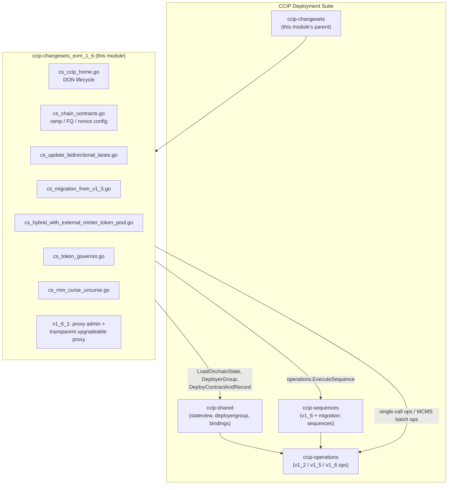
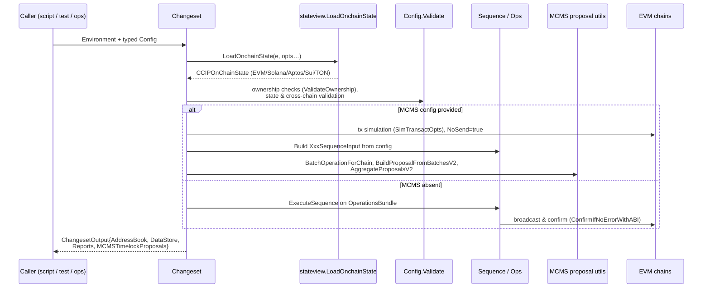
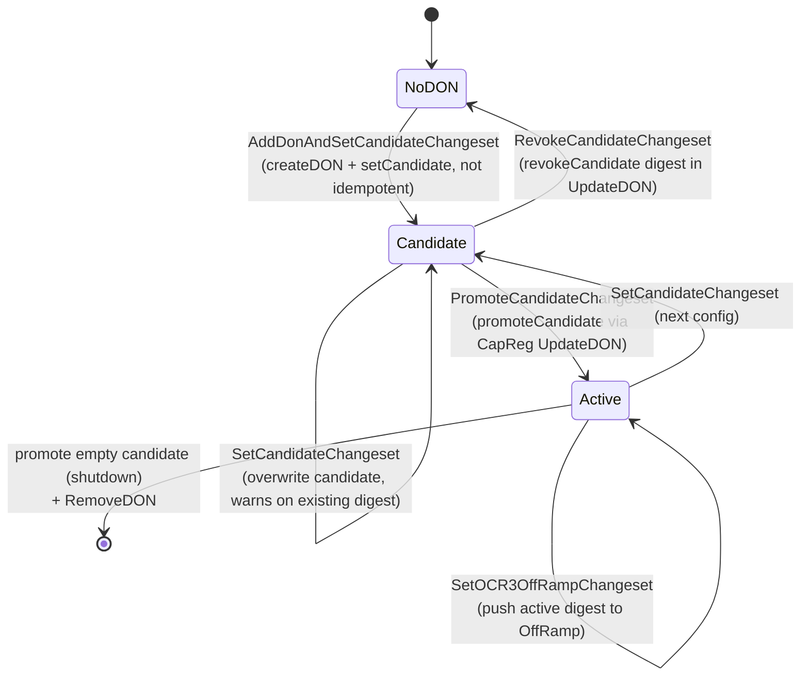
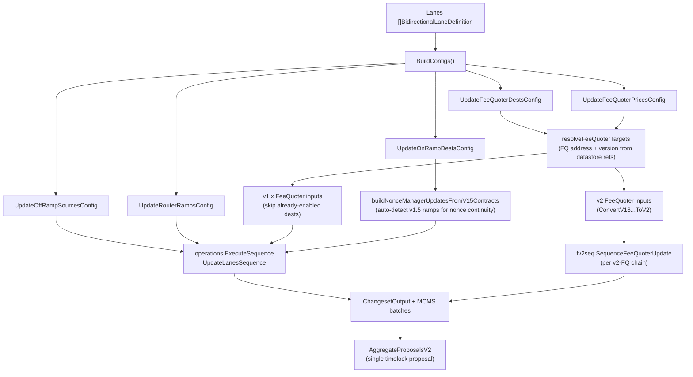

# CCIP Changesets — EVM v1.6 / v1.6.1 (`ccip-changesets_evm_1_6`)

## Introduction

`ccip-changesets_evm_1_6` packages the **CCIP v1.6 and v1.6.1 deployment changesets for EVM chains**. A *changeset* is the highest-level unit of work in the [Chainlink Deployment Framework (CLDF)](../../Deployment_Framework_Core___Product_Deployments.md): a `cldf.ChangeSet[C]` takes an `Environment` plus a typed config struct, validates it against live on-chain state, and either executes transactions directly with the deployer key or emits one or more **MCMS timelock proposals** for governance approval.

The module is the operational toolkit for:

- **CCIPHome / DON lifecycle** — register a CCIP DON, stage candidate OCR3 plugin configs, promote/revoke them, and manage home-chain reader configs.
- **Chain contract configuration** — configure `OnRamp`, `OffRamp`, `Router`/`TestRouter`, `NonceManager`, and `FeeQuoter` across many chains in one shot.
- **Lane management** — enable/disable bidirectional (or unidirectional) lanes atomically, including FeeQuoter v2 coexistence and v1.5→v1.6 nonce continuity.
- **v1.5 → v1.6 migration** — orchestrated multi-step migration of existing lanes, DONs, fee configuration, and ownership.
- **Token infrastructure** — hybrid external-minter token pool group updates, TokenGovernor deployment/roles, and transparent upgradeable token proxies (v1.6.1).
- **Emergency response** — RMN chain/lane/global curse and uncurse actions across EVM, Solana, and Aptos.

## Position in the System

This module is a child of the [`ccip-changesets`](../ccip-changesets.md) package within the [CCIP Deployment Suite](../../CCIP_Deployment_Suite.md). Sibling pages cover the other changeset families: [v1.5 changesets](ccip-changesets_evm_1_5.md), [cross-family changesets](ccip-changesets_crossfamily.md), [Solana changesets](ccip-changesets_solana.md), and [test helpers](ccip-changesets_testhelpers.md). Runtime protocol types it consumes are documented in [types-ccip](../../CCIP_Cross-Chain_Protocol/types-ccip.md) and the node-side CCIP oracle surfaces in [ccip](../../CCIP_Cross-Chain_Protocol/ccip.md).

External framework dependencies (declared in the repository manifest `chainlink/deployment/go.mod`) include `chainlink-deployments-framework` (Environment, changesets, operations, datastore, MCMS proposal utils), `chainlink-ccip` generated go-bindings and pluginconfig, `chain-selectors`, `mcms`, and per-family SDKs (`go-ethereum`, `gagliardetto/solana-go`, `aptos-labs/aptos-go-sdk`).

## Architecture

### Internal structure

The module maps one file per configuration domain, with two directories reflecting contract versions:

| File | Domain | Representative changesets |
|---|---|---|
| `changeset/v1_6/cs_ccip_home.go` | CCIPHome & DON registry | `AddDonAndSetCandidateChangeset`, `SetCandidateChangeset`, `PromoteCandidateChangeset`, `RevokeCandidateChangeset`, `UpdateChainConfigChangeset`, `DeployDonIDClaimerChangeset`, `DonIDClaimerOffSetChangeset` |
| `changeset/v1_6/cs_chain_contracts.go` | Ramps, routers, FeeQuoter, NonceManager | `UpdateOnRampsDestsChangeset`, `UpdateOnRampDynamicConfigChangeset`, `UpdateOnRampAllowListChangeset`, `WithdrawOnRampFeeTokensChangeset`, `UpdateOffRampSourcesChangeset`, `UpdateRouterRampsChangeset`, `SetOCR3OffRampChangeset`, `UpdateDynamicConfigOffRampChangeset`, `UpdateFeeQuoterPricesChangeset`, `UpdateFeeQuoterDestsChangeset`, `ApplyFeeTokensUpdatesFeeQuoterChangeset` (+`...V2`), `UpdateTokenPriceFeedsFeeQuoterChangeset`, `ApplyPremiumMultiplierWeiPerEthUpdatesFeeQuoterChangeset`, `UpdateNonceManagersChangeset`, `UpdateWrappedNativeOnRouterChangeset` |
| `changeset/v1_6/cs_update_bidirectional_lanes.go` | Lane orchestration | `UpdateBidirectionalLanesChangeset` / `UpdateLanesLogic` |
| `changeset/v1_6/cs_migration_from_v1_5.go` | v1.5 → v1.6 migration | `InitChainUpgradesChangeset`, `PromoteChainUpgradesChangeset` |
| `changeset/v1_6/cs_hybrid_with_external_minter_token_pool.go` | Token pools | `UpdateGroupsOnHybridWithExternalMinterTokenPool` |
| `changeset/v1_6/cs_token_governor.go` | Token governance | `DeployTokenGovernor`, `GrantRoleTokenGovernor`, `RenounceRoleTokenGovernor`, `TransferOwnershipTokenGovernor`, `AcceptOwnershipTokenGovernor`, `BeingDefaultAdminTransferTokenGovernor`, `AcceptDefaultAdminTransferTokenGovernor` |
| `changeset/v1_6/cs_rmn_curse_uncurse.go` | Emergency response | `RMNCurseChangeset`, `RMNUncurseChangeset` |
| `changeset/v1_6_1/cs_proxy_admin.go` | Proxy admin | `TransferProxyAdminOwnership` |
| `changeset/v1_6_1/cs_transparent_upgradeable_proxy.go` | Token proxies | `DeployTransparentUpgradeableProxy`, `SaveProxyAdmin`, `GrantRoleTransparentUpgradeableProxy`, `BeginDefaultAdminTransferTransparentUpgradeableProxy`, `AcceptDefaultAdminTransferTransparentUpgradeableProxy`, `SetCCIPAdminTransferTransparentUpgradeableProxy` |

### Key component types

- **`CCIPOCRParams`** (`cs_ccip_home.go`) — bundles `shared.OCRParameters` with optional `pluginconfig.CommitOffchainConfig` and `pluginconfig.ExecuteOffchainConfig`. Its `Validate` verifies OCR parameters, enforces that at least one off-chain config is present, checks token/aggregator consistency against `stateview` USDFeeds, and validates token-data observers (USDC CCTP pools on EVM versions 1.5.1/1.6.2/2.0.0-proxy and Solana PDA derivation; LBTC observers intentionally unvalidated).
- **`ChainConfig`** (`cs_ccip_home.go`) — home-chain reader entry per remote chain: `Readers [][32]byte`, `FChain uint8`, and an encodable `chainconfig.ChainConfig` blob.
- **`DONConfig`** (`cs_migration_from_v1_5.go`) — per-chain migration input: feed chain selector, commit/exec `CCIPOCRParams`, and `ChainConfig`.
- **`TokenGovernor` / `TokenGovernorGrantRole`** (`cs_token_governor.go`) — deploy parameters (token address, optional initial delay, initial default admin) and role-grant requests keyed by the `TokenGovernorRole` enum (minter, burner, freezer, pauser, recovery, checker admin, default admin, …).
- **`HybridGroupConfig`** (`cs_hybrid_with_external_minter_token_pool.go`) — token-pool group updates (group `0 = LOCK_AND_RELEASE`, `1 = BURN_AND_MINT`) with a `RemoteSupplies` map required whenever an update carries non-zero `RemoteChainSupply`.
- **`CursableChain`** (`cs_rmn_curse_uncurse.go`) — family-agnostic curse interface implemented by `EvmCursableChain`, `SolanaCursableChain`, and `AptosCursableChain`.
- **`TransparentUpgradeableProxy` / `TransparentUpgradeableProxyGrantRole`** (v1_6_1) — proxy deployment (with optional packed `initialize(...)` calldata) and MINTER/BURNER role grants against `BurnMintERC20Transparent`.
- **`ProxyAdmin`** (v1_6_1) — new-owner transfer for the admin contract discovered from the proxy's EIP-1967 admin slot.

### Execution model

Every changeset follows the same shape, built on shared services from [`ccip-shared`](../ccip-shared.md) and dispatched into [ccip-sequences](../ccip-sequences.md) / [ccip-operations](../ccip-operations.md):

Recurring conventions:

1. **Dual execution mode.** Every config carries an optional `MCMS *TimelockConfig`. When present, transactions are only *simulated* (`NoSend = true`), collected as `mcmstypes.BatchOperation`s with per-chain timelock addresses and inspectors, and returned as `MCMSTimelockProposals`. When absent, calls are confirmed on-chain immediately. Multi-proposal changesets (e.g., migration, lanes, curse) merge everything into a single aggregated timelock proposal via `AggregateProposalsV2`.
2. **Ownership gates.** `mcmschangesets.ValidateOwnership` verifies the expected owner (deployer key or timelock) for each target contract. Several changesets expose `SkipOwnershipCheck` — always annotated as *"do not use in isolation"* because they assume an enclosing changeset manages ownership. `state.EnforceMCMSUsageIfProd` forces MCMS in production-like environments (e.g., `UpdateRouterRampsConfig` when enabling main-router ramps).
3. **Idempotency.** Where possible, changesets diff against live state before acting: `UpdateChainConfigChangeset` skips equal chain configs (`isChainConfigEqual`), `SetOCR3OffRampChangeset` compares OCR3 digests/signers/transmitters (`isOCR3ConfigSetOnOffRamp`), lane updates filter already-enabled destinations (`FilterOutExistingDestChainConfigs`), allowlist updates compare the desired sender set, and the proxy-role grant skips accounts that already hold the role. Conversely, `AddDonAndSetCandidateChangeset` and `PromoteCandidateChangeset` are explicitly **not** idempotent and are guarded accordingly (DON-exists check; `AllowEmptyConfigPromote` + zero-digest checks so a repeated promotion cannot blank the active config).
4. **Multi-family state.** `CCIPOnChainState` (`stateview`) holds per-family maps (`Chains`, `SolChains`, `AptosChains`, `SuiChains`, `TonChains`). Even EVM-focused changesets consult it for remote families — e.g., `SetOCR3OffRampConfig` validates Solana OffRamp PDAs, Sui/Ton presence, and `validateUSDCConfig` verifies Solana CCTP source pools. `cs_rmn_curse_uncurse.go` is the only changeset deliberately written family-agnostic (emergency procedure), with per-family subject endianness assertions (Solana little-endian, EVM/Aptos big-endian).
5. **Datastore discipline.** Deploying changesets (`DeployTokenGovernor`, `DeployTransparentUpgradeableProxy`, `DeployDonIDClaimerChangeset`) pre-plan `datastore.AddressRef`s (`PlannedRefs`), reserve them (`shared.ReserveRefs`) to catch conflicts, and validate against the environment strictly (`ValidateAddressRefsStrict`) unless `ForceDatastoreOverwrite` is set. Qualifiers are token symbols; recorded outputs are returned in `ChangesetOutput.AddressBook`/`DataStore`.

## DON configuration lifecycle (CCIPHome)

The CCIPHome changesets implement a candidate/active state machine per `(DON, pluginType)`, executed through the CapabilitiesRegistry → CCIPHome capability-config path:

Notes:

- `UpdateChainConfigChangeset` maintains the per-remote-chain reader/FChain config on CCIPHome (batched, batch size 4, add/remove aware). `SetCandidatePluginInfo.SkipChainConfigValidation` may skip re-validating an existing chain config — again only for composed changesets.
- `DeployDonIDClaimerChangeset` (v1.6.1) deploys `DonIDClaimer` pointed at the CapabilitiesRegistry; `DonIDClaimerOffSetChangeset` calls `SyncNextDONIdWithOffset` after checking the deployer is an authorized deployer.
- `cs_migration_from_v1_5.go` chains this lifecycle for an entire network: `InitChainUpgradesChangeset` (idempotent: skips chains that already have a DON, sequences ownership transfers of FeeQuoter/NonceManager/RMNRemote, chain-config adds, commit DON creation + exec candidate, FeeQuoter translation of v1.5 ramps, NonceManager previous-ramps registration, test-router wiring with FeeAggregator=timelock) followed by `PromoteChainUpgradesChangeset` (promote commit/exec candidates, transfer OnRamp/OffRamp ownership, then a strictly ordered main-router cutover — OnRamp dest config → router ramps → OffRamp source config — to avoid disrupting traffic). `getSourceChainsForSelector` discovers lanes by scanning v1.5 `EVM2EVMOnRamp` maps, and `ensureTimelockOwnership` only transfers contracts still owned by the deployer key.

## Lane update data flow

`UpdateBidirectionalLanesChangeset` is the canonical composite changeset: it expands `BidirectionalLaneDefinition`s (each direction derived from the two `ChainDefinition`s, with `FeeQuoterDestChainConfig` and `GasPrice` per destination) into the five sub-configs, then runs them through one `UpdateLanesSequence`.

This composition is the recommended path for enabling or disabling lanes; the individual contract changesets it wraps are exported for finer-grained control (and for use by the migration changesets).

## FeeQuoter configuration surface

`cs_chain_contracts.go` centralizes FeeQuoter administration, with the tree-listed per-chain config types:

- **`ApplyFeeTokensUpdatesConfigPerChain`** — add/remove fee tokens by `shared.TokenSymbol`, resolved to addresses via `chainState.TokenAddressBySymbol()`.
- **`UpdateTokenPriceFeedsConfigPerChain`** — enable/disable per-token USD feeds; requires the feed to exist on the designated `FeedChainSelector` and reads token decimals on-chain.
- **`PremiumMultiplierWeiPerEthUpdatesConfigPerChain`** — per-token premium multiplier (must be non-zero).
- **Token transfer fee configs** — v1 (`ApplyTokenTransferFeeConfigUpdatesFeeQuoterChangeset`, symbol-keyed, min<max and `DestBytesOverhead ≥ globals.CCIPLockOrBurnV1RetBytes` checks) and v2 (`ApplyTokenTransferFeeConfigUpdatesFeeQuoterChangesetV2`, address-keyed, per-field optionals with `FillMissingValues` defaults differentiated for Ethereum source/dest, merge with on-chain config, no-op skipping, reset-to-default list).
- **Dest-chain configs & prices** — `UpdateFeeQuoterDestsConfig` validates destinations against supported chains and cross-checks active exec configs from CCIPHome (`GetAllActiveExecConfigs` forces `EnforceOutOfOrder` when `MultipleReportsEnabled`); `UpdateFeeQuoterPricesConfig` verifies an authorized price caller exists (deployer or timelock) and that tokens are in the address book. `DefaultFeeQuoterDestChainConfig` provides chain-type-dependent sensible defaults.

## RMN curse / uncurse (emergency actions)

`cs_rmn_curse_uncurse.go` models curses as composable `CurseAction` functions producing `RMNCurseAction{ChainSelector, SubjectToCurse}` entries: `CurseLaneOnlyOnSource`, `CurseLaneBidirectionally`, `CurseGloballyOnlyOnChain`, `CurseChain` (global self-curse + family-aware subject curses on all other chains), and `CurseGloballyAllChains`. Execution:

1. `RMNCurseConfig.Validate` enforces MCMS usage in prod, a non-empty `Reason`, and per-family subject/ownership validity (EVM: `RMNRemote` timelock ownership; Solana: `ValidateOwnershipSolana`; Aptos: MCMS mandatory).
2. Curse actions are optionally filtered to connected lanes (`FilterOutNotConnectedLanes` checks OffRamp source-chain configs), grouped per chain (`groupRMNSubjectBySelector`), and deduplicated against the live cursed-subject set (skipping no-ops unless `Force`).
3. Per-family `CursableChain` implementations apply the change — EVM via `Curse0`/`Uncurse0` through the `DeployerGroup`, Solana via CurseInstruction/UncurseInstruction on the RMNRemote PDA with error-code-driven curse detection (`9005` subject-cursed, `9006` global), Aptos via `aptos_ops.CurseMultipleOp`/`UncurseMultipleOp` whose MCMS ops are collected separately and merged.
4. All family proposals are aggregated into a single timelock proposal.

The module's smoke test `integration-tests/smoke/ccip/ccip_cs_rmn_curse_uncurse_test.go` (see [integration-tests](../../Dev,_Test___Simulation_Environments/integration-tests.md)) exercises the force-option behavior of these changesets end-to-end.

## Token infrastructure (pools, governor, proxies)

- **Hybrid external-minter pools** — `UpdateGroupsOnHybridWithExternalMinterTokenPool` resolves a pool by token symbol (state, v1_6_0) or explicit address, validates group transitions (known type/version, supported chain, no duplicate remote selectors, no no-op transitions, non-negative supply with a matching `RemoteSupplies` entry verified via `VerifyRemoteDecimals` + `ValidateRemoteChainSupply`), and applies `UpdateGroups` through the `DeployerGroup`.
- **TokenGovernor** — deploys `token_governor.TokenGovernor` per (chain, token) with role registry (`GetRoleFromTokenGovernor` fetches the `bytes32` role constants from the contract), grants/renounces roles (pre-checked with `HasRole`), and supports both `Ownable`-style (`TransferOwnership`/`AcceptOwnership`) and two-step default-admin (`BeginDefaultAdminTransfer`/`AcceptDefaultAdminTransfer`) flows. Datastore refs are planned, reserved, and strictly validated; the qualifier is the token symbol.
- **Transparent upgradeable proxies (v1.6.1)** — `DeployTransparentUpgradeableProxy` wraps a `BurnMintERC20Transparent` implementation, optionally packing `initialize(name, symbol, decimals, maxSupply, preMint, defaultAdmin)` calldata (deployment is rejected if the implementation is already initialized). `SaveProxyAdmin` and `TransferProxyAdminOwnership` locate the admin contract by reading the EIP-1967 admin slot (`shared.AdminSlot`) directly from chain state. Role grants target only `MINTER_ROLE`/`BURNER_ROLE` and are skipped when already held; `SetCCIPAdminTransferTransparentUpgradeableProxy` manages the CCIP admin on the implementation.

## Dependency Summary

| Dependency | Role | Documented in |
|---|---|---|
| `chainlink-deployments-framework` | `Environment`, `ChangeSet`, operations/sequences engine, datastore, MCMS proposal utils | [Deployment Framework Core](../../Deployment_Framework_Core___Product_Deployments.md) |
| `ccip/shared/stateview` | `CCIPOnChainState`, chain validation, token symbol resolution | [ccip-shared](../ccip-shared.md) |
| `ccip/shared/deployergroup` | `DeployerGroup` (deployer vs. timelock transacting, `Enact()`), `DescribedTransaction` | [ccip-shared](../ccip-shared.md) |
| `ccip/sequence/evm/v1_6` (+ `migration`) | `AddDONAndSetCandidateSequence`, `SetCandidateSequence`, `PromoteCandidateSequence`, `ApplyChainConfigUpdatesSequence`, `UpdateLanesSequence`, `FeeQuoterUpdateTokenTransferConfig`, `SetRMNRemoteConfig`, onramp-to-FQ translation | [ccip-sequences](../ccip-sequences.md) |
| `ccip/operation/evm/v1_6` (+ v1_2) | Typed ops: `DeployOnRampInput`, `DeployOffRampInput`, `DeployRMNRemoteInput`, `AddDONOpInput`, `ApplyFeeTokensUpdatesInput`, `RouterApplyRampUpdatesOpInput`, … | [ccip-operations](../ccip-operations.md) |
| `changeset/internal`, `changeset/globals` | `DonIDForChain`, `BuildOCR3ConfigForCCIPHome`, `CCIPHomeABI`, `ConfigType`, curse `Subject` helpers | [ccip-changesets](../ccip-changesets.md) |
| `chainlink-ccip` gobindings & `pluginconfig` | v1_6_0/v1_6_3 contract bindings, commit/exec off-chain config validation | [ccip](../../CCIP_Cross-Chain_Protocol/ccip.md) |
| `chainlink-common/pkg/types/ccipocr3` | `UnknownAddress` and OCR3 plugin types used in validation | [types-ccip](../../CCIP_Cross-Chain_Protocol/types-ccip/types-ccip_ocr3_plugin_types.md) |
| `chainlink/evm` (cldf chain) + `libocr` | Chain clients, `ocr3confighelper.PublicConfigFromContractConfig` for exec-config validation | — |

## Usage Guidance

- **Prefer composing over duplicating.** Lane-wide changes should go through `UpdateBidirectionalLanesChangeset`; greenfield network bring-up through the deployment sequences; v1.5 estates through `InitChainUpgradesChangeset` → (`SetOCR3OffRampChangeset`) → `PromoteChainUpgradesChangeset`.
- **Never enable the escape hatches in isolation.** `SkipOwnershipCheck`, `SkipChainConfigValidation`, and `DonIDOverride(s)` exist solely so composed changesets can batch operations; standalone use can produce inconsistent ownership or collide with concurrently-registered DON IDs (see the `GetNextDONId` race note in the migration logic).
- **Mind idempotency classes.** Config updates are mostly idempotent (diff-then-apply); DON lifecycle calls are not (`AddDonAndSetCandidateChangeset` fails if the DON exists; `PromoteCandidateChangeset` can promote an empty candidate unless `AllowEmptyConfigPromote` guards are left at their safe default).
- **Validate MCMS wiring first.** Changesets assume the target contracts are already owned by the timelock when `MCMS` is supplied — `ValidateOwnership` failures indicate an ownership-transfer step (e.g., `ensureTimelockOwnership`, `TransferToMCMSWithTimelockV2`) was skipped.
- **Test with the shared helpers.** The [test helpers](ccip-changesets_testhelpers.md) module (messaging test harnesses, Solana counter, Sui message types) pairs with this module for E2E verification, as do the [integration-tests](../../Dev,_Test___Simulation_Environments/integration-tests.md) smoke suites.
