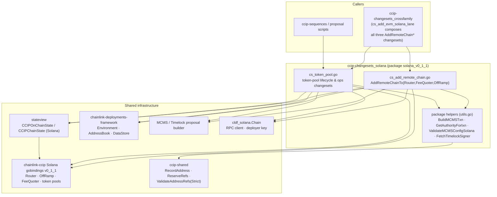
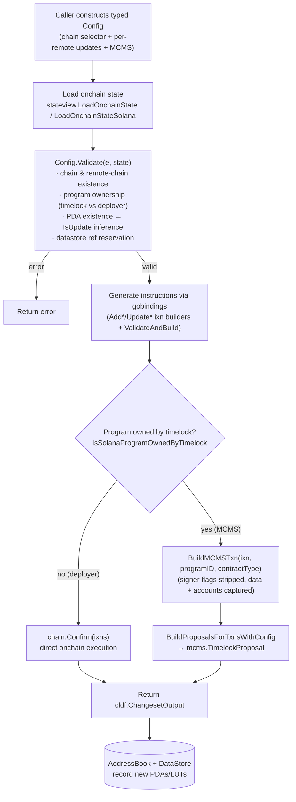
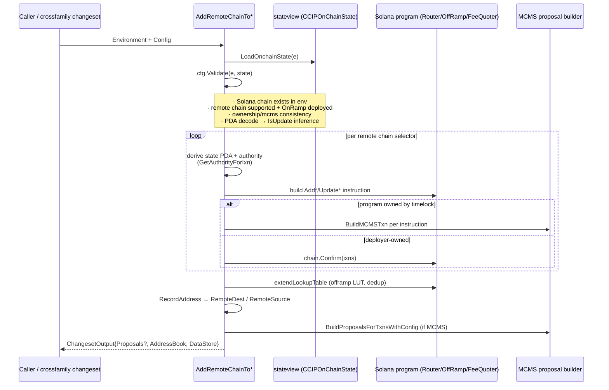
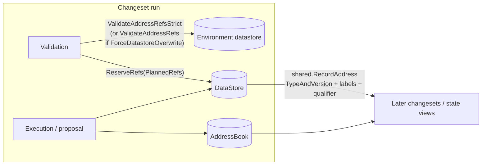

# CCIP Changesets — Solana (`solana_v0_1_1`)

## Overview

The `ccip-changesets_solana` module (Go package `chainlink/deployment/ccip/changeset/solana_v0_1_1`) implements the **Solana (SVM) deployment changesets** for CCIP. It is the SVM counterpart of the EVM changeset families described in [ccip-changesets_evm_1_5](ccip-changesets_evm_1_5.md) and [ccip-changesets_evm_1_6](ccip-changesets_evm_1_6.md), and lives inside the broader changeset layer documented in [ccip-changesets](../ccip-changesets.md).

The module is built on the [chainlink-deployments-framework](../../Deployment_Framework_Core___Product_Deployments.md) `ChangeSet` abstraction and targets the **v0_1_1 Solana CCIP programs** (Router, OffRamp, FeeQuoter, token pools) whose Go bindings are consumed from `github.com/smartcontractkit/chainlink-ccip/chains/solana/gobindings` (see `chainlink/deployment/go.mod`).

### Module at a glance

| Capability | File | Entry points |
|---|---|---|
| Remote chain onboarding (Router, FeeQuoter, OffRamp) | `cs_add_remote_chain.go` | `AddRemoteChainToRouter`, `AddRemoteChainToFeeQuoter`, `AddRemoteChainToOffRamp` |
| Token pool lifecycle & operations | `cs_token_pool.go` | `AddTokenPoolAndLookupTable`, `SetupTokenPoolForRemoteChain`, `SyncDomain`, `TokenPoolOps`, `LockReleaseLiquidityOps`, `ConfigureTokenPoolAllowList`, `RemoveFromTokenPoolAllowList`, `ExtendTokenPoolLookupTable`, `SetRateLimitAdmin`, `InitGlobalConfigTokenPoolProgram`, `EnableSelfServedInTokenPoolProgram` / `DisableSelfServedInTokenPoolProgram`, `InitializeStateVersion`, `CreateTokenMultisig`, `TransferMintAuthorityToSignerPDA`, `ModifyMintAuthority` |

Every exported entry point satisfies `cldf.ChangeSet[T]`:

```go
func(e cldf.Environment, cfg T) (cldf.ChangesetOutput, error)
```

and follows the same **validate → generate instructions → execute or propose** contract described in [Common Execution Model](#common-execution-model).

---

## Architecture

### Component relationships



### Position in the CCIP Deployment Suite

- **Parent**: [ccip-changesets](../ccip-changesets.md) — the changeset layer of the [CCIP Deployment Suite](../../CCIP_Deployment_Suite.md).
- **Siblings**: [ccip-changesets_crossfamily](ccip-changesets_crossfamily.md) (EVM↔Solana lane composition), [ccip-changesets_testhelpers](ccip-changesets_testhelpers.md) (e.g. the Solana `ReceiverCounter` used for end-to-end messaging verification), [ccip-changesets_evm_1_5](ccip-changesets_evm_1_5.md), [ccip-changesets_evm_1_6](ccip-changesets_evm_1_6.md).
- **Dependencies on other modules**:
  - [ccip-shared](../ccip-shared.md) — contract types (`shared.Router`, `shared.FeeQuoter`, `shared.BurnMintTokenPool`, `shared.CCTPTokenPool`, …), address/datastore recording helpers (`RecordAddress`, `ReserveRefs`, `ValidateAddressRefsStrict`), and the Solana `SignerRegistry` bindings.
  - `stateview` (`chainlink/deployment/ccip/shared/stateview`) — `CCIPOnChainState` with per-family maps (`EVMChains`, `SolChains`, `AptosChains`, `SuiChains`, `TonChains`); the Solana `CCIPChainState` carries program IDs, tokens, and pre-derived PDAs/LUT addresses.
  - [ccip-operations](../ccip-operations.md) / [ccip-sequences](../ccip-sequences.md) — EVM-side operations and sequences that these changesets complement when wiring lanes.
- **Runtime counterpart**: the deployed Solana programs are served by the Solana chain capability documented in [chain_capability_solana](../../Workflow___Capability_Runtime_(CRE_Engine)/chain_capability_solana.md); cross-chain message hashing/codec behaviour for Solana is specified in [ccip_chain_codecs](../../CCIP_Cross-Chain_Protocol/ccip/ccip_chain_codecs.md).
- **Solana MCMS deployment**: the timelock/MCMS programs being granted authority are deployed by the Solana MCMS sequences in [deployment-common](../../Deployment_Framework_Core___Product_Deployments/deployment-common.md) (`DeployMCMSWithTimelock`).
- **Chain client types**: RPC request/reply types used through `cldf_solana.Chain` are defined in [types-chains_solana](../../Shared_Foundation_Libraries___Domain_Types/types-chains/types-chains_solana.md).

---

## Common Execution Model

All changesets in this module share the same pipeline. Understanding it is a prerequisite for using the individual changesets.



Key invariants of the pipeline:

1. **State-first validation.** Every changeset loads the authoritative onchain state before doing any work (`stateview.LoadOnchainState(e)` or `LoadOnchainStateSolana(e)`), and validation logic derives decisions from state rather than trusting the config. For example, all three `AddRemoteChainTo*` changesets **infer `IsUpdate` from PDA existence**: if the remote chain's state PDA can already be decoded, the changeset marks the entry as an update and emits an `Update*` instruction instead of `Add*`.
2. **Lane preconditions.** Remote chains must be *supported* (`state.SupportedChains()`) and must have a deployed OnRamp (`state.ValidateRamp(remote, shared.OnRamp)`). A router may never be pointed at itself (`remote == routerConfigAccount.SvmChainSelector` is rejected).
3. **Dual authority / dual execution mode.** The config may carry `MCMS *cldfproposalutils.TimelockConfig`. Mixing MCMS and non-MCMS execution for a given program is disallowed per call (run the changeset multiple times to mix). Authority is resolved by `GetAuthorityForIxn`:
   - If the target program's upgrade authority chain resolves to the timelock (`IsSolanaProgramOwnedByTimelock`), the **timelock signer PDA** signs instructions, instructions are wrapped into `mcmsTypes.Transaction`s via `BuildMCMSTxn` (which strips `IsSigner` flags and records program ID + data + accounts), and the changeset returns a `mcms.TimelockProposal` built by `BuildProposalsForTxnsWithConfig`.
   - Otherwise the **deployer key** is used and instructions are confirmed directly via `chain.Confirm`.
   - `ValidateMCMSConfigSolana` cross-checks that the requested execution mode matches actual program ownership for the specific contract types in play (Router, FeeQuoter, OffRamp, RMNRemote, and token pools keyed by token + metadata).
4. **State recording.** Newly created onchain objects are recorded in both the legacy `AddressBook` and the canonical `DataStore` via `shared.RecordAddress`, using contract types such as `shared.RemoteDest`, `shared.RemoteSource`, and `shared.TokenPoolLookupTable` with labels/qualifiers that make them retrievable by `(chain, token, pool type, metadata)`.

---

## Remote Chain Onboarding (`cs_add_remote_chain.go`)

Adding a Solana↔remote lane requires configuring three programs on the Solana side. The module exposes one changeset per program; they are typically invoked together (as done by the cross-family lane changeset in [ccip-changesets_crossfamily](ccip-changesets_crossfamily.md)).

### Config types

| Config | Carrier type | Meaning |
|---|---|---|
| `AddRemoteChainToRouterConfig` / `RouterConfig` | `solRouter.DestChainConfig` + inferred `IsUpdate` | Router destination-chain settings (e.g. gas limits). Allowed-sender lists must be **complete replacements** — onchain clones the provided list and tooling does not support upserts. |
| `AddRemoteChainToOffRampConfig` / `OffRampConfig` | `EnabledAsSource bool` + inferred `IsUpdate` | Whether the remote chain may act as a **source** for messages into Solana. The OnRamp address of the remote chain is fetched from state and embedded (left-padded to 32 bytes with an explicit length field) into `solOffRamp.SourceChainConfig`. |
| `AddRemoteChainToFeeQuoterConfig` / `FeeQuoterConfig` | `solFeeQuoter.DestChainConfig` + inferred `IsUpdate` | Fee-quoting parameters for the destination chain. |

Each top-level config is keyed by the **Solana chain selector** (`ChainSelector`) plus a `map[uint64]*XConfig` of remote chain selector → update, and carries the optional `MCMS *TimelockConfig`.

### Flow



### Program-specific behaviour

- **Router** (`AddRemoteChainToRouter`): for a *new* remote chain emits two instructions — `AddChainSelector` (creates the remote-chain state PDA) and `AddOfframp` (whitelists the local OffRamp under the router's allowed-offramp PDA). For an *update* it emits `UpdateDestChainConfig` only. New remote state PDAs are queued into the OffRamp **address lookup table** and the PDA is recorded as `shared.RemoteDest`.
- **OffRamp** (`AddRemoteChainToOffRamp`): emits `AddSourceChain` / `UpdateSourceChainConfig` with the remote OnRamp address (`getSourceChainConfig`) and the `EnabledAsSource` flag; records `shared.RemoteSource`; also participates in the LUT extension.
- **FeeQuoter** (`AddRemoteChainToFeeQuoter`): emits `AddDestChain` / `UpdateDestChainConfig` against the FeeQuoter config PDA; queues the remote FeeQuoter dest-chain PDA into the same LUT extension pass.
- **Lookup table maintenance** (`extendLookupTable`): fetches the OffRamp's lookup table, diffs current entries against the new PDAs, and submits `ExtendLookupTable` for the delta only (no-op logged otherwise). Note the code comment: instruction builders from the gobindings set a module-global program ID, so instructions are **rebuilt manually** via `solana.NewInstruction(programID, accounts, data)` to avoid panics when called repeatedly (`runSafely(SetProgramID)` in the token-pool code serves the same purpose).

---

## Token Pool Lifecycle (`cs_token_pool.go`)

This file manages the full lifecycle of SPL token pools for the three supported pool types — `shared.BurnMintTokenPool`, `shared.LockReleaseTokenPool`, and `shared.CCTPTokenPool` (USDC). A pool is uniquely identified by the triple **(token mint pubkey, pool type, metadata)**, where `Metadata` selects which client/CLL token pool executable is in use.

### Changeset catalogue

| Changeset | Purpose |
|---|---|
| `AddTokenPoolAndLookupTable` | Aggregate entry point: per pool config — create the pool's ATA if missing, initialize pool config PDA (per pool-type `Initialize` instruction), optionally set pool signer as mint authority (BurnMint, when deployer currently holds it), then delegate to `AddTokenPoolLookupTable`. Returns a combined proposal covering all MCMS transactions. |
| `AddTokenPoolLookupTable` | Creates and populates a per-pool **address lookup table**. BurnMint/LockRelease tables get a fixed 10-entry list (LUT, token-admin-registry PDA, pool program, pool config PDA, pool token account, pool signer, token program, mint, FeeQuoter billing-token config PDA, router external-pool signer PDA); CCTP pools append 8 more entries (message transmitter, token messenger/minter, local token, event authority, …). Records under `shared.TokenPoolLookupTable` qualified by `(mint, poolType, metadata)`. |
| `ExtendTokenPoolLookupTable` | Appends arbitrary accounts to an existing pool LUT; by default refuses duplicate accounts both within the input and against onchain LUT entries (`SkipValidationsForDuplicates` to bypass). |
| `InitGlobalConfigTokenPoolProgram` | One-time global config initialization per pool program (router + RMN remote addresses into the `config` PDA). Idempotent: exits early if the config PDA already exists. |
| `EnableSelfServedInTokenPoolProgram` / `DisableSelfServedInTokenPoolProgram` | Flip `UpdateSelfServedAllowed` on BurnMint/LockRelease global config. |
| `SetupTokenPoolForRemoteChain` | Configure a Solana pool to accept a remote (EVM) chain: per `(pool, evmSelector)` either full new-chain setup (`InitChainRemoteConfig` → dummy rate-limits → real rate-limits → `AppendRemotePoolAddresses`) or incremental maintenance (override rate limits, `EditChainRemoteConfig` if token address changed/`OverrideConfig`, or append only the *diff* of pool addresses via `poolDiff`). Rate-limiter values are validated by `RateLimiterConfig.Validate` (rate < capacity when enabled; zero otherwise). |
| `LockReleaseLiquidityOps` | Lock/Release pool operations: `SetCanAcceptLiquidity`, Provide (approve-checked then `ProvideLiquidity`), Withdraw, and `SetRebalancer`. Balance is checked before approval. |
| `ConfigureTokenPoolAllowList` / `RemoveFromTokenPoolAllowList` | Enable/disable allow-list and add/remove accounts (onchain rejects already-configured accounts on add). |
| `TokenPoolOps` | Misc ops: `DeleteChainCfg` (remove a remote chain config; validated to exist first) and `SetRouterCfg` (re-point pool to a router). |
| `SetRateLimitAdmin` | Transfer per-pool rate-limit adminship (batch over pools). |
| `SyncDomain` | **CCTP only**: sync `CctpChainConfig` — CCTP `Domain` and `DestinationCaller` — into the CCTP pool's per-chain config for USDC (`EditChainRemoteConfigCctp`). |
| `CreateTokenMultisig` | Creates an SPL token multisig (threshold 1) whose signers are the pool signer PDA + up to 5 customer mint authorities, by shelling out to the `spl-token` CLI and parsing the created address from output (`parseMultisigAddress` regex). Records dual identity: legacy address-book type `"TokenMultisig"` v1.0.0 and canonical datastore type v1.6.0. |
| `TransferMintAuthorityToSignerPDA` / `ModifyMintAuthority` | Move token mint authority to the pool signer PDA (v1_6_2 BurnMint binding) or to a customer multisig (`TransferMintAuthorityToMultisig`; `OldMintAuthority` account meta only needed when current authority is itself a multisig). |
| `InitializeStateVersion` | Permissionless state-version migration for pre-existing pools (BurnMint/LockRelease). |

### CCTP domain configuration detail (`CctpChainConfig`)

```go
type CctpChainConfig struct {
    Domain            uint32           // CCTP domain id for the remote chain
    DestinationCaller solana.PublicKey // authorized destination caller
}
```

`SyncDomainConfig` maps remote chain selectors → `CctpChainConfig`. Validation requires: non-empty map, a CCTP pool present in state (`chainState.CCTPTokenPool`), correct ownership for the USDC/CCTP pool, and an **already-initialized chain config** for every remote selector (checked via `isSupportedChain` against the USDC mint + CCTP pool).

### Cross-family pool configuration (`EVMRemoteConfig`)

`SetupTokenPoolForRemoteChain` reads the **EVM side of the lane** to build the Solana-side remote config: `getOnChainEVMPoolConfig` resolves the EVM token pool by (symbol, pool type, semver version) from the v1_5_1 changeset helpers, reads its token address, decimals (with an ERC20 fallback when the pool ABI omits `GetTokenDecimals`), and pool address, producing a `solBaseTokenPool.RemoteConfig`. This keeps the two families consistent without duplicating EVM deployment logic (see [ccip-changesets_evm_1_5](ccip-changesets_evm_1_5.md)).

---

## State Tracking, Datastore & Ref Safety

New onchain artifacts must be discoverable by later changesets. This module uses the framework's dual stores:



- **Planned refs** — ref keys are computed from config alone (`TokenPoolLookupTableConfig.PlannedRefs`, `AddTokenPoolAndLookupTableConfig.PlannedRefs`) *before* any transaction is confirmed. This aggregate-boundary planning prevents the failure mode where an earlier token-pool transaction is confirmed and only then does a child step discover a duplicate ref. `shared.ReserveRefs` both asserts the keys are free and returns a pre-seeded data store.
- **Strict vs overwrite validation** — `ValidateAddressRefsStrict` rejects taking a key the environment already holds; passing `ForceDatastoreOverwrite: true` downgrades to the lenient validator (logged, not silent).
- **Qualifiers** — lookup tables are qualified by `shared.TokenPoolLookupTableQualifier(mint, poolType, metadata)`; remote chain state PDAs are labelled with the remote selector string (`strconv.FormatUint`); token multisigs use the token symbol as qualifier.

The Solana `CCIPChainState` (in `ccip-shared/stateview/solana`) is the read-side mirror: program IDs (`Router`, `FeeQuoter`, `OffRamp`, `RMNRemote`, pool maps keyed by metadata), token lists (`LinkToken`, `WSOL`, `USDCToken`, `CCTPTokenPool`, SPL/SPL-2022 mints), and cached PDAs (`RouterConfigPDA`, `FeeQuoterConfigPDA`, `OffRampConfigPDA`, per-selector `DestChainStatePDAs`, and `TokenPoolLookupTable` keyed by token → pool type → metadata).

---

## Solana-Specific Implementation Notes

These patterns are specific to SVM deployment and are easy to miss when porting EVM logic:

1. **PDA derivation is a state query.** Existence of an account at a derived PDA (decoded via `chain.GetAccountDataBorshInto`) is used both to detect prior configuration (`IsUpdate` inference) and to fail fast when a required account is missing (e.g. `TokenPoolOps.Validate` for `DeleteChainCfg`).
2. **Gobinding program-ID globals.** Binding packages expose `SetProgramID`, which mutates a package-level variable and panics on repeated calls; hence every use is wrapped in `runSafely(...)`, and several instruction builders are re-instantiated manually with `solana.NewInstruction(programID, accounts, data)` after extracting `ix.Data()`.
3. **Address lookup tables (LUTs).** Solana transaction size limits make LUTs mandatory for programs with wide account sets. The module creates (`CreateLookupTable`), extends (`ExtendLookupTable`), and awaits slot change (`AwaitSlotChange`) for both the OffRamp LUT (remote chain PDAs) and per-pool LUTs (fixed account lists per pool type).
4. **SPL token plumbing.** Associated token accounts for the pool signer (`FindAssociatedTokenAddress`, created only if missing), `SetTokenMintAuthority`, `TokenApproveChecked` before liquidity provision, and `spl-token` CLI multisig creation are all handled inside changesets so a lane can be stood up end-to-end.
5. **Ownership probing.** `solanastateview.IsSolanaProgramOwnedByTimelock` + `ValidateOwnershipSolana` compare the on-chain config owner against the deployer key and the timelock signer PDA derived from the stored MCMS/timelock state — this is what makes the deployer/MCMS mode switch safe rather than config-driven.

---

## Usage Patterns

### Bring up a new EVM→Solana lane (typical order)

1. Ensure both chains are in the environment and the remote (EVM) side has OnRamp deployed (`state.ValidateRamp`).
2. Run `AddRemoteChainToRouter`, `AddRemoteChainToOffRamp`, `AddRemoteChainToFeeQuoter` on the Solana chain (each produces its own proposal or direct execution).
3. If tokens are involved, run `AddTokenPoolAndLookupTable` (pool init + LUT), then `SetupTokenPoolForRemoteChain` to wire the EVM pool into the Solana pool (and the mirrored EVM-side configuration via [ccip-changesets_evm_1_6](ccip-changesets_evm_1_6.md) changesets).
4. For USDC, call `SyncDomain` after chain configs exist.
5. Verify end-to-end messaging with the helpers in [ccip-changesets_testhelpers](ccip-changesets_testhelpers.md).

### MCMS vs. direct execution

- Pass `MCMS: &TimelockConfig{...}` only when the target program is (or will be) timelock-owned; `ValidateMCMSConfigSolana` enforces consistency and `ValidateSolanaTimelockConfig` checks the proposal structure.
- Never mix modes within one call; run separate invocations per mode if needed (documented in the config comments).

### Testing

Integration/smoke coverage for these changesets (e.g. curse/uncurse flows that depend on lanes) lives in the integration test suites documented in [Dev, Test & Simulation Environments](../../Dev,_Test___Simulation_Environments.md); the messaging test harness and Solana receiver counter used to validate lanes are described in [ccip-changesets_testhelpers](ccip-changesets_testhelpers.md).

---

## Summary

`ccip-changesets_solana` encapsulates everything required to (a) onboard remote chains onto Solana's Router/OffRamp/FeeQuoter programs and (b) operate SPL/CCTP token pools, while consistently enforcing the framework's validate-first, state-derived, dual-mode (deployer/MCMS) execution discipline and recording all artifacts for reproducibility. For the EVM counterparts and the shared deployment primitives referenced throughout this page, see the sibling and dependency pages linked above.
