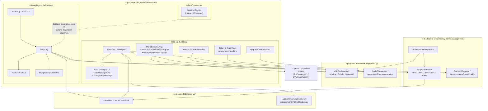
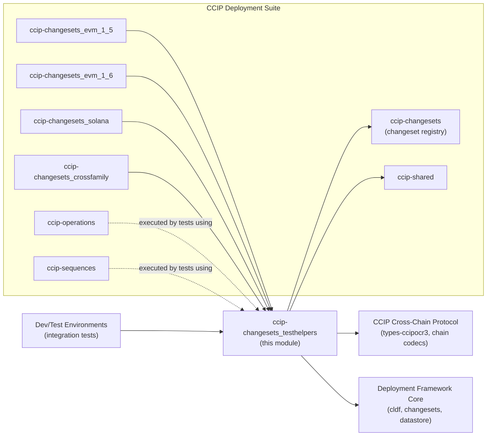
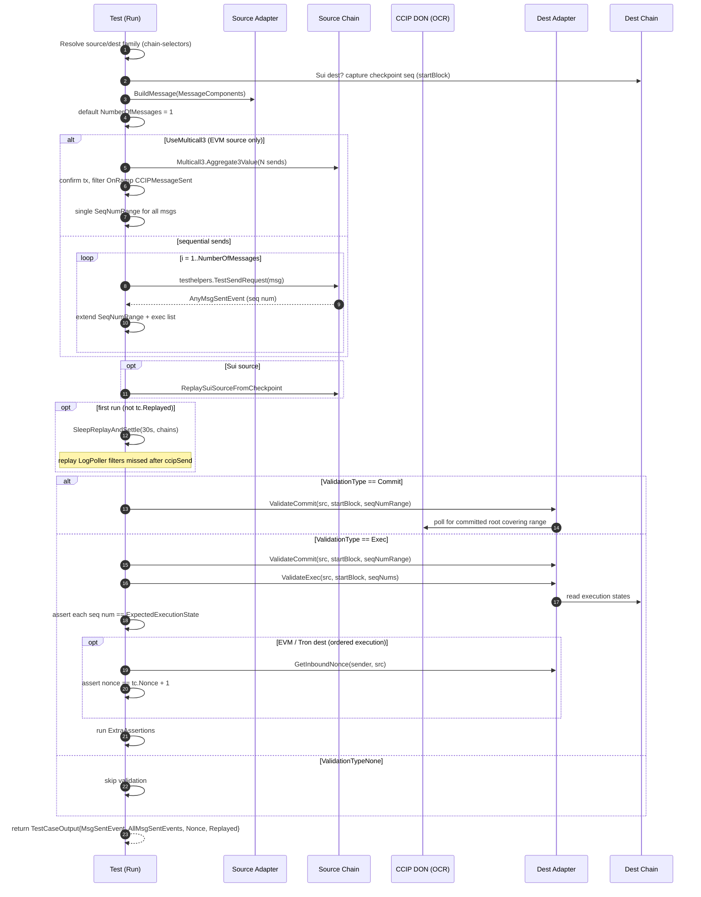
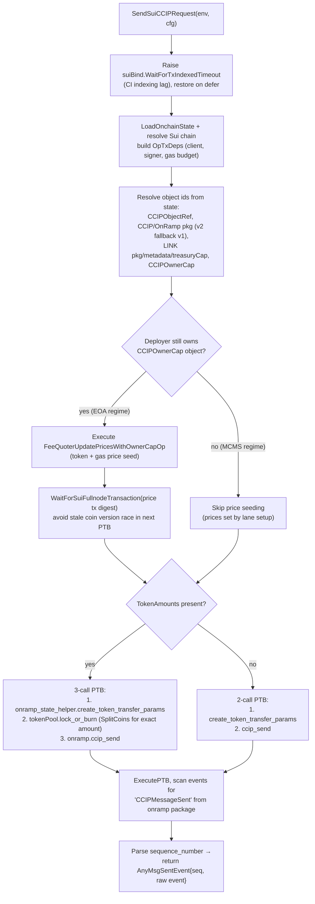
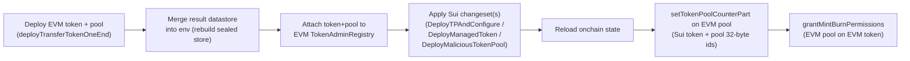

# CCIP Changesets — Test Helpers (`testhelpers`)

## 1. Introduction

The `ccip-changesets_testhelpers` module is the shared testing toolkit for the CCIP changeset suite (`chainlink/deployment/ccip/changeset/testhelpers/...`). While the [parent changesets module](../ccip-changesets.md) contains the production deployment logic (changesets for contract deployment, lane configuration, token pools, etc.), this module provides the **end-to-end verification harness** used to prove that deployed CCIP infrastructure actually works:

- **`messagingtest`** — a chain-family-agnostic harness that sends CCIP messages across chains and validates the full cross-chain lifecycle (send → commit → execute → nonce accounting).
- **Sui helpers** — everything needed to drive Sui↔Any CCIP lanes from tests: message construction via Programmable Transaction Blocks (PTBs), family-specific extra-args encoders, and token-pool deployment setups.
- **Solana receiver counter** — a custom BCS decoder for the test `test_ccip_receiver.Counter` account, used to assert message execution on Solana destinations.

The module sits between the [deployment framework core](../../Deployment_Framework_Core___Product_Deployments.md) (which supplies `cldf.Environment`, changesets, and operations) and the [CCIP protocol domain types](../../CCIP_Cross-Chain_Protocol.md) (message codecs, sequence-number ranges, chain selectors). It is consumed by changeset tests in the sibling versioned modules ([v1.5](ccip-changesets_evm_1_5.md), [v1.6](ccip-changesets_evm_1_6.md), [Solana](ccip-changesets_solana.md), [cross-family](ccip-changesets_crossfamily.md)) and by the integration test suites described in [Dev, Test & Simulation Environments](../../Dev,_Test___Simulation_Environments.md).

> **Module manifest note:** all code in this module belongs to the `github.com/smartcontractkit/chainlink/deployment` Go module, which pulls in the CCIP generated bindings (`chainlink-ccip/chains/evm`, `chainlink-ccip/chains/solana/gobindings`), the Sui SDK (`block-vision/sui-go-sdk`, `chainlink-sui`), the BCS/Borsh libraries (`gagliardetto/binary`, `aptos-labs/aptos-go-sdk/bcs`), and chain selectors (`smartcontractkit/chain-selectors`) — see `chainlink/deployment/go.mod` in the repository.

---

## 2. Module Composition

| File | Package | Core component | Role |
|---|---|---|---|
| `testhelpers/messagingtest/helpers.go` | `messagingtest` | `TestCaseOutput` (plus `TestSetup`, `TestCase`, `Run`, `ValidationType`, `SleepReplayAndSettle`) | End-to-end CCIP messaging test runner, family-agnostic via per-chain adapters |
| `testhelpers/test_sui_helpers.go` | `testhelpers` | `CCIPMessageSent` (plus `SuiSendRequest`, `SendSuiCCIPRequest`, extra-args builders, token-pool deployment handlers, `UpgradeContractDirect`) | Sui-source CCIP send, fee seeding, token-pool setup, and package-upgrade helpers |
| `testhelpers/solana/counter.go` | `solana` | `ReceiverCounter` | Custom BCS codec for the Solana test-receiver counter account |

Two closely-related sibling sub-packages exist in the same directory but are documented conceptually here rather than as separate pages: `feestest/` (fee-related test scenarios) and `messagelimitationstest/` (message size/limit scenarios), both of which reuse the same adapter and environment primitives.

---

## 3. Architecture

### 3.1 Component relationships



### 3.2 Module dependency map



- **Consumers** ([v1.5](ccip-changesets_evm_1_5.md), [v1.6](ccip-changesets_evm_1_6.md), [Solana](ccip-changesets_solana.md), [cross-family](ccip-changesets_crossfamily.md) changeset tests) import `messagingtest` to validate lanes configured by their changesets.
- **Runtime dependencies** are the [shared state/client views](../ccip-shared.md) (`stateview.CCIPOnChainState`, `ccipclient.AnyMsgSentEvent`) and the per-chain `Adapter` implementations (`test_adapter_evm.go`, `test_adapter_sui.go`, `test_adapter_svm.go`, `test_adapter_aptos.go`).
- **Protocol-level contracts** (message hashing, extra-args layouts, sequence-number semantics) are defined by the [CCIP core types](../../CCIP_Cross-Chain_Protocol.md) — in particular the [chain codecs](../../CCIP_Cross-Chain_Protocol/ccip/ccip_chain_codecs.md) whose tag constants the extra-args builders here must reproduce bit-exactly.

---

## 4. `messagingtest` — End-to-End Messaging Harness

### 4.1 Key types

| Type | Description |
|---|---|
| `TestSetup` | Bundles the test's `*testing.T`, `Sender`, the deployment-framework `cldf.Environment`, the optional `testhelpers.DeployedEnv`, the loaded `stateview.CCIPOnChainState`, and the `SourceChain` / `DestChain` selectors. `TestRouter` toggles routing through the `Router` contract instead of the OnRamp directly. |
| `TestCase` | Embeds `TestSetup` plus the scenario knobs: `ValidationType`, `Replayed` (skip replay), `Nonce` (expected pre-send inbound nonce), `Receiver`, `MsgData`, `ExtraArgs`, `FeeToken`, `ExpectedExecutionState`, `ExpRevertOnSource`, `ExtraAssertions`, `NumberOfMessages`, and `UseMulticall3`. |
| `TestCaseOutput` | The result of `Run`: the **last** `MsgSentEvent` (`*ccipclient.AnyMsgSentEvent`), **all** sent events (`AllMsgSentEvents`), the bumped `Nonce` (when an ordered-execution nonce check ran), and the `Replayed` flag. |
| `ValidationType` | `ValidationTypeNone` (send only), `ValidationTypeCommit` (wait for OCR commit on destination), `ValidationTypeExec` (commit **plus** execution and post-exec assertions). |

Two constructors support the two environments where tests run:

- `NewTestSetupWithDeployedEnv` — for **ephemeral test environments** where `testhelpers.DeployedEnv` (adapters, replay blocks, users) is available, enabling replay and adapter-based validation.
- `NewTestSetup` — for **long-running environments** (e.g., staging) where only a `cldf.Environment` + state are available; no `DeployedEnv` is attached.

### 4.2 Execution flow of `Run`

`Run(t, tc)` is the single entry point: it builds, sends, replays, and validates CCIP messages, dispatching all chain-specific behavior through the `Adapter` interface (`BuildMessage`, `GetInboundNonce`, `ValidateCommit`, `ValidateExec`).



**Behavioral notes:**

- **Multicall3 batching** is EVM-only (enforced with `require.Equal` on the source family). The harness checks the sender's balance covers `totalValue`, batches `NumberOfMessages` sends via `Aggregate3Value`, filters `OnRamp` `CCIPMessageSent` events for the expected sequence numbers, and expects a **single commit root covering the whole `SeqNumRange`**.
- **Replay handling** — if a node (or its LogPoller filters) registered *after* `ccipSend`, missed logs must be replayed. `SleepReplayAndSettle` sleeps, calls `testhelpers.SleepAndReplay` (async replay), then sleeps again: EVM replay returns before the poller finishes ingesting `CCIPMessageSent`, and the settle window gives the DON time to OCR-commit and transmit to the destination (required for Sui offramp polling). For a Sui **destination**, only the EVM **source** is replayed (Sui dest is observed via the SuiEventEmitter); Sui-source re-indexing is handled separately via `ReplaySuiSourceFromCheckpoint`.
- **Ordered vs unordered execution** — only EVM and Tron destinations have sender-scoped inbound nonces, so the `Nonce + 1` bump check runs only for those families. `tc.Nonce == nil` skips the check (logged, not failed).
- `getLatestNonce` reads the destination adapter's `GetInboundNonce(ctx, sender, sourceChain)`.

### 4.3 Example

```go
setup := messagingtest.NewTestSetupWithDeployedEnv(t, depEnv, onchainState,
    srcSel, dstSel, sender, true /* testRouter */)

out := messagingtest.Run(t, messagingtest.TestCase{
    TestSetup:               setup,
    ValidationType:          messagingtest.ValidationTypeExec, // commit + exec + nonce
    Receiver:                receiver,
    MsgData:                 []byte("hello ccip"),
    FeeToken:                linkAddress,
    ExpectedExecutionState:  int(executionState.Success),
    NumberOfMessages:        3,
    UseMulticall3:           true, // batch all 3 sends in one EVM tx
    ExtraAssertions:         []func(*testing.T){ assertReceiverCounterIncremented },
})
// out.MsgSentEvent     -> last CCIPMessageSent event
// out.AllMsgSentEvents -> all 3 events
// out.Nonce            -> bumped inbound nonce (ordered dests only)
```

---

## 5. Sui Helpers (`test_sui_helpers.go`)

### 5.1 Message and event types

| Type | Purpose |
|---|---|
| `SuiSendRequest` | Test-side send request: `Receiver`, `Data`, `ExtraArgs`, `FeeToken`, `FeeTokenStore`, `TokenAmounts []SuiTokenAmount`, `TokenReceiverATA`. |
| `SuiTokenAmount` | Token transfer leg: `TokenPoolType` (`BurnMint` / `Managed` / `LockRelease`), `Token` (coin object id), `Amount`. |
| `RampMessageHeader` / `Sui2AnyRampMessage` | JSON-shaped on-chain message header/message (message id, source/dest selectors, sequence number, nonce, fee fields). |
| `CCIPMessageSent` | The parsed on-chain `CCIPMessageSent` event: `DestChainSelector`, `SequenceNumber`, and the embedded `Sui2AnyRampMessage`. |
| `TokenPoolRateLimiterConfig` | Per-remote-chain rate-limiter knobs (in/outbound enabled, capacity, rate) shared by all pool deployment handlers. |

### 5.2 `SendSuiCCIPRequest` — sending a CCIP message from Sui

This function is the Sui counterpart of `testhelpers.TestSendRequest` and returns a `ccipclient.AnyMsgSentEvent` compatible with the messaging harness. Its control flow:



Implementation highlights:

- **Fee price seeding regime detection.** The helper probes the `CCIPOwnerCap` object ownership: if the deployer still address-owns it (legacy deployer-owned Sui tests) it runs the EOA `FeeQuoterUpdatePricesWithOwnerCapOp`; if the cap has moved into the MCMS registry (consumed during ownership transfer), seeding is skipped because lane setup already seeded prices via MCMS proposals.
- **Receiver-parameter family switch.** `create_token_transfer_params` receives the raw `Receiver` for EVM/Aptos destinations but the `TokenReceiverATA` for Sui/Solana destinations.
- **Exact-amount coin splitting.** `lock_or_burn` receives a `SplitCoins` result rather than the whole token coin object — passing an unresolved object arg would be rejected by the network (BCS variant issue).
- **Pool-type dispatch.** Token transfers select the bound contract, module name, and argument layout based on the pool type: BurnMint (`burn_mint_token_pool`), Managed (`managed_token_pool`, with deny-list + managed-token state objects), or LockRelease (`lock_release_token_pool`).
- **CI resilience.** The SDK default `WaitForTxIndexedTimeout` (30s) is temporarily raised to `SuiTxIndexingWaitTimeout` because fullnode indexing can lag in CI; the price-update tx digest is awaited before the send PTB, since the price tx mutates the signer's gas coin and the send PTB selects that coin by owned-object reference.

### 5.3 Extra-args encoders (cross-family wire formats)

CCIP extra args are encoded according to the **source chain family's** serialization conventions, and the destination's fee-quoter/OnRamp validates them. This module provides the three cross-family variants used in Sui/Solana/EVM lane tests:

| Function | Source → Dest | Encoding | Layout |
|---|---|---|---|
| `MakeSuiExtraArgs` | Sui → EVM | EVM ABI (`ccipevm.SerializeClientSUIExtraArgsV1`) | `ClientSuiExtraArgsV1{gasLimit, allowOutOfOrderExecution, tokenReceiver, receiverObjectIds}` |
| `MakeSuiSourceSVMExtraArgsV1` | Sui → Solana | **BCS**, 4-byte tag `0x1f3b3aba` (no length prefix), then: `u32` computeUnits (LE), `u64` accountIsWritableBitmap (LE), `bool`, `vector<u8>` tokenReceiver (ULEB128-prefixed, exactly 32 bytes), `vector<vector<u8>>` accounts | Field order matches `ccipaptos.decodeSvmExtraArgsV1` (the decoder the Solana-dest MessageHasher reaches via the source-family-dispatching codec bundle). Vectors MUST be ULEB128 length-prefixed via `WriteBytes` — **not** `FixedBytes`, or the fee-quoter/OnRamp rejects the message. |
| `MakeSolanaSuiExtraArgsV1` | Solana → Sui | **Borsh** (`solLatestFeeQuoter.SuiExtraArgsV1.MarshalWithEncoder`), 4-byte tag `0x21ea4ca9` prepended | Decoded by the relayer's `ccipsolana ExtraDataDecoder` back into lowercase-key Sui commit/execute fields (`gasLimit`, `allowOutOfOrderExecution`, `tokenReceiver`, `receiverObjectIds`) |

These builders exist because the tag constants and codecs in the `ccipsolana`/`ccipaptos` packages are unexported — the test helpers inline the tags and reproduce the exact serialization the on-chain decoders expect. The codec conventions themselves are documented in [CCIP chain codecs](../../CCIP_Cross-Chain_Protocol/ccip/ccip_chain_codecs.md).

### 5.4 Token & token-pool deployment handlers

All four handlers follow the same recipe and return the updated environment plus the deployed EVM token (`*burn_mint_erc677.BurnMintERC677`) and pool (`*burn_mint_token_pool.BurnMintTokenPool`):



| Handler | Sui pool deployed | Notes |
|---|---|---|
| `HandleTokenAndBurnMintTokenPoolDeploymentForSUI` | Burn-Mint LINK pool | Standard cross-family token transfer setup; remote pool/token addresses are converted to 32-byte form internally; rate-limiter configs applied per remote chain. |
| `HandleTokenAndManagedTokenPoolDeploymentForSUI` | Managed token + Managed pool | First deploys the managed token (unlimited allowance, minter = Sui deployer), then the pool with mint-cap and managed-token state/owner-cap object ids. |
| `HandleTokenAndLockReleaseTokenPoolDeploymentForSUI` | Lock-Release pool | Rebalancer is the Sui deployer address; otherwise identical wiring. |
| `HandleMaliciousBurnMintTokenPoolDeploymentForSUI` | **Test-only malicious** Burn-Mint pool | Used by the `ReleaseOrMintParams` **ownership-guard E2E test**: the pool self-registers during `initialize` with attacker-controlled `releaseOrMintParams` (e.g., an executor-transmitter-owned SUI coin id), so the coin id must be known before deployment. Returns `maliciousPkgID` and `maliciousStateObjID` because the malicious pool is **not** recorded in the Sui onchain state view. The EVM-side steps match the standard helper. |

### 5.5 Ancillary helpers

- **`WaitForTokenBalanceSui(ctx, t, fungibleAsset, account, chain, expected)`** — polls (test wait timeout, 2s interval) the summed balance of `0x2::coin::Coin<fungibleAsset::link::LINK>` objects owned by `account` via `QueryCoinsByAddress` until it equals `expected`.
- **`UpgradeContractDirect(ctx, callOpts, client, packageToUpgrade, upgradeCapID, modules, dependencies, policy, digest)`** — executes the full Sui package-upgrade PTB: `0x2::package::authorize_upgrade` (encoding resolved from the normalized module) → `ptb.Upgrade(...)` (consumes the UpgradeTicket) → `0x2::package::commit_upgrade`, then executes and returns the transaction response.
- **`mergeDataStoreIntoEnv`** — the environment's datastore is sealed (immutable), so this helper rebuilds a fresh memory datastore, merges the existing one plus the new entries, and re-assigns the sealed result.

---

## 6. Solana Receiver Counter (`solana/counter.go`)

The generated Solana go-bindings for the test CCIP receiver mark `BaseState` as a standalone account, so their decoder checks for an account discriminator that is **not present** when `BaseState` is merely embedded as a field of the `Counter` account. `ReceiverCounter` works around this with a minimal custom BCS codec (`gagliardetto/binary`):

- **`MarshalWithEncoder`** — writes the `test_ccip_receiver.CounterDiscriminator` followed by the `uint8` `Value`.
- **`UnmarshalWithDecoder`** — reads the type ID, verifies it equals `CounterDiscriminator` (returning a descriptive error otherwise), then decodes `Value`.

Tests on Solana destinations read the receiver's counter via this decoder to assert that `ccipReceive` executed the expected number of times (see the `ExtraAssertions` hook of the messaging harness above).

---

## 7. How This Module Fits the Wider System

1. **Changeset tests** (in [v1.5](ccip-changesets_evm_1_5.md), [v1.6](ccip-changesets_evm_1_6.md), [Solana](ccip-changesets_solana.md), [cross-family](ccip-changesets_crossfamily.md)) apply changesets/sequences ([ccip-operations](../ccip-operations.md), [ccip-sequences](../ccip-sequences.md)) to deploy and configure CCIP contracts, then call `messagingtest.Run` to validate lanes end-to-end.
2. **The shared layer** ([ccip-shared](../ccip-shared.md)) supplies the on-chain state view (`CCIPOnChainState` with per-family `Chains`/`SolChains`/`AptosChains`/`SuiChains`/`TonChains` maps) and the `AnyMsgSentEvent` / `CCIPSendReqConfig` types that decouple the harness from chain-specific event structs.
3. **Protocol correctness assumptions** — sequence-number ranges (`ccipocr3.SeqNumRange`), commit-then-execute ordering, ordered-vs-unordered execution semantics, and the family-specific extra-args wire formats — come from the [CCIP core types and codecs](../../CCIP_Cross-Chain_Protocol.md); these helpers encode the test-side mirror of those rules.
4. **Environment provenance** — the harness adapts to both ephemeral (Crib/CTF-style, see [Dev, Test & Simulation Environments](../../Dev,_Test___Simulation_Environments.md)) and long-running (staging) environments through the two constructors and the optional `DeployedEnv` dependency.

---

## 8. Related Documentation

- [ccip-changesets](../ccip-changesets.md) — parent module: changeset registry and versioned changesets.
- [ccip-shared](../ccip-shared.md) — state views, bindings, deployer groups, and the shared client used here.
- [ccip-operations](../ccip-operations.md) / [ccip-sequences](../ccip-sequences.md) — on-chain operations and sequences exercised by tests built on these helpers.
- [CCIP Cross-Chain Protocol](../../CCIP_Cross-Chain_Protocol.md) — oracle interfaces, chain codecs, and message types mirrored by the test encoders.
- [CCIP Chain Codecs](../../CCIP_Cross-Chain_Protocol/ccip/ccip_chain_codecs.md) — the production address/extra-data codecs whose encodings `MakeSuiExtraArgs` et al. must match.
- [Dev, Test & Simulation Environments](../../Dev,_Test___Simulation_Environments.md) — the ephemeral/staging environments this harness targets.
